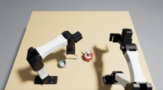
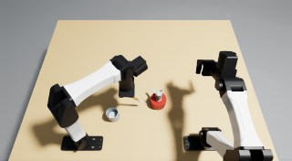

# Check a camping stove's connection to its gas cartridge with soapy water, and tighten it if it bubbles

Instruction given to the policy: `Check the stove's connection to its cartridge with the soapy water and the brush. If bubbles form, screw the stove down tight and check again. Put the brush back in the pot.`

Files: `task.py` (scene, hidden state, rules, score), `mechkit.py` (the mechanism kit the task file imports: bodies of several shapes, joints, moved bodies), `look.py` (the pixel test for froth), `demo.py` (scripted full-score run and the runs that show what each rule costs), `demo_kit.py` (the runner behind the scripted runs), `trials.py` (checks with a known load: the stop's reading against a known torque, what the hold on the cartridge stands, and whether froth can be seen), `froth_leaking.png` and `froth_sound.png` (the top camera's picture of a frothing and of a sound joint, as a policy gets it), `README.md`.

## The stove and its instruction sheet

The stove has the size and weight of the MSR PocketRocket 2 (73 g). Its instruction sheet (MSR PocketRocket 2 instruction sheet, ART# 82-820-3, Cascade Designs, English) says:

- "Check for leaks using soapy water. Do not try to detect leaks using a flame."
- "Check that the stove and fuel container connection is secure and tight."
- "Finger-tighten stove onto the top of the canister until connection is secure."
- "Never overtighten fuel canister to stove. Overtightening can damage stove or canister and cause fuel to leak."
- "Always check for fuel leaks before and after lighting stove."
- "Never attempt lighting stove if Flame Adjuster Valve is left open."

These carry the test, the tightening and the zero for opening the flame control. Over-tightening is not scored (see below). The sheet opens the pot supports before the stove goes onto the cartridge; here they are folded, as on a stove that has just been screwed on and is not yet set up to cook.

## Scene

Table coordinates in metres: x forward from the line through the two arm bases, y left from the midline, z up from the table top. Everything stands free except where stated.

| Part | Size, mass | Where |
|---|---|---|
| Gas cartridge, threaded valve, 100 g size (red, steel valve cup) | 90 mm across, 70 mm tall, 200 g with its print; stands on a rim 76 mm across | centre (0.220, -0.080) |
| Its print (three white strips, one dark block) | on the side wall | at an angle drawn from the seed, whatever the hidden state |
| Stove (MSR PocketRocket 2) screwed onto the cartridge, its three pot supports folded up | column 38.5 mm across, 75 mm tall (top 145 mm above the table), 73 g | on the cartridge's axis |
| Flame control: wire handle on a spindle in the stove's base | 45 x 12 x 2.5 mm, 6 g, 81 mm above the table | points 30 degrees left of straight ahead, closed |
| Pot (steel) with 20 mm of soapy water | 60 mm across, 70 mm tall, 140 g with the water | centre (0.140, +0.160) |
| Brush: flat wooden handle, metal band, 12 mm round head | 150 mm long, 20 g | stands in the pot, leaning 54 degrees on the near rim, handle towards the arms; its bristles start in the water |
| 17 white balls, 8 to 14 mm across (the froth) | not solid | under the table until shown |

Hidden state, from the seed: the stove is screwed home, or a third of a turn (120 degrees) short of home. In the second case the cartridge is turned back under the stove, so the stove and its flame control look the same in both; the print sits at its own seeded angle and tells nothing. With inspect-robots 0.60 two successive trials (`--epochs 2`) always get one of each case; `--seed 0`, first trial: not home.

## Rules

- The joint leaks while the stove is more than 30 degrees from home.
- The brush is wet for 20 s after its bristles last left the water (a point 8 mm from their end below the surface, inside the pot, pot standing).
- The joint line is the circle, 24 mm across and 70 mm above the table, where the stove's base meets the cartridge's valve cup. It is counted in 36 stretches of 10 degrees. A stretch is wet for 10 s after a wet bristle head came within 3 mm of it (9 mm from the head's axis). A head whose axis runs closer than 10 mm to the stove's axis wets nothing: bristles do not go through metal.
- A valid test: at least half the stretches wet, with the wet brush on the line.
- While the joint leaks, froth builds up on the cartridge's shoulder beside the wet stretches: every 0.3 s a white ball 8 to 14 mm across appears there, between the valve cup and 35 mm from the axis, and stays 5 s.

Score, by outcome, read at the end of the trial (the trial ends early with 1.0 once the 1.0 condition has held for 1 s):

| Score | Condition |
|---|---|
| 0 | the flame control was opened more than 20 degrees; or the cartridge tipped more than 45 degrees or left the table; or the stove was unscrewed to 170 degrees from home. Any of these at any time, for the rest of the trial. Also: no valid test. |
| 0.25 | a valid test at any time |
| 0.5 | and the stove within 10 degrees of home |
| 0.75 | and the last valid test came after the stove was last turned on its thread (by more than 5 degrees; travel past home does not count: there the stop gives, the thread does not turn) |
| 1.0 | and the brush is back in the pot (bristles' end inside it below the rim, at rest, no gripper within 4 cm of its handle), both grippers at least 5 cm from stove, cartridge and control, the cartridge upright (within 10 degrees) and within 3 cm of where it stood |

Test and tightening may come in any order. Tightening gently first and testing once afterwards also scores 1.0, in both hidden cases, and that is a valid way: the joint ends tight and checked.

Run limit: 2,400 control steps at 20 Hz (120 s).

## Can the froth be seen

The instruction's "if bubbles form" has to be readable from a camera. The pictures below are the top camera's, at the size a policy gets in the program's model runs (320 x 176), 5 s after the joint line was stroked with the wet brush in the same way: left a joint that leaks, right a sound one (runs `loose` and `home` of the reference runs).

 

The pixel test (`look.py`): count the pixels of that picture that lie on the cartridge's top and are near-white, that is red, green and blue all at least 150 of 255. The cartridge's top is where the camera sees a level disc 90 mm across at the shoulder's height, about the place the cartridge stands at the start: 241 pixels. The leaking joint has 101 such pixels, the sound one 47: 54 more, where 30 were asked for. The 47 are the stove's bright metal in front of the shoulder; before the strokes both pictures had 47 as well.

The froth is on the red shoulder because that is where the cameras see it: at the joint line itself, under the stove's foot, balls of 4 to 8 mm were a fringe one pixel wide. Neither wrist camera has the joint in its picture while the brush is held aside. The same check with no arm in the scene and the joint line declared wet instead of brushed (`trials.py froth`, run n2m) gave 99 against 47.

## Limits and readings

What the limits are, and what was read at rest and in ordinary handling (run n2w: the ten reference runs below):

| Limit | Value | Readings |
|---|---|---|
| Flame control: opened above | 20 degrees | untouched, and through the full-score runs: 0.0; pushed on purpose: 59.5; in the wrong-way run, where the turning stove carries the handle against the hand that holds the cartridge: 10.9 |
| Cartridge from where it stood, at the end | 30 mm | full-score runs: 0.8 at most; `home:force`: 16.0 at most, 1.0 at the end; flame control pushed open with nothing holding the cartridge: 30.8 |
| Stove from home, at the end | 10 degrees | full-score run: 0.1 |

## Over-tightening is not scored

The instruction sheet says "Never overtighten fuel canister to stove." The score does not look at it, and how far the stove was turned past home is only reported, as an angle (`most past home (deg)`). The reasons:

- A bench cannot read it. No gauge sits in the joint during a trial, so a level that hangs on the torque in the thread could not be scored on real hardware.
- The cartridge stands free, so the stove can only be tightened with what the hold on the cartridge stands. For the reference hold, two fingertips pressed on the cartridge's shoulder, that was measured with a known torque on the cartridge and no hand on the stove (`trials.py hold_gauge`, run n2t): pressed with 20 N it stood 0.2 N m and let go at 0.4; pressed with 30 N it stood 0.4 and let go at 0.6. Turned 40 degrees past home under a press of 30 N, the cartridge went round with the stove (`home:force` below). No reference run can over-tighten.
- With a hand on each of the two bodies, how far the stop's spring is pushed in does not tell the torque in the thread. In `home:force` the spring stood 11.8 degrees in when the cartridge let go, which at its 10 N m/rad would be 2.05 N m, under a hold that by itself gives way between 0.4 and 0.6 N m. Why the two differ has not been established.

In the reference runs the stove stood 1.6 to 1.7 degrees past home while the hand held it on its stop and 0.1 at the end. A lab that clamps the cartridge needs a limit of its own.

## What is simulated and what is computed

Simulated (PhysX, 240 Hz): every part as rigid bodies of boxes, cylinders and spheres; the thread as a turning joint about the vertical with dry friction of 0.05 N m and a sprung stop at home; the flame control as a turning joint about its own length with 0.02 N m of friction; contact and friction between grippers, brush, pot, stove, cartridge and table.

Computed by the task file, once per control step: whether the brush is wet, which stretches of the joint line its bristles have wetted, whether the joint leaks, and the froth (17 balls that are moved onto the cartridge's shoulder and back under the table; they ride on the cartridge and are not solid).

Stated departures from a real stove and cartridge:

- The thread has no axial travel (a real one: about 0.3 mm for a third of a turn) and spans 175 degrees from home, because the simulator limits a turning joint to half a turn; a real stove unscrews over several turns. The rule "unscrewed" therefore fires at 170 degrees. The stop at that end is a spring like the one at home (the simulator gives a joint one stiffness for both of its stops): turned on against it by 5 degrees more, the stove goes round past it. The trial is scored 0 by then.
- The thread's friction of 0.05 N m and the rim's 0.2 stand in for measurements on the trial hardware: a torque screwdriver on the stove, a tilt test of the cartridge on the bench. A real thread turns more stiffly over the last part of the turn, where the seal is squeezed; a constant friction does not model that.
- The stop at home is a spring of 10 N m/rad. A real stop is hard: what limits the torque on real hardware is the give of the arm and of the grip. The simulated arm gives little: told to turn the stove 2 degrees past home, it left it 1.6 degrees past. The stop's spring stands for the give a real arm and grip have.
- The stop reads true on a stove that is free to turn: with a known torque of 0.2, 0.5, 1.0, 2.0, 3.0 and 4.0 N m on the stove, the opposite one on the cartridge and no hand on either, it read 0.152, 0.454, 0.954, 1.954, 2.954 and 3.954 N m, which is that torque less the thread's friction, with the stove 0.9, 2.6, 5.5, 11.2, 16.9 and 22.7 degrees past home (run n2q, `trials.py stop_gauge`). Between two bodies that hands hold, its travel is no measure of the torque (see "Over-tightening is not scored"). No rule uses the reading.
- How far a real stove must be backed off before an air-filled cartridge froths steadily has to be measured on the trial hardware; 120 degrees to start and 30 degrees for "leaks" stand in for that measurement.
- The froth is drawn: white balls that give off half their white as light of their own, so that they read as white in the stove's shadow as well, as froth does. Without that light they added 32 near-white pixels instead of 52 in the check with no arm (runs n2l and n2m).
- The bristles are solid against the pot and the table (the brush stands in the pot on them) but pass through the stove, the cartridge and the flame control: rigid bristles would shove a 270 g assembly that soft ones only stroke. What they wet is computed from where they are. The brush's handle and metal band are solid: they do push the cartridge when they meet it.
- The rim the cartridge stands on has a friction of 0.2 against the table (0.15 sliding), whatever the table's own value. Its grip on the table, 0.02 N m, is under the thread's 0.05 N m: the cartridge turns with the stove unless it is held. Every other surface of the cartridge has 0.6 (0.5 sliding), averaged with the value of what touches it, so that a gripper pad pressed on it does not slide about.
- Holding the cartridge, as the simulator has it: anything that presses it onto the table with 4 N or more holds it against the thread's friction (0.2 x (2.7 N + 4 N) x 38 mm = 0.05 N m), also the turning hand bearing down on the stove, so one arm can do it. One fingertip pressed on the shoulder off the axis is a pivot: the cartridge then stands on the one point of its rim below the finger and swings about it (8 mm and 9 degrees in 16 s in run n2f). Two fingertips either side of the stove hold it still while the stove is screwed down. What that hold stands by itself, a torque put on the cartridge with no hand on the stove: 0.2 N m when pressed with 20 N and 0.4 N m with 30 N; it let go at 0.4 and at 0.6 (run n2t, `trials.py hold_gauge`). With the stove turned 40 degrees past home under a press of 30 N, the cartridge went round with the stove (`home:force`).
- Dry friction in the thread, the flame control and the print's sleeve: a brake at the friction value while the joint moves (a spun disc stopped after 0.989 rad where 1.000 was worked out by hand), a spring that holds it once it has come to rest. A held joint yields up to half a degree before it lets go and springs back by as much when let go; it holds standing loads up to about 0.9 of its friction (kit check, run spike6).
- The pot is 70 mm tall so that a 150 mm brush stands in it; in one 40 mm tall the brush's centre of mass lies outside the rim and it tips out.

## Reference runs

All scripted (`demo.py`), open loop from the layout's constants. Whether there is froth is decided from the top camera's picture and from nothing else: the pixel test above on the picture taken 5 s after the strokes, against the same count on the picture taken just before the strokes with the brush held aside in the same place; 15 or more near-white pixels more is froth. What the simulator knows (how many balls it has put on show) is written beside each decision in the run's `look.json`, for the record only. Run n2w of 2026-11-18, recorded on commit 75aea49 (the commits after it change this file, the two pictures and other tasks' folders only); a folder per run with `result.json`, `look.json`, the two pictures, a video per camera, `setup.png` and contact sheets.

The full-score plan: the left arm takes the brush from the pot, holds it aside for the first picture and strokes the joint line at five places from the left round the near side, then holds it aside again; if the second picture shows froth, it puts the brush back, the right hand pinches the folded stove from above, the left hand sets two fingertips on the cartridge's shoulder and presses down with 20 N, the right turns the stove 122 degrees clockwise onto its stop, and the left arm tests again; the brush goes back in the pot.

| Run | What the script does | Score | Near-white on the cartridge, before / after the strokes | Readings |
|---|---|---|---|---|
| `loose` | test (froth), tighten, test again, brush back | 1.00, ended as a success after 82.2 s | 47 / 101: froth | thread 120.0 to -0.1 degrees, 1.6 past home while held on the stop; cartridge 0.8 mm from its place at most; flame control 0.0 degrees; two tests, both valid |
| `home` | test (no froth), brush back | 1.00, ended as a success after 31.9 s | 47 / 47: none | thread 0.0 degrees; cartridge 0.0 mm from its place |
| `loose:no_test` | tighten without testing | 0.00 | no picture taken | thread -0.1 degrees, 1.6 past home at most; no valid test |
| `loose:no_tighten` | test, see the froth, put the brush back, leave the stove | 0.25 | 47 / 99: froth | thread 120.0 degrees; 1 valid test |
| `home:open_control` | push the flame control open, then test and put the brush back | 0.00 | 129 / 131: none (the push had shoved the cartridge 31 mm: other pixels) | flame control 59.5 degrees: zero for the trial |
| `loose:unscrew` | hold the cartridge and turn the stove 57 degrees the wrong way | 0.00 | no picture taken | thread 175.1 degrees: zero for the trial |
| `loose:no_steady` | as `loose`, but nothing holds the cartridge while the stove is turned | 0.25 | 45 / 102: froth | the cartridge turned 121 degrees with the stove; thread still 120.0 degrees; two tests, froth after the second as well |
| `loose:no_retest` | as `loose`, without the second test | 0.50 | 46 / 98: froth | thread -0.1 degrees; 1 valid test, made before the stove was turned |
| `loose:brush_kept` | as `loose`, but after the second test the arm parks with the brush still in its gripper | 0.75 | 47 / 103: froth | thread -0.1 degrees; two tests, both valid; the pot is empty at the end |
| `home:force` (shows a property, not a level) | press the cartridge down with 30 N, turn the stove 40 degrees further against its stop, then test and put the brush back | 1.00, ended as a success after 48.4 s | 48 / 49: none | 11.8 degrees past home at most; the cartridge turning with the stove from about 11 degrees, 38 degrees round in the end; 16.0 mm from its place at most, 1.0 at the end; 1 valid test |

What the top camera's contact sheet of `loose` shows: the untouched scene; the brush taken from the pot and held aside; the strokes; at 22 s white froth round the near side of the stove's foot on the red shoulder, still there at 28 s while the brush goes back into the pot; both hands at the cartridge from 33 s, the stove's handle pointing a third of a turn further round at 55 s; the second strokes; at 71 s the shoulder red and clean; the brush back in the pot; both arms parked at 82 s. The sheet of `home:force`: both hands at the stove from 3 s to 19 s; when they leave, the stove's handle points about 40 degrees further round than at the start, the cartridge having gone with it; the test follows, no froth, the brush goes back and both arms are parked at 48 s. The sheet of `loose:brush_kept` is that of `loose` up to the second test; in its last frame the pot is empty.

## How to run

Rule tests, no simulator: `scripts/rta check stove_check` (21 tests), `scripts/rta check mechkit` (31) and `scripts/rta check demo_kit` (11).

The reference runs: `scripts/rta demo <id> mech/tasks/stove_check loose,home,home:force,loose:no_test,loose:no_tighten,home:open_control,loose:unscrew,loose:no_steady,loose:no_retest,loose:brush_kept` (results in `outputs/<id>/<run>/`); `--dry` appended checks every pose against the arm's reach without the simulator. The checks with a known load: `scripts/rta simpy <id> mech/tasks/stove_check/trials.py /workspace/robocurve/outputs/<id> stop_gauge,hold_gauge,froth`.

One model trial with the stock embodiment and scorer (20 Hz, 320 x 176 pictures, fixed layout):

```bash
inspect-robots run --embodiment yam_arena --policy dream \
  -E task=mech/tasks/stove_check/task.py -E object_jitter=0 -E control_hz=20 -E cam_width=320 -E cam_height=176 \
  --instruction "Check the stove's connection to its cartridge with the soapy water and the brush. If bubbles form, screw the stove down tight and check again. Put the brush back in the pot." \
  --scorer task_score --max-steps 2400 --seed 0 --no-prompt --store-frames --log-dir <log dir>
```

`-E object_jitter=0` is required: the scripted runs are open loop, and the kit keeps jointed bodies out of the seeded jitter in any case.

A teleoperated take, recorded, one per hidden case (the run's seed picks the case for its first trial: 0 not home, 2 home): `RTA_SEED=0 scripts/rta teleop <id> mech/tasks/stove_check/task.py 120 --mac` and `RTA_SEED=2 scripts/rta teleop <id> mech/tasks/stove_check/task.py 120 --mac`; the take lands in `outputs/<id>_teleop/demo/`.
