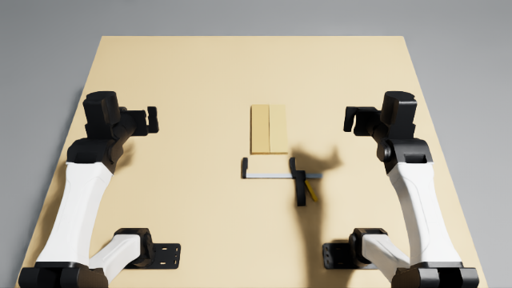
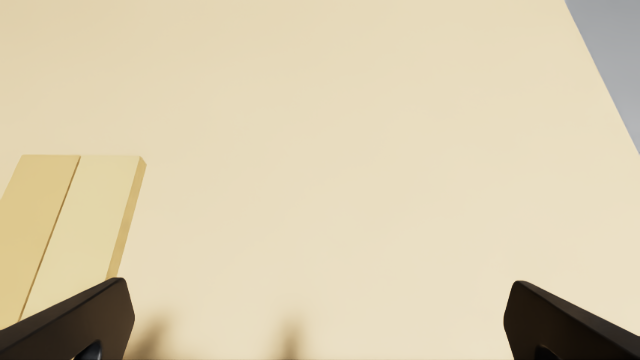
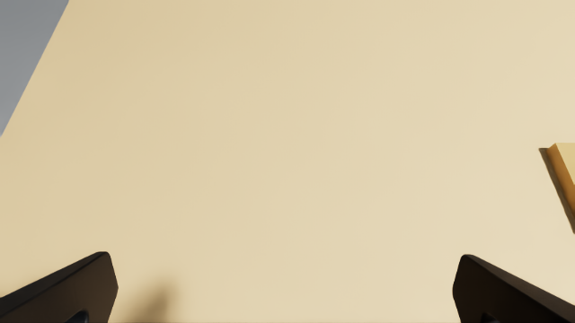
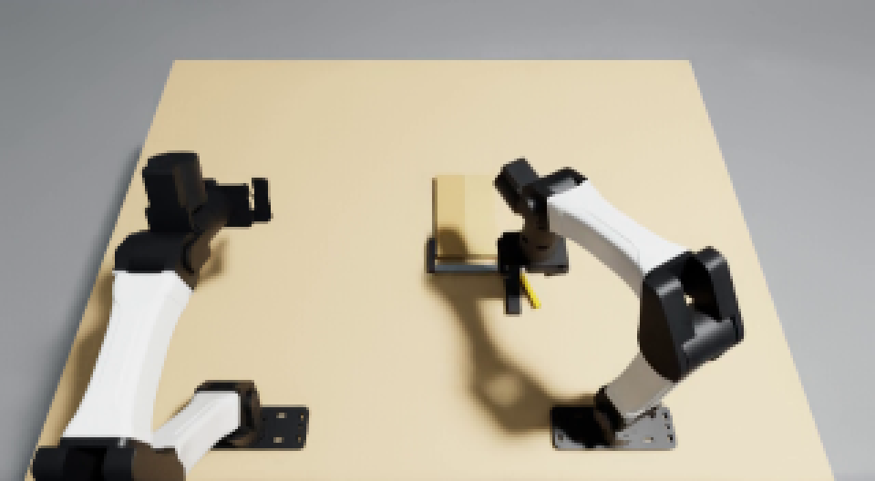
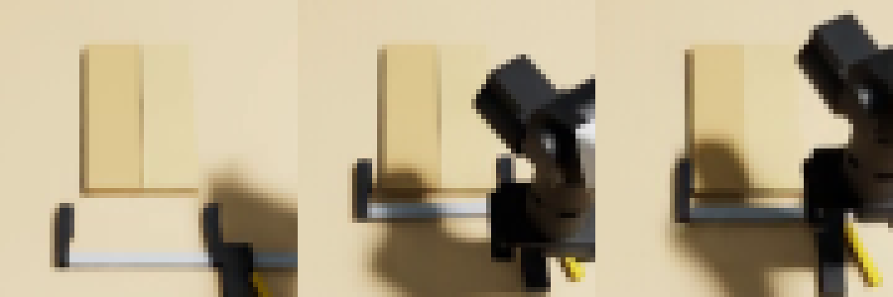
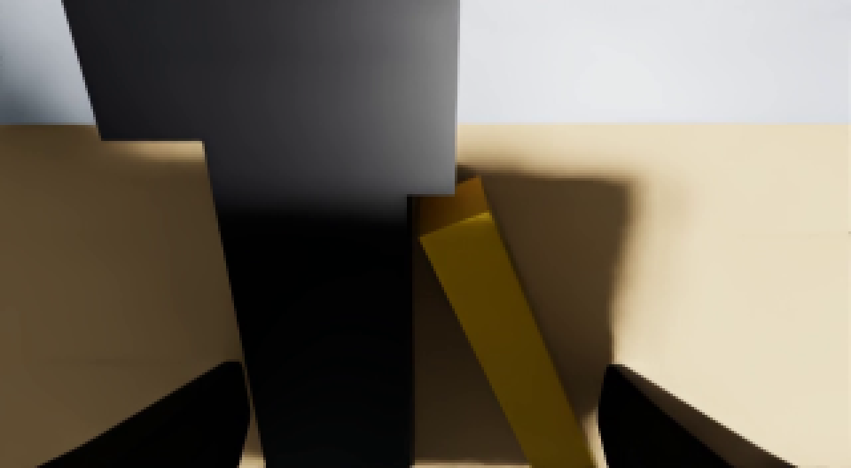
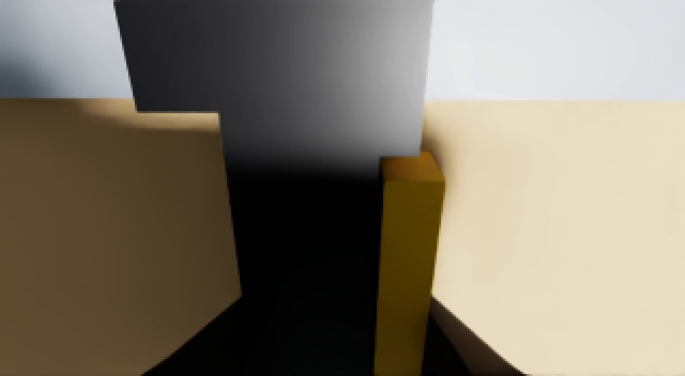
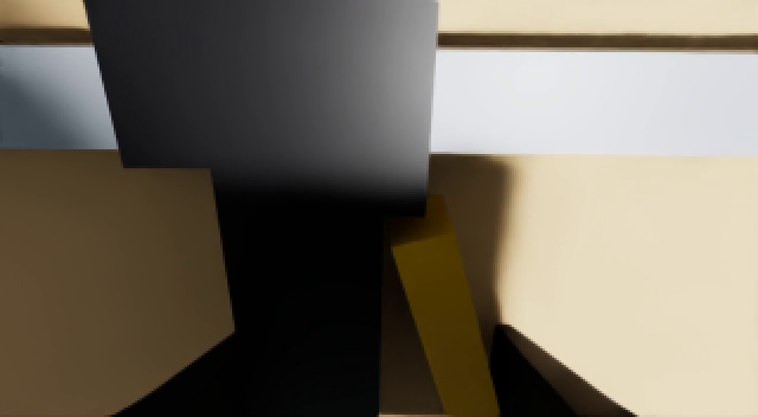

# Clamp two boards together with a one-hand bar clamp

Instruction given to the policy: `Clamp the two boards together edge to edge with the bar clamp so that the joint stays closed, then let go.`

Files: `task.py` (scene, mechanism, rules, score), `mechkit.py` (the mechanism kit the task file imports), `demo.py` (the scripted full-score run, the lower levels, the bar pushed through by hand, and the hand that stays), `demo_kit.py` (the runner behind the scripted runs), `trials.py` (checks in the simulator with no arm: rest and the first pictures, the gauge's rate, the lock plate, strokes of the trigger), `start_*.png` (the first pictures of a trial), `cue_*.png` (pictures at the size a policy gets), `README.md`.

 

The first pictures of a trial, both arms in their ready pose. The top camera sees the two boards side by side, the joint between them a line, and the clamp lying in front of them: the steel bar across, the bar's jaw at its left end, the grip's head and jaw at its right end, the black handle pointing towards the arms and the yellow trigger beside it. The right wrist camera sees the boards' near right corner; the left wrist camera sees the bench only.

## Scene

Bench coordinates in metres: x forward from the line through the two arm bases, y left from the midline, z up from the bench top. The arms' bases are at (0, -0.305) and (0, +0.305).

| Part | Size, mass | Where |
|---|---|---|
| Two pine boards (the right board and the left board) | 200 x 60 x 18 mm, 110 g each | lying flat side by side, long axes along x, near ends at x 0.33, their long edges 2 mm apart, the pair's middle at y -0.06 |
| One-hand bar clamp (IRWIN QUICK-GRIP mini bar clamp, 6 in): the grip | black: a head 30 x 30 x 18 mm round the bar, the grip's jaw 70 x 12 x 18 mm, the handle 83 x 24 x 18 mm; 190 g | lying flat, its middle plane 9 mm up (the boards' middle); the head at (0.248, -0.157), the handle pointing towards the arms (its end at x 0.150) |
| the bar | steel, 15 x 260 x 5 mm, with the bar's jaw (70 x 12 x 18 mm) on its end; 80 g | along y through the head, the jaws pointing away from the arms (+x), their tips at x 0.31, 2 cm short of the boards' near ends; opened 14 cm |
| the pads | rubber, 35 x 4 x 16 mm, on both jaws from the tip; the gauge pad (on the grip's jaw) 10 g, the bar's pad part of the bar | the gauge pad 5 mm outside the right board's outer edge, the bar's pad 13 mm outside the left board's |
| the trigger | yellow, 70 x 10 x 14 mm; 25 g | on a pin in the grip 20 mm from the bar towards the arms, along the handle's right side, open 23 degrees |

Nothing varies by seed. The clamp lies nearer the right arm (the head 0.25 m forward of its base and 0.15 m to its left); the right arm does the task alone.

Sizes and sources. From sellers' listings of the maker's figures: the clamp's opening 6 in (152 mm), throat 2-7/16 in (62 mm: the bar's centre line 62 mm behind the jaws' tips), rated clamping force 140 lb (623 N). Assumed, to be measured with a caliper and weighed: the parts' sizes other than those, the masses (about 0.3 kg in all, 110 g a board), the trigger's travel 0 to 23 degrees and its spring (set as 8 N 4 cm from the pin to hold it open, 11 N closed), the gauge's stiffness (1 mm for every 40 N, standing for pads, jaws and bar together), friction (pine on the bench 0.30, pine on pine 0.25, rubber 0.8). The trigger's spring read in the scene with a known load 4 cm from the pin (run `c6p`, 2026-11-20): 7.7 N start to close it, 10.4 N hold it closed, its rate 0.825 of the set one, as a spring inside a loop of joints reads in this simulator.

## How it is built

The grip (head, handle and the grip's jaw) is one free body. The bar slides through the head on a slide (it drags with 20 N s/m: 2 N at 10 cm/s); the bar's jaw is part of the bar. The trigger turns on a pin in the grip, 0 to 23 degrees from open to closed (closed, it lies along the handle 1 mm from it), held open by its spring.

The drive. The trigger's short arm, 15 mm from the pin inside the head, moves a drive plate along the bar through a link 8 mm long (a slider-crank, both hidden in the head). The drive plate slides on the bar; its stop on that slide follows it back every control step while the trigger is not squeezed (0.15 mm ahead of it: about 0.6 degrees of trigger) and stays put while it is squeezed. So the plate grips the bar one way: closing, the trigger draws the bar with it, 5.9 mm a full stroke; opening, the plate slides back along the bar. Squeezed means closed 0.4 degrees past its lowest since it was let go; let go, opened 0.4 degrees from its highest.

The lock plate is the bar's lower stop, moved after the bar every control step: the bar slides on freely in the closing direction and cannot go back. While the trigger draws the bar (squeezed, the plate at its stop) the lock plate follows the bar; otherwise it follows only to where the bar's jaw met the boards (where the bar is, less what the gauge pad has given) less 0.1 mm. A bar pushed by hand so slides closed freely, and the force of the push goes when the hand lets go: only the trigger leaves force on the boards.

The gauge. The gauge pad sits on the grip's jaw on a sprung slide, 1 mm for every 40 N, up to 5 mm (200 N). The clamping force is read from how far it has given, at its rate as measured in the simulator (39.7 to 40.1 N/mm, the check below), not from contact forces.

Lever arm. The short arm was made 15 mm long: the drive plate goes 5.9 mm a full stroke. With the gripper's 50 N on the trigger 4 cm from its pin, the hand reaches 137 to 150 N on the gauge; the real clamp is rated 140 lb (623 N). The arm was first 9 mm (3.5 mm a stroke): there a finger's 50 N built 151 to 155 N in the checks, and the boards sank into each other, about 2.5 mm a stroke (recording c6b); at 15 mm the same finger builds about 140 N and the joint holds.

Stand-ins for the solver. The gauge pad and the trigger move with the inertia of 200 g and 150 g (real 10 g and 25 g; their weight over the real one is carried by an upward push): a light body pressed between a hand or a board and joints gives way in this simulator. The link and the drive plate are hidden and weightless (their 100 g each carried). At rest is read from how far each part has gone over the last 0.25 s (the trigger by its tip): pressed together, the boards and the gauge pad carry velocities of 10 to 75 mm/s in the solver while they stand still to a few micrometres (recording c6f), its corrections of the contacts.

## Score

By where things are at the end of the run:

- 0 if a part has left the bench (2 cm or more under its top).
- Round the boards: both pads' middles 1 cm or more inside the boards' ends and within their thickness, each pad on its board's outer side (not more than 0.5 mm into it): 0.25.
- Closed: round the boards, the joint between the boards and both pad gaps 0.5 mm or less, at both ends of the joint: 0.5.
- Clamped: closed, with 20 N or more on the gauge pad: 0.75.
- 1.0: clamped, the boards' near ends within 3 mm of each other along the boards and their tops level within 1 mm, every part at rest (slower than 20 mm/s over the last 0.25 s) and both grippers 3 cm or more from clamp and boards, for 1 s.
- 0 otherwise.

On the real bench: a thin load cell or force-sensing film (0 to 200 N, 3 mm or less) between the gauge pad and the board reads 20 N or more after the hands are clear; a 0.5 mm feeler for the joint and the pad gaps; a straightedge and a tape for the rest; the video for the release.

Run limit: 1,200 steps (60 s at 20 Hz): three times the full-score run (414 steps) is more, and 1,200 is the most.

## Can it be seen

The top camera at the size a policy gets (320 x 176), enlarged three times (run `full` at its end, the hand up and away), and the part of it with the boards and the clamp enlarged six times: at the start, round the boards (`round`, at its end) and clamped (`full`, at its end). At this size a pixel is about 5 mm on the boards; the jaws stand out black beside them, the bar's jaw about 2.5 pixels off the left board when the clamp is round them (12.8 mm) and on it when clamped. The joint, 2 mm open at the start, is under half a pixel: it shows as the line between the two boards' shades, open or closed alike.

 

The right wrist camera at the same size, enlarged three times, run `full`: the hand round handle and trigger before the first stroke (11.9 s, the trigger open, 0.0 degrees); the end of the first squeeze (12.5 s): with nothing pressed the trigger closes all the way and lies along the handle (23.0 degrees); the end of the 5th squeeze (16.95 s), the jaws pressing the boards with 158 N: the squeeze brings the trigger only 6.1 degrees in. A clamp that has bitten shows as a trigger that no longer comes to the handle. The force itself cannot be seen.

## The checks before the script

No arm (`trials.py`, recording `c6i` of 2026-11-20, commit `1f9c7be`).

Rest: nobody touches anything for 3 s; nothing moves more than 0.002 mm. The gauge reads 0.00 N, the pads stand 5.0 and 13.0 mm from the boards, the joint 2.0 mm open.

The gauge: the gauge pad pressed into the grip's jaw for 1.5 s, the grip pushed back as hard along the same line (the clamp neither pushed nor turned as a whole):

| Press | Given | Rate | Grip moved |
|---|---|---|---|
| 10 N | 0.252 mm | 39.7 N/mm | 0.02 mm |
| 20 N | 0.499 mm | 40.1 N/mm | 0.06 mm |
| 40 N | 0.998 mm | 40.1 N/mm | 0.21 mm |
| 80 N | 1.998 mm | 40.0 N/mm | 0.43 mm |

The lock plate: the bar pushed closed, pulled open, pushed home on the gauge pad (no boards between the jaws here), pressed and let be:

| After | Bar drawn | Lock plate | Gauge |
|---|---|---|---|
| pushed closed with 0.6 N until 2 cm in | 20.62 mm | 20.52 mm | -0.0 N |
| let be | 20.66 mm | 20.56 mm | -0.0 N |
| pulled open with 20 N | 20.56 mm | 20.56 mm | 0.1 N |
| let be | 20.56 mm | 20.56 mm | 0.1 N |
| pushed closed with 0.6 N until the jaws meet | 115.28 mm | 115.18 mm | 0.0 N |
| pressed closed with 10 N | 140.28 mm | 139.91 mm | 10.9 N |
| let be | 139.99 mm | 139.91 mm | 0.0 N |

Pulled open with 20 N, the bar goes back the 0.1 mm the lock plate leaves behind a bar pushed by hand, and no further. Pressed closed with 10 N the gauge reads 10.9 N; let be, the bar goes back to where the jaws met and the gauge reads 0.0 N.

Strokes: the clamp put 6 cm round the boards as it stands; the trigger squeezed by a finger's force 4 cm from its pin (a torque on the trigger and the opposite one on the grip) for 0.6 s and let go for 0.6 s, again and again, until the joint is closed and three strokes more; then the bar's jaw pulled open with 20 N for 1 s:

| Finger | A stroke with nothing pressed | Joint closed at stroke | Gauge then | Three strokes later | Before / after the pull | Joint at the end, near / far | Boards' ends apart |
|---|---|---|---|---|---|---|---|
| 20 N | 5.72 to 6.07 mm | 4 | 32.2 N | 39.9 N | 39.9 / 39.9 N | -0.10 / 0.02 mm | 0.5 mm |
| 35 N | 5.73 to 6.21 mm | 4 | 76.8 N | 90.3 N | 90.3 / 90.3 N | -0.19 / 0.03 mm | 9.0 mm |
| 50 N | 6.76 to 6.88 mm | 3 | 3.2 N | 138.7 N | 138.7 / 138.9 N | -0.33 / 0.06 mm | 4.9 mm |

Squeezed this way the trigger slams shut in a few hundredths of a second; the bar coasts a little past the stroke and the force overshoots what the finger holds. The free clamp, struck like this, turns on the bench and drags the boards' ends more than 3 mm apart at 35 N and 50 N; held by the hand (the runs below) it ends with them 0.09 to 0.63 mm apart.

## Reference runs

Scripted, recording `c6h` of 2026-11-20 (commit `1f9c7be`), 20 Hz; `closed` recorded again as `c6j` (commit `2d1d385`) after it was made to squeeze on until the pads and the joint touch: in `c6h` it let go as soon as they were within the score's 0.5 mm and ended with both pads 0.48 mm off the boards. The right hand, pointing straight down and open, its fingers closing across the handle, comes down over the handle's far end, past the trigger's tip, and closes on the handle's two faces there. It slides the clamp 7 cm along the bench towards the boards and 2 mm to the right (the clamp comes 6.3 cm, turning 1.4 degrees: the arm lags against its drag), the jaws passing along the boards' outer edges. It opens, rises, and comes down over handle and trigger 4 cm from the trigger's pin, and pumps: it closes fully (each finger pushing with up to 50 N) in 0.6 s and opens again in 0.5 s. Each stroke draws the bar through the grip; the bar's jaw pushes the left board against the right one and both against the gauge pad. When the jaws and the joint are closed it gives three more strokes, then opens, goes up 8 cm and stays there. Every grasp after the first is placed where the clamp is then. Squeezing, the finger on the handle pushes harder than the trigger gives back, and the clamp slides along its bar on the bench under the hand, away from the right board (in `closed` the gauge pad went from 4.3 to 11.5 mm off it in the first stroke); the strokes after draw it back.

What the script reads from the simulator: where the grip and the bar are, to put the hand on them; whether the pads and the joint are closed and, in `closed`, how far they are from touching (a person sees the jaws come to the boards and the boards to each other); nothing else: not the gauge, and not the score.

| Run | What it does | Score | What the recording shows |
|---|---|---|---|
| `full` | slides the clamp round the boards, pumps until the jaws and the joint are closed and three strokes more, lets go | 1.0 | strokes of 5.7 to 7.2 mm; the joint closes at stroke 3 (0.2 N on the gauge), the next stroke takes it to 137 N and three strokes after closing it reads 149 N (the trigger stopping 4.7 degrees in); it ends pads 0.01 / 0.02 mm from the boards and 20.4 / 20.1 mm inside their ends, joint -0.38 / 0.19 mm, 149.4 N on the gauge, the boards' ends 0.09 mm apart and their tops 0.05 mm, the hand 78 mm away: 1.0 at 19.75 s, success after 20.7 s (414 steps) |
| `round` | slides the clamp round the boards and lets go; no stroke | 0.25 | it ends pads 4.24 / 12.77 mm from the boards and 24.3 / 19.7 mm inside their ends, joint 2.00 / 2.00 mm, 0.1 N on the gauge: round, not closed |
| `closed` | as `full`, but full strokes only while the jaws and the joint are more than 7 mm from touching, then slow squeezes (1 degree of trigger every 0.1 s), letting go as soon as the pads and both ends of the joint are within 0.2 mm; no more | 0.5 | 2 full strokes, the last begun 12.4 mm from touching (the pads' gaps and the joint at the near ends, as read); then 2 slow squeezes, begun 6.3 mm from touching; the joint closed at stroke 3, the hand let go with 6.4 N on the gauge; it ends pads 0.02 / 0.03 mm from the boards and 20.1 / 20.6 mm inside their ends, joint -0.01 / 0.00 mm, 6.4 N on the gauge: closed, under 20 N |
| `pushed` | slides the clamp round the boards; the closed hand pushes the bar's jaw towards the grip 2 mm a look until the joint is closed, backs off; no stroke | 0.5 | pushed, the gauge read 1.2 N at most; it ends pads 0.02 / 0.02 mm from the boards and 22.9 / 20.7 mm inside their ends, joint -0.00 / -0.00 mm, 0.6 N on the gauge: closed, with nearly nothing on the gauge |
| `held` | as `full`, but the hand stays closed on handle and trigger | 0.75 | strokes of 4.8 to 6.9 mm; the joint closes at stroke 4 (132.2 N on the gauge), the next stroke takes it to 158 N and three strokes after closing it reads 149 N (the trigger stopping 4.5 degrees in); it ends pads 0.01 / 0.02 mm from the boards and 19.3 / 20.0 mm inside their ends, joint -0.28 / -0.00 mm, 149.9 N on the gauge, the hand on the clamp |

Contact sheets looked at: the top and right wrist cameras of `full` and of `closed`. The hand comes over the handle's far end, slides the clamp round the boards, comes down round handle and trigger and pumps; the trigger comes to the handle in the first strokes and stops short of it once the jaws press; at the end the hand is up and the clamp holds the boards.

## Limits and readings

| Limit in the score | On the real bench | Reading in the full-score run | Run that shows the limit | Set directly |
|---|---|---|---|---|
| round: both pads' middles 1 cm or more inside the boards' ends and within their thickness: 0.25 | a tape | 20.4 / 20.1 mm inside | `round` (0.25) | 10.1 and 9.9 mm; the boards raised 8.9 and 9.1 mm |
| closed: the joint and both pad gaps 0.5 mm or less: 0.5 | a 0.5 mm feeler | gaps 0.01 / 0.02 mm, joint -0.38 / 0.19 mm | `closed`, `pushed` (0.5); `round` (0.25: open) | 0.4 and 0.6 mm at either end of the joint; a pad 1 mm clear: 0.25 |
| clamped: 20 N or more on the gauge pad: 0.75 | a thin load cell or force-sensing film (0 to 200 N, 3 mm or less) between the gauge pad and the board, read after the hands are clear | 149.4 N | `closed` (6.4 N), `pushed` (0.6 N): 0.5; `held` (0.75) | 19.9 and 20.1 N |
| the boards' ends within 3 mm of each other, their tops within 1 mm: 1.0 | a straightedge and a tape | 0.09 mm, 0.05 mm | none | 2.9 and 3.1 mm; 0.9 and 1.1 mm |
| at rest: every part slower than 20 mm/s over the last 0.25 s: 1.0 | the video | 1.45 mm/s at most | none | 19 and 21 mm/s; a board sliding 1 cm in 0.25 s |
| both grippers 3 cm or more from clamp and boards: 1.0 | the video | 78 mm | `held` (0.75: the hand on the clamp) | a hand 2 cm over the handle |
| a part 2 cm or more under the bench top: 0 | the video | on the bench | none | a board 2.1 cm under it |

Each level the runs reach short of 1.0 is met with room: `round` ends with the pads 19.7 mm inside the boards' ends (10 asked) and 4.2 mm or more from them (0.5 to be closed); `closed` and `pushed` end with 6.4 and 0.6 N on the gauge (20 to be clamped) and gaps of 0.03 mm at most (0.5); `held` keeps the hand on the clamp. The clamped runs end with the joint -0.38 to 0.19 mm (0.5 either way asked): pressed with about 150 N, the boards' near corners sink up to 0.4 mm into each other in the solver.

## States set directly

`tests/test_bar_clamp.py` sets every state without the simulator: the scene as specified (sizes, masses, places, the opening of 14 cm, the gauge pad 5 mm and the bar's pad 13 mm outside the boards, the trigger's travel and spring, 5.9 mm of drive a full stroke, the play longer than the squeeze takes to be seen); round needs both pads' middles 1 cm inside the ends (10.1 and 9.9 mm) and within the thickness (the boards raised 8.9 and 9.1 mm), a pad 1 mm clear scores 0.25 at most and 0.4 mm 0.5; the joint is read at both ends (0.4 and 0.6 mm); 19.9 and 20.1 N on the gauge; 1.0 needs both grippers 3 cm away (a hand 2 cm over the handle: 0.75), every part slower than 20 mm/s (19 and 21 mm/s), the ends within 3 mm (2.9 and 3.1) and the tops within 1 mm (0.9 and 1.1); a board 2.1 cm under the bench top scores 0; the gauge reads the pad at its rate. The ratchet step by step: the trigger draws the bar and the lock plate keeps it; a hand pushes the bar on and the lock plate keeps only where its jaw met the boards; a squeeze within the play keeps nothing of a push; the idle drive plate never holds the bar back before the lock plate does. Rest is read from how far the parts have gone over the last 0.25 s, not from the solver's velocities.
