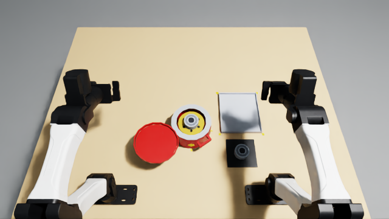
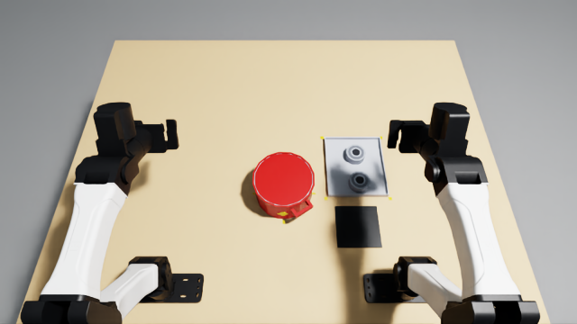

# Clear a left-in bearing off a shop bench can's spring screen, press-dip a second bearing, tray both, and close the lid

Instruction: `Put the bearing on the can's screen in the tray, press the other bearing down on the screen for a second, put it in the tray too, and close the can's lid.`

Files: `task.json`; `task.py` (rules, `score()`); `scene.py` (bodies, joints); `parts.py` (figures, sources); `checks.py`, `trials.py`, `demo.py`; `test_bench_can.py`; kit (`mechkit.py`, `demo_kit.py`, `kit_extra.py`); `start_top.png`, `start_top_policy.png`, `start_left_wrist.png`, `start_right_wrist.png`; `end_top.png`, `end_top_policy.png`.



## What the task tests

- **Physical lid blocker.** One `SKF 3305 A-2Z` bearing (`25.4 mm` wide) sits on the brass dasher screen (`9.2 mm` proud of the `92.1 mm` rim), physically blocking the hinged cover ajar (`23.4 deg` in PhysX) until moved to the tray.
- **Sustained spring plunge.** The second `SKF 3305 A-2Z` bearing must be pressed down `>= 12.0 mm` (of `16.0 mm`, `18.0 N` at `14 mm`) on the guided dasher for `>= 0.8 s` (`16 steps`), after which the screen springs back up (`<= 2.0 mm`).
- **Braced, finger-safe lid closure.** The `0.98 kg` steel can (`mu = 0.25`, `~2.4 N` slip) slides `122.5 mm` (`> 30 mm`) if its `172 deg` lid (`0.22 N m` drag) is pulled unbraced, vs `2.27 mm` braced. Clocked `90 deg` between hinge (`125 deg`) and front strap (`215 deg`), Right braces the strap while Left props the skirt to `~147 deg`, pushes its back to `~114 deg`, sweeps over `90 deg` TDC (`z <= 159.5 mm`) from above the rim so no finger is trapped, and presses the roof shut (`0.0 deg`) with its open hand (wrists `>= 294.1 mm` apart).

## Scene and grasps

- **Bench can (`can`, `dasher`, `lid`):** Eagle `Model B-601` (`B601`, UPC `48441223213`, `0.95 L` / 1 qt, 24-ga galvanized steel in red, `158.8 x 92.1 mm`, `0.98 kg` net mass, `118 mm` ID collar, `114 mm` brass dasher `14 mm` below rim, `56 x 22 x 14 mm` front strap, `165 mm` saucer lid built open at `172 deg`) dry on yellow ticks at `(265, 0) mm`.
- **Bearings (`brg_screen`, `brg_mat`):** two `SKF 3305 A-2Z` bearings (`ISO 15`: `d = 25.0, D = 62.0, B = 25.4 mm`, `0.35 kg`); one on `dasher`, one on a taped `120 x 120 x 3 mm` black NBR pad (`mat`) at `(165, -205) mm`.
- **Tray (`tray`):** Bochem `Art. 8480` 18/10 stainless tray (`200 x 175 x 15 mm`, `0.24 kg`) on yellow ticks at `(355, -215) mm`.
- **Grasps (`<= 94 mm` jaw, `~50 mm` finger backs clear of `118 mm` collar and `15 mm` tray walls, `z <= 159.5 mm`):** Right pinches each `62.0 mm` bearing (`84 -> 52 mm`) and the `14 mm` strap vertically; Left pinches the `4 mm` upturned skirt (`172 -> 147 deg`), pushes its back (`147 -> 114 deg`), and sweeps/presses the roof shut (`114 -> 0 deg`) from above with its open hand (`94 mm`).

## Rules, shortcuts, and stand-ins

- **0 for good** (bench video): `can` tilts `> 12 deg` or slides `> 30 mm` from yellow ticks, a bearing leaves the bench, or `tray` shifts `> 25 mm` or tilts `> 10 deg`.
- **End levels:** `0.0`: lid open `> 4 deg` (`skirt-to-rim gap > 3.5 mm`) or a bearing in/on the can (idle = `0.0`). `0.25`: `brg_screen` cleared and lid closed `<= 4 deg` (`gap <= 3.5 mm`). `0.5`: `0.25` plus `brg_mat` pressed `>= 12 mm` on `dasher` (`25.4 mm` bearing top at or below the `92.1 mm` rim on video) for `>= 0.8 s` (`16 steps`). `1.0`: `0.5` plus both bearings flat and unstacked in `tray`, `dasher <= 2 mm`, hands `>= 30 mm` clear, at rest (`<= 3 mm` drift, `< 10 mm/s`, `< 0.10 rad/s`) for `1.0 s` (`20 steps`).
- **Shortcuts scored 0 / capped:** traying both bearings with lid left open (`0.0`); closing lid onto `brg_screen` (`stalls ~23 deg -> 0.0`); pulling lid unbraced (`slides > 30 mm -> 0.0`); empty-finger or `< 0.8 s` press (`0.25`); stacked bearings (`0.5`).
- **Stand-ins & direct states:** dry trials in real life and PhysX. Zero `set_joint`, `write_pose`, `weld`, or `redraw` in `task.py`, `scene.py`, or `demo.py` (`lid` built open at `172 deg`; `trials.py` sets test states).
- **Can it be seen (`320 x 176`):** `start_top_policy.png` frames everything inside `+-0.303 m` (`u = 112..216, v = 74..134 px`); `end_top_policy.png` shows the closed red lid, empty black pad, both `62 mm` bearings in the tray, and arms at `READY`.

## Key figures and their sources

| Figure | Value | Source |
|---|---|---|
| `B-601` capacity, `OD x H`, net mass | `0.95 L` (1 qt), `158.8 x 92.1 mm`, `0.98 kg` | maker: `'1 quart capacity; Liter Capacity: 0.95'`, `'6.25D x 3.625H'`, `'Net Weight, kgs: 0.98'`, `'brass flame arrestor dasher screen'` [eagle] |
| Bearing `SKF 3305 A-2Z` (`d x D x B`, mass) | `25.0 x 62.0 x 25.4 mm`, `0.35 kg` | standard `ISO 15` series 33 [skf]; listing `'3305-A-2Z/C3MT33 SKF 25x62x25,4'`, `'0,35 kg'` [agro] |
| Tray `Bochem 8480` (`L x W x H`, mass) | `200 x 175 x 15 mm`, `0.24 kg` | maker: `'Instrumentenablage 18/10 Stahl, Artikelnr. 8480: 200, 175, 15'` [bochem]; mass estimate (0.8 mm sheet) |
| Collar ID, dasher `D` & recess, handle, `172 deg` lid | `118, 114, 14 mm`; `56 x 22 mm`; `172 deg` | estimate: scaled from Eagle's `B-601` photo [photo] against `158.8 x 92.1 mm` (open lid ~8 deg above level, ~40 mm off bench) |
| Mass split (`can, lid, dasher`); NBR pad | `0.68, 0.18, 0.12 kg`; `120 x 120 x 3 mm` | estimate: sheet-area split of `0.98 kg`; `our fixture`: cut black NBR pad |
| Dasher stroke & spring; lid & bench friction | `16 mm`, `2.2 N + 1,125 N/m`; `0.22 N m`, `0.25` | estimate: `18.0 N` at `14 mm` plunge; `2.8 N` hinge pull > `2.4 N` dry steel slip (`0.98 kg x 0.25`) |
| Worker relevance (`49-9071.00` + mechanics) | `2.61M` US workers (`>= 500k`) | O*NET `49-9071.00`: `'Clean or lubricate shafts, bearings, gears, or other parts of machinery'` [onet] |

`parts.FIGURES`: 7 maker, 3 standard, 1 listing, 1 our fixture, 15 estimate.

## First minutes of a real trial

On bought items (~4 min): weigh dry `Eagle B-601`, `Bochem 8480` tray and `SKF 3305 A-2Z` bearings on a scale and verify `158.8 x 92.1 mm` can and `118 mm` collar bore with calipers (1 min); place `B-601` on a tared scale and press a `3305 A-2Z` bearing down `14 mm` on the brass dasher to check spring force (~18 N) and `16 mm` stroke (1 min); check `172 deg` open lid angle with a protractor app, confirm `brg_screen` props the lid ajar (~23 deg), and check unbraced lid pull vs bench slip with a luggage scale (2 min) — a different reading replaces the estimate.

## Forces

| Force | Primitive (`scene.py`) | Acts on | Equal & opposite reaction on | Trigger / release |
|---|---|---|---|---|
| Dasher spring (`18.0 N` at `14 mm`) | `slide("dasher", spring=1125)` | `dasher` (`+z`) | `can` -> bench (`-z`) | Pressed `>= 12 mm` for `>= 0.8 s` by `brg_mat`; springs up on release |
| Lid hinge drag (`0.22 N m`) | `hinge("lid", friction=0.22)` | `lid` | `can` (slides `122.5 mm > 30 mm` unbraced; `2.27 mm` braced) | Propped `172 -> 147 deg`, pushed `-> 114 deg`, swept/pressed to `0 deg` |
| Bearing lid block | Rigid contact (`lid` <-> `brg_screen`) | `lid` (stalls `23.4 deg`) | `brg_screen` -> `dasher` -> `can` | Cleared when `brg_screen` is moved to `tray` |

## Checks run

- Rule tests (`test_bench_can.py`): `6/6` pass. Offline G1 (`checks.py`): `18` poses (`<= 0.09 mm`, margins `>= 6.2 deg`, `z <= 154.1 mm`), lid-closure wrists `>= 294.1 mm` apart (`hulls >= 58.9 mm`), full scene inside `+-0.3025 m` of `top_cam`.
- Simulator G1 (`checks.py --frame0`), G2 (`trials.py`: `8/8` pass across `0.0, 0.25, 0.5, 1.0` and all 4 zero rules), and G3 (`demo.py`: `score = 1.0` at `39.55 s`, `16.03 mm` / `28.25 N` held `2.05 s`, `max_can_slide = 2.27 mm`, `max_can_tilt = 1.50 deg`, `lid = 0.0 deg`, `hands_clear = 219.4 mm`).



## How it differs

Unlike the accepted solvent-bottle task (moves a bottle off a hotplate), the pending UV transilluminator task (lowers an unblocked cover with no spring screen), and the accepted French press task (plunger stays down, whereas this dasher springs back up after the held dip and is enclosed under an overhanging 172 deg lid while bracing the light can), this task combines blocker removal, a timed spring-return plunge, and braced two-stage lid closure.

## Assets and sources

Primitive `mechkit` shapes only (no third-party meshes, textures or sounds).
- [eagle] https://eagle.justrite.com/steel-bench-can-1-quart-dasher-screen-red-b601 (opened 2026-11-21) · [photo] https://industrialsafety.com/media/catalog/product/cache/99dc5e1dc90eb9727970ba1a904a05a5/E/a/Eagle-MFG-B-601-1.jpg (inspected 2026-11-21)
- [skf] https://www.skf.com/group/products/rolling-bearings/ball-bearings/angular-contact-ball-bearings/productid-3305%20A-2Z · [agro] https://www.agrolager.de/product_info.php?products_id=12062210 (opened 2026-11-21)
- [bochem] https://bochem.de/produkt/instrumentenablage-18-10-stahl-200x150x15mm/ · [onet] https://www.onetonline.org/link/summary/49-9071.00 (opened 2026-11-21)

## How to run

Tests: `python -m pytest -q mech/tasks/bench_can/test_bench_can.py`. G1: `scripts/rta simpy <id> mech/tasks/bench_can/checks.py --frame0 /workspace/robocurve/outputs/<id>`. G2: `scripts/rta simpy <id> mech/tasks/bench_can/trials.py /workspace/robocurve/outputs/<id>`. Demo: `scripts/rta demo <id> mech/tasks/bench_can` (`--no-video` check, `--quick` dry). Limit 110 s (2,200 steps at 20 Hz); demo ~40 s. Fixed layout: `--seed 0` gives trial seed 1415158438 and the same start.

```bash
inspect-robots run --embodiment yam_arena --policy dream \
  -E task=mech/tasks/bench_can/task.py -E object_jitter=0 -E control_hz=20 -E cam_width=320 -E cam_height=176 \
  --instruction "Put the bearing on the can's screen in the tray, press the other bearing down on the screen for a second, put it in the tray too, and close the can's lid." \
  --scorer task_score --max-steps 2200 --seed 0 --no-prompt --store-frames --log-dir <log dir>
```
