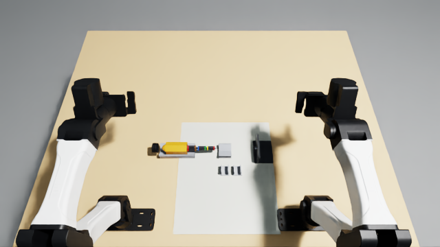

# Configure a 7-in-1 flip-socket nut driver and seat its blue 3/8-inch socket on a hex standoff

Instruction given to the policy: "Rearrange the flip-socket nut driver so that all three socket barrels are stored on its shaft with the blue 3/8-inch socket at the working tip, seat that socket fully over the 3/8-inch hex standoff on the bracket with the handle resting in the cradle beside it, then let go and move both hands clear."

Files: `task.json`; `task.py` (rules, score); `scene.py` (bodies); `parts.py` (every figure with its source); `checks.py`, `trials.py`, `demo.py` (reach, simulator trials, reference run); `test_flip_socket_swap.py`; the kit (`mechkit.py`, `demo_kit.py`, `kit_extra.py`); `start_top.png`, `start_top_policy.png` (320 x 176, a policy's size), `end_top.png`.

## What the task tests

- **Last on, first off.** A Klein 32900 driver stores three reversible double-ended socket barrels on its 1/4-inch hex shaft; the wanted blue 3/8 socket is on the green/blue barrel, behind the red/yellow one and facing the handle. Barrels pass only over the tip: red/yellow off, green/blue off, red/yellow back first.
- **End for end.** The green/blue barrel goes back turned round, blue end out.
- **Two hexes, clocked twice.** A barrel slides on only square and clocked to the shaft's flats (0.075 mm a flat, 2.4 degrees of play). The blue socket (9.89 mm across flats) passes the 9.53 mm standoff, its flats 15 degrees off level, within 4 degrees; the standoff's crown chamfer turns a free tool in from about 15 degrees off, 30 degrees off it butts.
- **The socket stands proud.** The shaft runs through each barrel's middle bore: the blue socket takes the standoff only beyond the tip, as far out as that bore still rides the shaft.
- **Two hands.** One hand holds the tool while the other moves barrels; at the bracket one holds the grip, one the barrel.

## Scene

Positions in mm from the midpoint between the arm bases, x forward, y left, z up from the bench.

- **Mat** (our fixture): light grey silicone, 420 x 350 x 4 mm.
- **Driver:** Klein Tools 32900 7-in-1 Impact Flip Socket with Handle: amber hex grip 38.1 mm across flats, 77 mm long, 101 mm of 1/4-inch hex shaft; along y in a rubber-lined 120-degree V cradle under its grip, shaft axis 40 mm up, tip at y = 6 pointing at the bracket (-y).
- **Barrels on the shaft, from the tip:** red 1/4 / yellow 5/16 (28.5 mm long, 13.5 mm across flats, red end out); 4 mm gap; green 11/32 / blue 3/8 (30.0 mm, 15.6 mm, green end out); 6.5 mm gap; brown 7/16 / red 1/2 (31.0 mm, 18.8 mm).
- **Bracket** (our fixture): charcoal steel L-bracket at x = 245, y = -175; a 3/8-inch hex standoff (RAF 2236-1032-SS) threaded 2 mm into its face, 7.5 mm of hex out at the shaft's height, flats 15 degrees off level, near face at y = -141.25.
- **End cradle** (our fixture): the same V, 46 mm long, its bottom 2.54 mm lower (a hex rolled 15 degrees sits that much higher in a 120-degree V), at y = -32 under the seated grip's front 31 mm.
- **Two stands** (our fixture): two thin rails 24 mm apart each, at x = 170, y = -30 and -75, a barrel lying across them at the shaft's height.

## Rules and score

- **0** for good if at any step the driver or any socket barrel falls off the bench (its centre more than 30 mm below the bench top); benign contact with the mat, the stands or the cradles costs nothing.
- **0.25**: during the trial the green/blue barrel is slid fully off the front of the shaft (both faces more than 1 mm outboard of the tip), which the red/yellow barrel blocks until it is off first.
- **0.5**: 0.25 met, and at the end all three barrels sit on the shaft (each coaxial within 10 degrees and 2 mm, the plain part of its through-bore wholly between tip and grip nose), the green/blue barrel at the working tip with its blue end outboard within 15 degrees and its blue face no more than 3 mm short of the tip.
- **1.0**: 0.5 met, and at the end the blue socket is seated on the standoff (its mouth 5 to 11 mm past the standoff's near face, axis within 5 degrees of the standoff's, centre within 2.5 mm of it, hex within 4.4 degrees of the standoff's flats: the fit's 3.9 degrees of play and 0.5), the driver level within 8 degrees, the handle down in the end cradle (its centre within 25 mm of the seated position and within 6 mm of the cradle's seat height), both grippers open to 60 per cent or more and every hull corner of both hands 50 mm or more from the tool, the barrels, the stands, the cradles and the bracket, held so for 2.0 s with the tool moving 3 mm at most.

Run limit: 4600 steps (230 s at 20 Hz), about 2.5 times the reference run's 92.8 s. The seed changes nothing: the layout is the same every trial.

## Key figures and their sources

| Figure | Value | Source |
|---|---|---|
| driver overall length | 178 mm | maker: 'Overall Length (cm): 17.8' ([Klein 32900][k1]) |
| handle across flats, the widest part | 38.1 mm | maker: 'Overall Width (Inch): 1.5' ([Klein 32900][k1]) |
| whole set mass | 272 g | maker: 'Weight (g): 272' ([Klein 32900][k1]) |
| shaft across flats | 6.35 mm | maker: "Drive Size: 1/4''" ([Klein 32900][k1]) |
| socket points; sizes | 6; 1/4 to 1/2 in | maker: 'Number of Points: 6', "Socket Size: 1/4'', 5/16'', 11/32'', 3/8'', 7/16'', 1/2''" ([Klein 32900][k1]) |
| handle length; shaft ahead of it | 77; 101 mm | estimate: the grip read against the 178 mm overall in the maker's photos; 178 less 77 |
| barrel lengths | 28.5, 30, 31 mm | estimate: read against the 178 mm overall in the maker's photos |
| barrel outsides across flats | 13.5, 15.6, 18.8 mm | estimate: the hexagonal outsides read the same way |
| through-bore across flats | 6.5 mm | estimate: the 6.35 mm shaft plus 0.075 mm a flat; the red 1/4 end drives 1/4-inch hex with this bore |
| socket clearance over its hex, a flat | 0.18 mm | estimate: a broached socket's working clearance at these sizes |
| 3/8 socket depth; the others | 15; 8 mm | estimate: the 7.5 mm standoff seats 5 mm or more; the maker's 'Shallow socket depth optimized for hex head fasteners' |
| bores on the shaft, friction | 0.16 | estimate: the sockets must slide freely on the maker's shaft; handbook lubricated steel on steel 0.10-0.16, read 0.16 |
| shaft tip lead-in | 1.5 mm, to 5 mm across flats | estimate: the crown chamfer of a 1/4-inch hex bit shank, 0.7 mm a flat |
| standoff across flats | 9.53 mm | listing: '3/8 Hex X 3/8 Long X 10-32 ID Threaded Female Standoff 303 Stainless Steel' (RAF 2236-1032-SS, [MF Supply table][mf]) |
| standoff out of the bracket; flats off level | 7.5 mm; 15° | our fixture: threaded 2 mm into a tapped hole, turned a quarter of a flat off level |
| standoff lead-in | to 8.1 mm across flats | estimate: the same crown chamfer, 0.7 mm a flat |
| standoff against a socket, friction | 0.35 | estimate: dry steel on stainless, the low end of the handbooks' 0.35-0.5 |
| barrel finish against the pads, friction | 1.2 | estimate: manganese phosphate on rubber pads, the kit's graspable pair |

## First minutes of a real trial

With a 0.01 mm caliper, a 0.1 g scale and a 10 N spring scale (about 4 minutes): measure the grip's length, each barrel's length and across-flats, the 3/8 socket's depth and the shaft's tip chamfer; weigh each barrel; pull each barrel along the shaft with the spring scale; check that the 1/4, 5/16 and 11/32 ends butt on the standoff and the blue end slides 7.5 mm on when clocked. In `parts.py`, a different reading replaces the estimate.

## Forces

Every force comes from contact and friction: no joint, weld, latch or computed force. The left hand pinches the grip at about 33 N a finger, the right hand a barrel at 16 N a finger, under the 40 N limit. The real tool's ball detent and magnet are not modelled: a barrel stays where it is put by friction on the oiled shaft (0.16) alone. In the reference run no barrel presses on the shaft with more than 0.6 N.

## Checks run so far

- `scripts/rta check`: 19 rule tests pass (each tier on written states, wrong sockets unseated, zero only for a fall, lead-ins enter at any clocking).
- `checks.py` (no simulator): pass: 30 commanded poses within 0.07 mm, joints 7.3 degrees or more inside their limits, hulls 1.5 mm or more clear of the fixtures, wrists 318 mm or more apart through the barrel work.
- `trials.py` (3 N steady press on the barrel): the aligned blue socket seats 7.3 mm; 30 degrees off its flats it butts at 1.2 mm, the green 11/32 end at 0.8 mm; 15 degrees off, the crown's chamfer turns a free tool into line (7.4 mm, recorded). `half`: 0.5. A barrel knocked off the bench: 0.
- `checks.py --frame0`: everything settles within 0.5 mm of where it is built and stays put 2 s, score 0.
- `demo.py --check`: 1.0 at 89.35 s (seat 6.7 mm, level 0.17 degrees); the 92.8 s run takes 7-10 min on one GPU.

## How it differs

Fitting one bit into an empty holder is a single insertion; here the wanted socket is trapped behind another on the same shaft, must be turned end for end, and the stack's order matters.

## Assets and sources

Every body is built from boxes in `scene.py` from the figures in `parts.py`; no third-party mesh, texture or font. Sources: [Klein Tools 32900][k1], its metric twin [32933M][k2], [MF Supply's standoff table][mf], [O*NET 49-9071.00][onet].

[k1]: https://www.kleintools.com/catalog/multi-bit-nut-drivers/7-1-impact-flip-socket-handle
[k2]: https://www.kleintools.com/catalog/multi-bit-nut-drivers/6-1-impact-rated-flip-socket-set-metric
[mf]: https://www.mfsupply.com/Hex_Standoffs_Cross_Reference_Table_s/4425.htm
[onet]: https://www.onetonline.org/link/summary/49-9071.00

## How to run

    scripts/rta check mech/tasks/flip_socket_swap
    scripts/rta simpy <id> mech/tasks/flip_socket_swap/checks.py --frame0 /workspace/robocurve/outputs/<id>
    scripts/rta simpy <id> mech/tasks/flip_socket_swap/trials.py /workspace/robocurve/outputs/<id>
    scripts/rta demo <id> mech/tasks/flip_socket_swap --check
