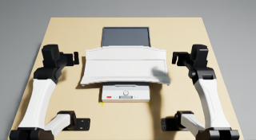

# Convert a baby scale into a toddler floor scale: hold the release button, slide the cradle tray back, set on the mat

Instruction: `Hold the baby scale's front release button in while sliding the curved weighing tray back off the scale base without moving the base off its marks, set the tray upright on the grey mat, then let go and move both hands clear.`

 

Other views: `start_left_wrist.png`, `start_right_wrist.png`, `end_top.png`, `end_top_policy.png`.

## What the task tests

In paediatric, family, WIC and home-visit clinics, medical assistants (`O*NET 31-9092.00`: `"Interview patients to
obtain medical information and measure their vital signs, weight, and height."`; `833,900` US workers), registered
nurses (`29-1141.00`: `"Record patients' medical information and vital signs."`; `3,465,400`) and LPNs (`29-2061.00`:
`"Measure and record patients' vital signs, such as height, weight, temperature, blood pressure, pulse, or
respiration."`; `666,900`) switch the `seca 354` from infants to standing children (manual `Fig. 5`: `"When
weighing children able to stand up: Remove the tray as described."`). The `525 x 80 x 250 mm` open-ended scoop locks
onto the `280 x 65 x 235 mm` platform (`Fig. 1-2`: `"To remove the tray just press the release button hard and slide
back the tray (Fig. 2)."`). One arm holds the button down while the other pinches the rolled edge of the open head wing
and slides the tray `>= 20 mm` back (`+x`); then both arms carry the scoop to the mat.

## Setup

Positions in cm from the midpoint between the arm bases (`x` forward, `y` left, `z` up). Fixed layout
(`object_jitter = 0`); `--seed 0` gives trial seed `1415158438` and the same start.

| Object | Product | Size, mass | Start (`cm`) |
|---|---|---|---|
| `scale_base` + `release_btn` | seca `354` Digital Baby & Floor Scale platform + button | `23.5 x 28.0 x 6.5 cm` (`1.47 kg`) + `30 g` | `(25.05, 0.0)` in yellow marks; button `(17.2, 0.0, +7.05)` |
| `weighing_tray` | seca `354` open-ended infant tray | `25.0 x 52.5 x 8.0 cm` (`0.80 kg`; top `+15.6 cm`) | locked at `(34.0, 0.0)` (`x = 21.5..46.5`, `y = -26.25..+26.25`) |
| `mat` | IKEA `TILLGANG` Tray, grey, Art. `104.199.50` | `29.0 x 37.0 x 2.0 cm`, `0.30 kg` | `(63.0, 0.0)` (`x = 48.5..77.5`, `y = -18.5..+18.5`) |

The standing deck is closed; as in `Fig. 1-2`, the latch sits in the recessed front step right behind the button.

**Can it be seen.** `start_top_policy.png` (`320 x 176`): LCD, red `seca` badge, four keys and the ringed button ahead
of the open scoop; yellow marks frame the base; the mat lies `20 mm` behind. `end_top_policy.png`: the closed deck with
its grey front step; the scoop level on the mat.

## Scoring (`task.py`, `task.json`: identical limits)

Whole-trial rules (from the trial video; the final photo confirms the end state): **0.0 for good** if at any step
(1) `scale_base` lifts `> 8.0 mm` at a corner or shifts `> 15.0 mm` from its marks, or (2) `weighing_tray` falls
onto the bench or flips upside-down, or any body falls off the bench (in simulation: downward bench impact
`> 0.50 m/s`, `z < -20 mm`, or tilt `> 90 deg`). Benign touches score nothing off.

End of trial: **1.0** when `weighing_tray` is detached and rests upright (`tilt <= 8.0 deg`) on the flat grey `mat`
(`mat` tilt `<= 5.0 deg`; tray centre within `3.0 cm` front-to-back and `5.0 cm` sideways of the mat's centre, by
ruler against its `29.0 x 37.0 cm` outer edges), `release_btn` is within `1.0 mm` of its top rest, `scale_base` is
within `15.0 mm` and `3.0 deg` of its marks, both hands are `>= 30.0 mm` clear of scale, button, tray and mat, and all
bodies stay still (`< 20 mm/s`, `< 0.20 rad/s`, `<= 2.0 mm` drift) for `1.0 s` (`20` steps); **0.5** when `1.0` is
not met while `weighing_tray` is unlocked and separated (slid `>= 20.0 mm` back, or moved clear of the base) with
`scale_base` undisturbed; **0.0** otherwise.

## Forces, stand-ins and states set directly

| Stated force or hold | Code (`file:symbol`) | Acts on / reaction on | Ends when | Sim reading (`trials.py` / `demo.py`) |
|---|---|---|---|---|
| button spring, `2400 N/m` | `scene.py`: `btn_slide` | `release_btn` up / `scale_base` down onto its feet | finger lifts (`<= 1.0 mm`) | `demo.py`: `5.5 mm` (`13.2 N`), back to `0.14 mm`; base moved `0.0 mm` |
| pawl lock | `scene.py`: pawl vs tongue | tray (`-x`) / `release_btn` and `scale_base` (`+x`) | button `>= 4.3 mm` down | `trials.py`: unpressed, stops at `3.8 mm` (`3.8 N`); pressed, slides `26.7 mm` |
| 2 keyhole studs | `scene.py`: studs vs lips | tray down / `scale_base` up | tray slid `>= 20 mm` back | `trials.py`: locked lift raises the base `67.5 mm` (`0.0`); `demo.py`: `0.0 mm` |
| edge pinches | gripper, jaws closing about `z` (`demo.py`) | the two `16 mm` rolled wing edges, `50.9 cm` apart | grippers open | `demo.py`: `~25 N` a finger (`50-51 N` two-finger sum a hand) |

**What stands in for what.** Boxes and cylinders at `1:1` maker outer sizes; the scoop's floor is a `6 mm` plate with
a `16 mm` rolled edge along each open end (photo: `~8-10 mm`), its walls step down toward the open ends; the latch is
two T-studs in keyhole slots of the front step plus the button's pawl. In simulation "rests on the mat" reads as at
least `1 N` of contact; the real `52.5 cm` tray bridges the mat's `20 mm` side rims, and two underside ribs stand in
for that. Electronics are unmodelled. **States set directly:** none in `task.py`, `scene.py` or `demo.py`; in
`trials.py` only `tray_bench_fall` places the tray above bare bench (the others use arm actions). **Assets:**
primitives only; no external meshes, textures, fonts or sounds.

## Key figures (`parts.py`), with their sources

Summary: **15 maker**, **3 standard**, **0 listing**, **0 team-checked**, **8 fixture**, **11 estimate**.

| Figure | Constant | Value | Source |
|---|---|---|---|
| assembled; tray W x H x D | `ASSEMBLED_*`, `TRAY_*` | `552 x 156 x 332`; `525 x 80 x 250 mm` | maker sheet: `"21.7 x 6.1 x 13.1\" / 552 x 156 x 332 mm"`, `"20.7 x 3.1 x 9.8\" / 525 x 80 x 250 mm"` |
| platform; capacity; mass | `BASE_*`, `SCALE_CAP_KG`, `SCALE_MASS` | `280 x 65 x 235 mm`, `20 kg`, `2.30 kg` | maker sheet: `"11 x 2.6 x 9.3\" / 280 x 65 x 235 mm"`, `"44 lbs / 20 kg"`, `"5 lbs / 2.3 kg"` (manual `"approx. 2.5 kg"`) |
| IKEA TILLGANG mat | `MAT_W/D/H`, `MAT_MASS` | `370 x 290 x 20 mm`, `0.30 kg` | maker page: `"Length: 37 cm"`, `"Width: 29 cm"`, `"Height: 2 cm"`, `"Weight: 0.30 kg"` |
| workers | `MA_WORKERS`, `RN_WORKERS`, `LPN_WORKERS` | `833,900`; `3,465,400`; `666,900` | O*NET pages (`Employment (2025)`) |
| mass split | `BASE/BTN/TRAY_MASS` | `1.47 / 0.03 / 0.80 kg` | estimate: shell, button and remainder of the sheet's `2.30 kg` |
| button spring, stroke, unlock | `BTN_SPRING`, `BTN_STROKE`, `BTN_UNLOCK` | `2400 N/m`, `6.5 mm`, `4.3 mm` | estimate: `12 N` at `5 mm` for `"press the release button hard"` |
| slide to free the studs | `HOOK_SLIDE` | `20 mm` | estimate: `16 mm` under the lips plus `4 mm` (`Fig. 2`) |
| floor; rolled edge; mat | `FLOOR_T`, `EDGE_D`, `MAT_FLOOR_T/RIM_T` | `6`, `16`; `6`, `8 mm` | estimate: shell `~3.5 mm`, edge `~8-10 mm` in the sheet photo, mat wall `~2.5 mm` (model slabs thicker) |
| layout, tolerances, limits | `BASE_FRONT_X`, `MAT_X`, `MAT_CENTER_TOL_*` | `13.3`, `63.0`, `3.0 / 5.0 cm`; `8 / 15 mm` | our fixture (ruler bounds, yellow marks) |

Links opened: `https://www.seca.com/en_us/products/all-products/product-details/seca354.html`,
`https://www.seca.com/fileadmin/documents/product_sheet/seca_pst_354_en-us.pdf`,
`https://www.seca.com/fileadmin/documents/manual/seca_man_354_364_int.pdf`,
`https://www.ikea.com/gb/en/p/tillgang-tray-grey-10419950/`,
`https://www.onetonline.org/link/summary/31-9092.00`, `https://www.onetonline.org/link/summary/29-1141.00`,
`https://www.onetonline.org/link/summary/29-2061.00`.

## First minutes of a real trial (about 8 minutes)

1. **Masses, 2 min:** weigh the base (batteries in) and the detached tray on a kitchen scale (`1.47 kg` and `0.80 kg`
   estimated from the sheet's `2.30 kg`); a different reading replaces the estimate.
2. **Button force and travel, 3 min:** with the base on a tared kitchen scale, press the button until the tray slides
   (`~10-12 N`, `~4-5 mm` by caliper); a different reading replaces the estimate.
3. **Slide travel, 3 min:** lock the tray (`Fig. 1`), check that a gentle upward pull lifts the base, mark the tray's
   front edge, then hold the button and slide the tray back until it lifts free (`~20 mm` by steel rule); a different
   reading replaces the estimate.

## How it differs

Public suites have no convertible clinical scale; board tasks measure infant length or slide small accessories
one-handed off bolted brackets or watch lugs. Harder than such a release: the unbolted `1.47 kg` base
lifts off its marks if the tray is pulled up before its `20 mm` slide (`0.0`), the tray leaves in two axes (back, then
up out of its keyholes), and the `525 mm` scoop needs both hands (grasps `50.9 cm` apart), so the button hand lets go
and re-grasps.

## How to run

- Tests (`8`, `< 1 s`): `scripts/rta check mech/tasks/baby_scale_convert`; IK: `python mech/tasks/baby_scale_convert/demo.py --quick`.
- Checks & trials: `scripts/rta simpy <id> mech/tasks/baby_scale_convert/checks.py --frame0 /workspace/robocurve/outputs/<id>`; `scripts/rta simpy <id> mech/tasks/baby_scale_convert/trials.py /workspace/robocurve/outputs/<id>`.
- Demo (`497` of `1,200` steps, `24.9 s`): `scripts/rta demo <id> mech/tasks/baby_scale_convert --check`.
- Policy (`1,200` steps, `60 s`, `20 Hz`): `inspect-robots run --embodiment yam_arena --policy dream -E task=mech/tasks/baby_scale_convert/task.py -E object_jitter=0 -E control_hz=20 -E cam_width=320 -E cam_height=176 --instruction "<instruction>" --scorer task_score --max-steps 1200 --seed 0 --no-prompt --store-frames --log-dir <dir>`.
