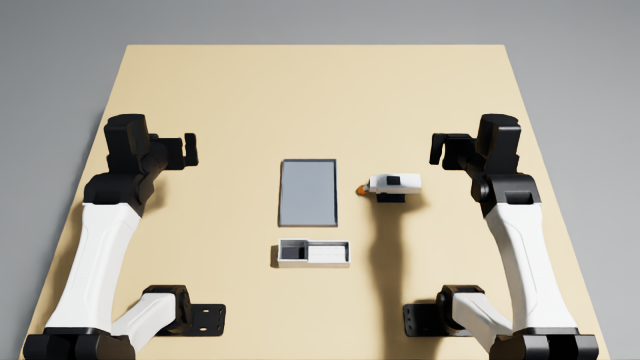
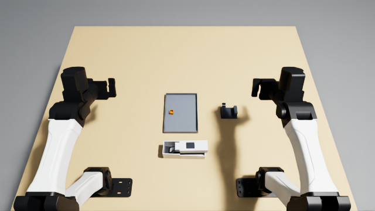
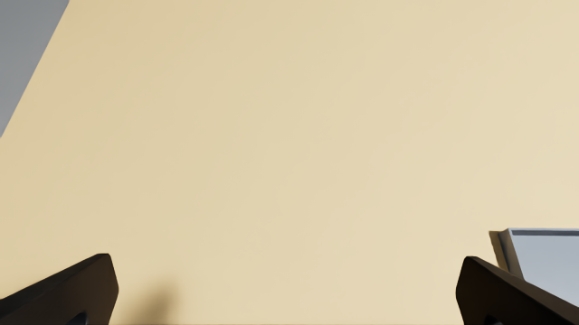
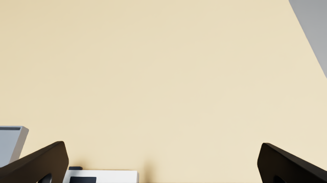

# Turn around a tympanic thermometer: eject the used probe cover without touching it, reload, and dock

- **Category:** Impact on jobs
- **Instruction:** `Eject the used amber probe cover into the grey tray without touching it or letting it touch the cradle or the white covers, press one fresh white cover from the rack onto the probe and keep it on, rest the thermometer in its cradle, and let go with both hands clear.`
- **Scene / horizon:** `station`, `SCORE_OVER = "end"`, 1,300 steps (65 s at 20 Hz), one fixed layout for every seed.

| Start (`top_cam`) | Finished (`top_cam`) |
|---|---|
|  |  |

| Start (`left_cam`) | Start (`right_cam`) |
|---|---|
|  |  |

## Job and published sources

Ward staff turn the thermometer around between patients without touching the used cover:

- O*NET 31-1131.00 Nursing Assistants (1,505,900 US employees, <https://www.onetonline.org/link/summary/31-1131.00>): "Record vital signs, such as temperature, blood pressure, pulse, or respiration rate, as directed by medical or nursing staff."
- O*NET 31-9092.00 Medical Assistants (833,900, <https://www.onetonline.org/link/summary/31-9092.00>): "Interview patients to obtain medical information and measure their vital signs, weight, and height." and "Clean and sterilize instruments and dispose of contaminated supplies."
- Rudolf Riester GmbH, ri-thermo® tymPRO (<https://riester.de/products/thermometry/ri-thermo-tympro-tympanic-thermometer>): Art. 1835: "Dimension / Weight 150 (L) x 42 (W) x 56 (H) mm / 80 g"; Art. 12640 "Probe cover for ri-thermo® tymPRO 30 rack / 300 pcs."; "One handed probe cover ejection button aids in the prevention of cross contamination"; "The unique Riester probe cover with dispenser box provides an efficient workflow, minimising cross contamination."
- Riester's photos there set the shapes: `Riester tymPRO 01 Photo`, the thermometer docked display-up along its cradle over the covers; `Riester tymPRO 02 Photo`, the open cradle, one white trough with a 2 x 5 rack of covers on its floor and a dark-lined pocket at one end, where its walls stand higher; `riester-tympro-c-1`, the probe angled forward away from the display, a dark-grey ribbed eject button on the head's end beside its root; `tympro-clinical-01-photo-2`, a gloved hand holding the cradle by its side walls.

## Scene

Positions in cm from the midpoint between the arm bases (x forward, y left; bases at y = ±30.5):

- **Start rest** (`start_pad`, our fixture, fixed) at (33.0, -20.0): a stepped block whose 38 mm saddle holds the thermometer level, display up, probe towards +y, its amber cover 8 mm off the bench.
- **Grey tray** (`disposal_tray`, our fixture): 20.0 x 15.0 x 2.0 cm at (33.0, +1.5).
- **Cradle** (`cradle`) at (15.0, 0.0): one open white trough 17.0 cm long (along y) and 5.6 cm wide, its walls 4.4 cm high along the rack and 5.8 cm at the pocket end (+y). The rack of ten fresh white covers (`cover_fresh_0..9`, 2 rows of 5 at 18.5 mm pitch) fills its floor from y = -8.2 to +1.4 cm; a dark rib at y = +1.6 to +2.4 cm, 4.4 cm high, starts the dark-lined pocket. Docked, the thermometer lies display-up along the trough on the rack end wall and the rib, its covered probe angled down into the pocket.
- **Thermometer:** the probe 55 degrees below the body's axis; the eject button in a recess in the head's end, above the probe.
- **Hands:** Right takes the tail from behind and above, holds the probe over the tray, tips it 35 degrees nose-down to press it into a rack cover, and docks it; Left presses the button with its closed fingertips' flat end, then holds the cradle's side walls during the press-on. TCPs: Right y <= -7.6 cm, Left >= +3.4 cm; wrists >= 283 mm apart (rule 280), hulls >= 52 mm (`checks.py`).

## Rules and score (`task.py:score`)

- **0 for good, latched at any step:** either hand touches the used amber cover; the used cover touches the cradle or any fresh cover; the ejected used cover touches the bench outside the tray; a fresh cover once on the probe comes off it again; the thermometer, cradle, tray or used cover falls off the bench.
- Otherwise read at the end, with every part of both hands >= 30 mm clear of all task parts, the eject button within 1.0 mm of rest and every part moving <= 3 mm over 1.0 s (20 steps):
  - **0.5:** the used cover rests on the tray's floor inside its walls.
  - **1.0:** as well, one fresh cover sits on the probe (its tip <= 4.0 mm off the cover's axis, within 15 degrees of it, >= 9 mm inside) and the thermometer lies in its cradle (<= 12 mm from its place along the bench, <= 6 mm in height, <= 10 degrees from level, probe towards the pocket end).
  - **0** otherwise.
- Mechanism: 4.0 mm of button travel cuts the used cover's weld; a rack cover seats on a coaxial press of >= 3.5 N (tip <= 3.5 mm off axis, >= 10 mm inside, within 14 degrees): its rack weld is cut and a probe weld made at that pose.

## Key figures and their sources (`parts.py`)

| Figure | Value | Kind | Source or derivation |
|---|---|---|---|
| Thermometer L x W x H, mass | 150 x 42 x 56 mm, 80 g | maker | "Dimension / Weight 150 (L) x 42 (W) x 56 (H) mm / 80 g", Riester page above |
| Covers per rack and box | 10, 300 | maker | Art. 12640 "30 rack / 300 pcs."; 2 rows of 5 in `Riester tymPRO 02 Photo` |
| Body thickness, head width | 32 mm, 30 mm | estimate | about 0.75 and 0.7 of the 42 mm width in `riester-tympro-c-1` |
| Probe angle below the body | 55 degrees | estimate | `riester-tympro-c-1` and the in-ear photo; with the 32 mm body it makes the 56 mm height |
| Ring and tip diameter, tip length | 14.0 mm, 8.4 mm, 13 mm | estimate | a third and a fifth of the 42 mm width in `riester-tympro-c-1`; the probe ends 150 mm from the tail |
| Eject button | 20 x 12 mm, 1.5 mm proud, face 10 degrees up | estimate | two thirds of the 30 mm head, on its end above the probe, in `riester-tympro-c-1` |
| Button stroke, release, spring | 5.5 mm, 4.0 mm, 900 N/m | estimate | Riester gives no travel; 3.6 N at the release and 4.95 N at the stop, a light thumb press |
| Cover flange, mouth, height | 17.6 mm, 13.8 mm, 17 mm | estimate | two covers fill the 43 mm rack at 18.5 mm pitch (`02 Photo`); mouth 0.2 mm under the ring; 13 mm tip + 1.5 mm + 2.5 mm end |
| Press that seats a cover | 3.5 N | estimate | a light press pushes the 13.8 mm mouth onto the 14.0 mm ring |
| Cover mass in the simulator | 4.0 g | estimate | rigid-body stability at 240 Hz; the real cover is under 1 g |
| Cradle L x W x H, mass | 170 x 56 x 58 mm (44 along the rack), 140 g | estimate | longer than the docked thermometer, 1.35 times its width (`01 Photo`); walls as high as the width at the pocket end, lower along the rack (`02 Photo`); 3 mm ABS shell, about 100 cm3 at 1.05 g/cm3 |
| Cradle foot friction | 0.85 | estimate | elastomer feet on a dry laminate worktop |
| Tray 200 x 150 x 20 mm; rest saddle 38 mm | | our fixture | tray mass 180 g, estimate: 2.5 mm PP walls and 3.5 mm floor at 910 kg/m3 |

## Forces (`parts.py`, `demo.py`, the run)

- **Fingers:** Right closes to 32 mm on the 42 mm body and Left to 46 mm on the 56 mm cradle walls: 5 mm a finger at 5000 N/m, 25 N a finger (<= 40 N).
- **Eject:** the spring takes 3.6 N at the 4.0 mm release and 4.95 N at the 5.5 mm stop. Left presses along the button's axis with 9 N told while Right braces 9 N against it: both arms give under load (6 N each way moved the button only 4.4 mm). Run gt28: button peak 5.62 mm.
- **Seat:** the seat needs 3.5 N; Right is told 5.5 N at the probe's tip while Left holds the cradle down with 3 N. Run gt28: seated at 3.52 N, the press then 4.8 N; a 3.2 N press does not seat (test).
- **Fit:** the 14.0 mm ring stops on the cover's 13.8 mm mouth; the rigid ring rests on the rim and the weld made at that pose stands for the rim's stretch grip (no friction figure is claimed). The 8.4 mm tip is a clearance fit: in the demo it sits 2.8 mm off the cover's axis (seat rule 3.5 mm).

## First minutes of a real trial

About 8 minutes with calipers, a 0.1 g scale, a 0-20 N push-pull gauge and a phone inclinometer:

1. Weigh and measure (2 min): the thermometer without batteries (80 g maker), a cover (under 1 g; 4.0 g simulated), the cradle (140 g), the tray (180 g); caliper the body (32 mm), head (30 mm), ring (14.0 mm), tip (8.4 mm), cover flange, mouth and height (17.6, 13.8, 17 mm), button (20 x 12 mm) and cradle (170 x 56 mm, walls 44 and 58 mm).
2. Eject (3 min): seat an amber-marked cover, press the button with the gauge and a depth rod until the cover drops: release travel (4.0 mm), stroke (5.5 mm), release force (3.6 N).
3. Seat (3 min): press the bare probe onto a cover standing in the rack with the gauge (3.5 N); check the docked thermometer is within 10 degrees of level; a different reading replaces the estimate.

## Checks run so far

- Rule tests: 6 pass; `checks.py`: every pose solves within 0.1 mm, joint margins >= 10 degrees.
- Trials gt24: the 0.5 and 1.0 tiers and all four zeros score as written.
- Demo gt28 `--check`: 1.0, first at 21.75 s of 65 s; recording gtrec1 (312c64a) identical.
- Dream-1 gtd2 (1,300 steps): 0.0; both arms drew back and stopped, nothing moved.

## How it differs

A between-patient turnaround, not a measurement: a no-touch button ejection of the used cover, a coaxial press-on from a rack the other hand holds, and a level dock in a fitted cradle. Ear-canal dwell on a manikin, forehead scanning and needle-sheath locking test none of these.

## Assets and sources

All bodies are mechkit boxes and cylinders (`scene.py`); the folder holds no meshes, photos or fonts; the pictures are simulator frames.

## How to run

```bash
scripts/rta check mech/tasks/tympanic_cover
scripts/rta simpy <id> mech/tasks/tympanic_cover/trials.py /workspace/robocurve/outputs/<id>
scripts/rta demo <id> mech/tasks/tympanic_cover --check
```
