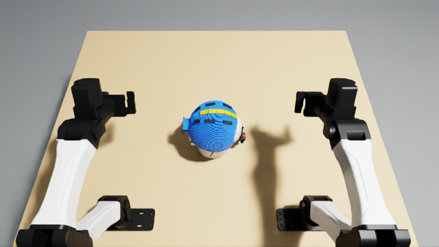
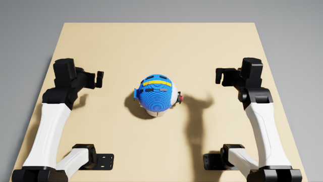

# Fit a tipped-back child's bike helmet: level it two fingers over the brows, then tighten its rear dial

Instruction: `Fit the helmet properly on the head form for a bike ride, turning the rear dial no more than four clicks past the band's first touch on the head, without touching the face or moving the head form, and let go.`

  

Policy crops (`320 x 176`): `start_top_policy.png`, `left_wrist_readability_policy.png`, `end_top_policy.png`. Rules
and `score()`: `task.py`; figures: `parts.py`.

## The task (Societal relatability)

- **Everyday:** parents fit a child's bike helmet before a ride, and a helmet tipped back off the forehead is a common
  fitting fault. NHTSA's guide (*Easy Steps to Properly Fit a Bicycle Helmet*, reproduced by Idaho EMS [nhtsa]): a
  helmet *"should be properly fitted, adjusted, and worn each time you ride"*, sits *"level on your head and low on your
  forehead—one or two finger-widths above your eyebrow"* (`15 to 35 mm`); Step 6B asks *"Does your helmet rock back
  more than two fingers above the eyebrows?"*; *"Your helmet should be snug"*, *"The Helmet Should Be Comfortable."*
- **Start and order:** straps set, the open ring lets the shell tip back `13 deg` (`45.9 mm` over the brow band, seen
  in the left wrist camera). Level first, then tighten: tightened tipped back, the band clamps
  the nape (`0.0`); open, the shell rocks back on release and dial torque pitches it back, so one hand holds the front
  rim in `15 to 35 mm` while the other turns the rear dial (`86-91 mm` up) in regrasps.
- **Snug, not over** (Decathlon: *"snugly, but not too tightly"* [fit]): at most `4 clicks past` the band's first touch,
  our estimate of a comfortable fit on the trial's foam head, the representative head form (`550 mm`, class of
  `EN 960 size 555` [cadex]; S fits `53-56 cm`): snug is `2` clicks past touch (`24 N` holds the pull); we allow `2` more (about
  `48 N`; ring `8 mm` under its first-touch round, a `1.4 %` squeeze of `555 mm`). Pitch unpublished: `20 deg`.

## How it differs

Beyond hold-and-turn: an unstated order (nape `0.0`, occiput `1.0`) and a tightness bounded both ways (the pull holds,
at most 4 clicks past touch) while the held shell rocks on a dome and dial torque pitches it back. Head-form wearables
have no tightening; BEHAVIOR-1K, LIBERO and RoboCasa365 have no helmet task.

## Setup (`parts.py`; m from the arm-base midpoint, x forward, y left, z up)

- **Head form:** Rayher `3396700` (29 cm tall, 55 cm round [rayher, mosaik]; US twin FloraCraft `RS260/6`, 53.3 cm
  [flora]), sawn `2 mm` under chin (`212 mm` crown), taped at `(0.28, 0.00) +/- 0.005` m facing `+y`; `8 mm` brow band
  `z = 102 mm`.
- **Helmet:** Decathlon B'TWIN `KH 500` S (`53-56 cm`, `220 g`, EN 1078, ref. `8737457` / `8737455` [dec_sup, dec_uk];
  Schwinn Thrasher Child, `50-56 cm`), straps at their marks. Pivots at ears (`z = 122 mm`); front edge `115 mm` ahead,
  red dial (`28 x 11 mm`, white line across its face) `112 mm` aft, `31 mm` down (`z = 67 mm` at `13 deg`, `91 mm`
  level). Fixed layout (`object_jitter = 0`, same for all seeds).

## Mechanism and bilateral forces (Check 51)

Serial tree (`mechanism.py:45-83`): `None --weld("head_mount")--> head -> hinge("tilt") -> helmet`, plus
`hinge("dial") -> dial` and `slide("band") -> band`. Over `15` clicks (`300 deg`), `band` draws `0.333 mm/click` (`5
mm`), touching the occiput (level) or nape (`13 deg`, `parts.py:145-150`) at `7` clicks and reaching `24 N` at `9`.

| Force / hold | Code (`file:line`) | Body <-> Reaction | Ends when | Demo (`h4d2`) |
|---|---|---|---|---|
| Rock-back `0.04 N m` | `parts.py:472-479`, `mechanism.py:249-276` | `helmet` (`+x`) <-> `head` (`-x`) | hand / hold `> 0.04` | L `<= 2.2 N` |
| Tilt hold `0.01+0.057*bf` | `mechanism.py:48-58`, `179-182`, `222-229` | `helmet` <-> `head` (`tilt` drive) | `> cap` (`1.38` at `24 N`) | `1.86 N m` |
| Dial `0.03+0.955e-3*bf` / `0.24` | `mechanism.py:59-69`, `185-188`, `201-219` | `dial` <-> `helmet` (`dial` drive) | stop; `>= 0.24` loosens | `0.030->0.060` |
| Band press `bf` (`55 N/mm`) | `mechanism.py:70-81`, `174-176`, `254-255` | `head` <-> `band` -> `helmet` | dial turned back | `7.3` cl., `32.5 N` |
| Dial twist `0.5*tau_dial` | `mechanism.py:251`, `270-276` | `helmet` (`+x`) <-> `head` (`-x`) | dial stops turning | `0.015->0.030` |
| Gripper contacts | `demo.py:70-120`, `task.py:136-138` | `helmet`/`dial` <-> L/R pads | grippers retreat | L `10.1`, R `2.3 N` |

Rest press (`trials` `e`): `8.5, 19.2, 29.7, 38.5 N` at `8, 9, 10, 10.8` clicks; `67.0 N` at `13.4`.

## Scoring (`task.py`, read at trial end)

- **Whole-trial 0.0** (`task.py:263-269`, video; final photo confirms end state): arm touches face (eyes, nose: shapes
  4-6) or `head` shifts `> 10 mm` off its marks.
- **End levels** (`task.py:222-288`; grippers `>= 30 mm` clear, `< 10 mm/s` and `< 0.1 rad/s` for `1.0 s` = 20 steps):
  **0.0** if brow-to-edge gap `> 35 mm` or `< 15 mm`, or dial not turned (idle `0.0`); **0.5** if `15 to 35 mm` but a
  `10 N` upward front-edge pull lifts it `>= 5 mm` (`bf < 24 N`) or the dial is over `4 clicks past` first touch
  (overtightened); **1.0** if `15 to 35 mm`, the pull lifts it `< 5 mm` (`bf >= 24 N`, hold `>= 1.19 N m`) and the dial
  is at most `11 clicks` from the open stop, held `1.0 s` clear.
- **Clicks:** counted on the video (white line) and again turning the dial back to its open stop at reset; the
  simulator reads the dial's angle (`<= 220 deg`).
- **Shortcuts:** tightened tipped back clamps the nape at `45.9 mm` (`trials` `f`: `0.0`); over eyes `10 mm` (test:
  `0.0`); levelled only, rocks back (`a`: `0.0`); dial stop `< 24 N` (test: `0.5`); cranked to `13` clicks, clamped (`c`:
  `0.5`); face/shift (`g`: `0.0`).

## Key figures and sources (`parts.py` `KEY_FIGURES`: 2 maker, 1 standard, 2 listing, 6 estimate)

| Figure | Value | Source |
|---|---|---|
| Head height | 290 mm | maker: Rayher `"Styropor-Kopf, weiblich, 29 cm"` [rayher]; FloraCraft `"6.3 x 6.8 x 10\""`, `"21\""` [flora] |
| Head circ. | 550 mm | listing: MosaikShop `"Model number: 3396700 ... Head circumference: 55 cm"` [mosaik] |
| Helmet S | 530-560 mm, 220 g | maker `"KINDER FAHRRADHELM - KH 500"`, `"REF: 8737455, 8737457..."` [dec_sup]; Decathlon UK S 53-56 cm, 220 g [dec_uk] |
| Fit window | 15 to 35 mm | standard: NHTSA (quoted above), upper `"rock back more than two fingers"` [nhtsa] |
| Cut head | 110, 210, 102 mm; 90 g | estimate: female proportions at 550 mm (158x188); ~3.6 L EPS at 25 kg/m3 |
| Shell/pivot | 220x180x120, 12, 122, 115 mm | estimate: head ellipse + 11-16 mm EPS wall; ear Y-junction 20 mm over brow |
| Rock-back | 13 deg, 45.9 mm; 0.04, 0.01 N m | estimate: open ring lets shell rock back 13 deg (rim top 159 <= 160); COM ~18 mm aft -> 0.04 N m |
| Dial/pawl | 28x11 mm, 20 deg, 0.03/0.24 N m | estimate: 18-tooth wheel; ~2 N click, ~17 N reverse pawl at 14 mm radius; 0.5 pitch share |
| Band/clamp | 15, 7, +2 cl.; 5 mm; 24 N | estimate: 30 mm S-draw -> ~5 mm radial; 7 cl. to touch + 2 at 55 N/mm -> 24 N (`1.38>1.19`) |
| Head form | EN 960 size 555 | maker: Cadex `"Number sizes available (EN 960): 495 – 515 – 525 – 535 – 555 – 575 – 585 – 605 – 625"` [cadex] |
| Comfort | 4 past touch (11 cl.) | estimate: snug 2 past touch (24 N holds the pull) + 2 (~2x the press, 48 N) |

[nhtsa] https://ems.idaho.gov/wp-content/uploads/2026/07/Bike-Helmet-Laws.pdf · [rayher] https://www.rayher.com/de/styropor-kopf-weiblich-29-cm-3396700 ·
[mosaik] https://www.mosaikshop.se/en/product/styrofoam-head-female-height-29-cm · [flora] https://shop.floracraft.com/amfile/file/download/file/64/product/4751/ ·
[dec_sup] https://support.decathlon.de/kinder-fahrradhelm-kh-500-1 · [cadex] https://www.cadexinc.com/?p=201 (all opened) ·
[dec_uk] https://www.decathlon.co.uk/p/500-children-s-helmet-blue/338990/c209c202m8737457 & [fit] https://www.decathlon.co.uk/p/500-city-cycling-helmet-neon-yellow/895/c132m8326834 (403 to script)

## First minutes of a real trial

The rock-back, pull and click figures are estimates, each checked on the bought KH 500 S and head form (~12 min; a
different reading replaces the estimate): (1) **head & shell (2 min):** tape (`550 mm`) and
ruler before sawing; scale/caliper on helmet and dial. (2) **rock-back (2 min):** straps at marks, dial open, it rests
tipped back (`13 deg` by protractor app, `46 mm` by ruler); tipped to `25 mm` and let go, it rocks back past `35 mm`; a
luggage scale at the front edge holds it level at about `0.35 N` (`0.04 N m / 115 mm`). (3) **clicks & pull (6 min):**
from the open stop, count clicks to first touch (a paper strip under the rear pad stops sliding; `7`) and to the stop
(`15`); 10 N pull after each click past touch: `>= 5 mm` lift before the clamp, `< 5 mm` from it (`2` past touch, which
must be at or under `4`); at `4` past touch the paper strip still draws out by hand; string round the dial: `0.03` / `0.24 N m`. (4) reset (~1 min).

## Verification and run commands

- **G1:** IK `<= 0.08 mm`, margins `>= 8.7 deg` (`5.9` demo), grasps `229 mm`, face `>= 33.3 mm` demo,
  idle `0.0` (`h4g1f`). **G2 (`test_helmet_fit.py`, 16 tests; `trials.py` `h4t1k`, `c` `h4t3`):**
  trials reach `0.0` (rock-back, twist, nape clamp, face touch, head shift), `0.5` (`19.5 mm`; `13` clicks, clamped),
  `1.0` (`10.55` clicks, `2.24 mm`, pawl `0.20`). **G3 (`demo.py` `h4d2` / `h4r2`):** `1.0` in `282` steps
  (`14.1 s` of the `900` = `45 s` limit at 20 Hz; `10.15` cl., `32.5 N`, gap `25.3 mm`).
- Run: `scripts/rta check helmet_fit`; `scripts/rta demo <id> mech/tasks/helmet_fit --check`; `inspect-robots run --embodiment yam_arena --policy dream -E task=mech/tasks/helmet_fit/task.py -E
  object_jitter=0 -E control_hz=20 -E cam_width=320 -E cam_height=176 --instruction "<the instruction above>" --scorer
  task_score --max-steps 900 --seed 0`.
