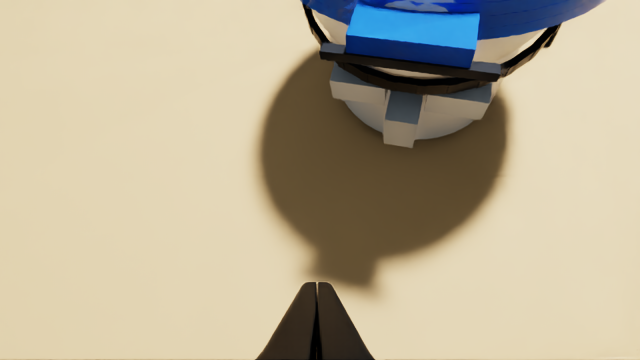

# Fit a tipped-back child's bike helmet: level it two fingers over the brows, then tighten its rear dial

Instruction: `Fit the helmet properly on the head form for a bike ride without touching its face or moving the head form, and let go.`

  

Policy crops (`320 x 176`): `start_top_policy.png`, `left_wrist_readability_policy.png`, `end_top_policy.png`.
Files: `task.py` (`score()`), `mechanism.py`, `parts.py`, `checks.py`, `trials.py`, `demo.py`, `test_helmet_fit.py`,
`mechkit.py`, `demo_kit.py`, `task.json`. Assets: none (kit primitives).

## The task

- **Fit window and open ring:** NHTSA's guide (*Easy Steps to Properly Fit a Bicycle Helmet*, reproduced by Idaho EMS
  [nhtsa]) sets a helmet *"level on your head and low on your forehead—one or two finger-widths above your eyebrow"*
  (`15 to 35 mm`; Step 6B sets *"rock back more than two fingers above the eyebrows"* as the upper edge), and for the
  dial says *"If the helmet has a universal fit ring instead of sizing pads, adjust the ring size to fit the head."*
  Decathlon's guide asks that it fit *"snugly, but not too tightly across your forehead"* and stay *"without sliding
  forward, backward, or sideways"* [fit]. Here the straps are already set at their marks and not handled, so the open
  ring is what lets the shell tip back `13 deg` (`45.9 mm` over the brow band, seen in the left wrist camera).
- **Safety order:** level first, then tighten. Tightening tipped back closes the band on the nape and clamps it there
  (`0.0`). Open, the shell rocks back on release and dial torque pitches it back too; one hand holds the front rim in
  `15 to 35 mm` while the other turns the rear dial (`86-91 mm` up) in four `75-deg` regrasps until the band clamps.

## How it differs

- Placing wearables on a head form (glasses, headsets) has no tightening or pull check.
- Hold-and-turn clamps on a fixed seat; here the shell rocks on a dome with no stop in the fit window while dial torque
  pitches it back, and success is head retention, not knob angle.
- Squaring a phone on a push-button ball-head tripod holds a spring button while aiming a 2-DOF joint that auto-locks on
  release; here no button frees the joint, an unstated order separates nape (`0.0`) from occiput (`1.0`) clamping, and
  the rear hand ratchets a dial in regrasps. BEHAVIOR-1K, LIBERO and RoboCasa365 have no helmet task.

## Setup (`parts.py`; m from the arm-base midpoint, x forward, y left, z up)

- **Head form:** Rayher `3396700` (`"Styropor-Kopf, weiblich, 29 cm"` [rayher], `"Head circumference: 55 cm"` [mosaik];
  FloraCraft `RS260/6`, `"6.3 x 6.8 x 10\" Female - White"`, `"Female head circumference is 21\"."` = `53.3 cm` [flora]),
  sawn `2 mm` under chin (`212 mm` crown), taped at `(0.28, 0.00) +/- 0.005` m facing `+y`; `8 mm` brow band `z = 102 mm`.
- **Helmet:** Decathlon B'TWIN `KH 500` S (`53-56 cm`, `220 g`, EN 1078, ref. `8737457` blue / `8737455` pink [dec_sup,
  dec_uk]; Schwinn Thrasher Child, `50-56 cm`), straps set at their marks. Pivots at ears (`z = 122 mm`); front edge
  `115 mm` ahead, red dial (`28 x 11 mm`) `112 mm` aft, `31 mm` down (`z = 67 mm` at `13 deg`, `91 mm` level). Fixed
  layout (`object_jitter = 0`; `--seed 0` -> trial seed `1415158438`, same for all seeds).

## Mechanism and bilateral forces (Check 51)

Serial tree (`mechanism.py:45-83`): `None --weld("head_mount")--> head -> hinge("tilt") -> helmet`, plus
`hinge("dial") -> dial` and `slide("band") -> band`. Over `15` clicks (`300 deg`), `band` draws `0.333 mm/click` (`5
mm`), touching the occiput (level) or nape (`13 deg`, `parts.py:144-149`) at `7` clicks and reaching `24 N` at `9`.

| Force / hold | Code (`file:line`) | Body <-> Reaction | Ends when | Demo (`h4d1`) |
|---|---|---|---|---|
| Rock-back `0.04 N m` | `parts.py:434-441`, `mechanism.py:248-275` | `helmet` (`+x`) <-> `head` (`-x`) | hand / hold `> 0.04` | L `<= 2.2 N` |
| Tilt hold `0.01+0.057*bf` | `mechanism.py:48-58`, `178-181`, `221-228` | `helmet` <-> `head` (`tilt` drive) | `> cap` (`1.38` at `24 N`) | `3.13 N m` |
| Dial `0.03+0.955e-3*bf` / `0.24` | `mechanism.py:59-69`, `184-187`, `200-218` | `dial` <-> `helmet` (`dial` drive) | stop; `>= 0.24` loosens | `0.030->0.078` |
| Band press `bf` (`55 N/mm`) | `mechanism.py:70-81`, `173-175`, `253-254` | `head` <-> `band` -> `helmet` | dial turned back | `7.3` cl., `54.7 N` |
| Dial twist `0.5*tau_dial` | `mechanism.py:250`, `269-275` | `helmet` (`+x`) <-> `head` (`-x`) | dial stops turning | `0.015->0.039` |
| Gripper contacts | `demo.py:69-119`, `task.py:136-138` | `helmet`/`dial` <-> L/R pads | grippers retreat | L `10.1`, R `2.3 N` |

Rest press vs clicks (`trials` `e`): `8.5, 19.2, 29.7 N` at `8, 9, 10` clicks; `67.0 N` at `13.4`.

## Scoring (`task.py`, read at trial end)

- **Whole-trial 0.0** (`task.py:257-263`, video; final photo confirms end state): arm touches face (eyes, nose: shapes
  4-6) or `head` shifts `> 10 mm` off its marks.
- **End levels** (`task.py:228-283`; grippers `>= 30 mm` clear, `< 10 mm/s` and `< 0.1 rad/s` for `1.0 s` = 20 steps):
  **0.0** if brow-to-edge gap `> 35 mm` or `< 15 mm`, or dial not turned (idle `0.0`); **0.5** if `15 to 35 mm` but a
  `10 N` upward front-edge pull lifts it `>= 5 mm` (`bf < 24 N`); **1.0** if `15 to 35 mm` and the `10 N` pull lifts it
  `< 5 mm` (`bf >= 24 N`, hold `>= 1.19 N m`), held `1.0 s` clear.
- **Shortcuts:** tightening tipped back clamps nape at `45.9 mm` (`trials` `f`: `0.0`); over eyes `10 mm` (`0.0`, test);
  levelling only rocks back (`trials` `a`: `0.0`); dial stop `< 24 N` (`0.5`, test); face/shift (`trials` `g`: `0.0`).

## Key figures and sources (`parts.py` `KEY_FIGURES`: 1 maker, 1 standard, 2 listing, 5 estimate)

| Figure | Constants | Value | Source |
|---|---|---|---|
| Head height | `HEAD_RAW_H` | 290 mm (`3396700`) | maker: Rayher `"Styropor-Kopf, weiblich, 29 cm"` [rayher]; FloraCraft `RS260/6` `"6.3 x 6.8 x 10\""`, `"21\""` [flora] |
| Head circ. | `HEAD_CIRC` | 550 mm | listing: MosaikShop `"Model number: 3396700 ... Heigh: 29 cm ... Head circumference: 55 cm"` [mosaik] |
| Helmet S | `HELMET_MASS` | 530-560 mm, 220 g | maker `"KINDER FAHRRADHELM - KH 500"`, `"REF: 8737455, 8737457..."` [dec_sup]; Decathlon UK S 53-56 cm, 220 g [dec_uk] |
| Fit window | `GAP_MIN/MAX` | 15 to 35 mm | standard: NHTSA `"level ... low on your forehead—one or two finger-widths above your eyebrow"`, upper `"rock back more than two fingers"` [nhtsa] |
| Cut head | `CROWN_TO_BROW/CHIN`, `BROW_Z`, `HEAD_MASS` | 110, 210, 102 mm; 90 g | estimate: female proportions at 550 mm circ. (158x188; 78 mm neck sawn 2 mm under chin; ~3.6 L EPS at 25 kg/m3) |
| Shell/pivot | `HELMET_L/W/H`, `BRIM_THICK`, `PIVOT_Z`, `BRIM_ARM` | 220x180x120, 12, 122, 115 mm | estimate: head ellipse + 11-16 mm EPS wall; ear Y-junction 20 mm over brow, front edge 115 mm ahead |
| Rock-back | `TILT_START_DEG`, `GAP_START`, `TIP_BACK/FRICTION_NM` | 13 deg, 45.9 mm; 0.04, 0.01 N m | estimate: straps set, open ring lets shell rock back 13 deg (rim top 159 <= 160); COM ~18 mm aft -> 0.04 N m |
| Dial/pawl | `DIAL_D/DEPTH`, `DIAL_CLICK_DEG`, `DIAL_TURN/HOLD_NM` | 28x11 mm, 20 deg, 0.03/0.24 N m | estimate: 18-tooth wheel (-112, -31 mm); ~2 N click, ~17 N reverse pawl at 14 mm radius; 0.5 pitch share |
| Band/clamp | `DIAL_TRAVEL_DEG`, `PRETOUCH/CLAMP_CLICKS`, `BAND_TRAVEL`, `CLAMP_N` | 15, 7, +2 cl.; 5 mm; 24 N | estimate: 30 mm S-draw -> ~5 mm radial; 2.33 mm gap on 55 cm head (7 cl.) + 2 cl. at 55 N/mm -> 24 N (`1.38>1.19`) |

[nhtsa] NHTSA guide reproduced by Idaho EMS, https://ems.idaho.gov/wp-content/uploads/2026/07/Bike-Helmet-Laws.pdf ·
[rayher] https://www.rayher.com/de/styropor-kopf-weiblich-29-cm-3396700 · [mosaik] https://www.mosaikshop.se/en/product/styrofoam-head-female-height-29-cm ·
[flora] https://shop.floracraft.com/amfile/file/download/file/64/product/4751/ · [dec_sup] https://support.decathlon.de/kinder-fahrradhelm-kh-500-1 (all opened) ·
[dec_uk] https://www.decathlon.co.uk/p/500-children-s-helmet-blue/338990/c209c202m8737457 & [fit] https://www.decathlon.co.uk/p/500-city-cycling-helmet-neon-yellow/895/c132m8326834 (403 to script)

## First minutes of a real trial

To check each estimate (~10 min): (1) **head & shell (2 min):** tape/ruler on Rayher 3396700 before sawing 2 mm under
chin; scale/caliper on KH 500 S and dial; (2) **rock-back on foam head (2 min):** straps at marks, dial open, let helmet
rock back, read tilt (protractor app) and gap (ruler), tip to 25 mm, let go to check rock-back, hold level with luggage
scale at front edge (`F * BRIM_ARM`); (3) **dial & 10 N pull (6 min):** clicks to touch/snug, string round dial
forward/back, 10 N front-edge pull (`< 5 mm` snug, `> 5 mm` open), reset (~1 min).

## Verification and run commands

- **G1:** IK `<= 0.07 mm`, margins `>= 8.7 deg` (`5.9` demo), grasps `229 mm`, face `>= 33.3 mm` demo (`28.8` G1, `20.6`
  pinch), idle `0.0` (`h4g1f`). **G2 (`test_helmet_fit.py`, `trials.py` `h4t1k`):** 15 tests; trials reach `0.0`
  (rock-back, twist, nape clamp, face touch, head shift), `0.5` (`19.5 mm`), `1.0` (`2.3 mm`, pawl `0.20`). **G3
  (`demo.py` `h4d1` / `h4r1`):** `1.0` in `336` steps (`16.8 s` of `900` = `45 seconds` at 20 Hz; `12.2` cl., `54.7 N`,
  gap `25.6 mm`).
- Run: `scripts/rta check helmet_fit`; `python3 mech/tasks/helmet_fit/demo.py --dry`; `scripts/rta simpy <id>
  mech/tasks/helmet_fit/trials.py /workspace/robocurve/outputs/<id>`; `scripts/rta demo <id> mech/tasks/helmet_fit
  --check`; `inspect-robots run --embodiment yam_arena --policy dream -E task=mech/tasks/helmet_fit/task.py
  -E object_jitter=0 -E control_hz=20 -E cam_width=320 -E cam_height=176 --instruction "Fit the helmet properly on the
  head form for a bike ride without touching its face or moving the head form, and let go." --scorer task_score
  --max-steps 900 --seed 0`.
