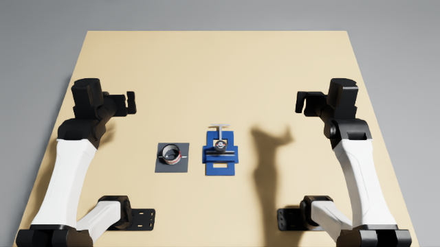
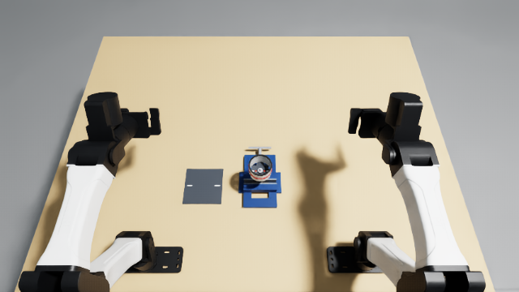

# Retract a quick-change arbor's pin collar, thread a 2-1/2 in hole saw on to align the drive pins, and lock it

Instruction: `Pull the arbor's pin collar down, screw the hole saw onto the arbor, short of bottoming out, until its two pin holes line up over the drive pins (back it off if it reaches the stop), then push the collar up so both drive pins lock through the hole saw.`

Files: `task.json`; `task.py` (rules, `score()`); `scene.py` (bodies, joints); `parts.py` (figures, sources); `checks.py`, `trials.py`, `demo.py`; `test_holesaw_arbor.py`; kit (`mechkit.py`, `demo_kit.py`); `start_top.png`, `start_top_policy.png` (320 x 176), `start_left_wrist.png`, `start_right_wrist.png`; `end_top.png`, `end_top_policy.png`.



## What the task tests

- **Retraction first.** Collar starts UP (`+8.0 mm`), projecting two `6.35 mm` pins `7.0 mm` above the shoulder; placing the cup without pulling it down rests it `7.0 mm` high (`0.0`).
- **Thread alignment short of bottoming out.** Screw the `63.5 mm` cup onto the `5/8"-18` arbor, short of bottoming out, until its two `7.8 mm` holes line up over the retracted `6.35 mm` pins (back off if it hits the stop, as `demo.py` does: tightening to `+415.0 deg` alone, a covered hold-and-turn, leaves holes `55.0 deg` past pins in sim so the collar stalls at `1.17 mm`, `0.25`). Sheet `49-56-7250` (`[manual]` p. 2): `"ensure hole saw is not bottomed out on threads"`.
- **2-pin twist lock.** At `>= 6.5 mm` (`8.0 mm` stroke), both `6.35 mm` pins pass through the `5.0 mm` plate into the `7.8 mm` holes, locking twist both ways.

## Scene and grasps

- **Vise and arbor** `(22.5, -1.5) cm`: **IRWIN `226340` forged-iron drill-press vise** (`101.6 mm` jaws, `178 x 134 mm` blue base, `38 mm` jaw top, handle `+x`; EU: **BESSEY `S10-ST`**) clamps the `7/16 in` (`11.1 mm`) hex shank of a **Milwaukee `49-56-7055` Large Thread Quick Change Arbor** (`101.6 mm`, `222 g`, `5/8"-18 UNF`; `49-56-7055` page gives no thread/length/mass/pins/collar/sheet; nut-free collar steps on `49-56-7250` sheet `[manual]` p. 2, p. 1 `49-56-9100` adds a nut; EU `2`-pin: **Milwaukee `4932479467`** or **Lenox `1779772` `2L`**) upright. Shoulder `105.0 mm`, nose `126.6 mm`, two `6.35 mm` pins (`25.4 mm` BCD) along `+/-y` with red tips. Collar (`42.0 x 27.0 mm`, white `+/-y` stripes) starts UP (`z = 78.0..105.0 mm`, `collar_z = 8.0 mm`).
- **Hole saw** `(22.5, +16.5) cm`: **Milwaukee `49-56-0147` `2-1/2 in` (`63.5 mm`) `HOLE DOZER` Bi-Metal Hole Saw** (EU `49560147`, `47.6 mm` tall with smooth black PVC rim guard; `195 g`, `5.0 mm` plate, `5/8"-18` bore, two `7.8 mm` holes at `+/-y`), backplate-down on a `120 x 120 x 3 mm` grey mat with white `+/-y` ticks.
- **Grasps:** Right (`-y`, `14 deg` pitch) pinches `42.0 <= 94 mm` collar at `z = 69.5..77.5 <= 160 mm` (`27.2 <= 40 N/pad`, `31 %` effort). Left grasps `63.5 <= 94 mm` barrel from above at `z = 28.6..157.1 <= 160 mm` (`30.1 <= 40 N/pad`, `5 %` effort), one regrasp.

## Rules, score, and shortcuts

- **0 for good:** cup drops off bench (`> 10 mm` below bench; from video).
- **0.25:** collar pulled `>= 6.0 mm` down (`collar_z <= 2.0 mm`, video) OR cup threaded within `2.0 mm` of shoulder without aligned lock.
- **0.5:** coaxial (`<= 4 mm`, tilt `<= 6 deg`), gap `<= 0.60 mm` (`0.60 mm` feeler gauge excluded), `7.8 mm` holes within `8.0 deg` of `+/-y` pins, collar not locked.
- **1.0:** `0.5` plus collar within `1.5 mm` of upper stop (`collar_z >= 6.5 mm`, both `6.35 mm` pins through `5.0 mm` plate so red tips show in both holes from above and cup resists hand twist), hands `>= 30 mm` clear, `< 10 mm/s` and `< 0.1 rad/s` for `1.0 s` (`20 steps`). Limit `1,600 steps` (`80 s`).
- **Shortcuts:** collar UP blocks cup `7.0 mm` high (`0.0`); `+415.0 deg` tight stalls collar at `1.17 mm` (`0.25`); `+180 deg` leaves `0.92 > 0.60 mm` gap (`0.25`); `< 0 deg` unthreads (`0.25`).

## Stand-ins and states set directly

- **Stand-ins:** (1) `5/8"-18` crests -> helical carrier (`4 x 50 g` gravity-balanced links adding `200 g` inertia to `195 g` cup; `cup_z` `set_limits` at `1.411 mm/turn` + three `<= 138.3 deg` hinges, `0.06 N m` drag, `+415 deg` stop, `< -3 deg` cut). (2) Teeth -> smooth PVC guard. (3) Flutes -> smooth `6.35 mm` nose; vise/shaft fixed.
- **States set directly:** `@on_reset` sets `collar_z = 8.0 mm`. Coaxial entry (`<= 3.5 mm`, `<= 6.5 deg`, `-0.4..+2.8 mm`) on retracted arbor (`collar_z <= 2.0 mm`) centers cup laterally (zero yaw jump) and makes `w_thread` (`cut` `< -3 deg`). `demo.py`: arm actions only.

## Key figures and sources

| Figure | Value | Source |
|---|---|---|
| Vise (`IRWIN 226340`) | `101.6`, `114.3 mm` | maker: `"textured 4" jaws"`, `"4-1/2" jaw capacity"`, `"Slotted base for easy installation and positioning"` [irwin] |
| Vise base & jaw top | `178 x 134`, `38 mm` | estimate: `7 in` base & `~1 in` jaw height from index (not opened) |
| Arbor (`49-56-7055`) | `11.11`, `>= 31.8 mm` | maker: `"7/16" Shank"`, `"Fits all hole saws 1-1/4 in. and larger"` (no thread/pins/collar/sheet) [arbor] |
| Thread (`5/8"-18`) | `15.88`, `1.411 mm/turn` | standard: ASME B1.1; maker `"5/8" x 18"` (`49-56-9100`) [arbor9100] |
| Nut-free collar steps | align & push up | maker sheet p. 2 (`49-56-7250`; p. 1 `49-56-9100` adds nut) [manual] |
| Arbor length & mass | `101.6 mm`, `222 g` | estimate: `4.0 in`, `0.49 lb` from index (not opened) |
| Pins, BCD, stroke, collar | `6.35, 25.4, 8, 42x27 mm, 85 g` | estimate: scaled against `15.88 mm` boss in [manual]; `85 g` share |
| Detent & thread drag | `10.0 N`, `0.06 N m` | estimate (assumed): spring-ball detent & dry `5/8"-18` drag; no maker figure |
| `+415` / `+360 deg` | `55.0 deg` back-off | estimate: sim figure; real trial records bought pair (`20-140 deg`) |
| Saw (`49-56-0147`) | `63.5`, `41.28 mm` | maker: `"2-1/2 in"`, `"1-5/8" Cutting Depth"` [saw] |
| Cup `H`, mass, plate, holes | `47.6 mm, 195 g, 5, 7.8 mm, +/-8 deg` | estimate: `41.3 + 5.0 + 1.3 mm` guard; `186 + 9 g`; `0.73 mm` play |
| Layout, `105`, `0.60 mm` | Scene & Rules | our fixture |

`parts.FIGURES`: `6` maker, `2` standard, `7` our fixture, `21` estimate.

## First minutes of a real trial

Bought tools (`~6 min`): weigh arbor & cup (`1 min`); caliper collar, pins, plate, `7.8 mm` holes (`2 min`); fit PVC strip, clamp `7/16"` shank upright (`+/-y` pins), screw cup to stop and back off to align to record the pair's back-off (use if `20-140 deg`, keeping stop blocked and aligned gap `<= 0.55 < 0.60 mm`, else swap `49-56-0147`), add ticks (`2 min`); luggage-scale `~10 N` detent (`1 min`).

## Forces and checks

| Force / hold | Primitive | On | Against | Governed / ended by (sim) |
|---|---|---|---|---|
| Detent (`10.0 N`) | `slide("collar_z")` | `collar` | `arbor_base` | `8->0 mm` (`4.1 s`); `0->8 mm` (`23.4 s`) |
| Thread (`0.06 N m`) | `turn_1..3` + `cup_z` | `hole_saw` | `arbor_base` | CW `412.5 deg`, CCW `360.2 deg`; cuts `< -3 deg` |
| Hidden (`4 x 0.49 N`) | `mk.push` (`4 x 50 g`) | `carrier..turner` | world (one-sided) | Balances `200 g` carrier weight |
| Pin axial block | PhysX contact | `collar` pins | `hole_saw` plate | `+415 deg`: `22 N` stalls `1.17 mm` (`15 N`) |
| `2`-pin twist lock | PhysX pin-in-hole | `hole_saw` holes | `collar` pins | `8 mm`: holds `0.30 N m` in `3.61 deg` (`1.0`) |

- **Visibility (`start_top_policy.png`, `end_top_policy.png`):** `+/-y` holes `+2.23/+2.50 mm` clear of rim ray in `top_cam`; at `320 x 176`, red tips fill both holes (`end_top.png`); `start_left_wrist.png`, `start_right_wrist.png` show grippers.
- **Checks:** `11` tests; `24` poses IK `<= 0.08 mm`, margin `>= 6.3 deg`, sep `>= 78.8 mm`; idle (`hs_f0_final`) `0.0`; `6` trials (`hs_trials_final`); `demo.py` (`hs_rec1`) `1.0` at `26.30 s` (`29.25 s`, `585/1,600`, `gap 0.14 mm`, `phase 0.18 deg`, `collar_z 8.0 mm`).



## How it differs

The accepted keyed-chuck task meshes a bevel key to tighten jaws on a smooth bit; accepted spin-on oil-filter and compression-joint tasks tighten forward to a stop; couplings slide onto smooth hubs. None retract a pin collar, align backplate holes over retracted pins short of bottoming out on a thread, and push twin pins through (`BEHAVIOR-1K`, `RoboCasa`, `LIBERO`: `0`).

## Assets and sources

Kit primitives only (no external meshes, textures, or sounds). Opened `2026-11-21`:
- `[arbor]` https://www.milwaukeetool.com/Products/49-56-7055 ; `[arbor9100]` https://www.milwaukeetool.com/Products/49-56-9100
- `[manual]` https://www.milwaukeetool.com/-/media/PDFs/Objective-Data/Download-Hole-Saw-Instructions.pdf (p. 2 `49-56-7250`: `"Screw the Hole Saw onto the arbor's thread; ensure hole saw is not bottomed out on threads. Align the pins with holes on the back of the hole saw and push the collar upward to secure the hole saw in place."`)
- `[saw]` https://www.milwaukeetool.com/Products/49-56-0147 ; `[irwin]` https://www.irwintools.com/product/226340/drill-press-vises
- `[jobs]` https://www.onetonline.org/link/summary/47-2111.00 (`821k`) ; https://www.onetonline.org/link/summary/49-9071.00 (`1.62M`).

## How to run

`scripts/rta check holesaw_arbor`; `scripts/rta simpy <id> <dir>/checks.py --frame0 <out>`; `scripts/rta simpy <id> <dir>/trials.py <out>`; `scripts/rta demo <id> <dir>` (`--no-video`, `--quick`). Max `80 s` (`1,600`); demo `29.25 s`. `--seed 0` gives trial seed `1415158438` (fixed start).

```bash
inspect-robots run --embodiment yam_arena --policy dream \
  -E task=mech/tasks/holesaw_arbor/task.py -E object_jitter=0 -E control_hz=20 -E cam_width=320 -E cam_height=176 \
  --instruction "Pull the arbor's pin collar down, screw the hole saw onto the arbor, short of bottoming out, until its two pin holes line up over the drive pins (back it off if it reaches the stop), then push the collar up so both drive pins lock through the hole saw." \
  --scorer task_score --max-steps 1600 --seed 0 --no-prompt --store-frames --log-dir <log dir>
```
