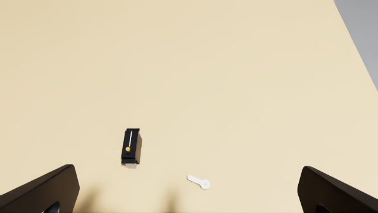
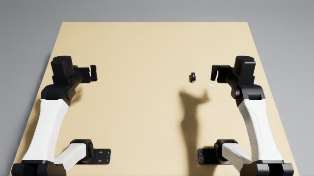
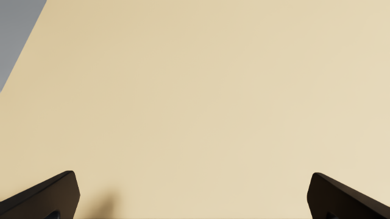
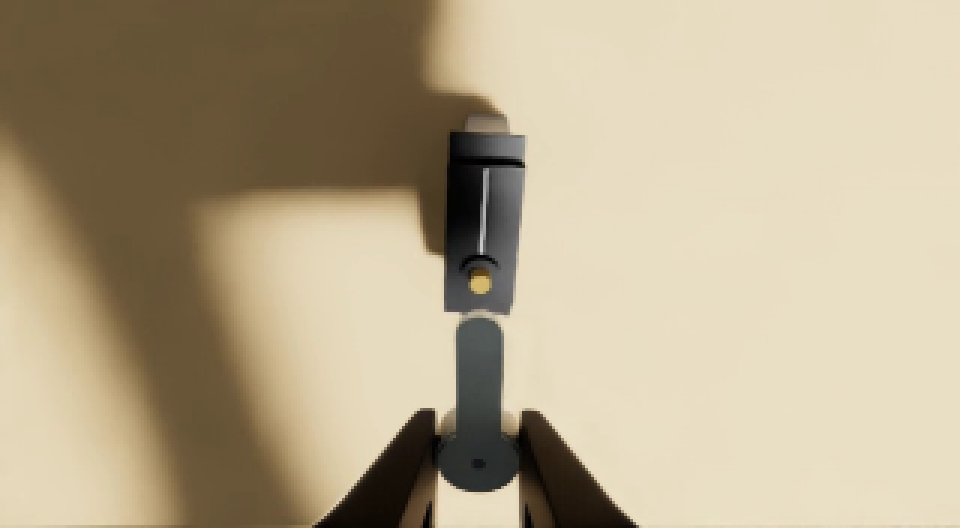
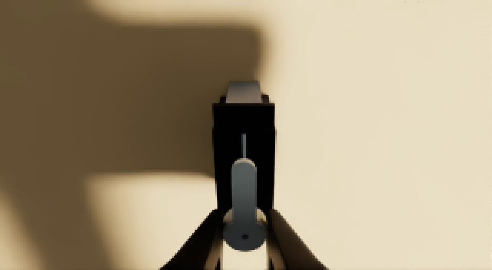
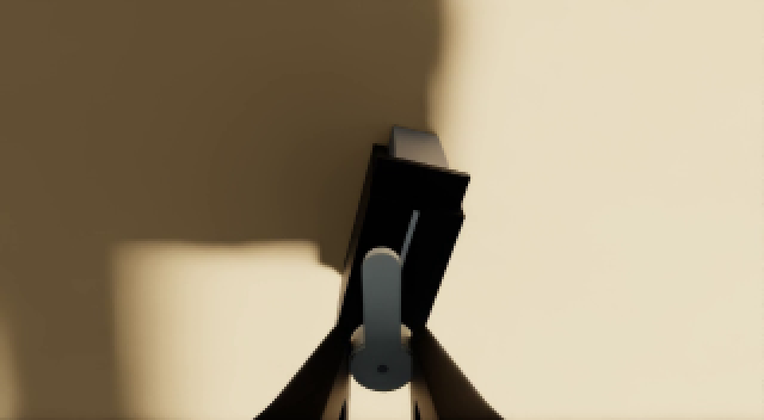

# Fit a servo horn on its splined shaft, the arm on the zero mark

Instruction given to the policy: `Fit the white servo horn onto the servo's splined output shaft with its arm lined up on the engraved zero mark, then let go.`

Files: `task.py` (scene, mechanism, rules, score), `mechkit.py` (the mechanism kit the task file imports), `demo.py` (the scripted full-score run, the lower levels, the horn put on as it was picked up, seated one tooth off, seated wrong and refitted, the hand that stays, and two checks of the press with the arm), `demo_kit.py` (the runner behind the scripted runs), `trials.py` (checks in the simulator with no arm: rest and the first pictures, the horn let fall onto the shaft, the horn pressed, pulled and set turning), `start_*.png` (the first pictures of a trial), `cue_*.png` (pictures at the size a policy gets), `README.md`.

 

The first pictures of a trial, both arms in their ready pose. The right wrist camera sees the servo's black case with its brass shaft at the near end and the white mark running from the shaft away from the arms, and the white horn standing on the bench in front of it, its arm pointing left. The top camera sees the servo and the horn small in front of the right arm; the left wrist camera sees the bench only.

## Scene

Bench coordinates in metres: x forward from the line through the two arm bases, y left from the midline, z up from the bench top. The arms' bases are at (0, -0.305) and (0, +0.305).

| Part | Size, mass | Where |
|---|---|---|
| Servo (TowerPro MG996R), black | 40.7 x 19.7 x 42.9 mm over all with the shaft, 55 g; the case top 35 mm up; mounting ears 54 mm over all, 2.5 mm thick, their undersides 27 mm up | fixed: hanging by its ears on two aluminium posts screwed to the bench, its long axis along x, its middle at (0.43, -0.22) |
| Output shaft | a brass spline 5.9 mm across with 25 teeth (14.4 degrees apart), 4.9 mm over a boss 11.5 mm across and 3 mm high; the crests' top 42.9 mm over the bench, their top edge chamfered 0.35 mm | up, 10 mm from the case's near end (towards the arms): its axis at (0.4197, -0.22) |
| Zero mark | a white line 24 x 1.2 mm engraved on the case top | from the boss outwards, away from the arms (+x) |
| Single-arm horn, white nylon, from the servo's own horn set | hub 14 mm across and 7 mm tall, its bore 6.8 mm across at the mouth; arm 28 mm from the hub's axis to its tip, 7 mm wide, 2 mm thick, its top flush with the hub's; 4 g | lying on the bench on its hub's mouth, its axis at (0.38, -0.33), the arm 68 degrees from the mark's direction (4 degrees off a tooth position) |

Nothing varies by seed. The servo and the horn lie before the right arm (the shaft 0.43 m from its base, the horn 0.38 m); the right arm does the task alone.

Sizes and sources. From sellers' listings of the maker's figures: 40.7 x 19.7 x 42.9 mm over all with the shaft, 55 g, 25 teeth. Assumed, to be measured with a caliper: the case top 35 mm up, the boss 3 mm, the spline 4.9 mm over the boss, the shaft's axis 10 mm from one end of the case, the ears 2.5 mm thick with their undersides 27 mm up and 54 mm over all, the horn's arm 7 mm wide, the chamfers of the crests' top edge and of the bore's mouth (0.35 mm at 45 degrees), the hub's cap 1 mm thick. Quoted from the earlier submission, which measured them on this servo, and not measured by us: the horn stands 3.5 mm proud when its teeth meet the shaft's crests, and seating it takes 32 N. Assumed: a seated horn comes off again under a pull of 10 N; the teeth find their gaps when the arm is within 2.0 degrees of a tooth position (the earlier build's figure).

## How the horn goes on, and what stands in for what

A real horn is put over the shaft, comes to rest on the spline's crests 3.5 mm proud and turns freely there; turned until its teeth find the shaft's gaps and pressed with 32 N it goes down, held in turn by the splines, until it is flush; pulled hard it comes off again. The simulator has no splines and no round holes, so each part of that stands on something else:

- **The horn has to be set on the shaft within the bore's play, about 0.1 mm.** Further off, it hangs on the chamfers of bore and crests or tips off the shaft (see "The checks before the script"). On the real parts the chamfers of bore and shaft guide a horn on from further away (the earlier build's figure: 0.8 mm), so the real task is more forgiving in this. The reference runs centre the horn on the shaft from the simulator's state: the script reads how far the hub's axis is from the shaft's and moves the hand by that.
- **The bore is a polygon, the teeth a square core.** The hub is twenty-four staves round its axis whose inner faces stand 3.025 mm from it (a bore 6.05 mm across, 0.075 mm a side round the 5.9 mm spline: the horn's teeth round the shaft's), a mouth chamfered at 45 degrees from 6.8 mm across down to that (sixteen plates on the cone), and the cap. From 1.4 mm over the mouth up to the cap runs a square core 3 mm across, standing for the horn's teeth and the hub's material between them: it rests on a square face on the crests' top, and passes the spline's fixed lower part as the horn goes down. The crests' top edge is four steps, not a cone (plates on a cone stand proud at their corners and caught the mouth).
- **The arm collides as its top half millimetre.** It is drawn 2 mm thick. As a solid 2 mm arm of even density it put the horn's centre of mass 3.5 mm from the hub's axis, past the crests' flat top, and a horn let go on the crests tipped over onto its arm; a real horn is held upright by its bore round the spline's top. The arm's top face, where a fingertip would press, is the same either way.
- **The crests are a body of their own on a slide.** The spline's lower part is fixed with the servo; its top 3 mm, the crests, are a separate body on a vertical slide that goes down into the fixed part, held by a stiff spring with a capped force. With the horn's arm more than 2.0 degrees from every tooth position (they are 14.4 degrees apart, the mark's among them; no shape decides it) the cap is 2,000 N: the horn's teeth stand on the crests, and a press of 40 N on the hub's top takes them 0.24 mm down, the spring's give, which comes back when the press ends. Within 2.0 degrees the cap is 32 N: pressed with more, the crests go down with the horn and stay where they are pushed; 0.2 mm down the horn is engaged (its splines have met the shaft's) and locked in turn at the angle it went in; after 3.45 mm the slide's stop holds it, flush, 0.05 mm over the boss. Pulled up with more than 10 N an engaged horn comes back up with the crests and turns freely again at the top.
- **On the crests the horn is held by joints, not by its touch.** When the horn sits on the crests within its play (its axis within 0.15 mm of the shaft's, upright within 7 degrees, its mouth within 0.3 mm of its place on the crests), whether a hand holds it or not, it is taken: in one step it is put exactly on the shaft's axis, upright and on the crests' face, and welded to a hidden disc on the crests that turns about the shaft's axis, freely (against a drag of 1 mN m) or, once engaged, locked. A press then goes through joints. Lifted 0.6 mm off the crests with more than 1 N, a horn that is not engaged is cut free. Held by its touch on the crests alone, a horn pressed off a tooth position sank into them in this simulator. A horn the hand sets on the crests is taken leaning less than a degree; one let fall on them tilted comes to rest wedged, leaning up to 5.5 degrees with its mouth up to 0.2 mm high, and righted in one step when taken there it can move the hub's top by 0.9 mm (the arm's tip by up to 3.4 mm, if it leans along the arm).
- **While it is taken on the crests the horn has 200 g of inertia; its weight stays that of 4 g.** A numerical stand-in: a 4 g body pressed with 37 N between a hand and a joint gives way in this simulator. In recording `c3u`, welded at 4 g, the horn was driven 3.7 mm down by the closed fingertips' 37 N, past the hidden disc and the crests, which went 0.15 mm. Given 200 g of inertia while it is taken, with a push that carries its weight over 4 g, it stands and goes down with the crests as built. Free (carried, let go, tipping over), the horn is 4 g. What the inertia would change on the crests, how fast a touch turns it, the drag of 1 mN m keeps as a 4 g horn's: one let go while turning at 0.5 rad/s stops within 0.1 degree, and a hand turning it feels 0.14 N at the hub's rim.
- **The grip on the hub does not carry the press; the fingertips do.** In the check `grip_check` the hand closed on the hub and pressing down slips on it at about 18 N, short of the 32 N that seat the horn. So the scripted runs let go of the horn on the crests, close the hand above it and press the hub's top with the closed fingertips.
- **At rest is read from the hub's speed.** The horn is at rest when its centre moves slower than 20 mm/s; its turn about the shaft is not counted (welded on the crests, the horn may tremble in turn without going anywhere).

## Rules

On the shaft: the hub's axis within 0.6 mm of the shaft's, upright within 8 degrees, its mouth between 0.5 mm over its place on the crests and 0.5 mm under its seated place. Engaged: the horn has gone 0.2 mm or more down within 2.0 degrees of a tooth position and is locked in turn (on a real horn: the splines have met, and the arm no longer turns when pushed gently). Down: how far the hub's mouth is under its place on the crests (3.45 mm seated).

| Score | Asked | On a real bench |
|---|---|---|
| 0 | the horn engaged with its arm more than 2.0 degrees from the mark (seated on another tooth), or not on the shaft, or none of the below | the photo from above |
| 0.25 | on the shaft, resting on the crests (down within 0.5 mm of 0), the arm within 3.0 degrees of the mark | a photo from above with a ruler laid along the mark: the arm against the mark; the arm turns when pushed gently |
| 0.5 | engaged with the arm within 2.0 degrees of the mark (on the mark's tooth), 0.5 mm or more down | the photo; the gap between the hub and the boss 3.0 mm or less (a caliper's depth rod), the arm does not turn when pushed gently |
| 0.75 | the same, 3.0 mm or more down (0.5 mm or less proud) | a 0.5 mm feeler does not go under the hub |
| 1.0 | and the horn at rest, both grippers 3 cm or more from it | the video of the release |

Only the state at the end of the trial counts: a horn seated on another tooth, pulled off and refitted on the mark's scores as it ends. A trial succeeds when the score has been 1.0 for one second; it then ends. The run limit is 1,200 steps (60 s): three times the scripted full run, 380 steps, rounded up to a hundred.

## Can it be seen

 

The right wrist camera at the size a policy gets (320 x 176), enlarged three times here. Top: run `full`, 7.85 s, the hand carrying the horn over the servo: the case, the brass shaft, the white mark and the horn's arm (held under the camera, pointing at the mark, 2.7 degrees from its direction). Below, just before the hand lets go of the horn on the crests: left, `full` (12.0 s), the arm on the mark (0.02 degrees from it); right, `wrong_tooth` (21.95 s), one tooth past it (13.84 degrees). The camera turns with the hand, so the arm stands upright in both and the case turns. On the mark, the mark's white line runs on from the arm's tip in the arm's line; one tooth past, it leaves the arm's side at 14 degrees. At this size the arm, 7 mm wide, is about 16 pixels across: 2 degrees, the window of a tooth position, moves the arm's tip by 1 mm, about 2 pixels, and a tooth's 14.4 degrees by 7 mm. From the ready pose the same camera shows case, shaft, mark and horn (the first picture above, at full size). The top camera at this size shows the servo about 6 pixels long, and the arm against the mark is not to be seen from there; the left wrist camera does not see the servo.

## The checks before the script

No arm (`trials.py`, recording `c3zg` of 2026-11-20, commit `f4afb9f`; the `press` checks made again as `c3zl` (commit `0946160`), after the change described under "Reference runs").

Rest: nobody touches anything for 3 s; the horn stays where it was built (0.0 mm).

Let fall onto the shaft from 2 mm over its place on the crests, its axis put aside (across the arm) and tilted about the arm, the arm 4 degrees off a tooth position; where it is 1.5 s later:

| Put aside | tilted 0 degrees | tilted 3 degrees | tilted 4 degrees | tilted 6 degrees |
|---|---|---|---|---|
| 0.0 mm | taken | taken | taken | taken |
| 0.4 mm | hangs on the chamfers, 14 deg, 0.43 mm high | hangs on the chamfers, 14 deg, 0.43 mm high | hangs on the chamfers, 16 deg, 0.48 mm high | hangs on the chamfers, 17 deg, 0.45 mm high |
| 0.7 mm | hangs on the chamfers, 29 deg, 0.84 mm high | hangs on the chamfers, 17 deg, 0.49 mm high | tips off the shaft (44 deg) | hangs on the chamfers, 28 deg, 0.89 mm high |
| 0.8 mm | tips off the shaft (44 deg) | tips off the shaft (46 deg) | tips off the shaft (47 deg) | tips off the shaft (45 deg) |
| 0.9 mm | tips off the shaft (47 deg) | tips off the shaft (53 deg) | tips off the shaft (46 deg) | tips off the shaft (44 deg) |
| 1.2 mm | tips off the shaft (52 deg) | tips off the shaft (45 deg) | tips off the shaft (46 deg) | tips off the shaft (46 deg) |

Only a horn set within the bore's play goes on: from 0.4 mm aside it hangs on the chamfers of bore and crests, from 0.7 mm it may tip off the shaft, and from 0.8 mm it does. Let fall on the axis tilted 3 and 4 degrees it lands wedged and leaning, 3.0 to 5.5 degrees with its mouth 0.08 to 0.2 mm high (the checks that set the limits for taking it); step by step (`drop_trace`), both are taken at the first control step after they are let go, and then stand on the axis, upright (tilted 0.00 and 0.00 degrees a second later).

Pressed down along its axis on the crests for 2 s, through the hub's top (the horn's own weight included), then let be for a second:

| Arm | Press | Down while pressed | A second after |
|---|---|---|---|
| on the mark's tooth | 20 N | 0.116 mm | 0.000 mm |
| on the mark's tooth | 30 N | 0.173 mm | 0.000 mm |
| on the mark's tooth | 31 N | 0.179 mm | 0.000 mm |
| on the mark's tooth | 34 N | 3.463 mm, engaged | 3.450 mm, engaged |
| on the mark's tooth | 40 N | 3.466 mm, engaged | 3.450 mm, engaged |
| 3 degrees from it | 40 N | 0.231 mm | 0.000 mm |
| 3 degrees from it | 60 N | 0.347 mm | 0.000 mm |

Pressed home and then pulled up along its axis for 2 s: with 8 N it stays home (3.447 mm down, engaged); with 12 N it comes up with the crests and off them; the pull then ends, and it falls back onto them and is taken again (0.000 mm, not engaged). Set turning at 2 rad/s about the shaft: resting on the crests it stops at once (the arm 0.04 degrees from where it was, a second later); pressed home it does not turn (-0.02 degrees).

With the arm (recording `c3zk`): the spec's check, whether the hand's grip on the hub carries the press, is `grip_check`; it does not: the grip slips at about 18 N. So the scripted runs press with the closed fingertips on the hub's top after letting go (`top_check`: off a tooth position the horn stands under 34 to 40 N, 0.21 to 0.24 mm down; on the mark's tooth it goes home, `full`).

## Reference runs

Scripted, recording `c3zf` of 2026-11-20 (commit `f4afb9f`), 20 Hz; `grip_check` recorded again as `c3zk` (commit `0946160`) and `refit` recorded again as `c3zm` (commit `5220bd9`) after a change to how a seated horn comes off when it is yanked (it comes free in the control step it passes the crests, not one step later) and to `refit`'s pull and second fit; the other runs never lift the crests (0.003 mm at most), which is all that change touches. The right hand, pointing straight down and open, comes down over the horn's hub with its fingers across the hub, closes on it with its grasp point 15 mm over the bench, lifts it 6 cm, carries it over the shaft, turning it so that the arm lies on the mark (one tooth, 14.4 degrees, past it in `wrong_tooth` and in the first fit of `refit`; not turned in `as_picked`), and lowers it onto the crests. There it turns the horn by what the arm is off (to within half a degree, three turns at most) and moves it sideways by how far the hub's axis is off the shaft's (to within 0.03 mm, six moves at most), twice. It lets go slowly (1.2 s), rises 15 mm, closes, comes down onto the hub's top and presses along the shaft with its fingertips: 40 N asked for at first, 2 N more every tenth of a second up to 50 N, until the horn is 3.3 mm down. Home, it holds 0.3 s, eases off, opens, goes up 8 cm and stays there.

What the script reads from the simulator: how far the horn is down, how far its arm is from where it should be, and how far the hub's axis is from the shaft's. A person sees the arm against the mark and feels the horn go down and stop; the hub's axis to a tenth of a millimetre is the simulator's state, which a person would feel as the hub dropping onto the shaft. The script does not read whether the horn is taken or engaged, and not the score.

| Run | What it does | Score | What the recording shows |
|---|---|---|---|
| `full` | puts the horn on with its arm on the mark, lets go, presses it home on the hub's top | 1.0 | taken on the crests at 11.95 s, the hand still holding it; the arm 0.02 degrees from the mark before the fingers open and -0.07 after, -0.07 while the hand closes and comes down onto the hub; engaged at 16.25 s with the fingertips pressing 35.4 N (the arm -0.07 degrees from the mark), home at 3.49 mm; it ends 3.45 mm down, the arm -0.10 degrees from the mark, the hand 92 mm away: 1.0 at 18.05 s, success after 19.0 s (380 steps) |
| `half_way` | as `full`, but the press starts at 31.5 N and grows 0.1 N every 0.2 s, and stops 1.2 mm down | 0.5 | the crests gave way under 32.6 N asked and the horn was engaged at 21.95 s; the press stopped at 32.8 N and the horn ends 1.62 mm down, the arm 0.46 degrees from the mark, engaged: 0.5 mm or more, short of 3 mm |
| `as_picked` | puts the horn on the crests turned as it was picked up, lets go, does not press | 0.0 | taken on the crests at 18.6 s; it ends resting on them with the arm 70.16 degrees from the mark (1.84 degrees from tooth position 5) |
| `wrong_tooth` | as `full`, with the arm one tooth (14.4 degrees) past the mark | 0.0 | let go with the arm 15.85 degrees from the mark; pressed, engaged at 26.15 s on the next tooth (1 from the mark's) and home; it ends 3.45 mm down, the arm 15.99 degrees from the mark: seated on another tooth |
| `refit` | as `wrong_tooth`; then opens round the seated hub, closes on it and pulls it straight up off the shaft, harder every tenth of a second until the hub's mouth is 2 mm clear of the crests; then stops pulling and goes 3 cm up, turns it onto the mark, centres it over the shaft 4 mm above its place, puts it on and presses it home | 1.0 | seated one tooth past (engaged at 18.05 s, the arm 14.58 degrees from the mark); pulled up, it came off the crests (1 time) at 11.9 N on the wrist and came away in the fingers; put on again on the mark and taken at 34.6 s, let go at -0.02 degrees, engaged at 39.95 s and home; it ends 3.45 mm down, the arm -0.03 degrees from the mark: 1.0 at 41.75 s, success after 42.7 s |
| `rest` | puts the horn on with its arm on the mark, lets go, does not press | 0.25 | taken on the crests at 12.4 s; it ends resting on them, 0.00 mm down, the arm -0.01 degrees from the mark |
| `held` | as `full`, but the closed hand stays on the hub's top | 0.75 | engaged at 25.25 s and home; it ends 3.48 mm down, the arm -0.15 degrees from the mark, the hand's grasp point 12.8 mm from the horn (3 cm asked for 1.0) |
| `grip_check` | the check of the grip: the hand, closed on the hub, presses 34, 37 and 40 N, 2 s each, the arm 4 degrees past the mark (off any tooth position, so that the crests do not give) | 0.0 (not a level) | the grip slips at about 18 N: the fingers slide 8.5 mm down the hub and past its mouth until their tips stand on the case's top, which carries the rest of the press; the crests are pressed 0.07 mm down, about 13 N of the wrist's 37 N. Eased and opened, the fingers drag the horn up off the crests and it is left tipped, 13 degrees |
| `top_check` | the check of the fingertips' press: as `grip_check`, but the hand lets go, closes and presses on the hub's top | 0.0 (not a level) | taken on the crests, let go with the arm 3.89 degrees from the mark; under 34, 37 and 40 N on the hub's top (the wrist reads 33.6, 36.7 and 39.7 N) the horn stands 0.21, 0.23 and 0.24 mm down, the crests' give, not engaged; eased, it is back at 0.00 mm |

Contact sheets looked at: the right wrist and top cameras of `full`, the right wrist camera of `held`, `grip_check` and `refit`. In `full` the right wrist camera shows the hand take the horn off the bench, carry it over the servo with the arm pointing at the mark, set it on the shaft with the arm along the mark, let go, close and come down onto the hub's top; at the end the hand is up and the horn sits on the shaft, its arm along the mark. The top camera sees the servo small under the right arm, and the hand over it hides the horn while it works. In `held` the closed hand stays on the hub's top to the end. In `grip_check` the closed fingers press down round the hub; in `refit` the hand pulls the seated horn straight up, turns it over the shaft and sets it on again.

## Limits and readings

| Limit in the score | Reading in the full-score run | Run that shows the limit |
|---|---|---|
| on the shaft: the hub's axis within 0.6 mm of the shaft's, upright within 8 degrees | 0.000 mm, 0.00 degrees | none: tests by state (0.59 and 0.61 mm; 7.9 and 8.1 degrees) |
| resting on the crests (down within 0.5 mm of 0) with the arm within 3.0 degrees of the mark: 0.25 | (seated at the end) | `rest` (0.25: 0.000 mm, -0.01 degrees); `as_picked` (0: 70.2 degrees) |
| engaged with the arm more than 2.0 degrees from the mark: 0 | -0.10 degrees | `wrong_tooth` (0: 15.99 degrees) |
| engaged on the mark's tooth, 0.5 mm or more down: 0.5 | 3.45 mm | `half_way` (0.5: 1.62 mm) |
| 3.0 mm or more down: 0.75 | 3.45 mm | `half_way` (under 3 mm: 0.5) |
| at rest: the hub's centre slower than 20 mm/s | 0.0 mm/s | none: tests by state (19 and 21 mm/s) |
| both grippers 3 cm or more from the horn | 92 mm | `held` (0.75: 12.8 mm) |

Each level the reference reaches short of 1.0 is met with room: `half_way` ends 1.62 mm down, 1.12 mm past the 0.5 mm of 0.5 and 1.38 mm short of the 3 mm of 0.75; `rest` ends with the arm 0.01 degrees from the mark (3 asked); `held` keeps the hand 12.8 mm from the horn (30 mm asked for 1.0). The runs that end engaged on the mark's tooth end 0.03 to 0.46 degrees from it (2.0 asked).

## States set directly

`tests/test_servo_horn.py` sets every state without the simulator: the scene as specified (sizes, places, the mark, the horn's start 68 degrees from the mark, 4 degrees off tooth position 5); the hub's staves, the mouth's 45 degree plates, the core and the crests' face and steps, at their sizes; resting on the crests scores 0.25 only with the arm within 3 degrees of the mark (2.9 and 3.1 degrees, 68, 14.4), on the shaft within 0.6 mm (0.59 and 0.61 mm) and 8 degrees (7.9 and 8.1), not lifted 0.6 mm; engaged on the mark's tooth scores 0.25, 0.5 and 0.75 by how far it is down (0.49, 0.51, 2.99, 3.01 mm), and 0 when the arm is more than 2.0 degrees from the mark (1.9 and 2.1 degrees, one tooth, half a turn); 1.0 needs the horn slower than 20 mm/s (19 and 21) and both grippers 3 cm away (29 and 31 mm); a horn seated wrong, pulled off and refitted scores as it ends; the nearest tooth position and the 2 degree window for every tooth position; the report gives the numbers behind the score.
