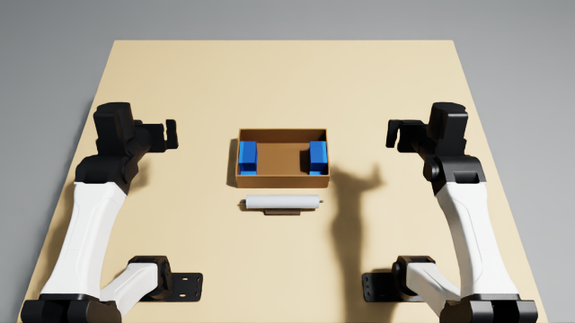

# Lift two nested foam end-caps out of a carton, fit both onto a steel roller on the bench, and lower it suspended

Instruction: `Take both blue foam end-caps out of the shipping carton, fit one onto each end of the steel roller on the bench, and lower the roller with both end-caps together into the carton so the roller rests suspended off the floor.`

Files: `task.json`; `task.py` (rules, `score()`); `scene.py` (bodies); `parts.py` (figures, sources); `checks.py`, `trials.py`, `demo.py`; `test_endcap_pack.py`; kit (`mechkit.py`, `demo_kit.py`, `kit_extra.py`); `start_top.png`, `start_top_policy.png`, `start_left_wrist.png`, `start_left_wrist_policy.png`, `start_right_wrist.png`, `start_right_wrist_policy.png`, `end_top.png`, `end_top_policy.png`.



## What the task tests

- **Double-ended kitting lockout.** Rollers ship in corrugated cartons on foam end-caps (`"Fit foam end caps or cradles to isolate journals and protect roller edges"`, `"Inside, the roller is held on cradles or end blocks so the body stays suspended"` [astra]), and pre-assembled shipper kits ship with inserts in the carton (`"Pre-assembled kit includes carton, can, lid, foam inserts and locking ring."` [kit]). Nested at the ends of the 254.0 mm carton, the two 46.0 mm caps leave 162.0 mm so the 200.0 mm roller (226.0 mm over its 8.0 mm spindles) cannot enter. Removing one cap and plugging the roller 21.0 mm into the other leaves 29.0 mm to the far wall (16.0 mm past the spindle), wedging the 46.0 mm second cap above the rim (`one_cap_jam_zero`: 81.2 deg tilt, 31.8 mm over rim, score 0.0).
- **Slip-on fit and carry.** Each 45.0 mm socket has 2.5 mm/side clearance on the 40.0 mm tube (friction 0.20) with no snap, weld, or lip. Lifting by one cap alone tips the 400 g roller past static friction (`atan(5/21) = 13.4 deg > atan(0.20) = 11.3 deg`) so the unheld cap separates under gravity (`one_hand_lift_quarter`: 0.5 -> 0.25). After taking both caps out and fitting them on the bench cradle (250.0 mm span), lowering the unit over the 80.2 mm wall into the 254.0 mm carton (2.0 mm/side clearance) is easiest with both hands squeezing the caps inward, suspending the roller 16.0 mm off the floor.
- **Grasps, shortcuts, stand-ins.** In the demo, the hands pinch the 72.0 mm x-wide blocks from above (`<= 94 mm` jaw, 40.2 mm room/side to front/back walls, 0 mm on +/-y faces, height `<= 148 <= 160 mm`, 24-25 N/finger `<= 40 N`). Dropping the roller onto nested caps or removing one cap scores 0.0; dropping the bare roller on the carton floor (`gap = 0 < 10 mm`) scores 0.25. Stand-in: blue PE caps are rigid blocks at a 23.3 g mass stand-in (true 1.7 lb/ft3 cap is 6.3 g; no rule reads cap mass), omitting foam give while keeping the 162 < 200 / 29 < 46 mm lockout and 4.0 mm wall capture. States set directly: none in `demo.py`, `bench_mated_half`, or `one_hand_lift_quarter`; `write_pose` sets start states only in `off_bench_zero` and `one_cap_jam_zero`.

## Rules and score

- **0.0 for good:** roller or cap falls off the bench (`z < -10.0 mm`; video). Also 0.0 unless both caps are lifted clear of the carton together (`0.2 s` = 4 steps; video).
- **0.25:** both caps extracted clear of the carton at least once.
- **0.5:** both caps extracted and fitted coaxially onto opposite ends of the roller (`>= 12.0 mm` inside each `21.0 mm` socket, radial `<= 6.0 mm`, angle `<= 10.0 deg`).
- **1.0:** both caps upright on the carton floor (`tilt <= 6.0 deg`, bottom within `4.0 mm` of floor, top `<= 82.2 mm`), roller `>= 14.0 mm` in both sockets (`radial <= 5.0 mm`, `angle <= 10.0 deg`, `tilt <= 5.0 deg`), roller underside **`>= 10.0 mm` clear above the carton floor** (`0 N` roller-carton contact; 10 mm bar passes underneath), and both hands `>= 30.0 mm` clear for `1.0 s` (20 steps, `<= 2.0 mm` drift). Run limit: 1,200 steps (60 s at 20 Hz).

## Key figures and their sources

| Figure | Value | Source |
|---|---|---|
| Carton inside L x W x H | 254.0 x 152.4 x 76.2 mm | maker: ULINE S-4600, `"10 x 6 x 3\" Corrugated Boxes"`, `"C flute"`, `"200 LB. TEST"` [box] |
| Carton wall | 4.0 mm | estimate: nominal single-wall C-flute caliper [box] |
| Roller OD, tube length | 40.0 mm, 200.0 mm | listing: RS 761-3149 (`RD-17W1JF4EAB RL200`), `"Roller Diameter: 40mm"`, `"Roller Length: 200mm"` [roller] |
| Spindle OD, overall length | 8.0 mm, 226.0 mm | listing: RS 761-3149, `"Spindle Size: 8 mm"`, `"Spring Loaded"`, `"Overall Length: 226mm"` (13.0 mm/end) [roller] |
| Roller mass | 400 g | estimate: Series 1700 40 x 1.5 x 200 mm steel tube (285 g) + 8 x 226 mm shaft (89 g) + two 6002 housings (26 g) |
| Blue PE plank density, colour | 27.2 kg/m3 (`"1.7LB"`), `"Blue"` | listing: Foam Factory `"Polyethylene Foam - Blue"`, `"1.7LB Density Blue Polyethylene"`, `"2\" x 48\" x 108\""` [foam] |
| Cap T x base/top W x H | 46.0 x 104.0/72.0 x 74.0 mm | our fixture: cut from 2 in blue PE plank [foam]; side reliefs per [guide] (`"Finger or thumb cut-outs beside a cavity make removal easy"`) |
| Socket bore, depth, z; pocket | 45.0 x 21.0 mm, z = 38.5 mm; 20 x 20 x 15 mm | estimate & our fixture: 2.5 mm/side is our easy-removal choice (`"Cavities are normally cut slightly larger than the part so it can be placed and removed easily but cannot move."` [guide]) |
| Cap mass | 23.3 g (stand-in; true PE 6.3 g) | estimate: sim stand-in for 25 N rigid pinch (233 cm3 x 27.2 kg/m3 = 6.3 g; no rule reads cap mass) |
| Socket & kraft friction | 0.20; 0.45 | estimate: zinc-plated steel on LDPE (0.18-0.25); kraft on PE (0.35-0.55) |
| Cradle (x = 222 mm); carton (360 mm) | 56 x 100 x 22.5 mm (24 mm rail gap) | our fixture: 3-4-5 rails hold 40 mm roller coaxial at z = 38.5 mm with 50 mm overhang/end |

`parts.FIGURES`: 3 maker, 5 listing, 15 our fixture, 6 estimate. Occupations: O*NET 53-7064.00 (`"555,500 employees"`, `"Assemble, line, and pad cartons, crates, and containers"` [onet1]) and 53-7062.00 (`"2,940,300 employees"`, `"Pack containers"` [onet2]).

## First minutes of a real trial

Check (~5 min): calipers on S-4600 inside sizes (1 min), RS 761-3149 tube/spindle lengths (1 min), and cap thickness, 45 mm bore, and 21 mm shoulder (1 min); scale on roller (~400 g) and cut blue PE caps (~6.3 g) (1 min); protractor-app tilt of one slip-on cap (~11 deg slip) and a 10 mm bar slid under the packed roller in the carton (1 min).

## Forces and checks

| Force / support | Primitive (`scene.py`) | Acts on | Reaction on | Demo (`gp_g3c`) |
|---|---|---|---|---|
| Pinch across x (72 mm) | Gripper PD + `GRIPPY` | `cap_l`, `cap_r` +/-x | Finger pads | 23.9-24.6 N/finger (peak 25.2 N; drive <= 4 %) |
| Carry squeeze | IK bias (`y = +/-95 mm`, 3.4 deg) + contact | `roller` ends & underside | `cap_l`, `cap_r` sockets | `cap_roller_N` = 2.0-3.3 N/end (`z = 38.6..133.0 mm`); engage 20.4-21.0 mm |
| Seated suspension | Rigid contact | `roller` (3.92 N) | `caps` (2.09 + 1.84 = 3.93 N) -> `carton` floor (4.38 N) | `roller_carton_N` = 0.00 N; `roller_floor_gap` = 15.99 mm |

Checks: 11 rule tests pass. Reach (`checks.py`): 22/22 poses IK `<= 0.07 mm`, margins `>= 7.4 deg` (`demo --quick` `>= 7.8 deg`), carton clear `>= 5.4 mm`, hand hulls `>= 22.3 mm` apart (`TCP >= 203 mm`). Idle (`gp_g1`): settles `<= 0.50 mm`, score 0.0. Trials (`gp_g2c`): `off_bench_zero` 0.0, `one_cap_jam_zero` 0.0, `bench_mated_half` 0.5, `one_hand_lift_quarter` 0.5 -> 0.25. Demo (`gp_g3c` / `gp_rec1`): **1.0** in 454 steps (22.70 s; 0.25 at 5.4 s, 0.5 at 9.8 s, 1.0 at 19.8 s), engage 18.5/20.7 mm, gap 15.99 mm, tilts 0.00 deg, hands 208.6 mm clear.

## Can it be seen

At `320 x 176` (`start_top_policy.png`, `end_top_policy.png`), the blue caps contrast against the brown carton, the steel roller against the dark cradle, and at the end the empty cradle and shadow gap under the suspended roller are clear.


## How this task differs

Nearest accepted tasks: *Pack a parcel following a printed packing plan* places plain boxes in an open tray without sockets or lockout; *Carry a stack of three boxes as one with both arms* squeezes a pre-stacked column onto an open shelf without extracting nested cushions, mating spigots on the bench, or lowering into a 2 mm/side box to suspend a payload; *Fit a U-joint cross longer than its yoke's ear gap* tilts one cross in fixed ears; *Change a toilet roll on a spring spindle held by one end* compresses a spring rod. In *RoboDojo: Pack Objects Into Box*, *BEHAVIOR-1K*, and *RoboCasa*, no task clears a 2-way nested-cap lockout, fits unlatched slip-on end-caps outside, and lowers the unit suspended.

## Assets and how to run

Procedural `mechkit` primitives (`box`, `cylinder`) only; no external meshes, textures, or sounds.
Links: [box] https://www.uline.com/Product/Detail/S-4600/Corrugated-Boxes-200-Test/10-x-6-x-3-Corrugated-Boxes ; [kit] https://www.uline.com/Product/Detail/S-7347/Paint-Cans-and-Shippers/1-x-1-Quart-Foam-Shipper-Kit ; [roller] https://uk.rs-online.com/web/p/conveyor-rollers/7613149 ; [astra] https://www.astraroll.com/AstraRoll-Roller-Packaging.html ; [foam] https://www.thefoamfactory.com/closedcellfoam/polyethylene.html ; [guide] https://foampackage.com/guides/preparing-a-foam-insert-drawing ; [onet1] https://www.onetonline.org/link/summary/53-7064.00 ; [onet2] https://www.onetonline.org/link/summary/53-7062.00 .

Run (`--seed 0` -> seed `1415158438`, fixed start; <= 60 s, demo 22.7 s):

```bash
inspect-robots run --embodiment yam_arena --policy dream \
  -E task=mech/tasks/endcap_pack/task.py -E object_jitter=0 -E control_hz=20 -E cam_width=320 -E cam_height=176 \
  --instruction "Take both blue foam end-caps out of the shipping carton, fit one onto each end of the steel roller on the bench, and lower the roller with both end-caps together into the carton so the roller rests suspended off the floor." \
  --scorer task_score --max-steps 1200 --seed 0 --no-prompt --store-frames --log-dir <log_dir>
```
