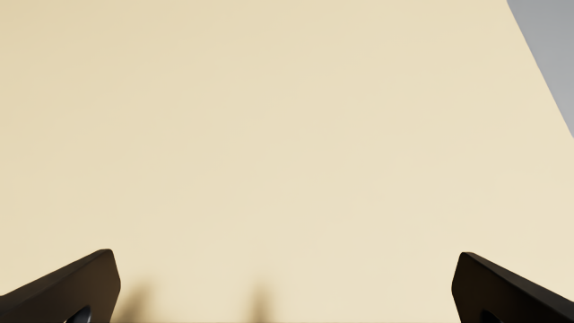
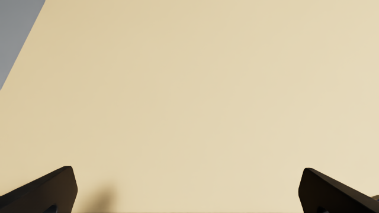
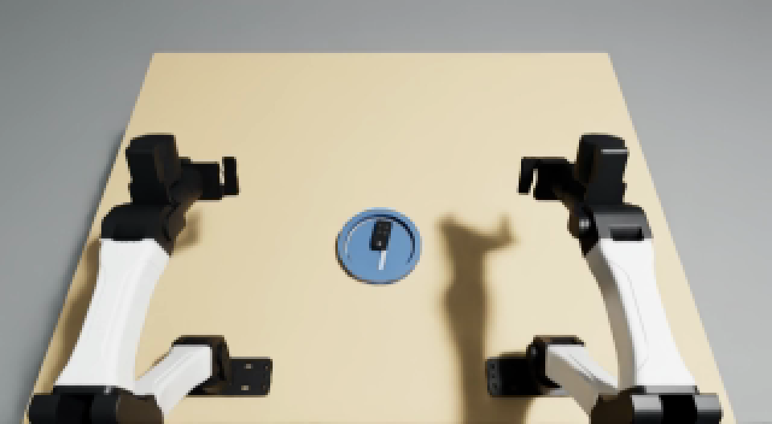
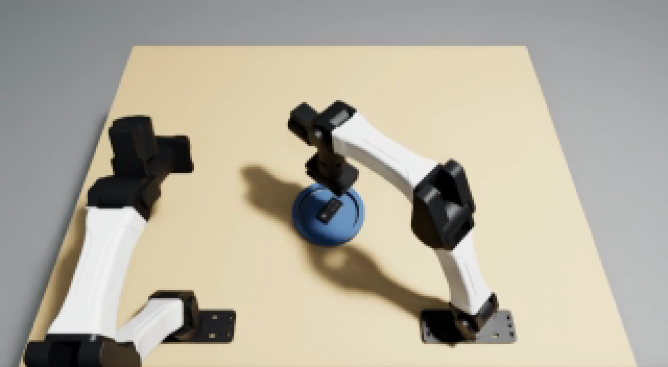

# Fold a car's flip key shut in the hands: release button held in, blade swung home until it latches

Instruction given to the policy: `Fold the car key shut and put it back in the tray.`

Files: `task.py` (scene, mechanism, rules, score), `mechkit.py` (the mechanism kit the task file imports), `demo.py`
(the scripted full-score run), `demo_kit.py` (the runner behind it), `trials.py` (checks in the simulator with no
arm: rest and the first pictures, the mechanism under known loads), `checks.py` (the grasp and reach checks without
the simulator: arm IK and the hands' collision hulls), tests in `tests/test_flip_key.py`.

 

The first pictures of a trial (seed 0), both arms in their ready pose: a round blue key tray in the middle of the
bench, the black key fob in it, buttons up, its steel blade folded out.

## What is hard

The blade folds only while the release button on the fob's face is held in; pushed without it, it does not move,
and let go short of the catch, its spring flicks it open again. One hand must hold the fob with a pad on the button
while the other swings the blade half a turn round its pin, and the fob must change hands before the button is let
out: the hand that pushed the blade home closes across the fob, one pad holding the blade in, and only then does
the other hand open, so that the pawl drops into the blade's notch. All of it in the air, not on the bench.

## Scene

Bench coordinates in metres: x forward from the line through the two arm bases, y left, z up from the bench top.
The arms' bases are at (0, -0.305) and (0, +0.305).

| Part | Size, mass | Where | Source |
|---|---|---|---|
| Car key: Kia folding key (Kia Soul, 4-button remote, manual code SK3), the fob | 70 x 34 x 16 mm, 35 g, black | in the tray, buttons up, lying flat | (a) |
| the blade | steel, 60 x 9 x 2.5 mm, 9 g; its pin 5 mm from its root end, 55 mm from the pin to the tip | folded out, in line with the fob | (a) |
| the release button | 10 mm round, 1.2 mm proud of the face when out; its middle 24 mm from the fob's middle towards the pin end, on the fob's centre line | on the fob's face beside the pin | (a): its place is taken from the bought key |
| Key tray: Fiesta 7 1/4 in salad plate in Turquoise glaze | about 184 mm across, floor about 150 mm, 20 mm high (a); as built: a round ceramic dish, floor 150 mm, rim 180 mm, 20 mm high, straight wall, mid-tone blue | its middle at (0.28, 0) | (a): to be measured on the bought plate |

(a): assumed, to be measured on the bought part (owner's bench test below).

The open key is 116 mm long (fob 70 mm, blade 46 mm beyond it): it lies flat only in a tray with a floor wider than
that at any turn, hence 150 mm. The open key's middle lies on the tray's middle.

## Setup

What varies by seed: the key's turn about the vertical through the tray's middle, 115 to 200 degrees (the fob's long
axis, pin end, measured from +x towards +y). The scripted plan was dry-run at both ends of the band (115.1 and 200.0
degrees: right arm's smallest joint margin 9.3 degrees); a turn of 104.7 degrees left 2.5 degrees on the right
wrist and 95 degrees failed, so the band stops at 115. Seed 0 turns the key 169.1 degrees. Under the harness,
`--seed 0` gives the task the trial seed 1415158438 (inspect-robots 0.60.0), which turns the key 174.9 degrees; the
scripted plan passes its dry run there too.

Reset (about 1 minute): fold the blade out until it latches open, set the tray on its mark on the bench (its middle
within 5 mm), lay the key in it buttons up at the seed's turn, its open length centred on the tray; check with a photo from above against the seed's start picture (the
key's turn within 5 degrees, its middle within 5 mm of the tray's middle).

## How it is built

The fob is one free body. The blade turns on a hinge to the fob at its pin, from open (0) to folded (180 degrees),
with end stops; it is built standing out sideways (90 degrees) so that its stops lie at -90 and +90 degrees of
travel. The release button slides into the fob on a sprung slide.

| Part | Value | Source |
|---|---|---|
| blade hinge | free 0 to 180 deg, end stops at both ends | geometry |
| blade spring | torsion, towards open: 0.02 N m open, 0.05 N m folded (0.00955 N m/rad) | (a); bench test 2 |
| pawl | holds the blade at 0 and at 180 deg while the button is out (the scene's stops hold any load; the real pawl about 0.6 N m) | (a); bench test 2 |
| release button | slide 1.2 mm; 2 N out, 4 N fully in | (a); bench test 1 |
| pawl lifted | button in 0.9 mm or more | (a) |
| pawl catches | button out and the blade within 3 deg of an end | geometry |

The pawl is the blade hinge's pair of stops, moved once per control step: with the button in 0.9 mm or more, the
stops sit at the blade's two ends and it turns freely; with the button out, the stops close round the blade (0.5
degree of play) at whichever end it is within 3 degrees of; anywhere else it rides on the blade's boss and the spring
turns the blade until a notch comes under it.

## What stands in for what

- The blade's spring is a torque computed every control step from the blade's angle and put on the blade and,
  opposite, on the fob: a simulator spring whose rest lies 120 degrees beyond open turns the wrong way past half a
  turn of difference (it wraps), and a stop at exactly half a turn from the built pose wraps too (run w9b: the key
  was thrown). The torque is the spring's figure at the angle; it changes slowly with the angle, so the 20 Hz update
  does not change it.
- The blade and the button move with the inertia of 50 g and 20 g (real 9 g and 1 g); their weight over the real one
  is carried by an upward push. A light part pressed between a hand and a joint gives way in this simulator.
- The blade's hinge has a damping of 0.0006 N m s/rad, about half of critical: the real blade stops at its stop, it
  does not ring.
- The pawl is the hinge's stops, not a part: its strength is not modelled (the stops hold any load). The difficulty
  stays: nothing in the scene lets the blade move without the button held in.

## Score

By the state at the end of the run, and over the whole trial for "left the bench", "picked up" and "swung home in the
hands":

- 0 if a part of the key has been 2 cm or more under the bench top at any moment.
- 0.25 if the blade is folded and latched but was swung home with the key lying in the tray or on the bench: on the
  last step on which the blade came within 3 degrees of folded from further open, the fob's middle was less than 2 cm
  over where it lay at the start. That is the shortcut of a fold on the bench (one hand presses the button from
  above, the other swings the blade round): it skips the fold in the air and the hand-over (rule tests below).
- 1.0: blade folded and latched (the pawl in the folded notch), swung home in the hands (the fob's middle 2 cm or more
  over its start when the blade came within 3 degrees of folded), the key in the tray (its middle within the floor's
  edge and no more than 20 mm over the floor's top), at rest (fob and blade tip slower than 20 mm/s over the last 0.25 s), both grippers 3 cm
  or more from the key.
- 0.5: the same, with the key anywhere else on the bench.
- 0: the blade open at the end (the pawl in the open notch).
- 0.25: the key picked up (its middle 2 cm over where it started) and the blade turned 90 degrees or more towards
  folded at some moment, the 1.0 and 0.5 conditions not met (the blade held part-folded, or the folded key still
  held).
- 0 otherwise.

On the real bench: tug the blade's tip with 2 N without pressing the button (a kitchen scale): it stays in; a photo
from above for the tray; the trial video for "swung home in the hands" (the key held clear of the tray and the bench
when the blade reached its folded end), for "picked up", the hands and the bench.

A blade forced against the closed pawl does not move (the scene stops it: trial below, 5 N at the tip). It is not
scored as damage: no bench reading of damage exists.

Run limit: 1,900 steps (95 s at 20 Hz), about three times the full-score run (620 steps).

## Can it be seen

The top camera at the size a policy gets (320 x 176), enlarged three times, frame 0 and the last frame of the
recording `w9r2`. A pixel is about 5 mm at the tray: open, the light blade shows as a strip of about 9 pixels beside
the black fob (14 pixels) on the blue tray; folded, the key is a black block with no strip. From a wrist camera 10 to
15 cm away (about 1 pixel per mm) the blade is 9 pixels wide (start_right_wrist.png). The pawl's catch itself is not
seen; it is read on the bench by the tug (Score).

## The grasps

| Grasp | Hand | Figures | IK, joint margin |
|---|---|---|---|
| the fob across its width (34 mm), pointing down, grasp point 6 mm over the fob's middle plane (fingertips 1 mm over its underside) | right | 34 mm of 94 | 0.06 mm, 18.9 deg (held level at the fold place) |
| the fob across its thickness (16 mm), hand LEVEL, the upper pad on the button, 12 cm over the bench at (0.25, -0.04), approach 105 deg right of forward | left | 16 mm of 94; the pinch presses the button in (bottomed: 1.20 mm, recording) | 0.02 mm, 14.0 deg (5.0 deg on the level wait beside it) |
| the blade's trailing edge under the rear finger's pad of the open hand (70 mm), 40 mm from the pin, over the whole half turn | right | the wrist turns 180 deg: joint 6 from +94 to -99 deg | 0.08 mm, 17.2 deg or more |
| the fob across its width over the folded blade, one pad on the blade's edge | right | 34.3 mm | in the dry run of the whole plan: right arm 0.1 mm at worst, smallest margin 9.3 deg (over the blade's start) |

A level pinch across the fob's thickness is in reach only about 12 cm over the bench near x 25 cm, from a few
directions (at 8 cm nearly nowhere): `checks.py`. Both hands' hulls over the whole swing: 8.3 mm apart at the
closest (at the start of the swing), the hand-over 16.4 mm, the close over the fold 11.9 mm.

## The checks before the script

No arm (`trials.py`, runs w9a to w9d of 2026-11-20): at rest nothing moves more than 0.006 mm in 3 s. Without the
button, 0.11 and 0.28 N m towards folded (2 and 5 N at the tip) leave the blade at 0.5 degrees (the pawl's play).
The button pressed with 3 N goes in 0.625 mm (the pawl stays down: 0.9 mm lifts it), with 4.5 N 1.202 mm (bottomed,
the pawl lifted), with 50 N 1.202 mm. With the button in, 0.03 N m towards folded holds the blade at 60.0 degrees:
the spring as read in the scene (0.02 + 0.00955 x 1.047 rad = 0.030 N m). A fold torque of 0.10 N m on a fob that
nobody holds slams the blade into its stop and throws the fob (w9d): a load of the trial, not of the key; the fold
is shown with the hand's own push in the recording.

## Reference run

Scripted, recording `w9r2` of 2026-11-20 (commit `08380ef`), seed 0 (key turned 169.1 degrees), 20 Hz. What the script
reads: the key's start from the seed (a layout constant), nothing else; it is open loop.

| Run | What it does | Score | What the recording shows |
|---|---|---|---|
| `full` | right hand takes the key across the fob, turns it level to the fold place; left hand, level, pinches the fob with its pad on the button; right hand lets go, opens 70 mm and swings the blade home with its rear finger, closes across the fob over the blade; left hand lets go and draws back; right hand sets the key in the tray | 1.0 | button in at 10.05 s (pawl lifted); the blade home in the hands at 21.50 s (the fob 104 mm over its start); button out at 22.90 s with the blade at 180.4 deg: the pawl in the folded notch; 1.0 from 30.05 s; 620 steps (31.0 s); fob and tip at 0.0 mm/s at the end; worst IK 0.08 / 0.1 mm |

Contact sheets looked at (top, both wrists): the right wrist sees the key and its blade in the tray, the pick and the
turn; the blade beside the pushing finger at 50 and 120 degrees; the blade home at 20.6 s; the folded key lying in
the tray, buttons up, at 30.6 s (the same as in `w9r`, the recording before the rule 'swung home in the hands'). From
above the hands hide the fold; the tray and key show at the start and the
folded key in the tray at the end. Frame 0 shows the tray and the key.

## Model run

Dream-1 (`dreamlabs/dream-1-beta`), run `w9m` of 2026-11-20, the task file of commit `c3007bd` with its instruction,
`--seed 0` (trial seed 1415158438: the key turned 174.9 degrees), over the whole run limit: 1,900 steps (95 s) in
18.0 minutes, 39 requests of 48 rows, mean answer 0.47 s. Score 0, not refused. From step 320 its rows lie beyond
the arms' joint limits, all of them from step 368; both arms fold up towards their bases within about 9 s and stay
there; the key lies untouched in the tray, its blade open (top camera, 12 frames over the 95 s). It was made with
the task file of commit `c3007bd`; the later scorer change (the blade must be swung home in the hands) cannot change
this run's score: its blade stayed open.

## States set directly

`tests/test_flip_key.py` (13 tests, no simulator): the scene as specified; every seed's turn within the band and the
open key inside the floor at any turn; the start scores 0; forced without the button the pawl stays in the open
notch and the score is 0 (pressed only 0.7 mm: still not lifted); latched in the tray 1.0; latched beside the tray
0.5; latched but still held 0.25; let go 10 degrees short of the catch: riding, then flicked open, 0; the catch at
2.8 degrees short and not at 3.2; held part-folded, picked up 0.25 and not picked up 0; the key off the bench 0 even
when folded back in the tray later; folded and latched but swung home lying in the tray (one hand on the button from
above, the key never lifted) 0.25; swung home in the hands, then laid in the tray 1.0.

## Owner's bench test (10 minutes: the bought key, a kitchen scale, a ruler)

1. Fob and blade sizes, weights, the button's place and travel; the button's force pressed on the scale (2 N out,
   4 N fully in, assumed).
2. Torque to fold: the blade's tip pushed on the scale at its length with the button held (1 N at 55 mm open,
   assumed); with the button NOT held, push until the scale reads 5 N and stop: it must not move.
3. Let the blade go 10 degrees short of folded with the button released: it must flick open.

## Nearest tasks

Board (fetched 11:57, 3,164 rows, every state): no row for a key fob, flip key, key blade or switchblade. Nearest:
#2387 "Fold an open button-lock pocket knife shut" (another team, revisable; its second review: "For it to be
relatable, the pocket knife should be manipulated without using the table. Also specify which make and model"):
this task is done in the hands, names its key, and its catch is the held release, not a blade's danger. #2426 key
onto a split ring: another job. Accepted, both of other teams: #2679 Apple Watch band and #2107 suitcase handle, a
held release while a part slides straight; here a part swings half a turn round a pin in the air, and the fob
changes hands before the release. DexJoCo "Fold Glasses" (fold both temples of a pair of glasses and put them into
an open case): free hinges, no release to hold, no catch, no hand-over. BEHAVIOR-1K, RoboCasa365: no folding key.

## Earlier reviews of this idea

None on a key; #2387's review is answered above (in the hands, a named make and model).

## Run and score

    scripts/rta demo <id> mech/tasks/flip_key full [seed=N]      # the scripted run, about 4 minutes on one simulator
    scripts/rta check mech/tasks/flip_key                        # the rule tests

Meshes, textures, sounds: none (primitive shapes only).
