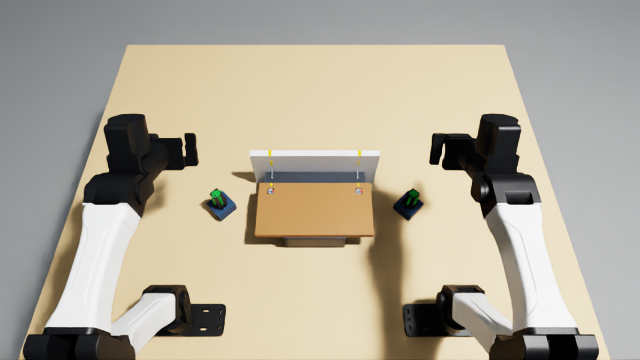
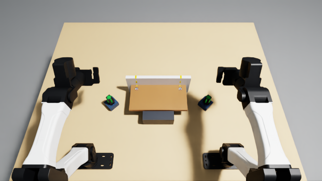

# Join a flat-pack shelf to an upright cabinet side with two Minifix 15 cam locks

Instruction: `Join the flat-pack shelf flush to the upright cabinet side on its two cam bolts with both cam locks turned tight using the stubby screwdrivers, then put both screwdrivers back in their cradles and move both hands clear.`

Files: `task.json`, `task.py`, `scene.py`, `parts.py`, `checks.py`, `trials.py`, `demo.py`, `test_cam_lock_shelf.py`, `mechkit.py`, `demo_kit.py`, pictures `start_top.png`, `start_top_policy.png`, `start_left_wrist.png`, `start_right_wrist.png`, `end_top.png`, `end_top_policy.png`.



## What the task tests

- **Constrained order.** Both Ø 15 mm zinc cams start `+90 deg` CW from open across the Ø 8.0 mm bores (`16.55 mm` in); pushing first stops `~9 mm` short (`0.0`). Both must open (`+-25 deg` of `+x`) first.
- **Two-hand steadying & slot press.** Cams sit `220 mm` apart (`y = +-110 mm`, `>= 200 mm` wrist spacing). One hand holds a rear wing while the other presses a PZ2 stubby `>= 1.5 mm` into the `3.5 mm` recess (`>= 1.5 N`) to turn each cam. An unheld `79 mm` stubby on a cam gets no lateral/tilt support and topples.
- **0.50 mm-play slide & 180 deg draw.** With both open cams waiting undisturbed, both hands slide the `280 mm` shelf square onto both Ø 7.0 mm bolts in 16-stave Ø 8.00 mm bores (`0.50 mm` play), then turn each cam `180 deg` CW in one `joint6` sweep to pull the seam flush (`<= 0.6 mm`) and lock.

## Scene

- **Upright side** (`cabinet_side`, fixed): `16 mm` white chipboard (EN 312 P2), `320 x 140 mm` at `x = 360 mm`, rear L-brackets; two Häfele S100 bolts (`262.27.029`, Ø 7.0 mm head, `25.0 mm` out) at `y = +-110, z = 72 mm`.
- **Support** (`support_block`, fixed): `64 mm` HDPE riser (`mu = 0.22`), `260 mm` wide at `x = 265..360 mm` and `150 mm` wide at `x = 175..265 mm` (64 mm under both rear wings).
- **Shelf & cams** (`shelf`, free `406 g`; `cam_l`, `cam_r`, free `10 g` zinc): `140 x 280 x 16 mm` board starting at `x = 318 mm` edge (`42 mm` gap); two Häfele Minifix 15 (`262.26.033`) in Ø 15 x 12.5 mm bores at `B = 24, y = +-110 mm`, `+90 deg` closed (red arrows `-y`).
- **Drivers & cradles** (`driver_l`, `driver_r`, free `37 g`; `cradle_l`, `cradle_r`, fixed): two Wera 355 PZ (`05008854001`, `79 mm`) tip-down in `54 x 54 x 29 mm` HDPE wells (`Ø 15 mm`) at `x = 285, y = +-245 mm` (`45 deg` yaw).

## Rules and score

- **0 permanently:** shelf mid-plane `< 56 mm` (off the support block) or a driver handle `< 32 mm` over the bench (from trial video on the bench).
- **0.25:** aligned and slid onto both bolts (`both seam gaps in [-1.0, 2.5] mm`: the cams' draw, not a lateral allowance; lateral offset `<= 2.0 mm`, held within `0.5 mm` by the 7 mm heads in 8.0 mm bores; tilt `<= 3.0 deg`).
- **0.50:** seated so and `>= 1` cam locked in `[150, 195] deg` CW from open (`>= 5.0 N` clamp; `<= 0.5 mm` give at `10 N` `-x` pull on bench).
- **1.00:** seated flush (`both seam gaps <= 0.6 mm`), both cams locked (`>= 5.0 N` each), both drivers upright in cradles (`tip <= 12 mm` horizontally, `<= 20 mm` z, tilt `<= 15 deg`), both hands `>= 30 mm` clear, held 20 steps (`1.0 s`, drift `<= 1.0 mm`). Limit: 1,800 steps (`90 s` at `20 Hz`).
- **Shortcuts blocked:** closed-cam push stops `~9 mm` short (`0.0`); opening without sliding scores `0.0`; `< 1.5 N` or `< 1.5 mm` slot touch gives `0.000 N m`; unparked driver caps at `0.50`.

## Key figures and sources

| Figure | Value | Source |
|---|---|---|
| Panel thickness (`PANEL_T`) | 16.0 mm | standard: EN 312 P2 melamine furniture chipboard |
| Cam bore (`CAM_BORE_D`), `B` (`DIM_B`) | 15.0, 24.0 mm | listing: Häfele `262.26.033` `"- Drill hole housing : 15.00 mm"`, `"24 or 34 mm"` [cam] |
| Cam depth (`CAM_BORE_DEPTH`), `A` (`DIM_A`) | 12.5, 8.0 mm | estimate, Häfele page seen in search (not opened: 403): `drilling depth x: 12.5+0.5 mm`, `dim. A: 8.0 mm` (half the panel) [uk_cam] |
| Edge bore (`EDGE_BORE_D`), face hole (`UPRIGHT_DRILL_D`) | 8.0, 5.0 mm | listing: Häfele `262.27.029` `"- Bolt hole : 8.00 mm"`, `"- For drill hole : 5.00 mm"`, `"24 mm drilling distance"` [bolt] |
| Bolt head (`BOLT_HEAD_D`), thread (`BOLT_THREAD_L`) | 7.0, 11.0 mm | estimate, Häfele page seen in search (not opened: 403): `Bolt Head: Ø 7 mm`, `Thread length: 11 mm` [uk_bolt]; check: `"- Bolt hole : 8.00 mm"` [bolt] (0.50 mm play) |
| Blade (`DRV_BLADE_L`, `DRV_BLADE_D`), handle (`DRV_HANDLE_L`) | 25, 6.0, 54 mm | maker: Wera `05008854001` `"Tip size": "PZ 2"`, `"Blade length mm": "25"`, `"Blade diameter mm": "6.0"`, `"Handle length mm": "54"` [wera] |
| Grip flats (`DRV_GRIP_FLAT`), mass (`DRV_MASS`) | 24.0 mm, 37 g | estimate: scaled from 54 mm Kraftform waist and 37.05 g distributor figure [tme] |
| Bolt reach (`BOLT_PROJ`), neck Ø, bore chamfer | 25.0, 4.0, 0.8 mm | estimate: `B = 24 mm` S100 geometry (stops 8.45 mm short on closed Ø 15 mm cam) |
| Cam mass, bore friction, spiral | 10 g, 0.05 N m, 4.30 -> 1.68 mm | estimate: hollow Ø 15 x 12.5 mm Zamak casting, bore friction; the 2.62 mm lead draws the seam 2.5 mm to flush |
| Slot depth, min engage (`SLOT_DEPTH_MIN`, `SLOT_FORCE_MIN`) | 3.5, 1.5 mm, 1.5 N | estimate: PZ2 depth in 3.5 mm cap and downward press preventing cam-out |
| Chipboard density, HDPE friction (`MU_SLIDE`) | 660 kg/m3, 0.22 | estimate: EGGER Eurodekor EN 312 P2 EPD mean; dry melamine-on-HDPE range |
| Cut panels, `y = +-110 mm`, 64 mm riser, 29 mm cradles | as in Scene | our fixture |

`parts.FIGURES`: 3 maker, 1 standard, 4 listing, 11 our fixture, 17 estimate.

## First minutes of a real trial

On bought parts (~5 min): caliper `262.27.029` head (`7.0 mm`), projection (`~25 mm`), and `8.0 mm` bore with an 8.0 mm drill shank (`1 min`); weigh `05008854001` and cut shelf on a kitchen scale (`1 min`); set `262.26.033` cams to `+90 deg`, push onto bolts, check `~9 mm` stop with a steel rule (`1 min`); open cams (`0 deg`), slide home, lock `180 deg` CW, verify a `0.6 mm` feeler fails to enter and a `10 N` `-x` luggage-scale pull gives `< 0.5 mm`, and tilt shelf on HDPE with an inclinometer for `tan(theta) ~ 0.22` (`2 min`); a different reading replaces the estimate.

## Forces

| Force / constraint | Code | Acts on | Reaction on | Active / ends when |
|---|---|---|---|---|
| 0.50 mm bolt-in-bore & 9 mm closed stop | 16-stave Ø 8.00 mm bore + cam rims (PhysX) | `shelf`, `cam_*` | S100 bolts on `cabinet_side` | Collision; throat opens within `+-25 deg` of `+x` |
| PZ2 slot axial torque (`<= 0.24 N m`, zero force/tilt support) | `task.py:update_couplings` (`mk.push`) | `+tau * cam_axis` on `cam_*` | `-tau * cam_axis` on `driver_*` | While `depth >= 1.5 mm`, `contact >= 1.5 N`, `tilt <= 15 deg` |
| Eccentric spiral draw (`2.5 mm`, `32 kN/m` staves) | Twin crescent flanges on `cam_*` (PhysX) | `cam_*` -> `shelf` (`+x`) | Bolt head on `cabinet_side` (`-x`) | Bolt head in pocket (`gap <= 2.5 mm`) and `cam_deg >= 58 deg` |
| Grips | `demo.py` | drivers, shelf wing | pads | `~32 N` a finger on drivers, `~22 N` on shelf (`<= 40 N`) |

## Checks and visibility at 320 x 176

- **Rules & reach:** 9/9 rule tests pass; 40 poses solve `<= 0.08 mm` / `0.01 deg`, margin `>= 10.8 deg`, height `<= 150 mm`, TCP separation `>= 224 mm`; 2 s idle drift `0.5 mm`, score `0.0`.
- **PhysX trials (`gc2chk`):** 7/7 pass — closed cams stop at `9.11 / 9.02 mm` (`0.0`); unheld driver in recess topples `91.4 deg`; seated unlocked `0.25`; one locked `0.50`; both locked `1.00` (`0.02 / 0.16 mm` give at `10 N` pull); both zero rules fire (`0.0`); tilt and yaw zeros dropped.
- **Demo (`gc1g3p`):** `1.00` (`0.25` at `35.55 s`, `0.50` at `45.85 s`, `1.00` at `71.95 s`, done `74.90 s` = `1,498 / 1,800` steps). Press `4.25-5.75 N` drives `-0.05 to -0.105 N m` opening (`90 -> -0.7 / -0.2 deg`), then `+0.044 to +0.112 N m` locking (`178.8 / 178.0 deg`), drawing seams `0.55 -> 0.00 mm` at `15.12 / 14.52 N` cam preload; lateral offset `0.02 mm`, both drivers parked, hands `164.3 mm` clear.
- **320 x 176:** `42 mm` start gap is a `10 px` dark band that closes when flush; red cam arrows turn `-y` -> `+x` -> `-x`.



## How it differs

Unlike pushing two boards onto fixed dowels by hand, this task needs a stubby screwdriver pressed into each cam slot while the other hand steadies the loose shelf, both blocking cams opened first, the 8.0 mm edge bores slid onto 7.0 mm bolts (0.5 mm play) with both cams undisturbed, and each cam turned 180 degrees to draw the seam tight.

## Assets and sources

No third-party meshes, textures or sounds; all bodies are `mechkit` primitives.
- [cam] https://www.homedecorhardware.com/hf-262-26-033.html · [bolt] https://www.homedecorhardware.com/hf-262-27-029.html
- [uk_cam] https://www.hafele.co.uk/en/product/connector-housing-without-rim-zinc-alloy-minifix-15/P-00860559/ (seen in search, not opened: 403)
- [uk_bolt] https://www.hafele.co.uk/en/product/connecting-bolt-for-5-mm-holes-with-special-thread-minifix-s100/P-00860582/ (seen in search, not opened: 403)
- [wera] https://www.wera.de/en/tools/355-pz-pozidriv-head-stubby-carburetor-screwdriver · [tme] https://www.tme.eu/en/details/05008854001/ (seen in search, not opened: 403)

## How to run

`PYTHONDONTWRITEBYTECODE=1 scripts/rta check cam_lock_shelf` · `scripts/rta simpy <id> <dir>/checks.py --frame0 <out>` · `scripts/rta simpy <id> <dir>/trials.py <out>` · `scripts/rta demo <id> <dir>` (`--check`, `--quick`; `<dir>` = `mech/tasks/cam_lock_shelf`). Limit 90 s (1,800 steps; demo ~75 s). Fixed layout (`--seed 0` -> trial seed `1415158438`).

```bash
inspect-robots run --embodiment yam_arena --policy dream \
  -E task=mech/tasks/cam_lock_shelf/task.py -E object_jitter=0 -E control_hz=20 -E cam_width=320 -E cam_height=176 \
  --instruction "$(jq -r .instruction mech/tasks/cam_lock_shelf/task.json)" \
  --scorer task_score --max-steps 1800 --seed 0 --no-prompt --store-frames --log-dir <log dir>
```
