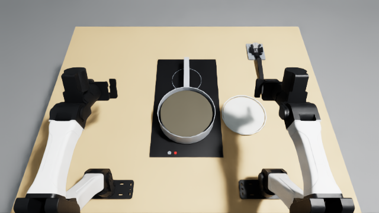
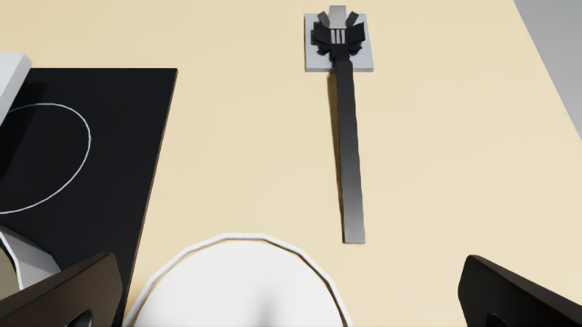
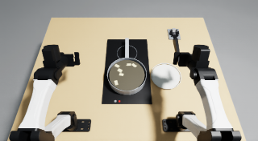
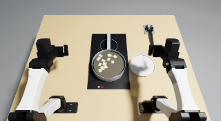

# Lift gnocchi out of simmering water with a slotted spoon as they float up, then switch the heat off

Instruction given to the policy: `The gnocchi are cooking; each is done when it floats up. Lift them out onto the plate with the slotted spoon as they are done, then put the spoon down and switch the heat off.`

Files: `task.py` (scene, the water as computed loads, rules, score), `mechkit.py` (the mechanism kit the task file imports), `skim.py` (the slotted spoon's planner: where the hand sits on the handle, a scoop and a serving as poses, the arm's reach and collision check without the simulator), `demo.py` (scripted full-score run and the runs that show what each rule costs), `demo_kit.py` (the runner behind the scripted runs), `trials.py` (checks in the simulator: rest, the cue pictures, the lamp, floating, digging at a gnocco on the pan's floor), `start_top.png` and `start_right_wrist.png` (the first pictures of a trial), `cue_none_up.png`, `cue_six_up.png`, `cue_twelve_up.png`, `cue_lamp_out.png` (the top camera's picture as a policy gets it), `README.md`.

 

The first pictures of a trial, both arms in their ready pose. Top camera: hob, pan, plate, and beyond the plate the slotted spoon on its rest (the whole bowl and the first 12 cm of the handle; the rest of the handle is behind the right hand). Right wrist camera: the whole slotted spoon.

## Where the task comes from

The idea is that of the program's pull request #2048: gnocchi are lifted out of the water with a spoon as they float up. Its review left one point open: "Replace the staged two-at-a-time cooking schedule with a realistic batch of gnocchi ... while retaining spoon-based retrieval."

How this task meets it: one small serving, twelve gnocchi (72 g), is in the water together from the start. Each floats up at a time of its own between 15 and 50 s after the start, in an order and at places drawn from the seed, as a batch does. They are lifted out with a slotted spoon, several to a spoonful where they float together (one to three; 1.33 a spoonful in the full-score run). Scene, kit, numbers and text are this task's own.

## Scene

Bench coordinates in metres: x forward from the line through the two arm bases, y left from the midline, z up from the bench top. The arms' bases are at (0, -0.305) and (0, +0.305). Everything stands free except where stated.

| Part | Size, mass | Where |
|---|---|---|
| Built-in induction hob with two zones (black glass), fixed | glass 306 mm wide, 527 mm deep, lying 6 mm proud of the bench; the zones are grey rings on the glass, 210 mm (front) and 145 mm (rear) across | x from 0.1275 to 0.6545, centred on y = 0; front zone's middle (0.305, 0), rear zone's (0.520, 0) |
| On/off key and lamp of the hob | key: a grey disc 16 mm across printed on the glass; lamp: a red square of 10 mm that glows while the heat is on | on the glass's front strip: key (0.1455, +0.070), lamp (0.1455, +0.045) |
| Pan: stainless sauté pan with water | 240 mm across and 70 mm deep inside, wall 2 mm, base 5 mm, 55 mm of water, 4.0 kg with the water; handle 180 mm long, pointing away from the arms | stands loose on the front zone, middle (0.305, 0); its rim is 81 mm and the water's surface 66 mm above the bench |
| Gnocchi, twelve | 26 x 18 x 15 mm, 6 g each | on the pan's floor at the start, on the side away from the right arm, at places drawn from the seed |
| Plate | 200 mm across, rim 6 mm high, 450 g | middle (0.325, -0.260) |
| Slotted spoon: nylon, cranked handle | 334.5 mm long, 60 g; bowl 90 x 69 mm and 15 mm deep; handle 20 x 8 mm, its underside 14 mm above the plane of the bowl's rim | its bowl on the spoon rest, its handle towards the arms with the end on the bench, 7.8 degrees nose up |
| Spoon rest | 110 x 90 x 8 mm, 150 g | middle (0.710, -0.370) |

The pan stands on the front zone; its water is drawn as an opaque grey-beige surface (cooking water is cloudy with starch). A gnocco on the floor cannot be seen. A floating one stands 1 mm out of the water and shows pale.

Hidden state, from the seed: when each gnocco is done (between 15 and 50 s after the start, each on its own), where each lies at the start and how it is turned, and the phase of its slow drift. With seed 0 the twelve are done between 15.1 and 47.7 s and reach the surface between 17.45 and 50.1 s.

Sizes. The hob has the glass and the zones of the Bosch PIB375FB1E, a 30 cm domino induction hob: "Dimensions 51x306x527 mm", "Number of cooking zones 2", "Dimensions of the heating elements 1 x (21,0 cm Ø), 1 x (14,5 cm Ø)", "Type of control DirectSelect touch control" (maker's product page, https://www.bosch-home.co.uk/en/product/PIB375FB1E, read 2026-11-18; the page marks the model as no longer available). Where the zones sit on the glass the page does not say: here the front zone's middle is 17.75 cm and the rear zone's 39.25 cm from the glass's front edge, and the key and the lamp are on the front strip. The pan is a 24 cm sauté pan 7 cm deep, without a named maker; its 1.5 kg empty is assumed (4.0 kg with its 2.5 l of water). The slotted spoon has the outer sizes listed for a nylon slotted spoon of this kind (334.5 x 69 x 37 mm); the bowl's depth of 15 mm and its flat floor of 30 x 24 mm are assumed, the listing does not give them. The spoon's listing is still to be cited here before the task is submitted.

## Rules

- A gnocco is done at its time and then rises; it has floated when its top is within 2 mm of the water's surface.
- It has left the water when its lowest part is 3 mm or more above the surface, or it is no longer over the pan.
- A gnocco counts when it floated, left the water after that and no more than 60 s after it floated, lies on the plate at rest, and was never touched by a gripper (a gripper's grasp point within 20 mm of its middle, at any time). A gnocco lying on another on the plate counts.
- The heat: a fingertip on the hob's key switches it, off and on again like a real key. A touch is a gripper's grasp point within 15 mm of the key's middle and up to 30 mm over the glass for 0.2 s; one touch switches once. The lamp is red while the heat is on.
- The slotted spoon is put down when it lies at rest and no gripper is within 4 cm of its handle.

Score, by outcome, read at the end of the trial (the trial ends early with 1.0 once the 1.0 condition has held for 1 s):

| Score | Condition |
|---|---|
| 0 | the pan was pushed more than 3 cm from where it stood, at any time, for the rest of the trial; or a gnocco that never floated lies on the plate (raw food served) |
| 0.25 | 3 gnocchi count |
| 0.5 | 6 count |
| 0.75 | 9 count, the heat is off and the slotted spoon is put down |
| 1.0 | 11 of the 12 count, the heat is off and the slotted spoon is put down |

While the heat is on or the slotted spoon is in a gripper the score is never above 0.5. The top level asks for 11 of 12 because one gnocco may end where the slotted spoon cannot take it (see "What the slotted spoon cannot do here").

The score that counts is the one at the end of the trial. "Lies on the plate" asks for rest (slower than 2 cm/s), in the counting and in the zero rule about a gnocco that never floated alike: both are about what lies on the plate at rest. The score shown during a trial can therefore change for a moment while a gnocco on the plate is knocked. In the reference run `raw` it reads 0.5 for one step at 73.75 s, while two gnocchi of one spoonful land beside the raw one, and 0 before and after.

Run limit: 3,000 control steps at 20 Hz (150 s).

## Can the floating gnocchi be seen

The instruction's "as they are done" has to be readable from a camera. The pictures below are the top camera's at the size a policy gets in the program's model runs (320 x 176): none up, six up and six down, all twelve up (run `l7rt`, `trials.py cue`).

  

- None up: the water is an even grey-beige, (124, 117, 98) of 255 on average; nothing shows of the twelve on the floor.
- Six up: six pale gnocchi, about (212, 208, 187), each apart from the others by eye. Counting by pixels (those that differ from the none-up picture) finds three patches of 74, 42 and 29 pixels: neighbours touch at this size.
- Twelve up: a cluster in which about ten to twelve can be told apart by eye; the pixel count finds four patches (148, 74, 49 and 20 pixels). At this size a policy can see that gnocchi float and where, not always how many.
- Each floating gnocco stands 1.0 mm out of the water and is level; left alone it wanders 6 to 10 mm from where it came up in 60 s (run `l7ru`, `trials.py float`).

The lamp at the same size: 6 red pixels while the heat is on, none when it is off (`cue_lamp_out.png` against `cue_none_up.png`).


## Limits and readings

What the scored limits are, how a real bench reads them, and what was read at rest and in ordinary handling (reference runs below, run `l7ref`):

| Limit | Value | A real bench reads it from | Readings |
|---|---|---|---|
| Pan pushed from where it stood | 30 mm | the final photo against the front zone's ring | at rest 0.0 mm in 60 s (run `l7ru`); through the 73 spoonfuls of the runs below 0.1 mm at most; pushed on purpose 74.4 mm (`shove`) |
| A floating gnocco's time in the water | 60 s | an overhead video: when it comes up, when it leaves the water | full-score run 4.9 to 33.8 s; the longest in a run not made late 34.4 s (`handled`); made late on purpose 73.5 and 75.3 s (`late`) |
| A gripper at a gnocco | grasp point within 20 mm of its middle | the video | with the slotted spoon in the hand the nearest a grasp point came to a gnocco was 91.0 mm (all runs); a hand going down over one 1.2 mm (`handled`) and 7.2 mm (`raw`) |
| Heat off, slotted spoon put down, gnocchi on the plate | at the end | the final photo (lamp, slotted spoon, plate) | as scored |

## Tipping the pan is not scored

The pan's tilt is read and reported (`pan tilted at most (deg)`) and no rule uses it, because no run can show such a rule: nothing these arms do tips this pan.

- The left hand pinched the pan's wall where it is nearest the arms and went 7 cm up: the fingers slid up the wall and the pan stayed level, tilt 0.0 degrees, moved 0.1 mm (`tip_only` below, and the same in run `l7u`). Lifting that side of a 4.0 kg pan takes about 20 N; the pinch on a wall 2 mm thick holds less.
- The pan's handle points away from the arms; with the hand pointing down the arms' reach ends 5 to 13 cm short of it.
- A hand that pushes the pan slides it and does not tip it: 74.4 mm with 0.12 degrees of tilt (`shove`).

## What the slotted spoon cannot do here

- **The part of the pan nearest the arm that holds it.** To get under a floating gnocco the bowl goes into the water nose down by 10 to 15 degrees and its handle leaves over the pan's rim towards the arm, with the hand on it (the rim is 15 mm over the water, the handle's underside 14 mm over the plane of the bowl's rim). For a gnocco near the arm's side of the pan there is no room for handle and hand. On a grid of 25 places 3.5 cm apart a whole scoop (down behind the gnocco, under it, up, level) is possible at 21; with 10 degrees or more to spare at every joint only beyond a straight line across the pan, at right angles to the direction to the right arm's base and 2.5 cm from the pan's middle on that arm's side. So the gnocchi lie, at the start, on the side of the pan away from that arm, as if slid in off the board on the far side: each middle at least 15 mm beyond that line and within 9 cm of the pan's middle, any two at least 8 mm apart. One that drifts into that part stays in the pan: in `raw` below, where the hand had stirred the gnocchi, one came up 13 mm from the pan's middle on the arm's side and was left.
- **Against the pan's wall.** The bowl's nose has to pass beyond the gnocco. No scoop fits a gnocco whose middle is more than 102 mm from the pan's middle (96 to 100 mm towards the sides); the wall is at 120 mm. A scoop on two gnocchi can push one of them out there: in one run on an earlier layout a gnocco ended 104 mm from the pan's middle and stayed in the pan (run `l7x`, `handled`); it did not happen in the runs below.
- **A gnocco on the pan's floor.** With the bowl nose down 27 degrees and its lowest point on the pan's floor, a gnocco was pushed 7.6 cm along the floor to the wall and left leaning there, under water; the slotted spoon shifted 13 mm in the hand; steeper the arm has no way (run `l7ru`, `trials.py dig`). In this simulation the slotted spoon does not bring a gnocco up before it floats, which is why the rule about raw food is shown with a hand (run `raw` below).
- The reference script leaves a gnocco it cannot reach: when nothing more is to float and no scoop has fitted what is left for 12 s, it tidies up. The top level allows for one such gnocco.
- **Where a serving lands.** A gnocco leaves the bowl late in the tip and comes down about 7 cm beyond the nose, or early in the swing (the second of two on the bowl) and comes down about 11.5 cm beyond it; then it skids. The six places the reference tips out over leave both landings 3.0 to 4.8 cm to the plate's rim. Before they were chosen for that, one and the same serving came down 83, 96, 101 and 103 mm from the plate's middle in four recordings, twice on the plate and twice off it (runs `l7g3` and `l7r`). With them, one gnocco of the 102 served in the runs below still skidded 13 cm, over the rim and onto the hob's glass (`spoon_kept`).
- **The bowl's height: about 2 mm decide.** The bowl has to pass under a gnocco whose underside is 14 mm under the surface and over the gnocchi still on the floor, 40 mm under it. With the fingers 2.2 mm off on the handle, so that the bowl rode that much higher than planned, and the plunge into the water taking 0.6 s, one scoop in seven brought a gnocco out (run `l7z`, stopped and void). With the plunge slowed to 1.0 s: three of three (run `l7g2`). With the fingers where the plan has them and the slower plunge: 73 of 73 (the runs below; 72 of 72 in the recording before, run `l7g3`). On the earlier layout, fingers right and the plunge in 0.6 s: 42 of 43 (runs `l7q`, `l7t`, `l7x`). No run shows how much more than this the scoop stands.
- **Where the fingers close on the handle.** Where the slotted spoon lies, 56 cm from the right arm's base, the simulated arm ends its pinch 2.2 mm low and 1.4 mm short of its target (0.3 mm off at 22 cm; runs `l7g1` and `l7q`). The script's `TAKE_SHORT` makes up for that: the hand is sent that much beyond the planned grasp point, and the pinch then ends 0.0 mm from it (`grip_only` below). Whoever moves the spoon rest has to read this again.

## What is simulated and what is computed

Simulated (PhysX, 240 Hz): every part as rigid bodies of boxes and cylinders; contact and friction between grippers, slotted spoon, gnocchi, pan, plate, spoon rest, hob and bench. The bowl is a flat floor with eight flat walls; a gnocco is carried on it by contact alone.

Computed by the task file, once per control step and held for the step: the water's load on each gnocco (lift on each of its eight parts by how much of that part is under the surface, drag, a slow drift); which gnocchi have floated, left the water, been touched; how far the pan has been pushed; the key and the lamp.

Stated departures from a real pan of gnocchi:

- The water is not a fluid. It does not move, splash or pour, nothing drains from a spoonful, and it acts on the gnocchi only: not on the slotted spoon, the pan or a hand. The slots are drawn.
- A raw gnocco gets 0.78 of the weight of the water it displaces as lift and lies on the floor; done, it gets 0.916 and floats with 1 mm showing; it turns from one to the other over 1 s and reaches the surface 2.35 to 2.39 s after its time (run `l7ru`). Drag 0.17 N s/m, a drift of 0.3 mN. These stand in for measurements on real gnocchi.
- The gnocchi are rigid boxes. A cooked gnocco is soft: that a gripper may not touch one stands in for squashing it.
- The water's surface is drawn opaque, so a gnocco on the floor is hidden altogether; in real cloudy water it may show dimly.
- Nothing is hot. Real trials use real gnocchi in simmering water with the gripper pads sleeved, and a fresh batch each trial.
- The renderer builds each picture from the frames before it. A small thing that vanishes or jumps stayed in the pictures for seconds: the lamp after it had gone out, and after a reset the gnocchi that the trial before had left afloat (12 to 26 pixels on the water brighter than 150 of 255 in the first picture, gone 3 s later; run `l7g3`). So the kit makes the renderer forget its earlier frames at every reset until the scene has settled, then renders eight more pictures before the first one is handed out (in the runs below no pixel on the water is brighter than 150 in any run's first second, and 6 at most differ by more than 25 from a clean first frame), and the task does the same at the step the heat is switched. For about a quarter of a second after the switch the whole picture is slightly softer: of the 230,400 pixels of a 640 x 360 picture, 6,875 to 7,615 differ from the picture before the switch by more than 25 of 255 one step after it, 1,911 to 2,292 five steps after and 561 to 732 twenty steps after (run `l7ru`, four switches). The lamp is out, or lit again, in the picture by the second or third step.
- The hand on the slotted spoon in the reference runs: a pinch across the handle 8 cm from where it starts, the hand leaning 30 degrees along the handle towards the bowl. With the hand straight above the handle a whole scoop was possible at 2 of 9 places.

## Reference runs

All scripted (`demo.py`), seed 0. Run `l7ref` of 2026-11-18, recorded on commit ece960c (the commits after it change this file, its pictures and another task's folder only); a folder per run with `result.json`, `trips.json`, a video per camera, `setup.png` and contact sheets. The start and cue pictures (run `l7rt`) and the lamp, float and dig trials (run `l7ru`) are on commit ecca3f0, which differs from ece960c in `demo.py` alone.

A recording is not repeatable to the step. With the same seed and the same script, runs that follow each other in one simulator session differ in the last digits of their contacts, and a gnocco that lands near an edge ends on either side of it: the serving named under "Where a serving lands" came down 83, 96, 101 and 103 mm from the plate's middle in four recordings. A rerun gives the levels below; its figures may differ from these.

What the script reads from the simulator: where the floating gnocchi are and since when each has floated. A person at the pan sees both. It never reads where a gnocco on the floor lies or when it will be done, and it decides nothing from a camera picture. Each trip is chosen for the most floating gnocchi over the bowl, then for the one that has floated longest; the arm's way is checked against its joint limits and the scene before it is taken.

The full-score plan: the right arm takes the slotted spoon off its rest (a pinch across the handle) and holds it level over the pan. When gnocchi float it brings the bowl into the water behind them, nose down 15 degrees, passes it under them, lifts, carries them level to the plate and tips them out nose down 60 degrees: one trip, 7.6 s. When the pan is empty it lays the slotted spoon back on its rest while the left arm puts a fingertip on the hob's key.

| Run | What the script does | Score | Gnocchi at the end | Trips (gnocchi brought out by each) | Readings |
|---|---|---|---|---|---|
| `full` | everything | 1.00, ended as a success after 91.3 s | 12 on the plate, 12 count | 9 (1, 1, 1, 2, 2, 2, 1, 1, 1) | floated 4.9 to 33.8 s before leaving the water; pan moved 0.0 mm |
| `nine` | stops taking gnocchi once nine lie on the plate, then tidies up | 0.75 | 10 on the plate, 10 count, 2 left in the pan | 7 (1, 1, 1, 2, 2, 2, 1) | ran 79.0 s |
| `six` | the same at six | 0.50 | 7 on the plate, 7 count, 5 left in the pan | 5 (1, 1, 1, 2, 2) | ran 63.8 s |
| `three` | the same at three | 0.25 | 3 on the plate, 3 count, 9 left in the pan | 3 (1, 1, 1) | ran 48.5 s |
| `heat_on` | everything, but the key is not touched | 0.50 | 12 on the plate, 12 count; the lamp is red | 9, as `full` | the slotted spoon is put down |
| `spoon_kept` | everything, but the arm parks with the slotted spoon in its gripper | 0.50 | 11 on the plate, 11 count; one skidded off the plate onto the hob's glass; the heat is off | 9, as `full` | |
| `late` | once nine have left the water it waits until those still floating have floated for more than 60 s, then takes them | 0.75 | 12 on the plate, 10 count: the two taken 73.5 and 75.3 s after they floated do not count | 9 (1, 1, 1, 2, 2, 1, 2, 1, 1) | waited from 70.65 to 106.9 s; ran 130.4 s |
| `handled` | before the first trip the open left hand goes down over two floating gnocchi, one after the other, as if to pick them out; then everything | 0.75 | 12 on the plate, 10 count: the two do not count | 6 (2, 2, 1, 2, 2, 3) | the hand's grasp point came within 1.2 mm of a gnocco's middle |
| `shove` | everything, and before the key the left hand, closed, pushes the pan back on the hob | 0.00; without the rule 1.00 | 12 on the plate, 12 count, heat off, slotted spoon put down | 9, as `full` | pan pushed 74.4 mm, tilt 0.12 degrees |
| `raw` | before it takes the slotted spoon the empty right hand reaches into the water, closes on what lies on the floor there and puts it on the plate; then everything | 0.00; without the rule 0.75 | 11 on the plate: the one that never floated, and 10 that count; one left in the pan where no scoop fits; heat off, slotted spoon put down | 7 (1, 1, 1, 1, 2, 2, 2) | the raw gnocco is out of the water at 4.7 s and on the plate at 8.3 s; the others floated 5.0 to 25.9 s before leaving |
| `tip_only` (shows a property, not a level) | the left hand pinches the pan's wall and goes 7 cm up | | nothing floats yet | | pan tilt 0.0 degrees, moved 0.1 mm |
| `grip_only` (shows a property, not a level) | takes the slotted spoon, two scoops and servings | | | | the pinch ends 0.0, 0.1 and 0.0 mm from the planned grasp point; the fingers stay within 0.5 mm of where the plan has them on the handle; at the end of the two scoops the bowl is 2.5 mm lower and 1.6 mm higher than the hand's pose puts it and 2.8 to 4.1 mm to one side |

In the ten runs with the slotted spoon it made 73 trips and every one brought gnocchi out, 102 in all. One of the 102 did not end on the plate (`spoon_kept`). In no run does the first second of the top camera's video show anything of the run before.

Where the raw gnocco comes from: the hand goes down at a place fixed in `demo.py`, 2 cm beyond and 2 cm to the right of the pan's middle. That is the part of the gnocchi's side of the pan that the right hand, pointing straight down, reaches at all (its joints 5.7 degrees inside their limits there, nothing beyond). The script does not read where gnocchi lie; with seed 0 one lies at that place, which was looked up beforehand so that the run would show the rule. The left hand reaches the gnocchi's side well, and not the plate.

What the top camera's contact sheets show. `full`: the untouched scene; the right hand at the handle beyond the plate; the slotted spoon held level over the pan until the first gnocchi show pale on the water at 18 s; nine scoops, the plate filling; at 87 s the left hand at the key while the slotted spoon is laid back on its rest; at 91 s both arms parked, the pan empty, the lamp out. `spoon_kept`: the same scoops; at the end the right arm is parked with the slotted spoon in its gripper, the lamp is out, and one gnocco lies on the hob's glass beside the plate. (The sheets of `late`, `shove` and `raw` were looked at in the recording before, run `l7g3`: the arm waiting with three gnocchi afloat from 64 to 111 s; the left hand against the pan's near wall and the pan a third of its width back; the right hand in the pan at 4 s and a pale gnocco on the plate at 12 s.)

## How to run

Rule tests, no simulator: `scripts/rta check gnocchi_lift` (15 tests), `scripts/rta check gnocchi_skim` (6), `scripts/rta check mechkit` (32) and `scripts/rta check demo_kit` (11).

The reference runs: `scripts/rta demo <id> mech/tasks/gnocchi_lift full,nine,six,three,heat_on,spoon_kept,late,handled,shove,raw,tip_only` (results in `outputs/<id>/<run>/`); `--dry` appended checks the fixed parts of the plan against the arm's reach and the scene without the simulator. The checks in the simulator: `scripts/rta simpy <id> mech/tasks/gnocchi_lift/trials.py /workspace/robocurve/outputs/<id> rest,cue,lamp,float,dig`.

One model trial with the stock embodiment and scorer (20 Hz, 320 x 176 pictures, fixed layout):

```bash
inspect-robots run --embodiment yam_arena --policy dream \
  -E task=mech/tasks/gnocchi_lift/task.py -E object_jitter=0 -E control_hz=20 -E cam_width=320 -E cam_height=176 \
  --instruction "The gnocchi are cooking; each is done when it floats up. Lift them out onto the plate with the slotted spoon as they are done, then put the spoon down and switch the heat off." \
  --scorer task_score --max-steps 3000 --seed 0 --no-prompt --store-frames --log-dir <log dir>
```

`-E object_jitter=0` is required: the scripted runs take the layout from the task file's constants, and the task lays the gnocchi from the seed by itself.

A teleoperated take, recorded: `scripts/rta teleop <id> mech/tasks/gnocchi_lift/task.py 150 --mac`; the take lands in `outputs/<id>_teleop/demo/`.
