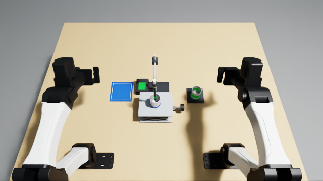
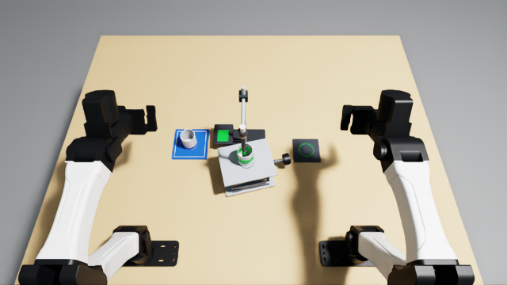

# Lower a lab scissor jack to clear a submerged pH probe, swap beakers, and raise to the immersion band

Instruction: `Lower the lab scissor jack until the sample beaker clears the fixed pH probe, move the sample beaker onto the blue mat, set the rinse beaker on the jack, and raise the jack until the probe tip sits inside the green immersion band without touching the beaker floor.`

Files: `task.json`; `task.py` (rules, coupling, `score()`); `scene.py`; `parts.py` (figures, sources); `checks.py`, `trials.py`, `demo.py`; `test_lab_jack_probe.py`; `mechkit.py`, `demo_kit.py`; pictures named below.



## What the task tests

Wet-lab technicians clamp pH electrodes at a fixed height on a retort stand and raise or lower vessels beneath them on a DIN 12897 scissor jack so the bulb is never unclamped or struck against a rim (`Other`: laboratory research automation).

The core difficulty is the **constrained physical order under a fixed overhead probe**, not wheel turning alone:
1. **Submerged jam at reset.** The probe tip sits fixed at `z = 130.0 mm`, `16.0 mm` inside the `60.0 mm` sample beaker on the `86.0 mm` deck (`rim = 146.0 mm`). Pulling sideways first drives its inner wall into the shaft (`lateral_strike_zero`: `81.0 mm` deflection, score `0.0`).
2. **Clearance swap.** Turning the `-y` wheel counterclockwise (`1.35` turns) drops the deck below `70.0 mm` (`61.7 mm` in `g3c5`, `8.3 mm` gap) so the sample beaker slides out onto the blue mat and the rinse beaker takes its place coaxially under the probe.
3. **Bounded raise.** Turning clockwise places the tip inside the `20.0-40.0 mm` green band (`deck = 90.0-110.0 mm`); cranking past `128.0 mm` drives the `2.0 mm` floor into the tip, feeding axial load back onto the wheel (`bottom_out_zero`: `16.0 N`, `0.091 N m` feedback, score `0.0`).

## Scene, grasps, and visibility

Coordinates in cm from the arm-base midpoint (`x` forward, `y` left, `z` up from bench; `object_jitter = 0`):
- **Scissor jack (`BOCHEM Art. 11120`, `DIN 12897`):** 18/10 stainless steel, `1.65 kg`, `13.0 cm` (`x`) by `16.0 cm` (`y` scissor axis) at `(25.0, +1.5)`, stroke `6.0-27.5 cm`, start deck `z = 8.6 cm`. Its `4.0 cm` (`DIN 6336`) black wheel sits on a half-height carrier (`0.5 * z_deck`) on the `-y` end (`y = -11.6 cm`, `z = 4.3 -> 3.1 -> 4.7 cm`).
- **Fixed pH electrode (`Hanna Instruments HI1230B`, `DIN 19262`):** PEI body (`1.2 x 12.0 cm` shaft, `16.35 cm` overall) clamped vertically on a rear stainless retort stand at `(36.5, +1.5)` (meter at `(38.5, +9.0)`), tip at `(25.0, +1.5, 13.0)`.
- **Dry 50 mL beakers (`Thermo Scientific Nalgene 1201-0050PK`, `ISO/DIN 7056`):** `4.8 cm` OD x `6.0 cm`, `2.0 mm` wall/floor; **dry** so no liquid sits near the shared robot. `beaker_sample` (blue stripe) starts on the deck; `beaker_rinse` (green band `2.0-4.0 cm` below rim, standing in for a `40 mL` rinse) starts on a `9.0 x 9.0 x 0.3 cm` grey pad at `(34.0, -19.5)`. `blue_mat` (`12.0 x 12.0 x 0.3 cm`) sits at `(36.5, +20.5)`.
- **Grasps (`checks.py`):** Left closed tip steadies `jack_base` at `z = 2.4 cm` (`3.5 N` down, `5%` effort); Right pinches the `1.8 cm` wheel across `y` (`4.4 -> 0.8 cm`, `~25 N`/pad, `z <= 6.2 cm`); side-grasps on `4.8 cm` beakers at `36 deg` pitch (`6.8 -> 4.0 cm`, `~20 N`/pad, max grasp `9.9 cm <= 16.0 cm`, two-hand TCP `>= 21.7 cm`, hulls `>= 7.5 cm`).
- **Can it be seen (`320 x 176`):** Green bands on `beaker_rinse` (`20-40 mm` below rim) and `probe` (`20-40 mm` above tip): at `1.0` (`end_top_policy.png`), `beaker_rinse`'s rim bisects `probe`'s green band.



## Scoring and stand-ins

- **Whole-trial zero rules** (level side video against a millimetre scale and top video; end photo confirming): `0` if (a) `probe` deflects laterally `> 4.0 mm`, (b) a beaker floor touches `probe`'s tip (`0 mm` gap; simulated via `>= 1.2 mm` / `>= 3.0 N` witness spring), (c) either beaker tilts `> 25 deg` or touches the bare bench outside its pad, or (d) `jack_base` slides `> 25 mm`.
- **Whole-trial event, needed for any credit:** at some moment the deck went below `70.0 mm` (the `60 mm` sample beaker's rim below the `130 mm` tip), read with its time on the side video against the scale. Not an end state: at `1.0` the deck stands at `90-110 mm`.
- **End levels**, the highest met (both hands `>= 30 mm` clear; deck and beakers moving `<= 2.0 mm` over `1.0 s` / `20` steps). *Sample placed:* `beaker_sample` upright (`<= 8 deg`) wholly inside `blue_mat` (centre `<= 36 mm` from its centre in `x`, `y`). *Rinse placed:* `beaker_rinse` upright (`<= 8 deg`) on `jack_deck`, coaxial with `probe` (`<= 12.0 mm` offset, `>= 4.0 mm` clear of its inner wall).
  - `0.25`: the event and the sample placed.
  - `0.5`: the event, the sample placed and the rinse placed.
  - `1.0`: the event, the sample placed, the rinse placed, and `probe`'s tip `20.0-40.0 mm` below `beaker_rinse`'s rim (deck `90.0-110.0 mm`, `>= 18.0 mm` above the floor).
- **Shortcuts blocked:** sideways pull before lowering hits `probe` (`0`); upward lift hits floor on `probe` (`0`); cranking to an upper stop bottoms out (`0`); mid-air holding fails deck-support and `30 mm` clearance (`0`).
- **What stands in for what:** Prismatic `deck_z` + half-height `carrier_z` preserve two-way screw work (`-F * lead/rad`); dry green band stands in for a `40 mL` rinse; `65 g` beaker mass (vs `15 g` true PP) stabilises `20 N` grasps; witness springs (`8.5 N m/rad`, `2500 N/m`) read strikes and bottoming; `demo.py` sets no states; `trials.py` does, for isolated checks.

## Key figures and bilateral forces

| Figure | Value | Source |
|---|---|---|
| BOCHEM 11120 plates, stroke, loads, thread | `160 x 130 mm`, `60-275 mm`, `7 / 30 kg`, `M8 x 1.25` | maker: `'A: 160'`, `'B: 130'`, `'C min: 60'`, `'C max: 275'`, `'DIN 12897'`, `'simple adjusting wheel'` ([bochem]) |
| BOCHEM 11120 mass | `1.65 kg` | listing: neoLab / LLG `9.118 924` `'Gewicht: 1.650,0 g'` (search sheet, 2026-11-21) |
| Wheel size | `40.0 x 18.0 mm` | standard `DIN 6336` M8 grip `40 mm`; width estimate from Form K hub |
| Lead and thread drag | `18.0 mm/rev`, `0.10 N m` | estimate: `74 mm` 2-tier pantograph on opposing `M8 x 1.25` spindle; unloaded thread friction |
| Nalgene `1201-0050PK` 50 mL beaker | `48.0 x 60.0 mm`, `2.0 mm` wall, `15 g` (`65 g` sim) | maker `'ISO/DIN 7056'` ([thermo]); listing U.S. Plastic item `76022` `1.86-2.01 in` OD, `0.033 lb` (search sheet); wall/sim mass estimate |
| Hanna `HI1230B` pH electrode | `12.0 x 120.0 mm` shaft, `163.5 mm` total | standard `DIN 19262` `12 mm`; listing Hanna `HI1230B` spec sheet (search sheet) |
| Station setup (`Z_PROBE_TIP`, `Z_DECK_START`, band) | `130.0 mm`, `86.0 mm`, `20-40 mm` | our fixture (steel ruler at reset) |

`parts.FIGURES`: 7 maker, 3 standard, 5 listing, 8 our fixture, 8 estimate.

| Force / coupling | Code (`task.py` / `scene.py`) | Acts on | Equal & opposite reaction | Governing event & log |
|---|---|---|---|---|
| Lift (`<= 68.7 N`) | `slide("deck_z")` spring | `jack_deck` | `jack_base` (`-> bench`) | `wheel` angle (`85.9 -> 61.7 -> 93.6 mm`, `g3c5`) |
| Screw drag + load | `coupled_step()` `mk.push` | `knob` | `wheel_carrier` (`-> jack_base`) | `0.10 N m` + `-F_deck * lead/rad` (`0.146 N m`, `g3c5`; `0.191 N m` at `16.0 N`, `g2t1`) |
| Probe contact | PhysX + witness joints | `probe` | `beaker_*` (`-> jack_deck`) | Clears for `z_deck < 70 mm` (`0.0 mm`/`0.0 N`, `g3c5`; `81 mm`/`16 N`, `g2t1`) |

## First minutes of a real trial

About `6 min`: caliper-check Nalgene `1201-0050` (`60 x 48 mm`) and BOCHEM `11120` wheel (`40 mm`) (`1 min`); weigh jack (`1.65 kg`) and beaker (`15 g`) (`1 min`); travel per wheel turn: deck height on a steel ruler after each of `5` turns up from `62 mm` (estimate `18.0 mm/rev` over `62-98 mm`) (`2 min`); operating torque: a luggage scale on a string round the `40 mm` wheel rim (force x `20 mm`: about `5.5 N` for the `0.10 N m` drag estimate plus the empty deck) (`1 min`); verify `Z_PROBE_TIP = 130 mm` and the `8 mm` gap at `z_deck = 62 mm` (`1 min`). A different reading replaces the estimate (`parts.LEAD_MM_REV`, `parts.WHEEL_HOLD_NM`).

## Validation and how it differs

- **Checks:** `10` unit tests pass; `checks.py` passes `36` poses (`IK <= 0.085 mm`, margins `>= 15.8 deg`) and `2 s` idle (`g1f1`, `0.0`); `trials.py` (`g2t1`) shows lateral strike `0.0`, bottom-out `0.0`, `0.25`, `0.5`, `1.0`; `demo.py --check` (`g3c5`) scores `1.0` in `1,715` steps (`85.75 s`, `3.13` wheel turns, immersion `23.64 mm`).
- **How it differs:** Public suites (`EFE AutoBio` *Pipette*, *Insert Centrifuge 5430*, *Thermal Cycler*; `BEHAVIOR-1K`; `RoboCasa365`) handle tubes, pipettes, or lids without a `DIN 12897` scissor jack or fixed overhead probe. Here the probe is fixed: the robot lowers a pantograph deck to clear a submerged jam, swaps vessels beneath it, and raises into a bounded window below floor bottoming.

## Assets, sources, and how to run

Zero third-party meshes, textures, or audio (`scene.py` primitives only; `start_left_wrist.png`, `start_right_wrist.png`, `start_top_policy.png`, `end_top_policy.png` rendered here). Sources: [bochem] https://bochem.de/produkt/hebebuehnen-18-10-stahl/?lang=en ; [thermo] https://www.thermofisher.com/order/catalog/product/1201-0050PK .

Tests: `scripts/rta check mech/tasks/lab_jack_probe`. Trials: `scripts/rta simpy <id> mech/tasks/lab_jack_probe/trials.py /workspace/robocurve/outputs/<id>`. Demo: `scripts/rta demo <id> mech/tasks/lab_jack_probe [--check]`. Runtime `<= 120 s` (`2,400` steps at `20 Hz`; demo `85.8 s`). One fixed layout for every seed.

```bash
inspect-robots run --embodiment yam_arena --policy dream \
  -E task=mech/tasks/lab_jack_probe/task.py -E object_jitter=0 -E control_hz=20 -E cam_width=320 -E cam_height=176 \
  --instruction "<the instruction above>" \
  --scorer task_score --max-steps 2400 --seed 0 --no-prompt --store-frames --log-dir <log_dir>
```
