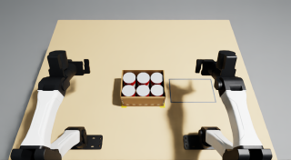
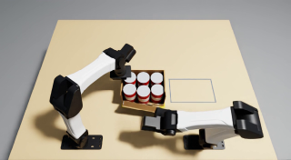
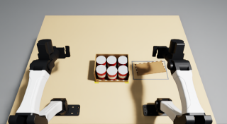

# Open a shelf-ready tray of cans: peel its perforated front panel out and down from a top corner so it tears cleanly

Instruction: `Tear the perforated front panel completely off the tray of cans, lay the torn panel flat on the bench clear of the tray, and leave all six cans standing upright inside the tray on its marks.`

Files: `task.py` (scene, rules, `score()`), `parts.py` (figures with sources, geometry), `peel.py` (tear law), `tray_template.svg` (1:1 mm dieline), kit, demo, trials, checks, tests, `task.json`, PNG views.

 

## Design notes: tear forces from a published study, and progressive peeling

Stockers and order fillers (`O*NET 53-7065.00`, ~2.8M US workers, BLS OEWS) tear the perforated front panel off shelf-ready trays by hand so the cans stay faced behind the lower lip. The pull's direction decides the tear:

- **Straight lift:** loads the whole bottom line in plane (`STRAIGHT_LIFT_HOLD_N = 459 N`). It never tears; an unbraced filled tray (`27.4 N`) tips (`0.0`).
- **Flat pull at the middle:** drives two tear fronts, one per side seam (`SYMMETRIC_PULL_HOLD_N = 5.5 N`): the side seams tear (half the perforation), the bottom line holds, the panel folds down but stays on (`0.5` at most).
- **Corner peel:** turning a top corner past `PEEL_SKEW_MIN_DEG = 6.0 deg` and peeling out and down runs one front along all `422 mm` of perforation at `PEEL_RUN_N = 2.75 N` (start = run) to `PEEL_COMPLETE_DEG = 52.0 deg` (`84.4 mm` arc), and the panel comes off.
- **The cans hold the tray:** it slides only at `9.58 N` (`mu = 0.35`), above every pull the task needs; a steadying hand is not needed (unbraced trial: tray `5.6 mm` off its marks).
- **Irreversible:** each torn stage advances the hinge's rest (`mk.set_spring`, reset by `@on_reset`); let go at `34 deg`, the panel stays open `>= 28 deg`.

## Key figures (`parts.py`)

| Figure | Constant | Value | Source |
|---|---|---|---|
| Board | `BOARD_T`, `grammage` | 3.0 mm, 405 g/m^2 | maker's data sheet: Ball & Doggett "Claycote B Flute - Brown", SKU 152448, "Single B-Flute", 3 mm, 405 gsm ([PDF](https://ballanddoggett.com.au/wp-content/uploads/2024/06/tech_data_sheet_claycote-flute-range.pdf)); or any 3 mm single-wall B-flute board of about 400 g/m^2 |
| Tray, panel, perforation | `TRAY_W/D/H`, `LIP_H`, `PANEL_W/H`, `PERF_CUT_M/TIE_M` | 230 x 164 x 130 mm, lip 28 mm, panel 218 x 102 mm, 18 mm header (rim 6.0 mm), 6 mm cut / 2 mm tie | ours by construction: `tray_template.svg` |
| Tray, panel mass | `TRAY_MASS`, `PANEL_MASS` | 54.6 g, 10.6 g | estimate: dieline board area (0.1349, 0.0262 m^2) x 405 g/m^2 |
| Can | `CAN_D`, `CAN_H`, `CAN_MASS` | 73.0 x 110.0 mm, 454 g | maker's page: "Mutti Polpa Finely Chopped Tomatoes in a 400g can" ([mutti.com](https://www.mutti.com/products/polpa-finely-chopped-tomatoes/)); listing: 454 g gross, basil variant of the same can ([kaufland.at](https://www.kaufland.at/product/316995887/)); listing: food tins "73/110 mm" ([dosen-zentrale.de](https://www.dosen-zentrale.de/en/products/sheet-metal/metal-packaging/tin-cans.html)); the brand gives no can size |
| Perforation indices | `PERF_TENSILE_INDEX`, `PERF_TEAR_INDEX` | 5.2 N m/g, 0.68 mN m^2/g | estimate: indices of perforated three-layer E-flute board (320-409 g/m^2), applied to our B-flute by grammage: Šarčević, Gregor-Svetec, Banić, Tehnički vjesnik 29(6) 2022 ([doi](https://doi.org/10.17559/TV-20211126090308)), Fig. 2c/2f, perforation 6/2, read off the bars |
| Straight-lift tear | `STRAIGHT_LIFT_HOLD_N` | 459 N | estimate: 5.2 x 405 = 2.1 kN/m x 218 mm bottom line |
| Corner peel | `PEEL_START_N`, `PEEL_RUN_N` | 2.75 N | estimate: one front 0.68 x 405 = 0.275 N; Elmendorf work 2 x 0.275 N x 422 mm = 0.232 J over the 84.4 mm arc |
| Flat pull | `SYMMETRIC_PULL_HOLD_N` | 5.5 N | estimate: two fronts (2 x 2.75 N); side seams are 204 of 422 mm |
| Skew, full-tear fold | `PEEL_SKEW_MIN_DEG`, `PEEL_COMPLETE_DEG` | 6.0 deg, 52.0 deg | estimate (model): the arc sets the peel force via the tear work |
| Frictions | `TRAY_FRICTION`, `CAN_FRICTION` | 0.35 (9.58 N slip), 0.45 | estimate: no published figure found; every outcome holds for a bench `mu >= 0.2` (slip above 5.5 N) |

Counts: maker 2, listing 2, ours 1, estimate 6.

## Tray recipe and first minutes of a real trial

Tray (one per trial): print the dieline 1:1, knife and steel rule, blunt-edge creases, 6/2 perforation by knife (about 53 ties) or cutting plotter, hot-melt glue; about 20 min by hand (task.json `reset_notes`).

About 10 minutes with caliper, scale, luggage scale and phone protractor: weigh a can and the empty tray (expect 454 g, 55 g); caliper the board (3.0 mm); tilt a filled tray on the bench board until it slides (expect about 19 deg); on a spare tray clip the luggage scale to a top corner and peel out and down (expect about 3 N, off at about 50 deg), on a second pull its middle flat (about 6 N, side seams only), on a third pull straight up (no tear).

## Scene and bilateral force check

Coordinates in cm from arm-base midpoint (`x` away, `y` left; `object_jitter=0`). Six unopened Mutti Polpa 400 g steel cans (`3 x 2`) stand in `tray_base` at `(28.0, 0.0) +/- 0.5 cm`, front panel at `x = 19.8 cm` facing `-x`, inside four `30 x 30 mm` yellow tape L-marks, with a `16.0 x 26.0 cm` grey outline at `(30.0, -28.5) +/- 0.5 cm`. Serial tree `tray_base -> c_lift -> c_pitch -> c_twist --weld(panel_detach)--> front_panel` (`5 g` hidden carriers inside `TRAY_MASS`; no closed loops, no `mk.push`).

| Stated force | Code (`file:line`) | Bodies | Ends when | Sim reading |
|---|---|---|---|---|
| Straight lift (459 N) | `peel.py:65` (`slide("perf_lift")`) | `front_panel` `<->` `tray_base` | never: the slide's stop (65 N) comes first | `g1t8` braced `22.3 N`: no tear; unbraced tips `11.4 deg` (`0.0`), side seams fold, panel stays on |
| Flat pull (5.5 N) | `peel.py:76,252` | same | side seams torn; bottom line holds | `g1t6` `5.5 N`, folds to `53 deg`, tray `0.4 mm`, `0.5` |
| Corner skew (6.0 deg) | `peel.py:87,236` | same | `\|skew\| >= 6.0 deg`; latched by the first corner stage | `g1v1` engages `6.7 deg` (`3.50 s`), peaks `13.4 deg` |
| Corner peel (2.75 N) | `peel.py:98,192,288` | same | all stages torn at `>= 52.0 deg` | `g1v1` `3.3 N` at `1 mm`, `2.75 N` over `4.0..84.8 mm`, off at `8.40 s`; `g1t6` let go at `33.8 deg`: stays `33.4 deg` |
| Bench & can contacts | `task.py:43-83` | tray, cans, panel `<->` bench | throughout | `g1v1` tray `4.34 mm`, tilt `0.01 deg`, can tip `1.13 deg` |

## Scoring and shortcuts

Read at trial end; once `1.0` holds `1.0 s`, a `3.5 s` hold parks both arms at `READY`. Whole-trial zero rules: `0.0` permanently if `tray_base` tilts `> 10.0 deg`, floor center lifts `> 15.0 mm`, any corner shifts `> 25.0 mm` from its tape mark, or any can tips `> 12.0 deg` or leaves `tray_base`. Otherwise: **`1.0`** if the panel is completely detached, flat (`<= 15.0 deg`, `z <= 20.0 mm`), `>= 30.0 mm` clear of the `tray_base` footprint without contact, all 6 cans upright (`<= 10.0 deg`) in `tray_base` within `25.0 mm` of marks, both grippers `>= 30.0 mm` clear, and all bodies `< 10.0 mm/s` and `< 0.10 rad/s` for `1.0 s`; **`0.5`** if at least half of the 422 mm perforation is torn (for example both side seams; by ruler), or the panel is off but misses a `1.0` rule, with cans upright and tray within `25.0 mm`; **`0.0`** otherwise. The simulator tracks the tear in 10 equal stages (half = 5). Shortcuts: a straight lift never tears and tips an unbraced tray (`0.0`); a flat pull only folds the panel (`0.5`); tipped cans zero.

   

## Dry checks, trials (`g1t6`, `g1t8`), recording (`g1v1`)

- **Dry checks (`checks.py`, `g1t5`):** IK `<= 0.078 mm`, margin `6.83 deg`, hand gap `>= 11.5 mm`, `15.0 N/finger` pinch (`5.45 x` the peel force); idle `2 s` scores `0.0`.
- **Trials (`trials.py`, all pass):** straight lift and flat pull as in the table; mid-peel release stays open; the known-load peel with no brace comes off, tray `5.6 mm`.
- **Recording (`demo.py`, `g1v1`, seed `0`, arm actions only; check run `g1t7` the same):** **`1.0`** (`401 / 1,600` steps = `20.05 s`, IK `0.08 / 0.09 mm`), panel flat `2.1 deg`, `58.9 mm` from the tray, both arms at `READY`. The left hand steadies the tray (not needed: trials).
- **States set directly & seed:** none in `demo.py` or `trials.py`; `test_shelf_ready_tray.py` sets states directly for all boundaries. `--seed 0` under the harness derives trial seed `1415158438` (fixed layout). Pictures: recording `g1v1`.

## How it differs and how to run

Unlike carton-flap opening, lid peeling or shelf placement (BEHAVIOR-1K `stocking_shelf`, RoboCasa pantry tasks), only one pull tears this perforation: a straight lift never tears and a flat pull only folds the panel, so the hand must turn a top corner and peel out and down through `52 deg`, irreversibly, beside six loose cans.

- Rule checks: `python mech/tasks/shelf_ready_tray/checks.py`, `python -m pytest -q mech/tasks/shelf_ready_tray/test_shelf_ready_tray.py` (18 tests).
- Sim trials & demo: `python mech/tasks/shelf_ready_tray/trials.py <out_dir>`, `python mech/tasks/shelf_ready_tray/demo.py <out_dir> --check`.
- Policy (`80 s` = `1,600` steps at `20 Hz`, seed `0`): `inspect-robots run --embodiment yam_arena --policy <policy> -E task=mech/tasks/shelf_ready_tray/task.py -E object_jitter=0 -E control_hz=20 -E cam_width=320 -E cam_height=176 --instruction "Tear the perforated front panel completely off the tray of cans, lay the torn panel flat on the bench clear of the tray, and leave all six cans standing upright inside the tray on its marks." --scorer task_score --max-steps 1600 --seed 0`.
- Assets: none (primitives; `tray_template.svg` is ours, under the repo license).
