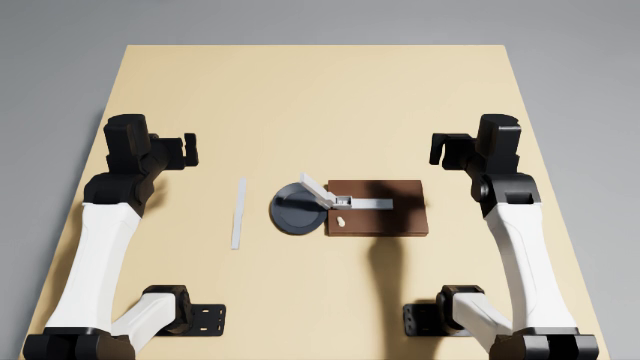
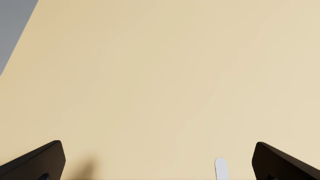
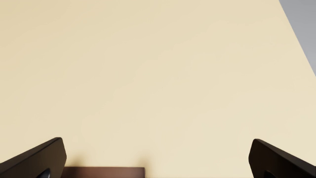
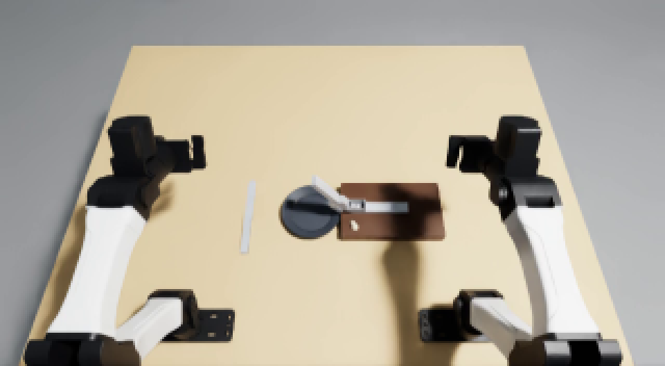
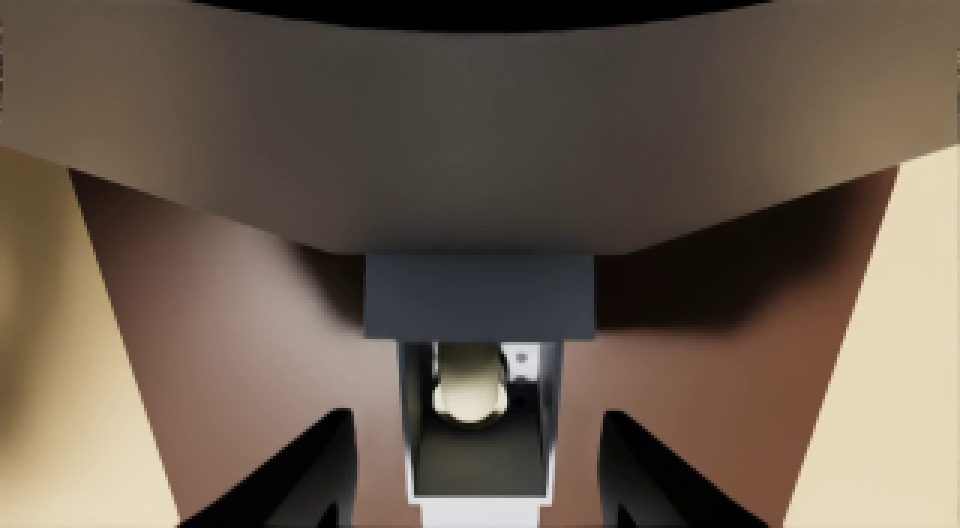
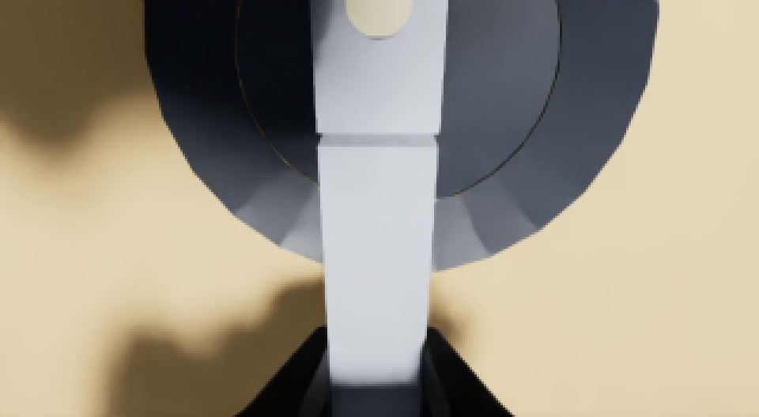
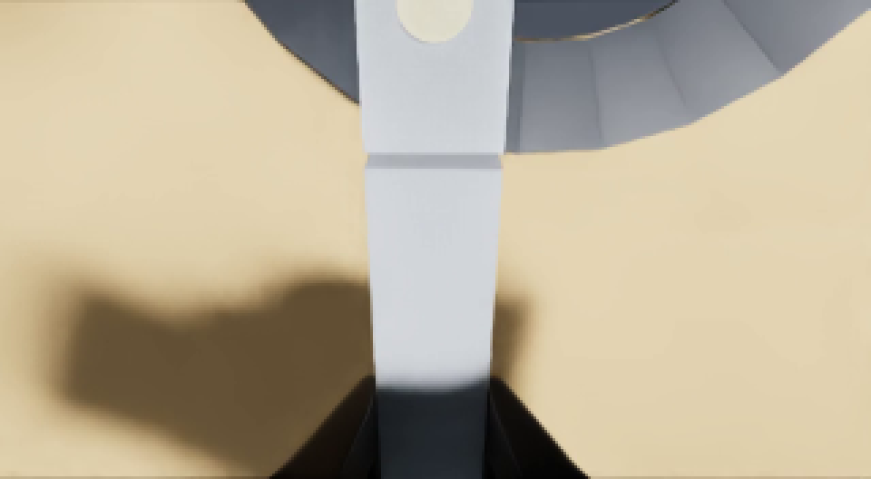
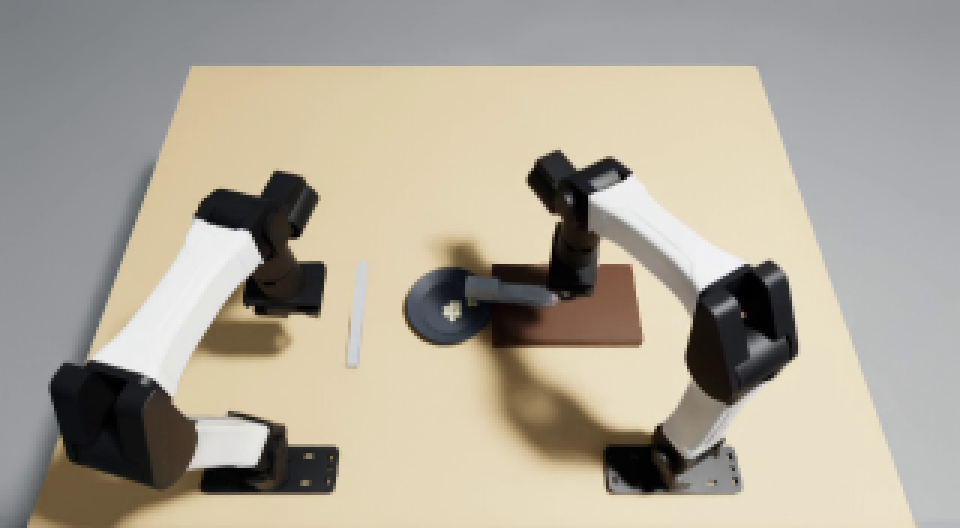

# Press a garlic clove through a garlic press onto a saucer, and scrape what hangs under it off with a knife

Instruction given to the policy: `Press the garlic clove through the garlic press onto the saucer, scrape what clings to the press onto the saucer with the knife, then put the press and the knife down.`

Files: `task.py` (scene, the garlic as a material, the clove's resistance under the plunger, rules, score), `mechkit.py` (the mechanism kit the task file imports), `demo.py` (the scripted full-score run and the five runs that show the lower levels), `demo_kit.py` (the runner behind the scripted runs), `trials.py` (checks in the simulator without an arm: rest, the clove let go over the chamber, the press under known torques, a knife under the lifted press), `push_gauge.py` and `push_check.py` (the arm's push on a spring gauge), `start_*.png` (the first pictures of a trial), `cue_*.png` (pictures at the size a policy gets), `README.md`.



 

The first pictures of a trial, both arms in their ready pose. Top camera: the bench; on it, in front of the right arm, the dark walnut board with the open garlic press lying on it and the pale clove on the board's near left part; left of the board the slate-grey saucer; left of that the knife on the bare bench. The clove measures 28.5 x 16.5 mm and shows as a pale spot of about 6 x 3 pixels on the dark board at the size a policy gets (see "Can it be seen"); no arm's shadow falls on it at the start. Neither wrist camera sees the board from the ready pose.

## Scene

Bench coordinates in metres: x forward from the line through the two arm bases, y left from the midline, z up from the bench top. The arms' bases are at (0, -0.305) and (0, +0.305).

| Part | Size, mass | Where |
|---|---|---|
| Cutting board, walnut, loose | 250 x 150 x 30 mm, 0.73 kg (650 kg/m3, assumed) | x 0.205 to 0.355, y -0.285 to -0.035: long side along y, its left edge 3.5 cm right of the midline |
| Garlic press, Zyliss Susi 3, cast aluminium | 155 x 26 x 57 mm closed, 150 g (retailers' figures); lower part 80 g, upper part 70 g (assumed split); chamber inside 34 x 24 mm, 24 mm deep, its floor a sieve of thirty 2.5 mm holes; plunger face 31 x 22 mm, its middle 26 mm from the hinge pin; opens 120 degrees | lying on the board along y, on its middle line x 0.28, its tip (the hinge end) 10 mm inside the board's left edge (y -0.045); open, the upper handle on its 120 degree stop |
| One peeled garlic clove | by seed one of four: 28.5 x 16.5 x 13 mm, 5 g; 26 x 14 x 11 mm, 4 g; 31 x 19 x 15 mm, 6 g; 31 x 15 x 12 mm, 5 g (length, width, thickness). Four convex parts: a blunt root end and a narrower middle, both flat underneath, a rounded back, a rounded tip | on the board's near left part, its middle within 1 cm of (0.232, -0.065), on its flat face or its side, turned any way (seed 0: the 5 g clove on its flat face, 25 degrees from the press's line) |
| Saucer, slate-grey stoneware, loose | 150 mm across, 20 mm high, 200 g (assumed); a flat well 104 mm across, 6 mm over the bench, inside a sloping rim | middle (0.280, 0.040), against the board's left edge |
| Table knife, stainless, blunt | 210 mm, 70 g (handle 95 x 18 x 9 mm, blade 115 x 20 x 2 mm with a round tip: assumed) | on the bench left of the saucer, along x, handle towards the arms: the handle from x 0.170 to 0.265 at y 0.200, the blade on to x 0.380 |

The three cloves not in use lie on the floor under the bench, out of every camera.

Sizes and sources. The press's outline and weight are retailers' figures; the chamber, the sieve, the plunger, the hinge's place and the split of the weight between the two parts are assumed from product pictures and are to be measured on the bought press (calliper; the two parts weighed after taking out the pin). The clove is packaged produce: one clove of 4 to 6 g, 26 to 31 mm long, from a bag of ready-peeled garlic cloves as supermarkets sell them (for instance Christopher Ranch Peeled Garlic; see "Setting up and resetting the real bench"); its widths and thicknesses are assumed from such cloves. The press is the Zyliss Susi 3 (maker's number E12150; the maker gives 15.5 x 5.7 x 2.6 cm). The garlic is Christopher Ranch Peeled Garlic in its 6 oz (170 g) bag, sold refrigerated. The saucer stands for a dark stoneware saucer of 150 mm, for instance the Fiesta saucer no. 470 (149 mm across, 22 mm high); that one has a cup ring in its middle where the scene has a flat well, which changes nothing in the score (weight on the saucer). The board stands for a walnut board 30 to 32 mm thick; boards that thick are sold a size larger than the scene's 250 x 150 mm, for instance the JK Adams end-grain walnut board of 16 x 10 x 1.25 in (406 x 254 x 32 mm): laid with its left and near edges where the scene's board has them, the press, the clove and the saucer keep their places, and the extra board reaches right and away, where nothing happens. The knife stands for a plain stainless table knife of about 21 cm with a round tip, for instance IKEA FORNUFT (21 cm); the scene's handle is 95 x 18 x 9 mm, and a thinner handle is to be measured before the trials, since a hand takes it from above. The masses of board, saucer and knife are assumed and are to be weighed.

## What stands in for what

A rigid-body simulator cannot crush a clove, push it through thirty holes or let it hang under a sieve. The task replaces that by rules (every number from the table `MATERIAL` in `task.py`, under "The clove as a material"):

- **The plunger passes through the clove; the clove's resistance is put on the hinge.** The press's upper part does not collide with cloves. The plunger arrives on the clove when its face comes down to the clove's highest point inside the chamber's outline, read in the press's own frame (`touch_angle`: exact for any angle of the handle). A handle that came down past that point within one control step (a free fall does: 10 degrees in a step) is put back there and its fall is taken up. From then on the hinge's drive is the clove: a stiff spring (338 N m/rad) capped at the yield (6.5 N m at the hinge, that is 250 N on the plunger's face 26 mm from the pin), whose rest is the clove's top as crushed so far. The rest sinks with the load the spring carries, 2.5 mm at the yield; with the spring's own 0.5 mm the plunger has then gone 3 mm from the touch, as the table asks. Past the yield the plunger goes on down and the rest follows it 1 mm behind: let go, the plunger comes back 1 mm. The spring pushes and never pulls: with the handle lifted off the clove the drive gives nothing, and a handle that comes down again is stopped where the clove was crushed to.
- **The clove is consumed when the plunger arrives.** Its share outside the chamber's outline is pinched off (waste, drawn as garlic on the rim); its body leaves the scene and the chamber is drawn filled with crushed garlic up to where its top was. The drawing goes down with the plunger.
- **Through the sieve in proportion to the plunger's travel.** Nothing before the yield (3 mm from the touch); 85 % of the pressed part with the plunger's face 3 mm over the sieve, in proportion between; the 15 % left is skin and fibre and stays in the chamber. Of what comes through, 30 % falls straight down onto whatever is under the sieve (the saucer, the board or the bench, drawn as spots there) and 70 % hangs under the sieve, one strand of 6 to 10 mm under each of the thirty holes (drawn). With the sieve resting on the board, everything that comes through goes onto the board.
- **Scraping.** A strand goes onto the knife when either long edge of the blade passes under its hole within 1 mm of the sieve (drawn as spots on the blade). What the knife carries goes onto the saucer when the blade comes within 1.5 mm of the saucer's surface.
- **The clove free on the board** is a rigid body of four convex parts, slippery (friction 0.3), that a hand can pick up, drop and roll. A pinch does not damage it (the gripper cannot press hard enough to bruise a clove in a way that changes a level).

## The clove as a material

Every number the simulation takes for the garlic, from `MATERIAL` in `task.py`. "Assumed": to be measured on the bench with the method given.

| Quantity | Value | Source, or how to measure it |
|---|---|---|
| the clove | one clove of 4 to 6 g, 26 to 31 mm long, taken from a bag of ready-peeled garlic cloves as supermarkets sell them (for instance Christopher Ranch Peeled Garlic), the bag within its use-by date and kept closed in a refrigerator at 2 to 4 C (36 to 40 F); the clove taken out of the refrigerator not more than 10 minutes before the trial and patted dry with a paper towel; a clove with a cut or bruised surface is not used | bench text |
| length | 26 to 31 mm | bench text |
| width, thickness | 14 to 19 mm, 11 to 15 mm | assumed from such cloves; calliper |
| mass | 4 to 6 g | bench text; 0.1 g scale |
| friction | 0.3 | assumed: a peeled clove is slippery; tilt the board until it slides |
| yield at the plunger | 250 N | assumed; the press on a kitchen scale, the peak reading while a clove goes through |
| travel from the touch to the yield | 3 mm | assumed; the plunger's travel from touching the clove to that peak |
| springback | 1 mm | assumed; how far the plunger comes back up when the press is let go |
| through with the face 3 mm over the sieve | 85 % | assumed; weigh what is left in the chamber |
| of what is through: falls straight down | 30 % | assumed; weigh what is on the saucer before scraping |
| of what is through: hangs under the sieve | 70 % | assumed |
| a blade's edge takes a strand within | 1 mm | assumed |
| strands | 6 to 10 mm | assumed (drawn only) |

The yield is assumed, and so is everything that follows from it below (the push the task needs).

## Rules

The amounts are shares of the clove's weight. What counts as on the saucer is pressed garlic on it.

| Score | Asked | On a real bench |
|---|---|---|
| 0 | the saucer or the board has left the bench (2 cm or more under its top); or more than a third of the clove was pinched off outside the chamber; or none of the levels below | the video; the waste on the rim weighed |
| 0.25 | the clove in the chamber with the plunger on it (the face no more than 1.5 mm over the lowest the clove was pressed to) | a photo of the press |
| 0.5 | 70 % or more of the clove through the sieve, under 45 % on the saucer | the saucer weighed before and after on a 0.1 g scale, the clove weighed before |
| 0.75 | 45 % or more on the saucer | the same |
| 1.0 | 65 % or more on the saucer; press and knife lying on the board or the bench (set down: within 3 mm of the board's top or the bench's top, nothing lower than the board's top where they lie on it); both grippers 3 cm or more from press and knife; every part at rest (under 2 cm/s over a quarter second) | the same, and the video of the release |

The score that counts is the one at the end of the trial. A trial succeeds when the score has been 1.0 for one second; it then ends. The run limit is 3,000 steps (150 s at 20 Hz).

The thresholds: a clean run puts 85 % of the clove on the saucer (25.5 % falls while pressing, 59.5 % comes off the knife); 65 % leaves room for a scrape that misses some strands; 45 % is a little more than what falls while pressing.

## Setting up and resetting the real bench

- The clove: one clove of 4 to 6 g, 26 to 31 mm long, taken from a bag of ready-peeled garlic cloves as supermarkets sell them (for instance Christopher Ranch Peeled Garlic), the bag within its use-by date and kept closed in a refrigerator at 2 to 4 C (36 to 40 F); the clove taken out of the refrigerator not more than 10 minutes before the trial and patted dry with a paper towel; a clove with a cut or bruised surface is not used. The bag is closed again and put back in the refrigerator at once. A bag of 170 g (6 oz) holds about 30 to 40 cloves, about half of them in the size and weight range: about 15 to 20 trials a bag. Weigh the clove (0.1 g scale) and lay it on its flat face on the board's near left part, its middle 27 mm from the board's near edge and 30 mm from its left edge. A new clove for every trial.
- The press (Zyliss Susi 3), emptied, washed and dried before every trial (skin and fibre out of the chamber, the sieve's holes clear): open on its stop, lying on the board along the board's long side, its tip 10 mm inside the board's left edge, on the board's middle line.
- The walnut board (250 x 150 x 30 mm) loose on the bench in front of the right arm, its long side along the bench's width, as under "Scene"; the slate-grey saucer, washed, dried and weighed empty, against the board's left edge, its middle in line with the press; the knife, wiped, on the bench beyond the saucer, handle towards the arms.
- At the end: the saucer weighed with what lies on it; on it as a share of the clove = (saucer after - saucer before) / clove before. Waste pinched off on the rim: scraped off the rim and weighed. A photo from above and the video for the rest.
- Between trials the grippers' pads are wiped (garlic juice on the pads makes them slippery), as are the press, the saucer and the knife as above. A reset takes about 8 minutes: weighing the saucer twice and the clove, washing and drying the press (the sieve's holes brushed clear), the saucer and the knife, wiping the pads, laying everything out.

## Can it be seen

At the size a policy gets (320 x 176), enlarged three times here, from the run `full` (recording `b3g12`; `b3g11` the same).

 

Left: the top camera at the start; the clove is the pale spot of about 6 x 3 pixels on the dark board beside the open press. Right: the right wrist camera as the clove is let go in the chamber (9.1 s): the clove lies lengthways between the fingertips, the chamber's walls round it.

 

The left wrist camera looks down along the knife it holds: during the scrape (47.5 s) and on the way to the saucer (52.0 s) the garlic taken off the sieve is a pale spot of about 5 x 5 pixels on the blade.



The top camera at the end (66.0 s): the garlic on the saucer is a pale patch on the slate beside the press's tip; the press lies on the board, the knife on the bench.

The strands under the lifted press: no camera shows them. The top camera sees the press from above, which covers them (`cue_top_lifted.png`); the right wrist camera, on the hand that holds the press, sees the handles a few centimetres away (`cue_right_holding.png`); the left wrist camera looks down along the knife (`cue_left_scraping.png`). The strands are drawn as they are (6 to 10 mm under each hole) and are not made bigger or moved to where a camera would see them. What a policy sees of the scrape is the garlic on the blade and then on the saucer.

## The arm can press that hard

The clove yields at 250 N on the plunger's face (assumed), 6.5 N m at the hinge. The arm was checked first on a spring gauge (recording `b3g4`, `push_check.py`): a bar hinged where the press's hinge is, with a spring of 200 N m/rad, standing at 25 degrees; known torques on the bar read it as 200.0 N m/rad (199.99 to 200.1). The right hand, pointing down, pinched the bar 25 mm from its end and pressed straight down, the push asked for ramped up and then down again.

| Push asked for | The arm's own reading of its push, going up | coming down | What the gauge's spring read, going up | coming down |
|---|---|---|---|---|
| 30 N | 28.8 N | 22.1 N | 39.3 N | 34.1 N |
| 45 N | 42.7 N | 36.8 N | 66.5 N | 53.5 N |
| 60 N | 56.4 N | 51.4 N | 85.7 N | 72.7 N |
| 75 N | 66.3 N (its hardest-working joint at 91 % of its effort) | | 90.0 N | |

The gauge read 1.3 to 1.6 times more than the arm. It is the gauge that is wrong: a joint whose two bodies are both held (the bar in the hand and on its hinge) reads more torque from its travel than it carries; the press's own hinge, with its lower part welded in place, read 1.31 times its known torque by the same reckoning and 1.00 standing free (below). The arm's own reading is the one to go by: it presses 0.94 to 0.96 of what is asked going up and less coming down (friction in its joints holds), and in the full-score run the clove gave exactly where that reading says it should (below).

In the full-score run (recording `b3g12`) the right hand presses with its closed fingertips on the upper handle's top face 15 mm from the handle's end, tilted half the handle's angle from straight down towards the grip end (so that the fingertips do not slide on the face and the press does not skate on the board). The clove gave at 34.65 s. Half a second before, with about 50 N asked, the arm read 49.1 N straight down and 10.7 N towards the grip end on the face 136 mm from the pin, the handle at 26.0 degrees: 6.53 N m at the hinge, against the clove's 6.5 N m. The most it pressed in that run was 61.2 N, with 75 N asked, the handle closed (its hardest-working joint then at 73 % of its effort; on the gauge, 75 N asked took 91 %).

With 75 N asked, the most the script asks, the arm gives 61 to 66 N on the handle, which puts at most about 300 to 330 N on the plunger's face where a clove gives, against the 250 N assumed: a press and clove that need more than that cannot be pressed by this arm as scripted.

A pinch across the handle does not do: it presses only through the pads' friction on the handle's sides, and in recording `b3g8` it slid down the handle at 48 N (5.75 N m), short of the yield; the clove stayed 3 mm in.

## The clove's resistance, checked with steady loads put on directly

No arm (recording `b3g7`, `trials.py press`). The press free on the board where it is pressed (51 mm past the board's edge), opened 45 degrees. First the hinge's drive by itself, before any clove: known torques of 1, 2 and 4 N m read 337.9 N m/rad for the 338 the scene gives it; with the lower part welded in place instead, 257.5 (the kit's known fault of a joint between held bodies, see above). Then the 5 g clove lengthways in the chamber, the handle let fall onto it by its own weight, and known closing torques on the handle with the same opening torque on the lower part (so that the press as a whole feels none).

| Load | Plunger into the clove (from where it touched) | |
|---|---|---|
| its own weight, after the handle came 10.2 degrees past the clove in one control step and was put back | 0.03 mm | the fall taken up where it touched |
| a quarter of the yield (1.6 N m), 1 s | 0.82 mm | stands |
| a half (3.3 N m), 1 s | 1.63 mm | stands |
| three quarters (4.9 N m), 1 s | 2.44 mm | stands |
| nine tenths (5.9 N m), 0.5 s and 2 s | 2.92 mm and 2.92 mm | stands |
| eleven tenths (7.2 N m), 3 s | down to the stop, the face 1.4 mm over the sieve | 85 % through: 30 % of it on the saucer, 70 % hanging |
| let go | came back 0.99 mm | |

The plunger goes about 7 % further than the model's 3 mm at the yield: the model reckons the face's travel on a 26 mm arm, and the face's middle, 11 mm below the pin, moves 28 mm for each radian. Then the closed press was lifted 6 cm over the saucer and held, a knife moved once across under its sieve at 2 cm/s took all that hung (2.98 g), and its tip set on the saucer's well put it there: 4.25 of 5 g on the saucer.

## Laying the clove in

The clove let go over the open chamber as a hand lets it go, its middle 15 mm over the rim, with nothing pressing (recording `b3g3`, `trials.py drop`; the 5 g clove unless named).

| Let go | Inside the chamber's outline | Lowest, highest point over the sieve | Tilt |
|---|---|---|---|
| lengthways; 3 mm off the middle; turned 15 degrees; turned 30 degrees | all of it | 0.6, 12.6 mm | 0 degrees: the walls turn it lengthways |
| on its side, lengthways | all of it | 0.2, 15.3 mm | 90 degrees |
| the largest clove (6 g), lengthways | all of it | 0.6, 13.8 mm | 0 degrees |
| across | 94 % | 24.0, 36.4 mm: on the rim | 1.5 degrees |

A clove let go across the chamber stays across it, on the rim; the plunger then meets it high (near 57 degrees in the test) and pinches off what lies over the side walls.

## The press at the board's edge

Lying on the board where it starts, the press stands open on its stop. Pushed to where it is pressed, 51 mm past the board's edge, it stands on the board as long as its centre of mass is over the board: closed it is 75.1 mm from the tip, with the handle on a clove (30 degrees) 69.9 mm, open on its stop (120 degrees) 31.4 mm. At the edge it tips once opened past 76.9 degrees. The split of its 150 g between its two parts is assumed (80 g lower, 70 g upper): with 10 g more in the lower part it tips past 89.0 degrees, with 10 g more in the upper part past 67.7 degrees. The handle is let go onto the clove at 74 degrees where the press starts, wholly on the board, and pressed below 35 degrees.


## Reference runs

The full-score run from committed code is the demo video. Recording `b3g12` of 2026-11-20, commit `8923167`, seed 0, 20 Hz: `full` scored 1.0.

| Time | What happens | Score |
|---|---|---|
| 0 to 9.6 s | the right hand picks the clove up and lets it go over the chamber; it lies lengthways on the sieve | 0 |
| 18.1 s | the handle, carried to 74 degrees and let go, falls onto the clove: the plunger meets it at 33.6 degrees, 17.2 mm over the sieve, all of it inside the chamber's outline | 0.25 |
| 22.6 to 27.2 s | the right hand pushes the press 62 mm along the board, until it stands 51.8 mm past the board's edge | 0.25 |
| 32.2 to 35.1 s | pressed with the fingertips; the clove gives at 34.65 s (the arm's own reading half a second before: 49.1 N down and 10.7 N towards the grip end, 6.53 N m at the hinge) and is through at 35.05 s: 85 %, of which 25.5 % of the clove falls onto the saucer and 59.5 % hangs under the sieve. As the push came on the press slid 2.7 mm back onto the board, to 48.6 mm past the edge, and stood there | 0.5 |
| 40.9 to 49.75 s | the closed press lifted 6 cm over the saucer; the knife's blade under the sieve, pushed up with 2 N, once across in 3 s: it takes all that hangs | 0.5 |
| 53.65 s | the blade's tip on the saucer's well: 85 % of the clove on the saucer | 0.75 |
| 65.2 s | the knife on the bench where it was, the press set down 46.8 mm past the board's edge, both hands away, everything at rest | 1.0 |

The trial ended a second later, at 66.15 s (1,323 of 3,000 steps). The run is the same, to the pixel, as `b3g9` and `b3g11` (the same script before it was committed, and at commit `7e65173` with the earlier instruction, which the script does not read).

Contact sheets looked at, of `b3g11` (top, left and right wrist cameras; `b3g12` is the same to the pixel), of `b3g10`'s five runs (top) and of `across` (right wrist). Top camera: every step can be followed; the clove is a pale spot on the board until the hand takes it, the open handle stands up over the board's left part, the press goes past the board's edge over the saucer, the left hand takes the knife under the lifted press and to the saucer; from 57 s the garlic is a pale spot on the saucer by the press's tip. Right wrist camera: the clove between the fingers over the open chamber and its sieve (4.5 s), the clove lying in the chamber (9.1 s), then the handle and, holding the press, the handles a few centimetres away. Left wrist camera: the bench and the arm's base until it takes the knife, then the knife along the middle of the picture, the saucer beyond it, garlic on the blade after the scrape. In `pressed` the left arm never moves; in `in_chamber` both hands go away with the handle lying on the clove; in `held` the right hand is on the press at the end; in `across` the right wrist camera shows the clove, let go across the chamber, lying in it.

The script, at 20 Hz: the right hand picks the clove up with a light pinch across its width (0.5 mm per finger past touching, about 2.5 N per pad), carries it over the open chamber turned lengthways and lets it go with its fingertips 2 mm over the rim. It pinches the open upper handle lightly 45 mm from its end, coming to it level from the grip end's side, carries it along its arc from the stop (120 degrees) to 74 degrees, past where its weight turns it shut (84 degrees), and lets go: the handle falls onto the clove. Meanwhile the left hand picks up the knife. The right hand, closed, pushes the end of the lower handle until the press stands 51 mm past the board's edge, 5 mm a look; sets its fingertips on the upper handle's top face 15 mm from its end and presses (30 N asked at first, 10 N more a second, at most 75 N), tilted half the handle's angle towards its grip end, until the handle is within 2 degrees of closed; presses on for a second, eases off; pinches the closed press across both handles there and lifts it 6 cm. The left hand turns the knife to point along the press, brings its blade flat under the sieve, pushes it up against the sieve with 2 N and runs it across in 3 s; sets the blade's tip on the saucer's well, tilted 15 degrees; lays the knife on the bench where it was. The right hand sets the press down where it was pressed, lets go and goes away.

Recorded earlier, and reported as they ran (recording `b3g10` of 2026-11-20, seed 0, from the code as it then stood: the script and task of commit `7e65173` except the clove's bench text, which changes nothing in the simulation):

| Run | What it does | Score | What the recording shows |
|---|---|---|---|
| `pressed` | as `full`, without the knife | 0.5 | the clove through at 35.55 s; 85 % through, 25.5 % on the saucer, 59.5 % left hanging under the sieve; the press set down |
| `half` | the blade run 35 % of the way across | 1.0, not the 0.75 planned | the knife went 3 to 7 mm further across than planned and took four of the five rows of strands: 73.1 % on the saucer. The 0.75 level is shown by the rule test instead |
| `in_chamber` | the clove in, the handle onto it, nothing pressed | 0.25 | the handle came 26.9 degrees past the clove in one control step, was put back where its face touched (32.4 degrees) and lay there |
| `across` | the clove let go across the chamber | 1.0 | the clove did not stay across: it turned and fell into the chamber (the plunger met it at 41.7 degrees, 21.1 mm over the sieve, all of it inside the outline); nothing pinched off. Pinching off is shown by the drop trial (a clove across, on the rim: 94 % inside), the rule test (more than a third: 0) |
| `held` | as `full`, the right hand stays on the press | 0.75 | 85 % on the saucer, everything at rest, the hand on the press at the end |

Also recorded, on the way: `b3g8` (`full` with the handle pinched across its width to press: 0.25, the pinch slid down the handle at 48 N, see "The arm can press that hard") and `b3g9` (`full` with the fingertip press, before it was committed: 1.0 in 66.2 s).

How each level is shown, then: 1.0 by the full-score run; 0.75 by the rule test (64.9 % on the saucer) and the run `held`; 0.5 by the run `pressed` and the rule test; 0.25 by the run `in_chamber` and the rule test; 0 (pinched off, a part off the bench) by the rule tests and the drop trial.

## What the reference script reads

From the simulator, to put the hands where things are, as a person sees or feels them: where the clove, the press's two parts, the knife and the saucer are; how far the handle is open (a person sees it); how far the press stands past the board's edge (to stop pushing it); the hands' own turn. Not the garlic's amounts, not the clove's resistance or any force, not the score, and no camera.

## Limits and readings

| Limit in the score | On the real bench | In the full-score run | Run that shows it | Set directly (test) |
|---|---|---|---|---|
| 65 % of the clove on the saucer (1.0) | the saucer weighed before and after, the clove before (0.1 g scale) | 85 % | none (`half` took 73 %, more than planned) | 64.9 %: 0.75; 65 %: 1.0 |
| 45 % on the saucer (0.75) | the same | 85 % | `pressed`: 25.5 % (0.5) | 44.9 %: 0.5; 45 %: 0.75 |
| 70 % through the sieve (0.5) | what is left in the chamber weighed, with what is under the press | 85 % | `in_chamber`: none through (0.25) | 69.9 % with 44 % on the saucer |
| the plunger on the clove in the chamber (0.25) | a photo | from 18.1 s | `in_chamber` | on it, 69.9 % through: 0.25; nothing touched: 0 |
| more than a third pinched off (0) | the waste on the rim weighed | none | none (in `across` the clove fell into the chamber) | 34 % with 100 % on the saucer: 0 |
| the saucer or the board off the bench (0) | the video | on the bench | none | the saucer 2.1 cm under the bench top: 0; 1.9 cm: kept |
| press and knife lying (1.0) | the photo | press 46.8 mm past the board's edge, lying on it | none | held 1 cm over the board: 0.75; tipped 10 degrees over the edge: not lying |
| both grippers 3 cm or more away (1.0) | the video | both away | `held`: the hand on the press, 0.75 | 2.9 cm: 0.75; 3.1 cm: 1.0 |
| everything at rest (1.0) | the video | at rest | none | 19 mm/s: 1.0; 21 mm/s: 0.75 |

## States set directly

`tests/test_garlic_press.py`, without the simulator (`scripts/rta check garlic_press`, 10 tests):

- the scene as specified (sizes, masses, places, the press's two parts, the four cloves within the bench text);
- the press starts wholly on the board; at the board's edge it tips only opened past 76.9 degrees;
- by seed the clove lies on the board on its flat face or its side, turned any way, within 1 cm of its place;
- the clove's crushing (2.5 mm at the yield, 3 mm of the plunger's travel with the spring's give) and what goes through the sieve with the plunger's travel (none before the yield, 85 % with the face 3 mm over the sieve);
- the plunger arriving on a clove lying lengthways: the handle closed half a degree a step, the touch put at the exact opening where the face first meets the clove (checked against the part's pose: the face's plane passes through the clove's highest covered point there), all of it pressed;
- the clove under a load: crushed in proportion and standing below its yield; a lifted handle free (the drive gives nothing) and, let down again, stopped where the clove was crushed to; past the yield the spring's rest follows the handle 1 mm behind;
- over the saucer 30 % of what comes through drops onto it and 70 % hangs as strands; over the board all of it goes onto the board;
- a clove across the chamber, lying on the rim: the plunger meets it above 55 degrees and pinches it off at both side walls; more than a third pinched off scores 0 whatever lies on the saucer;
- the knife takes a strand when either long edge of its blade passes under the strand's hole within 1 mm, and not when it passes 1.5 mm under; what it carries goes onto the saucer when the blade comes within 1.5 mm of the saucer's surface;
- the score's levels and the release, as in the table above.

## Nearest tasks elsewhere

- BEHAVIOR-1K has make_garlic_mushrooms and make_king_prawns_with_garlic, where garlic is an ingredient of a recipe and no press is used.
- RoboCasa365 has SpicyMarinade and GatherMarinadeIngredients, where garlic is picked up and placed.
- RoboCasa365 has JuiceFruitReamer, where fruit is pressed against a reamer: another tool, no lever, nothing scraped.
- On this board the only garlic task of any state is #2460 (closed, see below), besides #2455 (a silicone tube peeler, closed) and a pending potato-masher task.
- None of them presses a clove through a sieve with a lever or scrapes the press.

## Earlier review of this idea

Submission #2460 (2026-11-17, closed 11-18, "Egregious simplification") modelled the clove as a rigid rectangular block, "whose artificial shape defines the lengthwise fit and grasp", and gave no sourcing for the perishable clove; its instruction also dictated the method. Here the clove is four convex parts shaped like a clove (a blunt root end, a pointed tip, a flat face, a rounded back), in four sizes by seed, lying on its flat face or its side and turned any way; whether it lands lengthways in the chamber is up to how it is laid in (see "Laying the clove in"). The bench text says which clove and how it is kept and handled, with numbers: one clove of 4 to 6 g, 26 to 31 mm long, from a bag of ready-peeled garlic cloves as supermarkets sell them, the bag within its date and closed in a refrigerator at 2 to 4 C (36 to 40 F), the clove out of it at most 10 minutes before the trial, patted dry, none with a cut or bruised surface (packaged, not peeled by hand, so that every bench starts from the same clove). The instruction names the result and the tool, not the moves. The crushing resistance, not faulted then, is kept and written out above with its sources.

## How to run

A trial runs at most 3,000 control steps at 20 Hz (150 s); the scripted full-score run takes 66 s. The score is the task's own (`score` in `task.py`, read at the end of the trial). Seed 0 is the reference: the 5 g clove on its flat face, turned 25 degrees from the press's line, at its place on the board. Other seeds take one of the four cloves, on its flat face or its side, turned any way, its middle within 1 cm of that place; everything else is the same for every seed.

```
scripts/rta check garlic_press                                          # the rules' tests, no simulator
scripts/rta demo <id> mech/tasks/garlic_press full --quick              # the plan against reach and joint limits (any of the six runs)
scripts/rta demo <id> mech/tasks/garlic_press full                      # the full-score run, recorded
scripts/rta simpy <id> mech/tasks/garlic_press/trials.py /workspace/robocurve/outputs/<id> rest,drop,press
scripts/rta simpy <id> mech/tasks/garlic_press/push_check.py /workspace/robocurve/outputs/<id> 25
```
