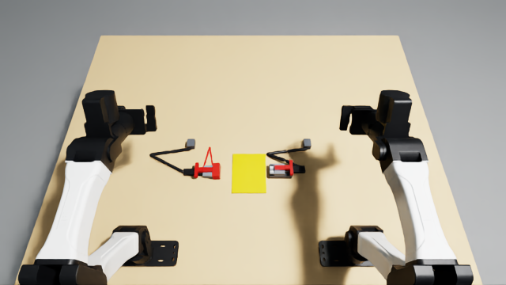

# Pull the dust cover off an Anderson SB50 battery connector and mate two SB50s home

Instruction: `Pull the red dust cover off, mate the two grey battery connectors fully together, lay the joined pair on the yellow mat, then let go and move both hands clear.`

Files: `task.json`; `task.py` (rules, score); `scene.py` (bodies, joints); `parts.py` (figures, sources); `checks.py` (grasps, reach); `demo.py` (reference run, trials); `trials.py` (cover pull); `test_sb50_mate.py`; the kit (`mechkit.py`, `demo_kit.py`, `kit_extra.py`); `start_top.png`, `start_top_policy.png` (320 x 176), `start_left_wrist.png`, `start_right_wrist.png`.

## What the task tests

- **The genderless mate.** The SB50 "mates with itself" (maker): two identical housings fit only with one turned over. Both start '+' face up; pushed together so, tongue meets tongue 14.7 mm short. Which one to turn is read from the handles and '+' marks.
- **Two hands.** One hand holds the left lead while the other pulls the cover off (10 N; unheld, the lead slides away). One connector is turned over, the noses brought in line within the fit (0.4 mm a side, 2 mm lead-in corners) and pushed home against 44 N.
- **Laid down and let go.** The joined pair goes on the mat and both hands move clear.

## Scene

- **Connectors** (maker's sizes): grey SB50 housings 48.0 x 36.5 x 15.9 mm, red SB50-HDL-RED T-handles (56.7 mm long, 48.6 mm crossbar, 25.1 mm behind the housing), two 6 AWG leads stiff for 66 mm, then four jointed links to a bench clamp. The nose is a lower tongue between two upper side walls: turned over, the noses slide to 81.0 mm rear face to rear face.
- **Dust cover**: red 134G1 on the left nose up to the handle (16 mm), its 200 mm strap looped round the leads.
- **Our fixture**: mat depth (x) 140 mm; mat length (y) 110 mm; mat thickness 4 mm; block under the right housing, height 20 mm. Layout and reset: `task.json`.

## Rules and score

1.0: the housings mated home (one turned over, 180 +- 20 deg; axes within 4 mm and 10 deg; 79.3 to 83.5 mm rear face to rear face), lying on the yellow mat (its midpoint 2 cm or more inside the mat's edges, each housing's lowest corner at most 18 mm over the mat and pitched 15 degrees at most), the cover off, both hands 30 mm or more away, all still for the last 1.0 s. 0.5: cover off, noses in line, one turned over, overlapping 5 mm or more (91.0 mm or less). 0.25: cover off (no part within 5 mm of the nose). 0 otherwise; nothing can fall off, so no event zeroes a trial. Full words and the bench measurements: `task.json` (scoring).

The simulator (task.py): the cover is freed where it is once its slide has moved 16 mm; the housings are joined where they stand once the noses overlap 1.5 mm, turned over and in line, and a slide then takes 44 N to move either way.

## Key figures and their sources

| Figure | Value | Kind | Words or derivation |
|---|---|---|---|
| housing length | 48 mm | maker | DWG 111923S1 rev 8: '[48.0] 1.89' |
| housing width | 36.5 mm | maker | DWG 111923S1 rev 8: '[36.5] 1.44' |
| housing height | 15.9 mm | maker | DWG 111923S1 rev 8: '[15.9] .63' |
| mated pair, rear face to rear face | 81.3 mm | maker | DWG 111923S1 rev 8: '[81.3] 3.20 REF.', 'MATED PAIR' |
| mating force | 44 N | maker | DS-SB50 rev 9, specifications: 'Avg. Mating / Unmating Force', 'Wire-to-Wire Low Force Contacts' '10' Lbf, '44' N |
| lead insulation diameter | 11.2 mm | maker | DS-SB50 rev 9: 'Max. Wire Insulation Diameter' '0.440' in., '11.200' mm |
| nose side wall width | 4 mm | estimate | scaled from the drawing's front view |
| nose fit, each side and at the middle | 0.4 mm | estimate | a sliding fit of moulded polycarbonate (1.1 mm between the tongues) |
| rounded nose corners | 2 mm | estimate | the lead-in of a moulded nose |
| handle length | 56.7 mm | maker | DWG 113923S1 rev 5: '[56.7] 2.23', 'HANDLE - POLYCARBONATE' |
| handle crossbar width | 48.6 mm | maker | DWG 113923S1 rev 5: '[48.6] 1.92' |
| handle stem width | 13.9 mm | maker | DWG 113923S1 rev 5: '[13.9] .55' |
| handle height at the crossbar | 13.4 mm | maker | DWG 113923S1 rev 5: '[13.4] .53' |
| handle reach behind the housing | 25.1 mm | maker | DWG 113923S1 rev 5, 'SB50 MOUNTING ORIENTATION': '[25.1+-0.8] .99+-.03', '[73.4] 2.89 REF.' |
| handle height over the housing | 9.5 mm | estimate | scaled from the drawing's side view against the 13.4 mm |
| crossbar depth | 10 mm | estimate | scaled from the drawing's top view against the 56.7 mm length |
| stiff lead length behind the housing | 66 mm | estimate | 6 AWG cable bends little within 66 mm of the housing |
| connector mass with handle and stiff lead | 115 g | estimate | 32 g housing + 2 x 18 g contacts + 22 g handle and screws + 25 g for 66 mm of two 6 AWG leads |
| dust cover width A | 46.5 mm | maker | DWG 114209S1 rev 2 table: '134G1', 'SB50', A '1.83' in, '46.5' mm |
| dust cover height C | 27.9 mm | maker | DWG 114209S1 rev 2 table: '134G1', C '1.10' in, '27.9' mm |
| depth the cover sits over the nose | 16 mm | estimate | the 14.7 mm nose plus 1.3 mm, up to the handle's front end |
| cover front wall | 6 mm | estimate | the side walls are (46.5 - 36.5) / 2 = 5 mm; the front a little thicker |
| dust cover mass | 38 g | estimate | about 32 cm3 of elastomer at 1.2 g/cm3 |
| force to pull the cover off | 10 N | estimate | a snug elastomer slip fit (the maker: 'NOT A HERMETIC SEAL'), far above the 0.8 N the lead slides with |
| cover strap length | 200 mm | estimate | a lanyard long enough that the cover, laid aside, stays put while its connector is lifted 10 cm and carried |
| mat friction | 0.7 | estimate | rubber against polycarbonate |

## First minutes of a real trial

Before the first trial: pull the cover off a bare SB50 nose with a luggage scale on its strap and read the peak (the 10 N estimate); push a pair home with a force gauge on one handle (the maker's 44 N average); measure the cover's depth on the nose and the strap's free length (16 mm, 200 mm); check the leads reach the mat with the pair lifted 10 cm (35 cm housing to clamp in the simulator). For each, a different reading replaces the estimate.

## Forces

| Force | Acts on | Reaction on | Ends when |
|---|---|---|---|
| Cover slip fit, 10 N (estimate) | cover | left housing | slid 16 mm: off, freed |
| Mating, 44 N either way (maker) | right housing (on the slide) | left housing | noses stop at 81.0 mm; pulled apart past 0.5 mm overlap, cut |
| Pinch (demo): 26 N a finger pushing, 36 N turning or carrying the pair, 20 N on the cover | parts held | fingers | hand opens |

Readings: reference run: cover off at 8.15 s, joined at 34.4 s, pushed from 35.3 s (the slide 44.0 N at most), home (82 mm or less) at 36.85 s; fingers 27.4 / 26.8 N at most while pushing (left / right), 36.3 / 37.8 N in the whole run; at rest 81.68 mm rear to rear, lowest corners 2.0 / 7.3 mm over the mat, pitched 7.3 / 7.4 deg.

## Reference run (`demo.py`, `full`)

The left hand takes the left leads behind the T-handle's crossbar (35 deg tilt) and pulls back with 12 N while the right hand pulls the cover off and puts it down aside. The right hand takes the right leads behind the crossbar from behind (the block holds them free of the bench), lifts the connector and turns it over with the wrist's last joint (36 N a finger), re-pitched if it sags 3 deg or more (not needed here). The left hand brings its connector in line from the observed poses, stops 4 mm short, aims again to within 0.8 mm and pushes the noses in: joined. Both loosen to 26 N a finger and push (46 N left, 50 N right), the pads on the crossbars' wings, until home. The right hand lets go; the left lays the pair on the mat at 6 deg (its rest: on the left leads' end and the turned handle) and lets go; the cover stays where it was put. No pose is set by code.

## Checks run so far (seed 0, `--check`)

- `full` (the reference run): 1.0 at the end (52.15 s); first 0.25 at 8.2 s, 0.5 at 36.25 s, 1.0 at 50.2 s; closest 80.93 mm rear to rear, 81.68 mm at the end.
- `half` (pushed home, then held up: not laid down): 0.5 at the end (45.0 s); first 0.25 at 8.2 s, 0.5 at 36.25 s; closest 80.93 mm rear to rear, 81.04 mm at the end.
- `unflipped` (right connector not turned over, pushed with 20 N a hand): 0.25 at the end (47.1 s); first 0.25 at 8.2 s; the noses stopped at 95.33 mm rear to rear (tongue on tongue, 22.0 N between them).
- `idle` (no move): 0.0 at the end (7.0 s); never above 0; closest 264.36 mm rear to rear, 264.36 mm at the end.

## How it differs

Accepted plug tasks push one plug into a fixed socket or reseat one with one hand. Here both connectors hang free on their leads, a strapped cover comes off first, one identical housing must be turned over, and two hands push against each other with 44 N.

## Assets and sources

No third-party model, picture or font; every body is built from the kit's boxes, cylinders, capsules and spheres. Documents (opened 2026-11-22): DS-SB50 rev 9 https://p1.aprimocdn.net/idealindustries/d7c0a682-e691-4b60-8e76-b3f000737d74/ap-web_product-assets_default_data-sheets_ds-sb50_Original%20file.pdf; DWG 111923S1 rev 8 https://p1.aprimocdn.net/idealindustries/87704745-9c35-4c17-b150-b3f000738119/ap-web_product-assets_default_drawings_111923s1_Original%20file.pdf; DWG 113923S1 rev 5 https://p1.aprimocdn.net/idealindustries/f190eeb5-cd3a-47b3-a941-b3f00073821e/ap-web_product-assets_default_drawings_113923s1_Original%20file.pdf; DWG 114209S1 rev 2 https://p1.aprimocdn.net/idealindustries/a49a7d1e-4ed8-43d7-b117-b3f0007389c9/ap-web_product-assets_default_drawings_114209s1_Original%20file.pdf; O*NET 53-7051.00 https://www.onetonline.org/link/summary/53-7051.00.

## How to run

Tests: `scripts/rta check mech/tasks/sb50_mate`; runs: `scripts/rta demo <id> mech/tasks/sb50_mate full,half,unflipped,idle [--check]`; start pictures and reach: `checks.py --frame0 <out>` (simulator).
