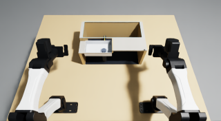
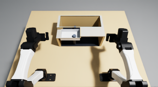
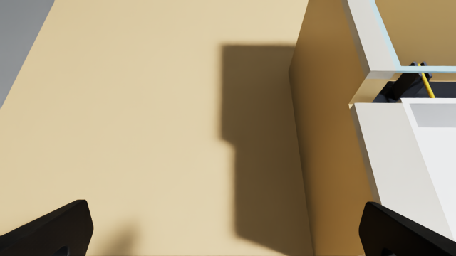
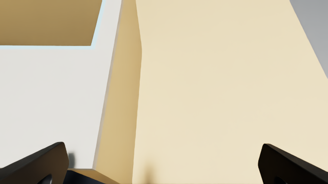

# Reconnect a bathroom-sink pop-up stopper to its rear-facing pivot rod under the basin and lift the stopper open

Instruction: `Lift and align the sink's pop-up stopper from inside the basin while sliding the pivot rod forward through the rear drain port and stopper eye under the basin until its ball seats, then press the rear rod down to hold the stopper open.`

Files: `task.json`, `README.md`, `task.py` (rules & `score()`), `parts.py` (43 figures & sources), `scene.py`, `collar_cad.py` (closed 2-manifold collar STL), `mechkit.py`, `demo_kit.py`, `checks.py`, `demo.py`, `trials.py`, `test_sink_stopper.py`, `start_top.png`, `start_top_policy.png`, `start_left_wrist.png`, `start_right_wrist.png`, `end_top.png`, `end_top_policy.png`. Procedural shapes only; no external meshes, textures, or sounds.

## Why this job matters and why it needs two hands

Maintenance workers (O*NET 49-9071, ~1.5M US; BLS OES) and plumbers (O*NET 47-2152, ~480k US) reconnect lavatory pop-up stoppers after clearing hair or replacing seals. Under a full-depth counter, the port points rearward (`+x`) behind the `1-1/4 in` tailpiece while the eye sits inside the opaque tee `6.2 mm` below the port and `90 deg` off line. Left hand lifts the `35.6 mm` cap ~`6 mm` and turns `-90 deg`; Right hand enters the front doorway, curves around `-y` of the `38 mm` pipe with vertical jaws (`closing = [0, 0, -1]`, wrist camera horizontal), pinches the clevis, snaps the `18.3 mm` ball `32 mm` forward into its rear collar seat through the eye, and presses the rod down ~`12.9 deg` so washer friction holds the stopper open.

## Hardware, layout, and grasps

`station` frame in metres (`x` forward of arm bases, `y` left, `z` over `0.7475 m` benchtop; `object_jitter = 0`).

| Body | Buyable / cut hardware (US & EU) & dimensions | Start (`z` over bench) | Grasp (`<= 94 mm`, `<= 160 mm`) |
|---|---|---|---|
| `vanity` (fixed) | `18 mm` birch (`y = -0.255..+0.205`, doorway `x = 0.334`, full-height walls to `x = 0.622, z = 0.204`), `z = 0.172` surround (`x = 0.334..0.444`), right shelf (`z = 0.204`), `160 x 424 x 9 mm` clear acrylic rear L-roof (`x = 0.444..0.604, z = 0.204` + `23 mm` lip), `5 mm` white ABS basin (`110 x 190 x 42` outer, `100 x 180 x 38 mm` inner, `z = 0.130`, `40 x 40 mm` hole), mat, cradle `0.563..0.590` | Fixed | Carcass (`checks.py` 8-link & roof block) |
| `drain` (kinematic) | `1-1/4 in` (`31.8 / 38.0 mm`) tee (`ASME A112.18.2`; Danco `80767` / Cornat `TEC317405`), `54.0 mm` flange `z = 0.136`, `+x` port `z = 0.054` (`seat x = 0.401`) + `PETG` 4-slot collar (`collar_cad.py`, `26.4 x 19.0 mm`, `19.2 mm` bore tapped to `80767` thread, est. `20 x 1.5 mm`, `x = 0.417`) | `(0.375, +0.035)` | Fixed (`240 Hz` forces) |
| `stopper` (`36 g`) | Danco `11041` chrome ABS (`132.1 x 35.6 mm`; Cornat `TEC317414` `35 x 120 mm`), holes `#1-3, #5-6` taped leaving `#4` (`8.5 x 10.0 mm` eye `88.2 mm` below seal) | `(0.375, +0.035, 0.136)`, `+90 deg` | Left: `54 -> 35.6 mm`, `z <= 159.5 mm` (`37.7 N/pad`) |
| `pivot_rod` (`44 g`) | Danco `88532` steel rod (`150 x 5.5 mm`, `18.3 mm` ball, `27.5 x 4.5 mm` tip; Cornat `TEC317405` + `22 x 14 x 16 mm` clevis `68 mm` behind ball), red band `16 mm` behind ball | Ball `(0.433, +0.035, 0.054)` | Right: `36 -> 16 mm`, `z = 60 mm` (`36.2 N/pad`) |

## Can it be seen

Roofed to `x = 0.622 m`, the `160 x 424 x 9 mm` rear acrylic L-panel (`z = 0.204 m`) collides solidly (`-4.5 mm` block in `checks.py`) while `mk.show` hides its face inside an aqua border so `top_cam` (`start_top.png`, `start_top_policy.png`) sees the `35.6 mm` cap and yellow-zinc rod (`start_left_wrist.png`, `start_right_wrist.png` show wrists). At completion (`end_top.png`, `end_top_policy.png`), the rod sits `32 mm` forward and the stopper stands `8.99 mm` open.

   

## Mechanics, bilateral forces, and stand-ins

`240 Hz` PhysX contacts only — zero `weld`, `push`, proximity latches, or `write_pose`/`set_joint` in `task.py`, `scene.py`, or `demo.py` (`trials.py` sets poses for partial/foul checks):

| Interaction | Bilateral pair | Condition & `demo.py` reading |
|---|---|---|
| Bore, port & `8.5 x 10.0 mm` eye | `stopper` <-> `drain` / `pivot_rod` | Closed stem blocks rod `23.3 mm` short (`37.2 N` in `blocked_closed`); lifted ~`6 mm` & turned `-90 deg`, `4.5 mm` tip passes `10.65 mm` past axis. |
| Collar (`4.2 kN/m`) & washer (`12.5 kN/m`, `mu = 1.1`) | `pivot_rod` ball <-> `drain` port | Advancing `32.0 mm` (`mark: 32.0 -> -0.38 mm`, seat `0.07 mm`) clicks `18.3 mm` ball past 4 collar beads (`68.0 N` peak) into 4 beads (`~0.43 N m` hold; `3.21 N` rest). |
| Rear-rod lever lift | `pivot_rod` tip <-> `stopper` eye | Pressing rod down `12.9 deg` lifts `36 g` stopper `8.99 mm` open; after release (`hands clear 221.8 mm`), `pivot_rod` supports `stopper` (`0.38 N`, `0.00 mm` drift, `89` steps). |

**Stand-ins:** (1) `PETG` 4-slot collar (`python3 mech/tasks/sink_stopper/collar_cad.py snap_collar.stl`: `10 mm` skirt, `19.2 mm` bore tapped to `80767` thread, est. `20 x 1.5 mm`, over `88532` washer; `9 mm` crown) replaces turning a nut while keeping `32 mm` seating and ball hold physical; (2) tape covers unused holes on `11041` leaving `#4`; (3) the `9 mm` acrylic roof keeps the full-depth barrier while letting `top_cam` see the rod. Water, P-trap, and faucet strap are unmodeled.

## Scoring, shortcuts, and checks

Tools: `150 mm` rule, `100 mm` square, `30 mm` block, and trial video (fall foul checked from video; end photo confirms rest state). Run limit: `1,000 steps (50 seconds at 20 Hz)`.

- **`0.0` (fall foul, latched):** ball `< 25.0 mm` over bench or unseated tail `< 4.0 mm` onto floor (`foul_rod_drop`). Lifting the stopper out is unlatched (`lift_inspect_recover`: `0.0` while out, `1.0` when coupled).
- **`0.5` (rest `<= 25 mm/s`, hands `>= 30.0 mm` clear):** red mark `<= 3.5 mm` from `x = 0.417 m` (`ball <= 3.5 mm` off throat) and stopper upright (`radial <= 4.0 mm`, `tilt <= 8.0 deg`, `gap in [-2.0, 22.0] mm`) without `1.0` hold (`seated_half`: `3.5 mm -> 0.5`).
- **`1.0`:** `0.5` seated plus cap held open `8.0..22.0 mm` (`radial <= 3.5 mm`, `tilt <= 6.0 deg`) for `1.0 s` (`20 steps`) within `2.0 mm` drift.
- **Shortcuts blocked:** top-down rear reach hits the `9 mm` acrylic roof; unaligned shove hits closed stem (`0.0`); over-lift misses eye (`<= 0.5`) or left out/crooked fails `radial <= 3.5 mm` / `gap <= 22.0 mm` (`0.0`).

## Key figures and sources (`parts.py`)

`parts.FIGURES` totals `43`: `7` maker, `1` standard, `3` listing, `21` our fixture, `11` estimate.

| Figure (`parts.py`) | Value | Source |
|---|---|---|
| Danco `11041` height, head, 6th hole; Cornat `TEC317414` | `132.1`, `35.6`, `115.3 mm`; `35 x 120 mm` | Listing: `"5.2 in in total length with 1.4 in OD head... last hole is 4.54 in"` (`https://mrosupreme.com/products/danco-11041-pop-up-sink-stopper-pop-up-plastic-chrome`); Cornat `"3,5 x 12 cm"` (`https://www.bueromarkt-ag.de/waschbeckenstoepsel_cornat_exzenterstopfen_durchschnitt_35_mm,p-tec317414.html`) |
| Danco `88532` shaft, thread-in, ball, inner stub | `150 x 5.5`, `4.0`, `18.3`, `27.5 x 4.5 mm` | Maker (DancoSupport on `https://www.homedepot.com/p/DANCO-Universal-Ball-Rod-for-Pop-Up-Drains-88532/203193993`, search-indexed): `"150 mm (5.9 inches)"`, `"5.5 mm"`, `"4 mm"`, `"Large Ball: Diameter = 18.3 mm"`, `"27.5 mm"`, `"about 4.5 mm at the tip"` |
| Drain bore & flange (`ASME A112.18.2`; Cornat `TEC317405`) | `31.8`, `54.0 mm` | Standard `ASME A112.18.2`; Delta `RP5651` `2-1/8 in`; Cornat `1 1/4 Zoll` (`https://www.bueromarkt-ag.de/ablaufgarnitur_cornat_tec317405_aus_messing,p-tec317405.html`) |
| Cap `12.5 mm`, eye `8.5 x 10.0 mm` at `88.2 mm`, `36 / 44 g`, OD `38.0 mm`, `80767` port thread `20.0 x 1.5 mm`, `k = 12.5 / 4.2 kN/m`, `mu = 1.1` | see left | Estimates: `132.1 - 115.3 - 4.3 mm`; `#4` of 6 scaled from `1.4 in` head photo; ABS/steel/brass volumes; `31.8 + 2x3.1 mm`; `0.78 in` pivot-nut thread; bead preload (`~8-10 N` click, `~0.43 N m` hold) |
| Full-depth carcass, `9 mm` acrylic roof, `5 mm` ABS basin (`110 x 190 x 42 mm`), `PETG` collar, limits | see `parts.py` | Our fixture: cut/printed sizes & tolerances |

### First minutes of a real trial (~6 minutes)

Check with a thread gauge & `150 mm` calipers (`2 min`) the `80767` port thread (est. `20.0 x 1.5 mm`; sets the tap for the `19.2 mm` bore) and `#4` eye (`8.5 x 10.0 mm` at `88.2 mm`), weigh both parts (`1 min`), check with a `2 kg` (`20 N`) spring scale (`2 min`) the `~8-10 N` collar click and `>= 8 mm` open hold, and time the `20 s` reset (`1 min`); a different reading replaces the estimate.

## How this task differs

Unlike surface drain tasks (wand or plunging), peg-in-hole, or RoboCasa / BEHAVIOR-1K faucet/cabinet tasks, this task requires bimanual blind alignment under a full-depth counter: curving around a pipe through a doorway to thread a rear (`+x`) rod through a hidden eye and lever the stopper open.

## How to run

- Checks (`< 2 s`): `scripts/rta check mech/tasks/sink_stopper`
- Trials (`~45 s`): `scripts/rta simpy tr1 mech/tasks/sink_stopper/trials.py /workspace/robocurve/outputs/tr1`
- Demo (`~20 s` sim, `~1.5 min` wall): `scripts/rta demo d1 mech/tasks/sink_stopper`
- Dream-1 (`1,000 steps / 50 s` sim, `~3-4 min` wall; `--seed 0` -> seed `1415158438`, fixed layout):

```bash
inspect-robots run --embodiment yam_arena --policy dream \
  -E task=mech/tasks/sink_stopper/task.py -E object_jitter=0 -E control_hz=20 -E cam_width=320 -E cam_height=176 \
  --instruction "Lift and align the sink's pop-up stopper from inside the basin while sliding the pivot rod forward through the rear drain port and stopper eye under the basin until its ball seats, then press the rear rod down to hold the stopper open." \
  --scorer task_score --max-steps 1000 --seed 0 --no-prompt --store-frames --log-dir outputs/dream_sink_stopper
```
