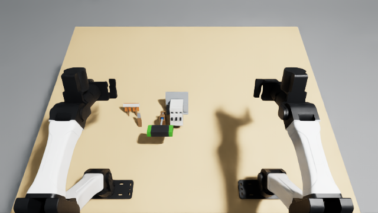

# Seat a comb busbar in three breakers, cap its spare tooth and torque each terminal to its click

Instruction given to the policy: `Put the grey cap on the comb busbar's spare tooth, seat its other three teeth in the three breakers' top terminals, and tighten each terminal screw with the torque driver until it clicks, then let go of the comb and keep both hands still and clear of it.`

Files: `task.json`, `task.py` (rules, score), `parts.py` (figures, sources, shapes), `checks.py`, `trials.py`, `demo.py`, `test_comb_busbar.py`, the kit (`mechkit.py`, `demo_kit.py`, `kit_extra.py`), `start_top.png`, `start_top_policy.png` (320 x 176).



## What the task tests

- **Three teeth into three terminals at once.** The rigid comb's teeth (1.5 x 10.5 mm, 18 mm apart) go down the three top terminals' 2.5 x 12.5 mm slots together: the comb must be square to the row and on all three mouths. A terminal closed on nothing blocks its tooth.
- **Then each terminal closed to the maker's torque.** Each M5 screw starts half a turn open (plate 1.9 mm off the slot's back wall): half a turn closes the plate on the 1.5 mm tooth, 15 degrees more reach the maker's 2.0 N m, where the adapter clicks. Short of the click the terminal is closed but under-torqued: 0.5.
- **Both hands on the last turn.** A pinch on the T-handle carries under 1 N m about the screw (pad friction across its 22 mm). So the left hand turns each screw to the touch; for the last turn the right fingertips push the T-handle's free arm while the left hand pushes back through its pads (no net force on the driver) and turns on; both stop at the 2.0 N m click.
- **The spare tooth capped.** The fourth tooth stands beside the row; the maker's cap goes on it (its catch takes the tooth 22 mm in) before the comb is seated.

## Scene

- **Our fixture**: a 35 mm DIN rail, 90 mm long, screwed to a 10 mm steel plate 100 x 100 mm leaning back 30 degrees, welded to a 4 mm steel foot plate with a 6 mm strut behind it. Only this lean is ours (the YAM wrist cannot hold the driver level for screws facing straight out); the terminals' slots and screws, comb, cap and tools are as sold.
- **Breakers:** three Schneider Electric Acti9 iC60N 1P C16 (A9F74116) side by side on the rail, 18 mm apart, top terminals open. Its sheet: discontinued 1 Nov 2020 [se1]; the A9F77116, on sale in France, has the same body and 2 N m and takes the comb [se4].
- **Comb:** a 4-module (72 mm) piece of the Acti9 A9XPH112 on a poplar rack, at the same lean.
- **Cap:** an Acti9 A9XPT920 tooth cap in a poplar holder.
- **Driver:** a Wera 416 R T-handle bitholder with a Bernstein 4-985 2.0 N m torque adapter and a Wera PZ 2 x 25 mm bit, in a poplar holster.

## Rules and score

- **0 for good** if the comb, the cap or the driver leaves the bench (its centre 10 mm under the bench top).
- **End state** (at the end; every loose part still 1.0 s, under 10 mm/s and 0.05 rad/s, both grippers 30 mm or more from the comb): a tooth stands in every breaker's slot at least 22 mm deep (the bar within 4 mm of the tops, the tooth within 1.2 mm of the slot's middle front to back and 3 mm along the row), and each terminal's clamp plate is closed on its tooth; else 0.
- **1.0** if then every screw was tightened until the driver's limiter clicked (2.0 N m) and the cap is on the spare tooth; **0.5** if a screw was left short of its click or the spare tooth is bare.
- **On the bench:** each click from the trial's video and sound; a tooth seated when the bar rests on the tops; a clamp closed when the comb does not lift at a light pull; the cap from the video.
- Grips: 25 N a finger on the comb, 35 N on the T-handle (commanded squeeze at 5,000 N/m). Run limit 4,000 steps (200 s).

## Key figures and their sources

| Figure | Value | Source |
|---|---|---|
| Breaker size | 85 x 18 x 78.5 mm | maker [se1]: 'Height 85 mm', 'Width 18 mm', 'Depth 78.5 mm' |
| Terminal torque (the adapter's preset) | 2.0 N m | maker [se1]: 'Tightening torque 2 N.m top or bottom' |
| Comb pitch, colour | 18 mm, white | maker [se2]: '18 mm pitch - 12 modules', 'Width 220 mm', 'Colour White (RAL 9003)', 'Cuttable' |
| Tooth cap | grey, 3.5 x 12.5 x 28 mm, 2 g | maker [se3]: 'set of 20 tooth caps for Acti 9'; size, mass, colour: estimate (a 1 mm-walled sleeve) |
| Tooth section | 1.5 x 10.5 mm | estimate: about 16 mm2 of copper for the comb's '100 A' [se2] |
| Comb mass | 16 g | estimate: a third of the 12-module piece, whose package weighs 49 g [se2] |
| Screw lead; start | 0.8 mm a turn; half a turn past the tooth | standard: ISO 261, M5 x 0.8; the reset sets the start |
| Turn from touch to 2.0 N m | 15 deg | estimate: a stiff clamp on copper (the click is scored) |
| Running torque | 0.1 N m | estimate: an M5 screw turning free in its thread |
| Bit's play in the recess | 4 deg | estimate: the cross's clearance |
| T-handle | 99 x 44 x 22 mm, 82 g | maker [wera1]: 'Handle diameter mm 99', 'Handle length mm 44'; [wera3]: 'Size: 94x98x22 mm', 'Weight: 82 g' |
| Torque adapter | 2.0 N m +-10 %, 12 x 28.3 mm, 21 g | maker [bern]: 'Tightening torque 2.0 Nm', 'Tolerance +/-10%', 'The click sound indicates when the torque is reached' |
| Bit | PZ 2 x 25 mm, 5 g | maker [wera2]: '855/1 Z bits, PZ 2 x 25 mm', 'Weight: 5g' |
| Rail | 35 x 7.5 mm | maker [wago]: '35 x 7.5 mm ... according to EN 60715' |
| Slot, hole, cap's catch | 2.5 x 12.5 mm slot, 1.6 mm lead-ins; 9 mm hole, 2 mm countersink; catch at 22 mm | estimate: from the tooth and the bit |
| Fixture, rack, holder, holster, 30-deg lean | as in Scene | our fixture |

## First minutes of a real trial

Checking the estimates on the bought parts (about 7 min): caliper on a tooth, a slot and an access hole (2 min); comb piece and cap on a kitchen scale (1 min); a cap pushed onto a tooth until it catches, its depth by caliper (1 min); a screw closed from half a turn open, the angle from touch to click by a pencil mark on the T-handle (2 min); the bit's play and the adapter's slip to its click, by the same mark (1 min). A different reading replaces the estimate.

## Forces

| Force | How it is made | On | Against | Ends when |
|---|---|---|---|---|
| Screw torque | 0.1 N m free, then 7.3 N m/rad on the tooth; 2.0 N m while the limiter slips (click after 3 deg); eased in over 0.15 s | the driver, against its turn | the panel, through the screw | the bit leaves its hole or stops turning |
| Right hand's push | 30 N on the T-handle's lower arm, 36 mm from the axis (1.1 N m) | the driver | the right hand | the screw clicks |
| Left hand's push | 30 N back through its pads, 13 mm from the axis on the other side (0.4 N m), with its wrist's twist | the driver | the left hand | the screw clicks |
| Bit's press | 3 N along the screw | the driver | the panel, through the hole's floor | the press is eased |
| Clamp's hold | a weld of the comb to the panel, made where it stands when the first plate presses its tooth | the comb | the panel | every plate is turned back off its tooth |
| Cap's catch | a weld made when a tooth is 22 mm into the cap | the cap | the comb | never in the task |

## Checks run so far

- 13 rule tests pass. `checks.py`: 74 hand poses within 0.08 mm, joints 6.2 deg or more inside limits, hands 24.9 mm or more apart, under 16 cm; carried comb and hands 3 mm or more from fixed parts on each move (sockets excepted; the capped tooth passes breaker 1 at 2.7 mm).
- At rest (cb2s): 3 s, score 0, loose parts moved 0.00 mm.
- Trials (cb4t): driver off the bench: 0; breaker 1's empty clamp shut to 0.2 mm: the comb stops 10.6 mm high: 0.
- Recording (cb4r): 1.0 at 124.95 s, done at 125.9 s (2,518 of 4,000 steps): cap caught at 22.0 mm; teeth let go 7.8 mm in, 0.35 mm off; comb welded at 60.85 s; clicks at 62.10, 90.55 and 119.00 s, plates on their teeth. Hand forces in the last turns, from the demo's simulator spring model (not a bench reading): right median 29 N, peaks 33.7-36.7 N; left 29.5 N, peaks 29.9-30.3 N. `--snug` (cb4u): plates on their teeth at 0.6 N m, no click: 0.5.

## How it differs

Accepted and pending tasks snap one module onto a DIN rail, switch breakers or click-torque one bolted lug; here a rigid comb's three teeth enter three terminals together, then each terminal is closed to the maker's torque with both hands.

## Sources

Primitive shapes only (boxes and cylinders); no third-party meshes, textures or sounds.
- [se1] https://www.se.com/ae/en/product/download-pdf/A9F74116 ; [se2] https://www.se.com/ae/en/product/download-pdf/A9XPH112 ; [se3] https://www.se.com/ae/en/product/download-pdf/A9XPT920 ; [se4] https://www.se.com/fr/fr/product/download-pdf/A9F77116
- [wera1] https://www.wera.de/en/tools/416-r-t-handle-bitholding-screwdriver-rapidaptor ; [wera3] https://hybris-media.wera.de/download/pdfgenerator-datasheets/en/05023404001.pdf ; [wera2] https://hybris-media.wera.de/download/pdfgenerator-datasheets/en/05072082001.pdf
- [bern] https://www.bernstein-werkzeuge.de/en/products/productdetails/4-985-torque-adapter ; [wago] https://www.wago.com/global/accessories/steel-carrier-rail/p/210-113

## How to run

`python -m pytest -q test_comb_busbar.py`; `python3 checks.py`; `python trials.py <out>` (simulator); `scripts/rta demo <id> mech/tasks/comb_busbar` (`--check`: no video; `--snug`, `--bare`: 0.5 runs; `--quick`: no simulator).

The layout is fixed; nothing is drawn from the seed.

```bash
inspect-robots run --embodiment yam_arena --policy dream \
  -E task=mech/tasks/comb_busbar/task.py -E object_jitter=0 -E control_hz=20 -E cam_width=320 -E cam_height=176 \
  --instruction "Put the grey cap on the comb busbar's spare tooth, seat its other three teeth in the three breakers' top terminals, and tighten each terminal screw with the torque driver until it clicks, then let go of the comb and keep both hands still and clear of it." \
  --scorer task_score --max-steps 4000 --seed 0 --no-prompt --store-frames --log-dir <log dir>
```
