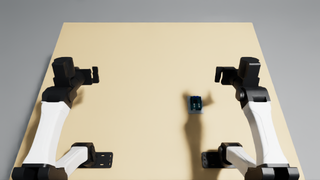
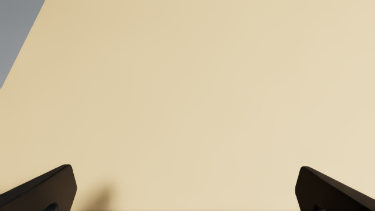
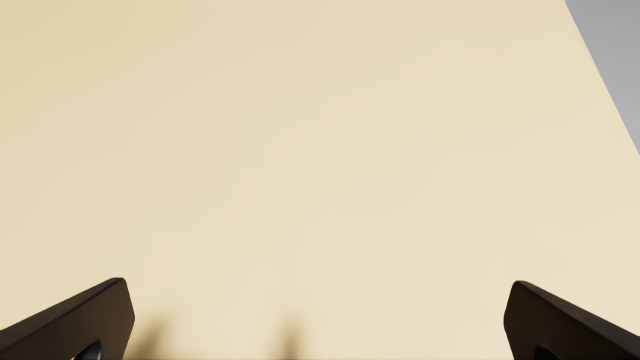
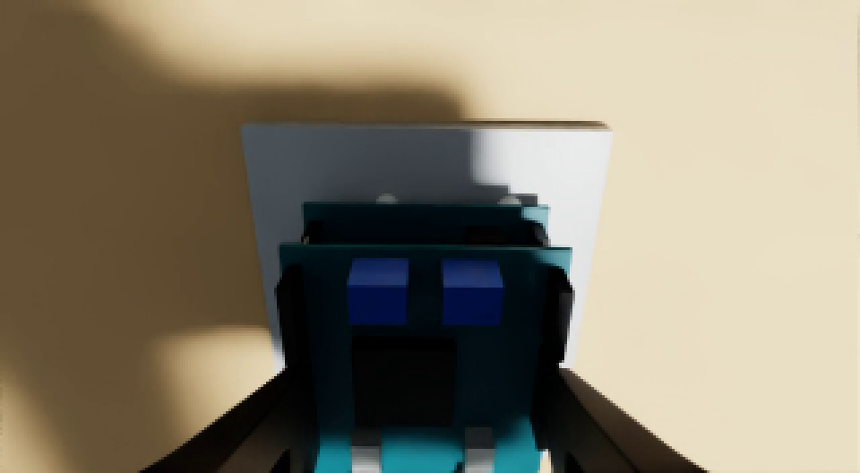
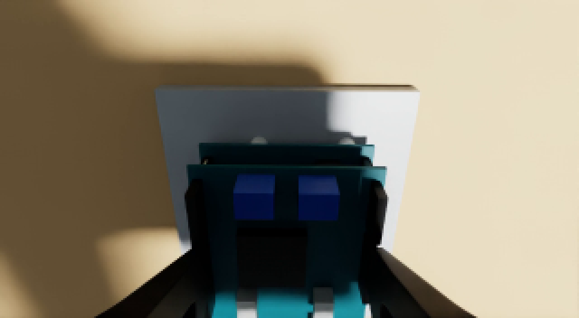

# Seat a motor shield on a controller board without bending a pin

Instruction given to the policy: `Press the motor shield down onto the controller board until it is fully seated, without bending its pins, then let go.`

Files: `task.py` (scene, the four strips' resistance, rules, score), `mechkit.py` (the mechanism kit the task file imports), `demo.py` (the scripted full-score run and the five runs that show the lower levels and the two ways to bend a pin), `demo_kit.py` (the runner behind the scripted runs), `trials.py` (checks in the simulator: rest, the arm's press on a spring gauge, the strips' resistance under steady loads put on directly, the shield lifted and let go), `start_*.png` (the first pictures of a trial), `cue_*.png` (pictures at the size a policy gets), `README.md`.



 

The first pictures of a trial, both arms in their ready pose. Top camera: the bare bench and, in front of the right arm, the carrier plate with the two boards on it. They are small in this picture: the boards measure 69 x 53 mm and the top camera has 5.5 mm to a pixel at the size a policy gets. Neither wrist camera sees the boards from the ready pose; the right one does as soon as the hand goes over them (see "Can it be seen").

## Scene

Bench coordinates in metres: x forward from the line through the two arm bases, y left from the midline, z up from the bench top. The arms' bases are at (0, -0.305) and (0, +0.305).

| Part | Size, mass | Where |
|---|---|---|
| Carrier plate, fixed to the bench | 100 x 80 x 6 mm | middle (0.28, -0.20), long edges along x |
| Arduino Uno R3, screwed to the carrier on four 5 mm spacers | 68.58 x 53.34 mm, board 1.6 mm thick; four female header strips, 8.5 mm tall, 2.54 mm pitch: 10 and 8 contacts along one long edge, 8 and 6 along the other, the two rows 48.26 mm apart | on the carrier, its USB end towards the arms; socket tops 21.1 mm over the bench |
| Arduino Motor Shield Rev3 | 68.58 x 53.3 mm, 25 g; stacking headers: 32 pins, 0.64 mm square, under the board, and its own sockets on top over the same four strips | resting on the Uno's sockets on its own pin tips, each tip 0.5 mm in its socket's lead-in; its board 31.1 mm over the bench (underside), its own socket tops 41.2 mm |

Nothing else is on the bench. Nothing varies by seed.

Sizes and sources. The Uno's outline, the places of its four strips (pins at 18.80 to 41.66 mm and 45.72 to 63.50 mm from the USB end on the digital edge, 27.94 to 45.72 mm and 50.80 to 63.50 mm on the other) and the 48.26 mm between the rows are Arduino's dimension drawing of the Uno R3. Assumed, to be measured on the bought parts: the shield's 25 g (to be confirmed on the product page); the stacking pins' length under the shield's board (10.5 mm) and the 6 mm of it that go into a socket, measured with a caliper on the shield and with a depth gauge in a socket; the 5 mm spacers. With these the seated shield's board stands 4.5 mm over the Uno's socket tops, on its pins. The parts drawn on the two boards besides the headers (USB socket, power jack, controller, the shield's driver chip, terminals and white connectors) are there to be recognised; their places are not from a drawing and nothing touches them.

## What stands in for what

A rigid-body simulator has no spring contacts that grip a pin. This task replaces the 32 contacts by four resistances, one for each header strip.

- **Each strip's pins meet a seat inside their socket.** The seat is a small pad on a vertical slide, hidden in the socket under the middle of the strip: the pins of a strip resist alike, so together they resist at its middle. The pad is slippery, so it holds the pins in no other way. It resists going down with 1.67 N for each of the strip's pins: 16.7, 13.4, 13.4 and 10.0 N for the strips of 10, 8, 8 and 6 pins, 53.4 N in all. 1.67 N is the average insertion force of a 0.64 mm square pin in Samtec's SSW socket (data sheet F-215); the Uno's own sockets are unbranded, so the figure is assumed for them, and is to be measured by pressing a shield onto an Uno that stands on a kitchen scale. A seat holds still under a load below its resistance (it yields up to 0.1 mm), goes down under a load above it, and stops 5.5 mm down (the pins are home). It stays where it was pushed: let go on the way it comes back 0.15 mm at most; within 0.3 mm of its stop, which is what the score calls seated, it is drawn onto the stop and stays there. The figures are under "The four resistances".
- **The shield stands on the four seats and on nothing else.** Its pins go through the Uno's sockets without touching them and rest on the seats. So at the start the shield is held up by the four resistances alone, 5.5 mm over its seat: no brake, no hand, as a real shield set on its pins in the lead-ins. Lifted and let go it falls back onto the seats.
- **Where the shield can go.** Its place over the Uno is given (in the real pair the pins in their lead-ins give it): it can go up and down and tilt about both level axes, and nothing else. The two axes pass through the level of the pin tips, on the board's centre line: that is where the pins hold a real shield. The tilt is stopped at 7 degrees either way: that is one row, or one end of the rows, home with the other still on its pin tips, and pins that are in their sockets let a real shield tilt no further. The slide and the two hinges that give the shield these freedoms are joined by two thin plates hidden inside the stack, 20 g each and carried against gravity: they add nothing to the shield's weight, and 40 g to what has to be moved when it moves.
- **A pin bends by rule.** One strip 1.5 mm or more in its sockets while another stands 2.0 mm or more higher: a pin of the lower strip is bent, for the rest of the trial. The 2.0 mm is assumed; on a real pair the check is to pull the shield and look at the pins.
- **Pulling out is not modelled.** A real seated shield needs about 44 N to pull off (1.39 N a pin, same data sheet). Here nothing holds the shield down but its weight: lifted, it comes off, and the score, which reads the shield itself, no longer calls it seated.

## Rules

How far a strip is in: how far the middle of its pin tips stands below the tops of the Uno's sockets (0.5 mm at the start, 6.0 mm home).

| Score | Asked | On a real bench |
|---|---|---|
| 0 | a pin has bent at any time in the trial; or none of the levels below | the shield pulled off and its pins looked at |
| 0.25 | every strip 1.5 mm or more in at the end | a ruler at the four corners: the shield's board no more than 9.0 mm over the Uno's socket tops |
| 0.5 | every strip within 2 mm of its seat | the ruler: no more than 6.5 mm |
| 0.75 | seated: every strip within 0.3 mm of its seat | a 0.3 mm feeler gauge does not go between the pins' shoulders and the socket tops at the four corners |
| 1.0 | seated, the shield at rest, and both grippers 3 cm or more from it | the video of the release |

The score that counts is the one at the end of the trial. A trial succeeds when the score has been 1.0 for one second; it then ends. The run limit is 600 steps (30 s).

## Can it be seen

 

The right wrist camera at the size a policy gets (320 x 176), enlarged three times here: left, the fingertips standing on the shield before the press, the shield on its pin tips (3.85 s of the run `full`); right, the shield seated (11.2 s). The hand goes down with the shield, so the shield stays where it is in the picture. What changes lies beyond the shield's far edge: the dark strip of the Uno that shows there is 15 pixels deep before and 11 after (rows 76 to 90 and 80 to 90 of the picture, read down its column 150), and the carrier plate behind it comes nearer. The cue is there and it is small: 4 pixels. The top camera does not show it: the two boards are about 10 x 12 pixels in its picture at this size, and the hand covers them during the press. Besides its pictures a policy gets the arm's joint readings, in which the hand goes down 5.5 mm and stops.

## The arm can press that hard

The four strips ask for 53.4 N in all. Before anything else the arm was checked on a spring gauge: the same scene with the four seats as springs (20 kN/m in all) instead of resistances, the right hand pointing straight down with a fingertip's end on each row of the shield's own sockets, pressing over the middle of the 32 pins (recording `c1r`, `trials.py press`).

| Push asked for | The springs read | The four strips in |
|---|---|---|
| 20 N | 18.2 N | 1.30 to 1.61 mm |
| 40 N | 37.5 N | 2.26 to 2.63 mm |
| 53.4 N | 50.6 N | 2.75 to 3.42 mm |
| 60 N | 56.6 N | 3.24 to 3.64 mm |
| 80 N | 75.8 N | 4.20 to 4.66 mm |

The springs read 5 to 9 per cent less than is asked for. The arm presses about 2 per cent less than it is asked to (its own reading of its press, taken from its joints, says so in the run `full` as well), and its press falls about 0.6 N for every millimetre the hand goes down, as it does here on the gauge's springs. With 60 N asked for it holds 56.6 N, more than the 53.4 N the strips resist with; with 80 N, 75.8 N, and the joint that works hardest then gives 85 per cent of what its drive can. So the carrier stays where the task has it, 30 cm from the right arm's base. On the gauge the shield lies up to 0.67 mm lower at one end than at the other: the gauge's four springs are alike, and the hand stands over the middle of the strips' resistance, which is not the middle of the four springs.

## The four resistances, checked with steady loads put on directly

No arm (recording `c1q`, `trials.py resist`). Each seat by itself: a steady force of nine tenths of its resistance for 3 s, then eleven tenths, then nothing.

| Strip | Resists with | Under nine tenths of it, 3 s | Under eleven tenths of it | Let go |
|---|---|---|---|---|
| digital, 10 pins | 16.7 N | went 0.09 mm and stood | 5.4 mm down in 0.1 s | was within 0.3 mm of its stop and went the last 0.04 mm onto it |
| digital, 8 pins | 13.4 N | went 0.09 mm and stood | 5.0 mm down in 0.1 s | came back 0.10 mm |
| power, 8 pins | 13.4 N | went 0.09 mm and stood | 5.0 mm down in 0.1 s | came back 0.10 mm |
| analog, 6 pins | 10.0 N | went 0.09 mm and stood | 5.3 mm down in 0.1 s | was within 0.3 mm of its stop and went the last 0.10 mm onto it |

The four seats together, each under the same part of its own resistance, the shield standing on them: under eight tenths (42.8 N in all) for 3 s the strips went in 0.08 mm; under 95 hundredths (50.8 N) 0.015 mm more; under eleven tenths (58.8 N) the four seats were home after 0.2 s. So a seat stands under a steady load below its resistance and goes at once under one above it. The shield, which nothing pressed in this check, came down after the four seats and lay level on them, all four strips 6.00 mm in. Under the scripted hand the same seats give a few tenths of a millimetre before they go (run `full`): the board trembles between the fingertips and the seats in the simulator (its speed reads over 2 cm/s while it stands still), so the load on a seat is not steady.

## Reference runs

Scripted, recording `c1p` of 2026-11-19 (commit `efb8d68`), 20 Hz. The right hand, pointing straight down and open 44 mm so that a fingertip's end stands on each row of the shield's own sockets, comes down over the middle of the 32 pins (8.7 mm from the board's middle lengthwise, towards the end away from the USB socket: the strips are not placed evenly) and presses: 40 N asked for at first, then 5 N more every second up to 52 N and 2 N more every second from there. Home, it presses 5 N harder for half a second, eases off, goes up 8 cm and stays there.

| Run | What it does | Score | What the recording shows |
|---|---|---|---|
| `full` | presses until every strip is home, lets go | 1.0 | under 40 to 53.6 N asked for the strips give 0.25 to 0.48 mm in small steps and stand; the shield goes down from 7.95 s, when 53.6 N are asked for and the arm's own reading of its press, taken from its joints, is 52.7 N (with the shield's weight 52.9 N on the seats, which resist with 53.4 N); it goes on down while the arm reads 52.8 to 54.4 N and is home at 10.35 s, with 58.4 N asked for (the arm is a soft spring: its press falls about 0.6 N for every millimetre the hand goes down); the four strips never more than 0.25 mm apart in height; pressed home with 63.4 N asked for and let go, all four are 6.00 mm in; 1.0 from 12.10 s, and the trial ends a second later (13.05 s) |
| `half` | the same press; the hand lets go when every strip is 4.2 mm in | 0.5 | the shield goes on to 4.67 to 4.86 mm while the hand lets go and ends 4.40 to 4.69 mm in: within 2 mm of home, not home |
| `quarter` | the hand lets go when every strip is 2.2 mm in | 0.25 | on to 2.53 to 2.74 mm, ends 2.25 to 2.56 mm in: more than 1.5 mm, more than 2 mm from home |
| `one_end` | both fingertips on the rows' ends away from the USB socket; 15 N at first, 5 N more every second up to 28 N and 2 N more every second from there | 0 | that end goes in and the other stands: at 9.80 s, with 32.8 N asked for (the arm reads 30.8 N), the digital strip of 8 pins is 2.45 mm in and the digital strip of 10 pins 0.32 mm, 2.13 mm higher: a pin has bent. The shield is tilted 5.0 degrees then and 7.1 at most, where its stop holds it; the hand lets go with that end 3.1 to 3.2 mm in; it comes back to 2.45 to 2.89 mm and stays there, the other end 0.28 mm in |
| `one_row` | one fingertip on the power and analog row, the other in the air beside the carrier; 15 N at first, slower from 21 N | 0 | that row goes in alone: at 8.60 s, with 26.2 N asked for (the arm reads 24.2 N; the row's two strips resist with 23.4 N), the power strip is 2.48 mm in and the digital strip of 10 pins 0.46 mm, 2.02 mm higher: a pin has bent. The shield is tilted 2.5 degrees across the board then and 3.5 at most; the hand lets go with that row 3.4 to 3.5 mm in; it comes back to 3.21 mm and stays there, the other row on its pin tips (0.48 mm) |
| `held` | as `full`, but the hand stays on the seated shield | 0.75 | every strip home at 10.35 s; at the end (14.9 s) the hand is 13 mm from the shield (3 cm asked for 1.0) |

Contact sheets looked at, of this recording: the right wrist camera's of `full`, `half`, `one_end` and `one_row`, the top camera's of `one_row`, the left wrist camera's of `full`. Right wrist camera: the two fingertips are seen to stand on the two rows of the shield's sockets; in `one_end` the hand stands over the far end of the board, in `one_row` it stands to one side with one fingertip over the bench beside the carrier. With the hand gone, the shield of `one_end` and `one_row` (about 3 mm lower at one end or on one row) cannot be told from a level one in these pictures. Top camera: the hand covers the boards while it is over them; before and after they look the same from above. The left wrist camera sees the bench only.

What the script reads from the simulator: how far the four strips are in (a person sees the board come down and feels it stop), to let go in `half` and `quarter` where they are meant to stop, to stop the one-sided presses and to know when the shield is home. It does not read whether a pin has bent, nor the score, and it does not look at a camera.

## Limits and readings

| Limit in the score | Reading in the full-score run | Run that shows the limit |
|---|---|---|
| a pin bends: one strip 1.5 mm or more in, another 2.0 mm or more higher | strips 0.25 mm apart at most | `one_end`, `one_row` (0) |
| 1.5 mm in | all four 6.00 mm in at the end | `quarter` (0.25), 2.25 to 2.56 mm in |
| within 2 mm of home | the same | `half` (0.5), 1.31 to 1.60 mm from home |
| seated: within 0.3 mm of home | 0.00 mm from home | `half` |
| both grippers 3 cm from the shield | 98 mm | `held` (0.75) |

All of these are heights and distances; no force is scored. The two levels that the reference reaches by letting go on the way are met with room: `half` ends 0.40 mm inside the 2 mm limit and 1.01 mm short of seated, `quarter` 0.75 mm past 1.5 mm and 1.44 mm short of the next level. In the runs that are pressed evenly the strips are never more than 0.31 mm apart in height, against the 2.0 mm at which a pin bends. The seat that stands in for the contacts comes back up to 0.15 mm when a press is let go on the way, and is drawn the last 0.3 mm onto its stop (see "What stands in for what"): a strip that a press leaves within 0.3 mm of home, which the score calls seated, stays seated.

## States set directly

Two things are shown without an arm, by putting the bodies where they are wanted (recording `c1q`, `trials.py lift`). The shield put 2 cm over its start and let go: a twentieth of a second later it is still in the air (13.8 to 15.0 mm over the sockets' tops); it falls back onto its pin tips, all four strips 0.50 mm in as at the start, and the seats have not moved (0.00 mm); score 0, no pin bent. The shield and its four seats put home (6.00 mm in, score 1.0), then the shield alone put 3 cm higher: a twentieth of a second later it is in the air (18.2 to 19.5 mm over the sockets' tops, score 0); it falls home again (6.00 mm, score 1.0). Nothing holds the shield up over its pin tips and nothing holds it down. It falls more slowly than a free body: the two hidden plates between its joints, 20 g each, are carried against gravity, so the shield weighs its 25 g but has to move 65 g.

Every other rule of the scorer is checked by tests that set the state directly (`tests/test_shield_seat.py`): each level a hundredth of a millimetre either side of its limit; seated with a hand on it, with a gripper 2.9 and 3.1 cm away, at rest and moving; a pin bent across the rows and along a row, at 1.9 and 2.02 mm; bent stays bent to the end of the trial and is gone in the next; a shield lifted off after seating is not seated; a tilt of half a degree is seated and one of a degree and a half is not; where a seat's spring rests as the seat is pushed, let go and brought within 0.3 mm of its stop.

## Earlier reviews of this idea

This idea was submitted before as pull request #1891 and reviewed twice; its importance was not questioned. This is a new build (scene, code and text are our own); the two reviews are answered as follows.

- *First review: the board was "released 9.4 mm above the header despite its pins extending only 6 mm, while simulated brakes hold its pose"; start and intermediate states must be physically reproducible.* Here the shield starts where a real one stands when it is set on an Uno: on its own pin tips, each tip half a millimetre in its socket's lead-in, 5.5 mm above its seat. No brake holds it: it rests on the four resistances that stand in for the sockets' contacts, and they hold it as they hold a real one, until the press reaches what they resist with (53.4 N; in the run `full` the shield goes down with 52.9 N on the seats). Every state in between is one the real pair can be in: a strip is as far in as it was pushed, because the contacts grip its pins.
- *Second review: "a lifted board cannot be retained above its pin tips"; a full-score demonstration of the corrected version and a Dream-1 run on it.* Above the tips nothing holds the shield: put 2 cm up and let go, it falls back (see "States set directly"). The full-score demonstration is the run `full`. The Dream-1 run is made on this scene at the full run limit.

## How to run

Rule tests, no simulator: `scripts/rta check shield_seat` (7 tests).

Checks in the simulator: `scripts/rta simpy <id> mech/tasks/shield_seat/trials.py /workspace/robocurve/outputs/<id> rest,resist,lift` and, by itself, `... press` (it turns the scene into the spring gauge).

The reference runs: `scripts/rta demo <id> mech/tasks/shield_seat full,half,quarter,one_end,one_row,held` (results in `outputs/<id>/<run>/`: three videos, a contact sheet per camera, `result.json` with a row per step, `readings.json`); `--quick` checks every run's plan against the arm's reach without the simulator.

One model trial with the stock embodiment and scorer (20 Hz, 320 x 176 pictures):

```bash
inspect-robots run --embodiment yam_arena --policy dream \
  -E task=mech/tasks/shield_seat/task.py -E object_jitter=0 -E control_hz=20 -E cam_width=320 -E cam_height=176 \
  --instruction "Press the motor shield down onto the controller board until it is fully seated, without bending its pins, then let go." \
  --scorer task_score --max-steps 600 --seed 0 --no-prompt --store-frames --log-dir <log dir>
```

`-E object_jitter=0` is required: the shield stands on its pin tips where the task puts it.
