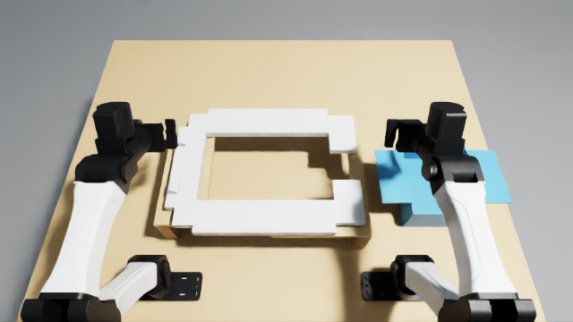

# Set a specimen pan across a toilet bowl under the raised seat, both wings on the rim, and lower the seat onto them

Instruction: `Lift the toilet seat, set the specimen pan upright across the bowl opening with both wings on the rim, lower the seat onto the wings, then let go and move both hands clear.`

Files: `task.json`; `task.py` (rules, `score()`); `scene.py` (bodies, hinge); `parts.py` (figures, sources); `checks.py`, `trials.py`, `demo.py`; `test_specimen_hat.py`; the kit (`mechkit.py`, `demo_kit.py`, `kit_extra.py`); `start_top.png`, `start_top_policy.png` (320 x 176), `start_left_wrist.png`, `start_right_wrist.png`.



## What the task tests

- **Lift the seat and keep it up.** Its check hinges stop it 11 degrees past upright, where it stays up; short of its balance at 94 deg it falls back. Here it cannot be left up: from 94 deg it leans into the left arm at rest (trial), and a grip there would sit 30-34 cm over the bench, out of the hands' reach. So it is held: at the grip, 17 cm from the hinge, the 1.91 kg seat weighs 24 N closed and 19 N at 42 deg, where the demo keeps it while the right hand sets the pan.
- **Across, not lengthwise.** The opening is a Kohler K-4302 elongated bowl's, 248 mm wide and 373 mm long. Set down lengthwise the 222.3 x 336.6 mm pan drops through; turned across, its wings bridge the 248 mm with 44 mm on the rim each side.
- **Lowered, not dropped.** The seat comes down onto the wings; let go above 20 degrees it falls shut and the trial is lost. Then both hands let go and move clear.
- **Impact on jobs.** A specimen pan under the toilet seat is how urine or stool is collected from a patient who can use the toilet. O*NET 31-1131.00 Nursing Assistants (1,505,900 employed, 2025) lists "Collect specimens, such as urine, feces, or sputum." ([O*NET](https://www.onetonline.org/link/summary/31-1131.00)).

## Scene

Positions in cm from the midpoint between the arm bases, x forward, y left. A mock bowl rim: 12 mm birch plywood on four 10.3 cm pine blocks, top 11.5 cm over the bench, its opening cut to the Kohler K-4302 bowl's 24.8 x 37.3 cm (x 15.6 to 40.4, y +19.0 to -18.3). Under the back of the seat the frame is 31.0 cm across, so the seat's side arms overhang it by 29 mm. A Bemis 1955CT seat is bolted on the frame's back (bolts 5-1/2 in. apart at y +27.0), its front towards -y, closed; its check hinges stop it 11 degrees past upright. The Medline pan stands upright on the bench at (27.0, -43.0), lengthwise. The layout is fixed: no seed draws any of it (runs used seed 0). Full text: `task.json` setup.

## Rules and score

0.0 for good if at any step the pan falls through the opening (its lowest point within 8 mm of the bench, its middle under the opening) or the seat is let go above 20 degrees (with no hand within 25 mm of it and not resting on the pan, it falls 2 deg or more from a height over 20 deg). Otherwise, at the end of the trial:

- **1.0**: the pan across the opening: upright (tilt <= 8 deg), its wings within 20 deg of square across the opening, its middle inside the opening, both wing tips over the side rims with their undersides at most 5 mm over the rim top; the seat lowered onto the wings (at most 3 deg up, the ring over the middle of both wings); every part of both hands at least 30 mm from the seat, the pan and the deck; all held so for 1.0 s (20 steps) with the pan moving at most 1.5 mm and the seat at most 0.5 deg.
- **0.5**: the pan across the opening as above, any 1.0 condition not met.
- **0.0**: otherwise (a pan on the bench, on top of the closed seat, lengthwise, tilted).

On the bench: the fall through and the seat let go from the video (with times); tilt by phone inclinometer on the pan's rim and the seat; wings on the rim and under the ring by eye and ruler; hands and the 1.0 s from the video.

## Key figures and their sources

| Figure | Value | Source |
|---|---|---|
| Seat length, hinge bolts to front | 471.5 mm | maker, [spec sheet](https://www.toiletseats.com/assets/0B7012484_1955CT_SSCT-Bemis-Spec.pdf) "18-9/16"", [page](https://www.toiletseats.com/p/bemis-elongated-open-front-less-cover-plastic-toilet-seat-in-white-that-stays-tight-2) "Depth: 18.563 in" |
| Seat width; opening width; front gap | 368.3; 201.6; 88.9 mm | maker: "14-1/2"" ("Width: 14.5 in"); "7-15/16""; "3-1/2"" |
| Ring thickness; with bumper | 20.6; 28.6 mm | maker: "13/16""; "1-1/8"", "Ring Bumpers: Four" |
| Hinge bolt spread | 139.7 mm | maker: "Bolt Spread: 5.5 in" |
| Seat mass | 1.912 kg | maker: "Weight: 4.216 lbs" (all of it given to the seat) |
| Hinge pin over the rim | 35 mm | estimate: about 25 mm under the top of the 2-3/8 in. hinge end |
| Seat outline: hinge-end width, opening's back edge, horn start, front horn half-width | 240, 60, 400, 160 mm | estimate: scaled from the maker's drawing with its 14-1/2 x 18-9/16 in. |
| Bumper rows from the hinge; their offset from the middle line | 140 and 340; 142 mm | estimate: scaled from the maker's side view; under the middle of each side arm |
| Pan across wings; front to back; height | 336.6; 222.3; 100.0 mm | estimate from the [listing](https://www.odpbusiness.com/a/products/458238/Medline-Specimen-Collector-Pans-30-Oz/) "13-1/4 in.", "8-3/4 in.", "3-15/16 in." |
| Bowl width between the wings; wing depth; wing thickness | 186; 160; 4 mm | estimate: the wings 75 mm a side to the 336.6 mm span; about 3/4 of the 222.3 mm; a 1 mm sheet on a 4 mm rib |
| Pan mass | 80 g | estimate: about 0.147 m2 of 0.6 mm polypropylene |
| Rim top; deck | 115 mm; 12 mm plywood | our fixture |
| Opening | 248 x 373 mm | maker, Kohler K-4302 Highcrest elongated bowl, [roughing-in sheet](https://resources.kohler.com/onlinecatalog/pdf/116148_1.pdf) "9-3/4" (248 mm)", "14-11/16" (373 mm)" (its oval cut as a rectangle) |
| Seat's travel to its stop | 101 deg | maker: "Check hinges prevent the seat from going 11° beyond vertical" |

`parts.py` holds 36 figures: 12 maker, 12 estimate, 12 our fixture (the scoring limits among them).

## First minutes of a real trial

About 8 minutes with the bought seat and pan: the pan's three outside sizes, its bowl width and wing depth with a caliper and ruler (3 min); pan and seat on a kitchen scale (1 min); the seat's pin height and bumper positions with a ruler (2 min); the seat raised until it stays up, its angle with a phone protractor app (1 min); a luggage scale lifting the seat's side arm 17 cm from the hinge, at 0 and at 42 degrees, for the 24 N and 19 N (1 min). For each figure marked estimate, a different reading replaces the estimate.

## Forces

| Force | On | Reaction on | Value |
|---|---|---|---|
| Seat's weight about the hinge | seat | hinge pins, then the holding hand | 4.08 N m closed, 3.25 N m at 42 deg, 0 at 94 deg, 0.47 N m onto its stop at 101 deg (centre of mass 218 mm from the pin) |
| Lift at the left grip, 17 cm from the hinge | seat's side arm | left hand | 24.0 N closed, 19.1 N at 42 deg (by friction of the pinch) |
| Pinch across the 83.4 mm side arm | seat | left fingers | 33 N a finger sent (6.6 mm x 5,000 N/m); demo peak 33.7 N a finger |
| Pinch on the 4 mm front wall | pan | right fingers | 10 N a finger sent; demo peak 10.1 N |
| Seat's front bumpers on the wings | pan's wings | seat | statics 4.08 N m / 0.34 m = 12.0 N; demo end 12.4 N |
| Pan on the rim | deck | pan | 0.8 N pan + 12.4 N seat; demo end 13.2 N |

Every grip is under 40 N a finger and inside the hand's 94 mm opening. Grasps close 13.3 cm (seat) and 8.8 cm (pan) over the bench; the hands then rise to 25.1 cm (seat held at 42 deg) and 21.5 cm (pan carried 12 mm over the rim), above the usual 16 cm: the 100 mm pan must clear the 115 mm rim and the seat must be up for it. `checks.py` solves these poses with 17.5 deg or more of joint margin.

## Checks run so far

- `checks.py` (offline): every waypoint within 0.084 mm and 0.012 deg, joint margins 17.5-59.3 deg, hands' hulls at least 12.6 mm from bench, deck, seat and pan (fingers on what they hold excepted), hands at least 41 mm apart; the seat's weight needs at most 25 % of a joint's torque; the carried pan passes 40.5 mm under the raised seat and 30.8 mm over the deck.
- Rule tests: 14/14 (`test_specimen_hat.py`).
- Demo `--check` (run spo4): 1.0 (0.5 at 10.75 s, 1.0 at 18.7 s; run limit 60 s; seat peak 40.9 deg; pan tilt 0.0 deg, wings 0.0 mm over the rim, 0.85 deg off square).
- Trials (PhysX, `trials.py`, runs spot4, spot6): seat let go at 40.7 deg: 0 (rule fired at 7.65 s, the seat shut in 0.2 s); pan put lengthwise into the opening: falls to the bench, 0 (6.75 s); the demo with the seat left up: 0.5; pan put across the closed seat: rests on the ring, wings 28.6 mm over the rim, 0; seat put at 98 deg, arms at rest: it leans into the left arm, is pushed forward and falls shut, 0 (0.7 s).
- Start (run spf3): 2.0 s idle, the pan moves 0.0 mm and the seat 0.0 deg, score 0; the four start pictures in this folder.

## How it differs

Nearest tasks we know of: taking a used commode pail out from under its seat (a level slide of a bucket); putting a quick-release toilet seat back on its hinge posts (hardware); fitting a front-lock raised toilet seat (home adaptation). Here the seat is kept up while a pan that falls through if set lengthwise is turned and bridged, and the seat is lowered onto it.

## Assets and sources

No third-party assets: every shape is a box or cylinder in `scene.py`; no picture, mesh or font from elsewhere. Product sources are linked in the table above (Bemis page and spec sheet opened by us on 2026-11-22; the pan listing not opened by us).

## How to run

```
scripts/rta check mech/tasks/specimen_hat                     # rule tests
scripts/rta simpy <id> mech/tasks/specimen_hat/checks.py [--frame0 /workspace/robocurve/outputs/<id>]
scripts/rta simpy <id> mech/tasks/specimen_hat/trials.py /workspace/robocurve/outputs/<id>
scripts/rta demo <id> mech/tasks/specimen_hat --check          # 1.0, no video
```
