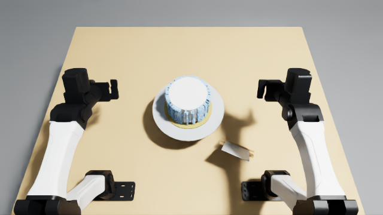
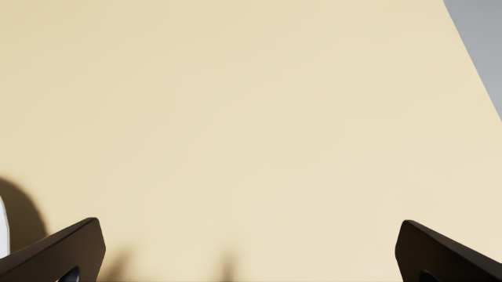
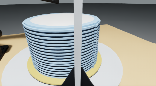
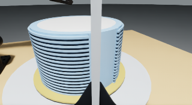
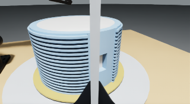

# Smooth the icing on a cake's side with a smoother, on a turntable

Instruction given to the policy: `Smooth the icing on the side of the cake with the smoother, then put the smoother back in its block.`

Files: `task.py` (scene, the icing and its rules, score), `mechkit.py` (the mechanism kit the task file imports), `demo.py` (the scripted full-score run, and a check of the take alone), `demo_kit.py` (the runner behind the scripted runs), `trials.py` (checks in the simulator: rest and the first pictures, what drawing the icing costs, the hand's hold of the smoother under known loads and the cue pictures), `reach.py` (the arms' reach for every pose the job needs, without the simulator), `start_top.png` and `start_right_wrist.png` (the first pictures of a trial), `cue_ridged.png`, `cue_smoothed.png`, `cue_bare.png` (the right wrist camera's picture as a policy gets it), `README.md`.

 

The first pictures of a trial, both arms in their ready pose (rest trial `b2k47`). Top camera: the cake on the stand, its ridged blue side and the dummy's white top. Right of the cake, towards the right arm, the smoother leans in its block: the plate's face shows, with the block's back at both its ends. Right wrist camera: the bench in front of the right arm, the fingertips, and the edge of the stand's top at the left margin.

## Where the task comes from

The idea was submitted before as #674 and closed. Its review: "A rigid, already-smooth dummy with no icing removes the material-handling skill that makes cake-side smoothing useful"; "full credit permits a 3 mm blade gap without smoothing any icing"; "The primary score measures tool pose and turntable coverage rather than whether the cake's side was smoothed"; "The instruction reveals the key method".

How this task meets it:

- The icing is a material here. The side starts combed: ridges 3 mm high and 6 mm apart running round, the comb's take-off scar down the side and an out-of-round, the last two from the seed. The smoother's straight edge cuts the high places down to itself and fills the low ones from the roll of icing it carries; where it leaves the icing, the roll stays as a mark; where it goes closer than 1 mm to the foam, the foam shows.
- Full credit asks for an even side, no more than 1.2 mm between high and low within any 50 mm, and only cutting and filling give that. An edge that stands off the icing leaves the ridges, 3 mm high to low, and such a side scores nothing (rule test `test_an_even_side_scores_one_and_its_limit_is_read_within_any_50_mm`).
- The score is read from the icing at the end of the trial. The smoother's place counts only as "back in its block", and how the cake was turned not at all.
- The instruction names the job and the tool. It does not say to hold the smoother still, to turn the stand, how deep to set the edge or how to take it off.

## Scene

Bench coordinates in metres: x forward from the line through the two arm bases, y left from the midline, z up from the bench top. The arms' bases are at (0, -0.305) and (0, +0.305).

| Part | Size, mass | Where |
|---|---|---|
| Revolving cake stand (Ateco 612): aluminium top on a cast-iron base | top 305 mm across, 3 mm thick, its upper face 127 mm over the bench; base: a foot 170 mm across and 25 mm high (a) and a column; 3.0 kg in all (2.4 kg base, 0.6 kg top (a)) | its axis at (0.30, 0.00); the base stands loose on its non-slip pad; the top turns freely, no pegs, no stops |
| Cake: a decorator's foam practice round on a cake board on a non-slip mat | dummy 152 mm across, 102 mm high, white; board 203 mm across, 3 mm (a); mat 1.5 mm (a); about 450 g with board and icing | on the stand's top, its axis on the stand's axis |
| Icing (Wilton Creamy White Decorator Icing, medium consistency, at 20 to 22 C, tinted pale blue with gel food colour) | on the side only, about 5 mm thick, combed once round with the comb's coarse teeth: ridges running round, 6 mm apart, 3 mm high to low; the comb's take-off scar 2 mm high down the side; out of round by up to 1 mm | on the dummy's side; the scar's place and the out-of-round are drawn from the seed |
| Smoother (Ateco 1447 decorating comb and icing smoother) | anodized aluminium plate 152 x 102 mm, 2 mm thick (a), 84 g by its size (a); three toothed edges and one straight edge, a long one (a) | standing on a short edge in the block's groove and leaning on its back, its straight edge upright and facing 65 degrees from +x |
| Beech block (a): a small stand with a grooved foot and a leaning back, the kind sold as a plate or tablet stand | base 140 x 80 x 15 mm, reaching out under the lean; back 140 mm long, 39 mm high and 10 mm thick, leaning 30 degrees from upright; at its foot a groove 6 mm wide and 4 mm deep, lined with a non-slip strip and closed in front by a lip 6 mm thick; 180 g (beech, 0.7 g/cm3) | at (0.17, -0.20), loose on the bench |

Sizes marked (a) are assumed; the others are the retailers' figures for the named parts. Which edge of the Ateco 1447 is straight is not given by its sellers ("three toothed edges, one straight"); a long one is assumed. If the bought comb's straight edge is a short one, any straight scraper 152 mm long does the same job.

The icing is tinted and the dummy is white so that bare foam shows white on blue, to a camera and to a bench photo, and the ridges throw a visible shade. The block leans the plate 30 degrees: upright, the plate showed the top camera, which hangs almost over the block, only its 2 mm top edge. The first block had a slot 3 mm wide and 18 mm deep with a jaw on either side, like a knife block's. The pinched plate drawn out of it jammed, which a 2 mm plate in that slot does past 3.2 degrees off the slot's line with friction 0.5, and the block came away on it, in three recordings (`b2k20`, `b2k28`, `b2k30`). In front of the plate the stand has only the lip, 4.8 mm away and 4 mm high. A back 30 mm high could not hold the plate: leaning on the back's top edge, its foot needs friction 0.89 to stay; it slid to the lip and the stand, then 50 mm wide, tipped over onto its back before anything moved (rest trial `b2k37`). The back is now 39 mm high, as high as it can be: there the closing fingertip passes 1.8 mm over its top edge (44 mm: 2.0 mm into it). There the foot needs friction 0.55, and the non-slip strip gives 1.0. At the start the plate settles once onto the lip, leaning 35.9 degrees, 4.0 mm from where it is built, and then stands still; the stand does not move (rest trial `b2k44`).

Hidden state, from the seed: the scar's place round the cake and the out-of-round (its size up to 1 mm and its phase). With seed 0 the scar is in column 81 of 96 (306 degrees round from +x) and the out-of-round is 0.27 mm high to low. A model run started with `--seed 0` under the harness gets the trial seed 1415158438: the scar in column 76 (287 degrees) and an out-of-round of 0.04 mm. The reference script reads neither. It sets the edge from the icing's mean thickness, so it can do the job from every start the seed can draw.

## The icing

Every number the simulation uses for the icing, in one table (`MATERIAL` in `task.py`). All are assumed (a); how each is measured on the bought icing is given below the table.

| Quantity | Value | What it is |
|---|---|---|
| Mean thickness | 5 mm | as iced on the side with an offset spatula |
| Ridges | 6 mm apart, 3 mm high to low | the comb's coarse teeth, combed once round; in the field: the rows alternate 1.5 mm over and under the mean |
| Scar | 2 mm high, one column (5.3 mm) wide, up the whole side | the comb's take-off |
| Out of round | up to 1 mm high to low, once round | how the spatula left the side |
| Cut push | 0.4 N per mm of depth per 100 mm of edge (4 kPa on the cut section), along the icing's motion past the edge and outward, each | what the icing pushes the edge with while it is cut; in the range of buttercream |
| Roll | 10 mm2 in section, along each row the edge works | the icing the edge carries along its length and fills from; what it cuts beyond that stays on the blade's face, out of the work |
| Fill reach | 2 mm | a cell this far under the edge is still filled from the roll |
| Bare | under 1 mm of icing | the foam shows through |

How to measure them (kitchen tests, on the bought icing at 20 to 22 C):

- Cut push: spread the icing 5 mm thick on a flat board standing on a kitchen scale, and comb it. Hold the smoother's straight edge across the ridges in a guide that sets it 1 mm under their tops, the plate upright, and draw it 100 mm along at about 2 cm/s with a spring scale pulling. The spring scale reads the push along the motion; the kitchen scale's rise reads the push outward (off the icing). Each, divided by the depth and the length of edge in the icing, gives the figure; repeat at 2 and 3 mm.
- Roll: after one turn of a combed cake under the edge, photograph the bead on the blade's face from its end with a ruler beside it, and measure its section.
- Fill reach: comb a board, then draw the edge over it at heights 1, 2 and 3 mm over the troughs; the highest at which the troughs still fill is the reach.
- Ridges, scar, out of round, thickness: a steel rule held upright against the side and feeler gauges in the gaps, at eight places round, after combing.
- Bare: icing thinned to 0.5, 1 and 1.5 mm on the foam, photographed in the bench's light: the thinnest at which no foam shows.

## How it is built

Simulated (PhysX, 240 Hz): the stand's base, standing loose on its pad; its top, on a free hinge on the base; the cake, one free body (mat, board and foam dummy) resting on the top on its mat; the smoother; the block; both arms. Contact and friction between all of them. The tiles that draw the icing take part in no contact.

Computed by the task file, once per control step:

- The icing: a field of thicknesses on the side, 96 cells round by 34 up (5.3 mm round and 3 mm up at the surface), that turns with the cake. The smoother's straight edge is found in the cake's frame, row by row. Every cell it has passed in a row since the last step (in the order passed, its distance from the foam taken in a straight line between the two steps) is cut down to the edge where it stood higher, what was cut going onto the roll; or filled up to the edge from the roll where it stood lower by up to 2 mm. Where the edge leaves a row, that row's share of the roll stays on the side as a mark.
- The cut's push: 4 kPa times the cut section now (the depth the edge cuts in each row times the row's height), along the icing's motion past the edge and outward, each; on the smoother at the cut's middle, and the same backward on the cake. In full from 2 mm/s of the icing past the edge, in proportion below; nothing while the edge does not cut.
- The bearing's drag: 0.01 N m (a), in proportion below 0.2 rad/s.
- The drawing: one tile per cell, a thin box moved in and out with the cell's thickness and hidden where the icing is thinner than 1 mm, so that the white foam shows. Drawing costs 4 % of a step for a turning cake: median steps of 325, 338 and 433 ms in run `b2k5`, with no tile moved, with 170 tiles moved a step (as a turning cake moves them) and with all 3,264 moved every step. Steps have since become faster on this host (175 ms at rest in `b2k47`); the share is what counts.

Stated departures from a real cake:

- The roll the edge carries stays on the blade when the smoother goes back into its block; the plate is not wiped. (There is no plate to wipe it on in the scene: nothing unscored is.)
- Only the straight edge works the icing. The toothed edges are drawn as the plate's plain edges and do nothing.
- Not modeled: the icing's slumping, air pockets, its temperature, crumbs, icing on the cake's top edge (the top is left bare) and icing sticking to the hand. The icing has no mass of its own in the dynamics; its weight is in the cake's.
- The cut's push is one figure for every speed from 2 mm/s up; real icing pushes harder the faster it is cut.
- The foam dummy is rigid: an edge pressed against it is stopped by it.

## Rules and score

Read on the band from 10 mm over the board to 10 mm under the dummy's top (rows 4 to 31 of 34), at the end of the trial. The trial ends early with 1.0 once the 1.0 condition has held for 1 s.

| Score | Condition |
|---|---|
| 1.0 | within any 50 mm of the surface (17 rows up, 9 columns round) no more than 1.2 mm between high and low; no bare place; the mean thickness 3 mm or more; the cake's axis within 5 mm of the top's axis; the smoother in its block; both hands' collision hulls 3 cm or more from the smoother, the iced cake, the board, the stand's top and the block |
| 0.75 | the same but for one flaw: one mark (connected cells standing out above the band's median, at most 4 columns round and 2 mm high), or one bare place smaller than 2 cm2; mended (the flaw's cells set to the median), the band is even |
| 0.5 | the ridges are under 1.5 mm (high to low within 50 mm up the column) on at least half the columns |
| 0.25 | the edge has cut at least half the band's height in a quarter of the columns |
| 0 | less; or the cake 15 mm or more off the top's axis, or the stand's base 15 mm or more off its place; or more than a third of the band bare |

A side at 1.0 or 0.75 by its icing but with the smoother not in its block, or a hand within 3 cm, scores 0.5 (0.25 if its ridges are not under 1.5 mm on half the columns).

The smoother is in its block when the two lowest corners of its plate are in the groove: within its length, between the lip and the back (with 0.5 mm play), and from 2 mm under its floor to the lip's top.

Run limit: 2,700 control steps at 20 Hz (135 s): the reference run's length and about 30 %.

## Can the icing be seen

The cue pictures: the right wrist camera from the hand's working pose at the cake, the smoother held, at the size a policy gets in the program's model runs (320 x 176). The icing is set to each state directly (run `b2k16`, `trials.py hold`). The block had a slot then; it is not in these pictures.

  

- Ridged: the whole side shows dark lines running round, the shade under each ridge.
- Smoothed band: to the right of the plate (where the turning has passed the edge) the side is a plain pale blue up to the cake's outline; the lines stop at the plate.
- Bare place: a white patch, 4 columns by 10 rows (21 by 30 mm), in the smoothed band.

## How each level is shown

One recorded run, the full-score reference run `b2k49` (below). Every other level and rule is shown by a rule test in `tests/test_cake_smooth.py` that sets the icing and the parts' places directly, without the simulator:

| Level or rule | Shown by | What it sets and reads |
|---|---|---|
| 1.0 | the reference run `b2k49`; `test_an_even_side_scores_one_and_its_limit_is_read_within_any_50_mm` | the reference run's end; in the test, an even side (1.0), a wave just under the limit within 50 mm (1.0), a step 0.1 mm over it (under 1.0) and the side with its ridges (0) |
| 0.75, one mark | `test_one_mark_or_one_small_bare_place_scores_three_quarters` | a mark down the side 1.9 mm high (0.75) and 2.1 mm high (0.5); two marks of 1.5 mm (0.5) |
| 0.75, one small bare place | the same test | a bare place of 12 cells, 1.9 cm2 (0.75), and of 13 cells, 2.1 cm2 (0.5) |
| 0.5 | `test_the_lower_levels` | half the way round smoothed, the rest as combed (0.5); the side even but 2.9 mm thick on average (0.5) |
| 0.25 | `test_the_lower_levels` | 47 columns smoothed and the edge's cut over 24 columns (0.25); over 23 (0) |
| 0, a third of the band bare | `test_the_lower_levels` | 33 of 96 columns bare (0) |
| 0, the cake or the stand off its place | `test_one_point_zero_needs_the_smoother_in_its_block_the_hands_clear_and_the_cake_centred`, `test_the_stand_pushed_off_its_place_scores_nothing` | the cake 4.9, 5.1, 14.9 and 15.1 mm off the top's axis (1.0, 0.5, 0.5, 0); the stand's base 14.9 and 15.1 mm off (1.0, 0) |
| the smoother in its block, the hands clear | `test_one_point_zero_needs_the_smoother_in_its_block_the_hands_clear_and_the_cake_centred`, `test_the_smoother_is_in_its_block_only_down_in_the_groove` | the smoother at the cake (0.5); a hand 29 and 31 mm from the icing (0.5, 1.0); the plate drawn 3.5 and 4.5 mm up the back, 6.5 and 8.5 mm off it (in, out, in, out); the other short edge down (in) |
| how the icing is cut, filled and marked | `test_the_edge_cuts_the_high_rows_and_fills_the_low_ones_as_the_cake_turns`, `test_a_deep_edge_leaves_foam_bare_and_a_straight_pull_leaves_its_roll_as_a_mark`, `test_the_roll_is_capped_and_what_it_cannot_hold_stays_on_the_blade`, `test_drawn_away_along_the_turning_the_mark_is_smaller_than_pulled_straight_off`, `test_the_cut_pushes_the_blade_along_the_icing_and_outward`, `test_a_wide_raised_band_is_not_one_mark_and_the_scar_is_read_apart` | the smoother put against the icing and the cake turned under it, step by step |

## The hand's hold on the smoother

How far the held edge gives under the cut's push (rule 4 of the build rules), measured before the limits were set (run `b2k16`, `trials.py hold`). The plate was built where the hand holds it at the cake, its edge 20 mm off the icing's mean surface; the hand closed on it, the weld that held it was cut, and loads were put on the edge's middle for 1.5 s each, with 1 s unloaded after each:

| Load on the edge | The edge's middle moved, from where the load before left it | Slip of the plate in the fingers |
|---|---|---|
| 0.2, 0.5, 1 N outward | 0.006, 0.109, 0.239 mm outward (0.376 mm from where it stood before any load) | 0.003 to 0.028 mm |
| 0.2, 0.5, 1 N along the turning (clockwise from above) | 0.1, 1.4, 3.5 mm along; 0.0, 0.3, 0.9 mm inward | 0.036 to 0.316 mm |
| 0.44 N each way at once | 0.4 mm along, 0.2 mm inward | 0.322 mm |

The cut's push at the reference run's depth is about 0.3 N each way (the ridges' tops 2.7 mm over the edge). Along the turning the hand gives most, and the plate is swung 20 degrees from the cake's radius: when the cake turned clockwise, the drag swung the edge into the icing, from 3.9 mm off the foam to the foam in 0.5 s, and the plate shoved the cake 75 mm off the top's axis (recording `b2k28`, score 0). The cake now turns anticlockwise, so the icing comes at the edge from the side of the plate's free end, as a scraper is held, and the drag swings the edge off the icing.

## Limits and readings

What each scored limit is, how a real bench reads it, and what the runs and trials read (the reference run `b2k49` below; `b2k46` was the run before it, on the same scene but with the edge set 1.2 mm under the mean and drawn away in one stroke):

| Limit | Value | A real bench reads it from | Readings |
|---|---|---|---|
| High to low within any 50 mm, for 1.0 | 1.2 mm | a steel rule held upright against the side at eight places round, the gaps under it read with feeler gauges; a photo of the side at each place | the combed start (seed 0): 5.07 mm. `b2k49`: plain side 0.507 mm at most (95th percentile 0.419, median 0.122), over the scar 0.325 mm. `b2k46`: plain side 1.594 mm, all of it the take-off mark; with the mark mended, 1.038 mm |
| One mark, for 0.75 | at most 2 mm high and 4 columns (21 mm) round | the rule and feeler gauges across the mark | `b2k46`: the take-off mark 1.33 mm high, 3 columns wide: 0.75. `b2k49`: the take-off spread over 7 columns, 0.40 mm at its highest, not a flaw |
| Bare | under 1 mm of icing; one place under 2 cm2 is one flaw; more than a third of the band, 0 | a photo: the white foam through the blue icing | `b2k49`: thinnest 3.32 mm, no bare cell; `b2k28`, with the edge swung into the icing: 1,724 bare cells |
| Ridges, for 0.5 | under 1.5 mm up a column on half the columns | the rule held upright | the start: 0 of 96 columns; `b2k49`: 96 of 96 |
| Mean thickness, for 1.0 | 3 mm or more | the side's diameter at three heights with a caliper: half its excess over the dummy's 152 mm | `b2k49`: 3.552 mm; `b2k46`: 3.005 mm |
| The cake on the top's axis | within 5 mm for 1.0; 15 mm or more, 0 | a photo from above against a ring drawn on the top | rest: 0.002 mm in 3 s (`b2k47`); `b2k49`: 0.00 mm all through; `b2k28`: 75 mm |
| The stand's base off its place | 15 mm or more, 0 | tape marks on the bench round the foot | rest 0.0 mm; `b2k49`: 0.0 mm |
| The hands clear | 3 cm from the smoother, the iced cake, the board, the stand's top and the block | the final photo | `b2k49`: 145.2 mm at the end. The two grasp points were never nearer each other than 231 mm |
| The smoother in its block | the plate's two lowest corners in the groove | the final photo | `b2k49`: in at the end. `b2k36`: on the 30 mm back, out (the stand tipped over at the start) |

## Reference run

Scripted (`demo.py`), seed 0. Run `b2k49` of 2026-11-20, recorded on commit aefe071; a folder with `result.json`, `readings.json`, the icing's end state `field.npy`, a video per camera, `setup.png` and contact sheets.

The right hand comes up behind the smoother, pointing level along its plate, slides its open fingers over it and closes 60 mm from the straight edge at mid-height. It draws the plate 20 mm up its own plane, takes it 7 cm off the block and turns it over on the way to the cake. There it sets the straight edge upright against the icing, the plate's lower corner just over the board, the plate swung 20 degrees from the cake's radius towards the arms, and holds still. The left hand, pointing down with its fingers closed, pushes the stand's rim round from outside, 98 degrees a stroke, anticlockwise from above, 14 times. Over the last two strokes the right hand draws the edge 3 mm away while the cake turns, then takes it clear, carries the smoother back and lowers it into the groove 1 mm off the back; let go, it settles onto the back. Both hands go to their ready pose.

What the script reads from the simulator: where the smoother, the block and the cake are (to put the hand on them), the icing's mean thickness (where a person sees the surface) and how far the stand's top has turned. It does not read the ridges or the score.

| Score | Ended | First reached | Strokes, turns | Readings |
|---|---|---|---|---|
| 1.00 | as a success after 100.0 s (2,000 of 2,700 steps) | 0.25 at 17.5 s, 0.5 at 22.6 s, 0.75 and 1.0 at 99.05 s (the smoother back in its block and the hands clear: the side was even long before) | 14 strokes of 93 to 100 degrees, 3.81 turns | high to low within 50 mm 0.507 mm; mean thickness 3.552 mm; the edge stood upright (each column within 0.04 mm from bottom to top); the cut's push 0.27 N on average while cutting, 1.62 N at most; on the blade's face at the end 76 cm3; worst inverse kinematics 0.14 mm |

What the contact sheets show. Right wrist camera: the ridged side behind the plate at 13.6 and 20.1 s; at 26.6 s a plain pale blue band right of the plate, the ridges still to the left; at 33 s plain nearly all round, the last ridges at the right outline; from 40 s an even pale blue side all round; at 99.5 s the cake from the side, smooth, the plate in its block at the right. Top camera: the block and the leaning plate at 0.1 s; the plate carried to the cake by 13.6 s; the left arm at the rim's far side, then pushing round to the near side, again and again; at 93 s the plate on its way back; at 99.5 s the plate leaning in the block again and both arms in their ready pose.

Runs `b2k20`, `b2k28` and `b2k30` ran the same code through the take, and read the same at every point compared there (the hand's height and its joint springs' push, every 0.5 s from 3 to 7.5 s).

## Model run

One trial of the Dream-1 model (`dreamlabs/dream-1-beta`), the stock embodiment and scorer, 2,700 steps at 20 Hz, `--seed 0` (trial seed 1415158438), run `b2k50` of 2026-11-20 on commit a4864f0: score 0.0 after all 2,700 steps. Both arms lifted their hands and moved about the bench. The right hand stayed between the block and the cake's right side; its camera had the cake's ridged side in view from 105 s to the end. The smoother was never taken, and the side kept its ridges.

## Checks run so far

- Reach, without the simulator (`reach.py`): the pinch at the block and at the cake, the rim pushed from outside from 70 to 165 degrees round, and the whole plan followed move by move at 20 Hz. Every move is followed within 0.1 mm and every joint stays at least 3.2 degrees inside its limits (`b2k43`). The plate is 8.1 mm off the block's outline while it is turned over and back.
- The hands' collision hulls along the take, against the plate and each of the block's boxes, without the simulator. Nothing touches while the hand slides over the plate. Closing, the fingertip under the plate passes 3.0 mm over the back's top edge with the plate as built, and 1.8 mm with the plate as it settles (`b2k42`, `b2k45`).
- Rest (`b2k47`, `trials.py rest`): over 3 s the stand, its top and the cake move 0.0 to 0.002 mm. The block, built 1 mm over the bench, settles that 1.0 mm and stays upright. The plate settles once, before the first picture, onto the lip (4.6 mm, to a lean of 35.9 degrees), then stands still. Median step 175 ms. Built standing on the bench, the block never moved and was not drawn in the first pictures until the hand stirred it (`b2k44`, `b2k46`).
- Drawing the icing (`b2k5`, `trials.py cells`): 4 % of a step (above).
- The hand's hold and the cue pictures (`b2k16`): above.
- Earlier recordings, each stopped by what it showed:
  - `b2k20`: the left hand pressed on the stand's top 15 mm inside the rim, its body over the cake, and shoved the cake 11.8 mm; the rim is now pushed from outside.
  - `b2k28`: turned clockwise, the edge swung into the icing (above).
  - `b2k20`, `b2k28`, `b2k30`: the plate jammed in a 3 mm slot and the block came away on it. In `b2k30` the block's weight sagged the hand 4.4 mm, the plate's lower corner sat on the board, the edge tilted 1.8 degrees and each column was left 3 mm thicker at the top than at the foot (score 0.25).
  - `b2k36`: on a stand with a 30 mm back, the plate slid and the stand tipped over before the arms moved (score 0).


## How to run

Rule tests, no simulator: `scripts/rta check cake_smooth`.

The reference run: `scripts/rta demo <id> mech/tasks/cake_smooth full` (results in `outputs/<id>/full/`); `take` instead of `full` runs the take alone (out of the block, off it, held); with `--quick` appended, the plan is checked against the arms' reach and joint limits without the simulator. The checks in the simulator: `scripts/rta simpy <id> mech/tasks/cake_smooth/trials.py /workspace/robocurve/outputs/<id> rest,cells` and, in a process of its own, `... hold`. The reach check without the simulator: `scripts/rta simpy <id> mech/tasks/cake_smooth/reach.py /workspace/robocurve/outputs/<id> plan:full` (or `all`, `stroke outside`, `blocks`).

One model trial with the stock embodiment and scorer (20 Hz, 320 x 176 pictures, fixed layout):

```bash
inspect-robots run --embodiment yam_arena --policy dream \
  -E task=mech/tasks/cake_smooth/task.py -E object_jitter=0 -E control_hz=20 -E cam_width=320 -E cam_height=176 \
  --instruction "Smooth the icing on the side of the cake with the smoother, then put the smoother back in its block." \
  --scorer task_score --max-steps 2700 --seed 0 --no-prompt --store-frames --log-dir <log dir>
```

`-E object_jitter=0` is required: the scripted runs take the layout from the task file's constants, and the task draws the icing's hidden state from the seed by itself.
