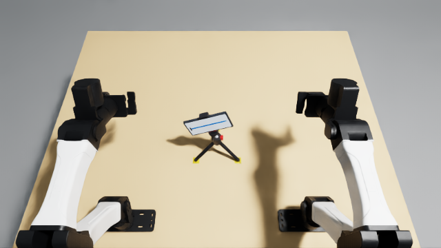
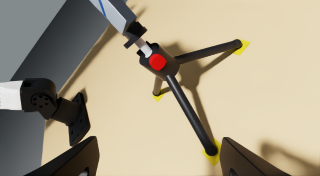

# Square a phone on a mini tripod ball head: hold it, press the head's button, set it straight, let the button relock

Instruction: `Make the phone on the mini tripod level, and leave it standing level on its own.`

Files: `task.py` (scene, rules, `score()`), `parts.py` (figures, sources, checks), `head.py` (head lock, button spring),
`checks.py` (offline IK, clearances, cameras), `trials.py` (`rest`, `flop`, `slip`, `force`, `letgo`, `order`), `demo.py`,
`test_pixi_level.py`, `mechkit.py`, `kit_extra.py`, `demo_kit.py`, `task.json`, pictures. Third-party assets: none;
every body is a `mechkit` primitive.

 

 

Other views: `start_left_wrist.png`, `start_left_wrist_policy.png`, `start_right_wrist.png`,
`start_right_wrist_policy.png`.

## Why it matters and how it differs

People stand phones on tabletop tripods for video calls and recipes; a leaning phone spoils every frame. On the PIXI,
pressing the button frees the ball joint, and on release the head is "locked automatically" where it stands (maker's
page, [tripod]); the phone's centre of mass sits 79 mm above the ball, so an unheld phone drops onto the 35 deg stops.
Beyond holding a release, the task tests setting a freed head level in two axes within 3 deg while both hands are busy
(one on the phone, one on the button), the head relocking wherever the button is let go. Near level (within about 7 deg)
the free head's drag (`FREE_NM` 0.02 N m against 0.15 N m x sin lean) holds a let-go phone in the simulator (`px5t4`
`letgo`: `1.0`); on a PIXI, the first-minutes drag check settles the real case.

## Key figures and their sources (`parts.py` `FIGURES`)

Tripod: Manfrotto PIXI mini tripod MTPIXI-B ([tripod]); clamp: Manfrotto PIXI smartphone clamp MCPIXI ([clamp]), bought
separately (the kit MKPIXICLAMP-BK, 0.215 kg by the maker, holds a lighter universal clamp); phone: Apple iPhone 15
([phone]); any phone of its size and mass with a level app works. Sources: 4 maker, 8 estimate. The start angles `(+10.0, -20.0) deg` are
the reset's setting. Its button is red, per a review of the MTPIXI-B ([review]).

| Figure | Constant | Value | Source |
|---|---|---|---|
| Tripod height, mass | `TRI_H`, `TRI_MASS` | 135.0 mm, 190.0 g | maker: maximum height 13.5 cm, weight 0.19 kg [tripod] |
| Head stops | `STOP_DEG` | +/-35.0 deg | maker: front and side tilt 35 deg each way [tripod] |
| Clamp mass, width | `CLAMP_BODY_MASS`, `CLAMP_W` | 41.0 g, 30.0 mm | maker: weight 0.041 kg, width 3 cm, opens 6-10.4 cm [clamp] |
| Phone size, mass | `PHONE_L/W/T`, `PHONE_MASS` | 147.6 x 71.6 x 7.8 mm, 171.0 g | maker: 147.6 x 71.6 x 7.80 mm, 171 grams [phone] |
| Foot circle | `LEG_SPAN` | 180.0 mm | estimate: 112 mm legs from a 75 mm hub, the maker's 18.5 cm folded length less the head |
| Foot friction | `TRI_FRICTION` | 0.80 | estimate: rubber feet on a dry bench top, mid-range for rubber on wood |
| Ball, neck, button; pinch span | `BALL_Z`, `HEAD_D`, `BUTTON_Z`, `HEAD_PINCH_SPAN` | 100.0, 34.0, 103.0, 38.0 mm | estimate: ball 35 mm under the maker's 13.5 cm top, 34 mm neck, button beside the ball |
| Clamp jaws | `CLAMP_BASE_H`, `CLAMP_TOP_H` | 8.0, 7.0 mm | estimate: with the 71.6 mm phone they make the maker's 8.7 cm clamp height |
| Lock torque, button out | `LOCK_NM` | 1.50 N m | estimate: 2.7x the 0.56 N m the maker's 1 kg rating needs 10 cm above the ball at 35 deg |
| Drag, button in | `FREE_NM` | 0.02 N m | estimate: under the 0.05 N m the phone puts on the head at the start, so a freed phone flops |
| Button force, stroke, release | `BUTTON_N`, `BUTTON_TRAVEL`, `PRESSED_FRACTION` | 18.0 N, 3.0 mm, 0.80 | estimate: a firm one-finger press; it frees in the last 0.6 mm |
| Button, ball masses | `BUTTON_MASS`, `C_TILT_MASS` | 8.0, 25.0 g | estimate: parts of the maker's 0.19 kg |

[tripod]: https://www.manfrotto.com/global-en/pixi-mini-tripod-black-mtpixi-b/
[clamp]: https://www.manfrotto.com/us-en/pixi-clamp-for-smartphone-with-multiple-attachments-mcpixi/
[phone]: https://support.apple.com/en-gb/111831
[review]: https://www.techwalls.com/manfrotto-pixi-mini-tripod-review/

**First minutes of a real trial** (about 15 min): ruler and scale on the tripod (1 min); ruler across the
feet (1 min); tripod on a board tilted until it slides, level app, mu = tan(angle) (2 min); caliper on ball, neck,
button and clamp jaws (3 min); luggage scale on a string at the phone's end, 90 deg, until the head slips, both axes
(3 min); button held, the smallest lean that drops the phone (2 min); tripod on a tared kitchen scale, button pressed to
the stop and to the release point, caliper depth rod (3 min).

## Scene, mechanism and bilateral forces (Check 51)

Pure serial chain (`head.py`), no one-sided `mk.push` loads in `task.py`: `tripod -> hinge("tilt", y) -> c_tilt -> hinge("roll", x) -> clamp --weld("phone_clamp")--> phone`,
plus `tripod -> slide("button", limits=(0, 3.0 mm), spring=6000 N/m)`.

| Stated force or hold | Code (`file:line`) | Acts on / Reaction on | What ends or triggers it | Reading in the recorded run `px5v1` |
|---|---|---|---|---|
| Head lock (`LOCK_NM` = 1.50 N m) | `head.py:41-62`, `head.py:152-166`, slip sum `head.py:199-204` | `clamp`+`phone` <-> `tripod` (bilateral drive) | `button` travel >= 2.40 mm; or torque > 1.50 N m | locked to `6.85 s` and from `13.95 s`: slip `0.00 deg`, peak `0.23 N m` |
| Free drag (`FREE_NM` = 0.02 N m) | `head.py:169-207` | `clamp`+`phone` <-> `tripod` (cap 0.02 N m) | `button` back < 2.40 mm (locks where it stands) | free from `6.85 s`: the left hand turns the phone `(+11.1, -19.4) deg` to level |
| Button spring (`BUTTON_N` = 18.0 N at 3.0 mm) | `head.py:64-74`, `head.py:118-120` | `button` (right front pad) <-> `tripod` (right rear pad) | right gripper opens | unlocks at `2.41 mm` (`14.5 N`); pads `28.6 N` on `button`, `29.5 N` on `tripod` |
| Left-hand hold & levelling | `task.py:258-264`, `demo.py:96-169` | `phone` <-> left pads (contact) | left gripper opens after the head locks | peak `35.9 N` over two pads (about `18 N` a pad); phone ends `+0.09, +0.01 deg` |

Recorded run `px5v1` (log `outputs/px5v1/demo/result.json`): `t = 3.15-3.40 s` the left pads close on the phone
(`14.3 + 15.4 N`) and the tripod turns `6.1 deg` on the bench (foot slide `12.4 mm`); `t = 6.85 s` the right pinch
unlocks the head at `2.41 mm`; slide at most `12.66 mm` of the `20 mm` allowed; `t = 13.95 s` button out, head locked
at `+0.09, +0.02 deg` with the phone still held; score `1.0` at `21.75 s`, feet `8.0 mm` off their marks at the end.

## Scoring, limits and shortcuts

Read at trial end (early stop once `1.0` holds `2.0 s` after the `1.0 s` rest window). Zero rules are read from the trial
video; the end state from the final photo and a phone level app:
- **0.0 (whole-trial):** any tripod foot lifts `> 10 mm` off the bench, slides `> 20 mm` from its tape mark, the phone
  touches the bench, or the phone turns on the head while nobody presses the button, seen on the trial video (the
  simulator counts more than `0.2 deg`).
- **End levels** (both grippers `>= 30 mm` clear; button `<= 0.5 mm` out: on the bench nothing touches it; all bodies
  `<= 0.02 m/s` and `<= 0.05 rad/s` for `1.0 s`: nothing moves for 1 s on the video): **1.0** if `|tilt| <= 3.0 deg`
  and `|roll| <= 3.0 deg` (`px5v1`: `+0.09, +0.01 deg`); **0.5** if both
  `<= 8.0 deg` with one `> 3.0 deg` (rule tests at `2.9/3.1` and `7.9/8.1 deg`); **0.0** otherwise.
- **Shortcuts** (`px5t4`): pressing the button without holding the phone drops it onto the stops; it must then be
  lifted level again. Pushing the locked phone with the tripod unbraced tips it first (`1.5 N` on the phone lifts a foot `12.6 mm` -> `0.0`); tilting the legs to level the
  phone breaks the `10 mm` lift / `20 mm` mark rules; bracing the tripod and forcing the locked phone level slips the
  head past `1.50 N m` (`force`: button never in, ends `+0.01, -0.85 deg` at rest, slip `13.9`/`19.1 deg` -> `0.0`, where the end rules alone read `1.0`). A one-sided button poke shoves the tripod only with the phone unheld (`49.7 mm` slide -> `0.0`);
  with the phone held, a one-sided right push (`16.0 N`, head unlocked: slide at most `15.6 mm`, lift `2.2 mm`) stays within the rules.

## Feasibility, cameras, commands and seeds

- **Grasps and IK (`checks.py`, `demo.py --quick`):** left hand pinches the `7.8 mm` phone at its lower left end
  (`z = 133.2 -> 156.9 mm`, `<= 160 mm`; 15-18 N/pad); right hand pinches the `38.0 mm` button and neck at `z = 103.5 mm`
  (~29 N/pad, under the 40 N finger limit). Hand hulls `>= 22.0 mm` apart, right hand `>= 15.8 mm` from the phone;
  IK error `<= 0.1 mm`, margins `>= 7.7 deg` (left), `>= 15.6 deg` (right).
  `px5v1` takes `435` steps (`21.75 s`) of `1,200 steps` (`60 s`). States set directly: none in `demo.py`; rule tests use
  `mk.set_state`; `trials.py` `slip` and `force` push torques (`mk.push`).
- **Can it be seen:** at `320x176` (`start_top_policy.png`) the phone's 20 deg roll gives a `7.1 px` slant across its
  top edge (`0.0 px` level); in `cue_button_right_wrist_policy.png` the `18 mm` button spans `16 x 14 px`.
- **Seeds & commands:** one fixed layout (`object_jitter = 0`); `--seed 0` under the harness gives trial seed
  `1415158438`, the same layout as every seed.
  - Pure tests: `scripts/rta check pixi_level`
  - Scripted check (no video): `scripts/rta demo px5v1 mech/tasks/pixi_level --check`
  - Harness run: `inspect-robots run --embodiment yam_arena --policy dream -E task=/workspace/robocurve/mech/tasks/pixi_level/task.py -E object_jitter=0 -E control_hz=20 -E cam_width=320 -E cam_height=176 --instruction "Make the phone on the mini tripod level, and leave it standing level on its own." --scorer task_score --max-steps 1200 --seed 0`
