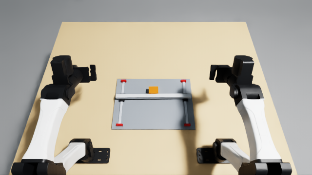
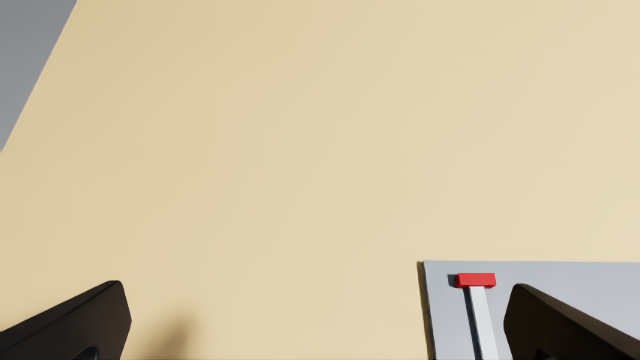
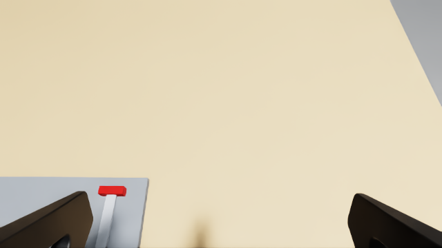
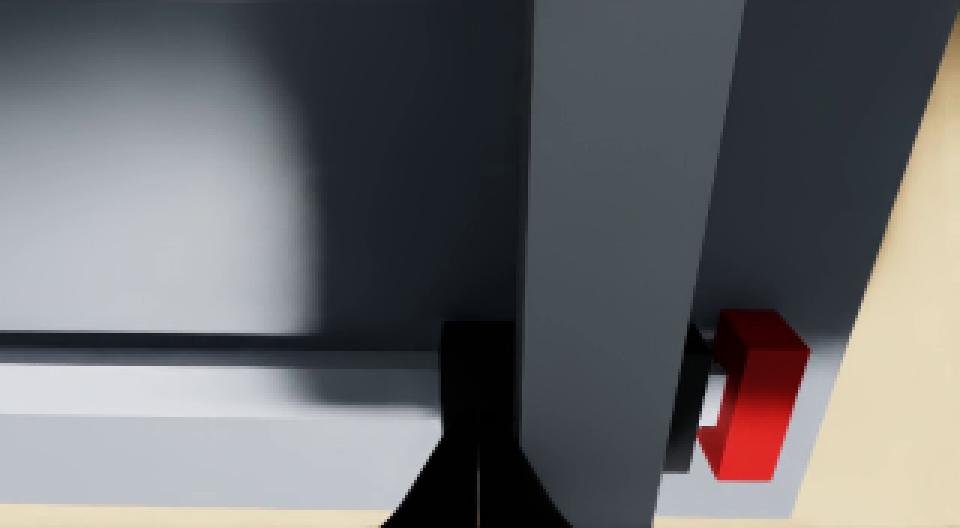
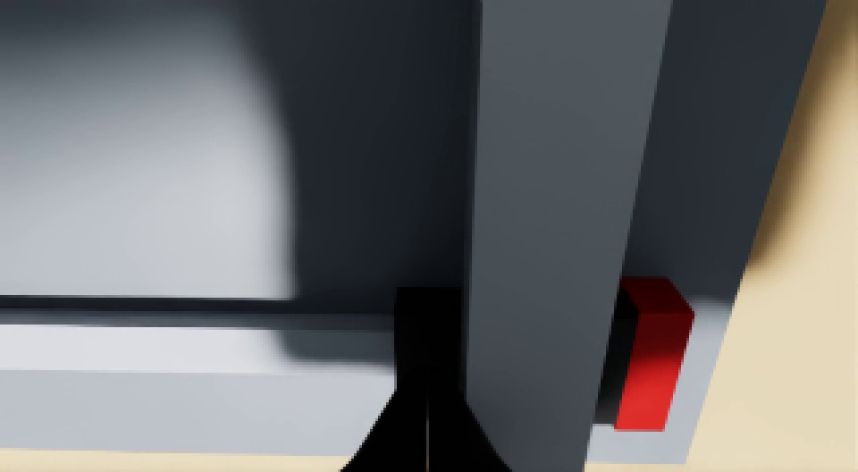

# Square a racked gantry beam on its two rails

Instruction given to the policy: `Slide the gantry beam along its rails until both carriages touch their far end stops, then let go.`

Files: `task.py` (scene, rules, score), `mechkit.py` (the mechanism kit the task file imports), `demo.py` (the scripted full-score run, the two lower levels as the same push cut short, the push at one end that binds, and the hands that stay), `demo_kit.py` (the runner behind the scripted runs), `trials.py` (checks in the simulator: rest and the first pictures, steady loads put on the beam directly, the hand's push at one end), `start_*.png` (the first pictures of a trial), `cue_*.png` (pictures at the size a policy gets), `README.md`.



 

The first pictures of a trial, both arms in their ready pose. Top camera: the base plate in front of and between the arms, the two rails on it with a red stop at each end, the beam across them with the orange toolhead on its far face, and the two black carriages showing under the beam's near edge. The beam stands racked, 80 mm from the far stops: about 15 pixels at the size a policy gets (5.5 mm a pixel); the 2.7 mm by which one end is ahead of the other is half a pixel there. Each wrist camera sees the near stop of its own rail.

## Scene

Bench coordinates in metres: x forward from the line through the two arm bases, y left from the midline, z up from the bench top. The arms' bases are at (0, -0.305) and (0, +0.305).

| Part | Size, mass | Where |
|---|---|---|
| Base plate, fixed to the bench | 300 x 420 x 10 mm | middle (0.275, 0), its long edges along y |
| Two HIWIN MGN12 rails, bolted to the plate | 12 mm wide, 8 mm high, 250 mm long | along x from 0.150 to 0.400, at y = -0.170 and +0.170 |
| Four end stops, red | 10 x 30 x 13 mm | one at each end of each rail: the far stops' faces at x = 0.400, the near stops' at 0.150 |
| The gantry: a 2020 aluminium extrusion 400 mm long, bolted across two MGN12H carriages; a toolhead block on the beam's far face at its middle | extrusion 20 x 20 x 400 mm; carriages 45.4 mm long, 27 mm wide, their tops 13 mm over the rails' foot; toolhead 40 x 50 x 40 mm; 0.8 kg in all | racked: the left carriage's far face 80.0 mm from its stop, the right one's 77.3 mm; the beam turned 0.455 degrees |

Nothing else is on the bench. Nothing varies by seed.

Sizes and sources. The rail's width and height and the carriage's length, width and height over the rail's foot are HIWIN's catalogue figures for the MGN12 rail and the MGN12H block. Assumed, to be measured on the bought parts: the gantry's 0.8 kg (from catalogue masses, a carriage 54 g and the extrusion 0.5 kg a metre, the rest the toolhead), weighed on a kitchen scale before assembly; the friction between carriage and rail, 0.2 (tilt the fixture until the gantry slides of itself: the tangent of that angle); the play of 0.25 mm a side between carriage and rail (a dial gauge on the beam's end, the beam rocked sideways by hand). The play stands for that of a gantry whose belts and bolts are loose: a new preloaded carriage has none.

## What stands in for what

- **A carriage holds its rail as a channel, not on balls.** A real MGN12H runs on balls in a groove along each side of the rail, and the grooves also hold it down. Here the groove is a square step under the rail's head (a head 12 mm wide and 3.5 mm high on a neck 9 mm wide), and each carriage is a channel that wraps the head with 0.25 mm of play a side and reaches under it with two lips. Pulled straight up with twice the gantry's weight, it rises 0.25 mm and is caught (see "Loads put on directly"); it cannot come off sideways, and the stops at both ends of each rail keep it from running off an end.
- **Nothing but contact holds the gantry.** It is one free body; there is no joint, no brake and no rule that holds or slows it. A carriage slides on its rail with a friction of 0.2 (static and dynamic, assumed). The binding is contact too: pushed at one end only, the beam turns in its play until each carriage bears on its rail's head at two opposite corners, and the friction there holds it, or lets it creep when the push is hard (see "Loads put on directly").
- **A carriage touches its stop face to face.** The stop is a block fixed to the plate; the score reads both upright edges of the carriage's far face against the stop's face, so a carriage that touches with one edge only, its face not square to the stop, is not touching.

## Rules

How far a carriage is from its stop: how far the middle of its far face stands from the face of the stop at the far end of its rail (80.0 and 77.3 mm at the start). How wide the opening at a stop is: the larger of the two distances from the stop's face to the two upright edges of the carriage's far face.

| Score | Asked | On a real bench |
|---|---|---|
| 0 | a carriage off its rail, or past one of its stops (neither can happen on this fixture); or none of the levels below | |
| 0.25 | both carriages 25 mm or more nearer their far stops than at the start | a tape from each carriage's far face to its stop: 55.0 mm or less on the left, 52.3 mm or less on the right |
| 0.5 | both carriages within 5 mm of their stops | the tape: 5 mm or less at both |
| 0.75 | both touching, face to face: the opening at each stop no wider than 0.1 mm | a 0.1 mm feeler gauge enters neither opening, tried at both edges of both faces |
| 1.0 | touching, the beam at rest, and both grippers 3 cm or more from the gantry | the video of the release |

The score that counts is the one at the end of the trial. A trial succeeds when the score has been 1.0 for one second; it then ends. The run limit is 600 steps (30 s).

## Can it be seen

 

The right wrist camera at the size a policy gets (320 x 176), enlarged three times here, while the hand pushes behind the beam in the run `full`: left, 7.6 s, the right carriage 5.6 mm short of its stop; right, 9.1 s, the carriage on its stop. Between the black carriage and the red stop, 5.6 mm of the rail's light top shows as 6 pixels (read along rows 135 to 140 of the picture); touching, none. The left wrist camera sees the same at its own end. The top camera shows the beam's travel (80 mm is about 15 pixels at this size) but not the last millimetres: 5 mm is one pixel there.

## Loads put on directly

No arm (recording `c2a`, `trials.py loads`): steady forces put on the beam, each from the racked start. The gantry weighs 7.85 N; with a friction of 0.2 it takes 1.6 N to slide it square.

- **At the middle of the beam's near face, 3 N along the rails:** both carriages are within 0.5 mm of their stops after 0.35 s; under the load they lie on their stops (gaps of -0.001 to 0.000 mm: the contact gives a thousandth of a millimetre), the beam turned 0.000 degrees; 1.5 s after the load is taken off the widest opening at a stop is 0.000 mm, and the score 1.0. The simulator settles a face against its stop well inside the 0.1 mm the score allows.
- **At the right end, over the right carriage** (the beam turns in its play, the carriages bear on their rails at opposite corners):

| Push | Right carriage went in 3 s | Left carriage went | Of that in the third second (right, left) | Beam turned, after 1 s and after 3 s |
|---|---|---|---|---|
| 3 N | 0.82 mm | -0.09 mm | 0.00, 0.00 mm | 0.608 and 0.608 degrees |
| 6 N | 1.00 mm | 0.17 mm | 0.00, 0.00 mm | 0.609 and 0.609 degrees |
| 12 N | 1.35 mm | 0.41 mm | 0.17, 0.17 mm | 0.612 and 0.612 degrees |
| 24 N | 2.34 mm | 1.37 mm | 0.32, 0.32 mm | 0.617 and 0.618 degrees |

The beam starts turned 0.455 degrees. Under 3 and 6 N at one end it turns a little further and stops: it binds. Under 12 and 24 N it keeps creeping, both carriages alike, a fifth to a third of a millimetre a second, still turned: the binding is a wedge, not a lock, and a hard push at one end drags the beam on slowly.
- **Pulled straight up with twice its weight:** it rises 0.25 mm, the play, and the carriages' lips catch it under the rails' heads; let go, it is back on its rails.

## The hand's push at one end

Before the script, the check that the beam binds under a hand (recording `c2a`, `trials.py bind`): the right hand, closed and pointing down, its fingertips 29 mm over the bench, comes down behind the beam over the right carriage and is asked 66 mm forward in 3 s. The right carriage goes 1.27 mm and the left one 0.38 mm; the beam turns to 0.61 degrees and stands, while the arm pushes along the rails with up to 9.8 N (its own reading, taken from its joints). Score 0; the gantry stays on its rails.

## Reference runs

Scripted, recording `c2b` of 2026-11-19 (commit `7bfd642`), 20 Hz. Both hands, closed and pointing down, come down behind the beam, one over each carriage, 6 mm behind the beam's near face where it stands (the beam is racked, so the right hand starts 2.7 mm ahead of the left). They go forward together at 25 mm a second, each slowing to 5 mm a second when its carriage is within 8 mm of its stop; a hand stops going forward when its own carriage touches its stop, and the other goes on until its carriage does too, which squares the beam. Then both go back 2 cm, up 8 cm and stay there.

| Run | What it does | Score | What the recording shows |
|---|---|---|---|
| `full` | pushes until both carriages touch, lets go | 1.0 | both hands touch the beam's near face after 6 mm and push it along the rails, the beam keeping its rack (turned 0.465 degrees at most); the right carriage touches its stop at 8.65 s, the left one at 8.75 s, which squares the beam; at the end both far faces lie on their stops, the openings 0.000 mm, the beam turned 0.000 degrees; the arms never push along the rails with more than 1.8 N; the gantry never rises off its rails (0.000 mm) and moves 0.073 mm sideways at most; 1.0 from 10.25 s, and the trial ends a second later (11.20 s) |
| `short` | the same push; both hands stop when both carriages are 30 mm nearer their stops | 0.25 | the carriages end 45.8 and 43.2 mm from their stops (left, right): 34.2 and 34.1 mm nearer than at the start, more than 5 mm away |
| `near` | stops when both carriages are within 3 mm | 0.5 | they end 2.88 and 2.00 mm from their stops: within 5 mm, not touching |
| `one_end` | the right hand alone pushes its end, asked 9 cm forward | 0 | the beam turns in its play from 0.455 to 0.613 degrees and binds: the right carriage goes 1.36 mm and the left one 0.47 mm while the arm pushes along the rails with up to 14.1 N; they end 79.5 and 75.9 mm from their stops (left, right) |
| `held` | as `full`, but the hands stay on the beam | 0.75 | both carriages touching (widest openings 0.000 mm); at the end the hands are 6 mm from the gantry (3 cm asked for 1.0) |

Contact sheets looked at, of this recording: all three cameras of `full`, the top and right wrist cameras of `one_end`. In `full` the top camera shows the beam sliding along the rails to the far stops, the orange toolhead going with it, both hands behind it; each wrist camera sees its own carriage, the beam above it and, from about 6 s, the red far stop coming nearer until the carriage meets it. In `one_end` the beam does not move along the rails while the right hand presses; the right wrist camera tilts as the arm yields under the push, and once the hand is up its carriage still stands in the middle of its rail.

What the script reads from the simulator: how far each carriage is from its stop (a person sees the gap close), to slow down, to stop `short` and `near` where they are meant to stop and to stop each hand when its carriage touches. It does not read the score, and it does not look at a camera.

## Limits and readings

| Limit in the score | Reading in the full-score run | Run that shows the limit |
|---|---|---|
| off its rails or past a stop: 1 mm (the play is 0.25 mm) | lifted 0.000 mm at most, 0.073 mm aside | none: the fixture does not let it happen; tests by state |
| 25 mm nearer | both on their stops | `short` (0.25): 34.1 to 34.2 mm nearer |
| within 5 mm | the same | `near` (0.5): 2.00 to 2.88 mm from the stops |
| touching: the opening at each stop 0.1 mm or less | widest opening 0.000 mm | `near` |
| both grippers 3 cm from the gantry | 83 mm | `held` (0.75) |

All of these are distances; no force is scored. The two levels that the reference reaches by stopping short are met with room: `short` ends 34.1 mm nearer than the start where 25 mm are asked, and 43.2 mm from the stops where 5 mm would give the next level; `near` ends 2.00 to 2.88 mm from its stops, inside 5 mm by 2.12 mm, with openings of 2.04 mm or more where 0.1 mm would be touching. The simulator settles a face against its stop at 0.000 mm (the run `full`, and 3 N put on the beam's middle: see "Loads put on directly"), well inside the 0.1 mm feeler.

## States set directly

Every rule of the scorer is checked by tests that set the state directly (`tests/test_gantry_square.py`): each distance a hundredth of a millimetre either side of its limit, for each carriage alone; the feeler at the widest edge of a face that is not square to its stop; 1.0 with the beam moving at 3 cm/s, and with a gripper 2.9 and 3.1 cm from the beam; a gantry lifted 2 mm and 2 cm, shifted 2 mm sideways, set 2 mm past its far stops or past its near stops: each scores 0 (none of these can happen on this fixture, whose carriages are caught under their rails' heads and stopped at both ends); lifted by its play, 0.25 mm, it is still on its rails.

## Earlier reviews of this idea

This idea was submitted before as pull request #2013 and reviewed three times; its importance was not questioned. This is a new build (scene, code and text are our own); the reviews are answered as follows.

- *First and second reviews: open-bottom carriages let the beam be lifted and set down on the stops; "realistically captured carriages or physical retainers"; "actual face-to-face stop contact, correct carriage height and position on both rails"; tests for off-rail and beyond-stop states.* Each carriage here is a channel that wraps its rail's head and reaches under it with two lips: pulled up with twice the gantry's weight it rises by its play, 0.25 mm, and is caught (see "Loads put on directly"); a stop stands at both ends of each rail. A carriage counts as touching only when both upright edges of its far face are within 0.1 mm of its stop's face. The carriages ride on the rails' heads, their tops 13 mm over the rails' foot as on an MGN12H, on both rails at 17 cm either side of the midline. The off-rail and beyond-stop states are scored 0 and tested (see "States set directly").
- *Third review: nothing but the runs on that fixture: a demo within the run limit, a Dream-1 run, the scorer's tests reported.* The demo is the run `full` (11.2 s of the 30 s limit); the Dream-1 run is made on this scene at the full run limit; the tests are listed above (`scripts/rta check gantry_square`).

## How to run

Rule tests, no simulator: `scripts/rta check gantry_square`.

Checks in the simulator: `scripts/rta simpy <id> mech/tasks/gantry_square/trials.py /workspace/robocurve/outputs/<id> rest,loads,bind`.

The reference runs: `scripts/rta demo <id> mech/tasks/gantry_square full,short,near,one_end,held` (results in `outputs/<id>/<run>/`: three videos, a contact sheet per camera, `result.json` with a row per step, `readings.json`); `--quick` checks every run's plan against the arms' reach without the simulator.

One model trial with the stock embodiment and scorer (20 Hz, 320 x 176 pictures):

```bash
inspect-robots run --embodiment yam_arena --policy dream \
  -E task=mech/tasks/gantry_square/task.py -E object_jitter=0 -E control_hz=20 -E cam_width=320 -E cam_height=176 \
  --instruction "Slide the gantry beam along its rails until both carriages touch their far end stops, then let go." \
  --scorer task_score --max-steps 600 --seed 0 --no-prompt --store-frames --log-dir <log dir>
```

`-E object_jitter=0` is required: the gantry stands on its rails where the task puts it.
