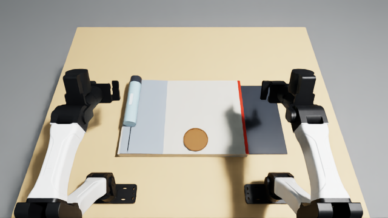
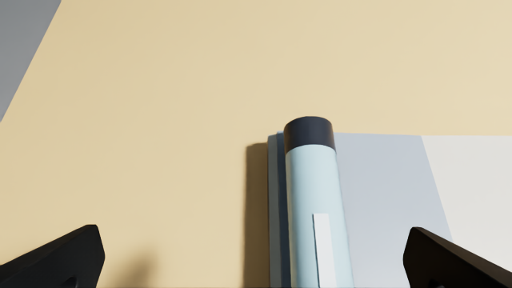
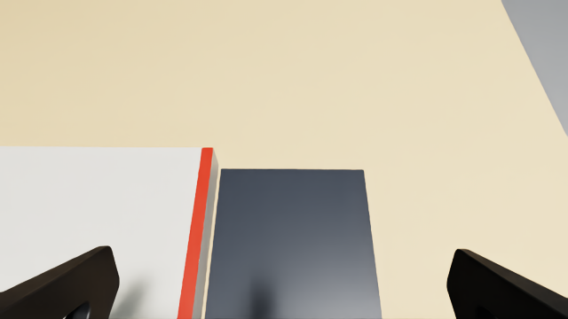
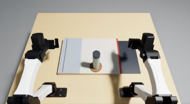

# Stop a glass bottle rolling off a sloped drainboard toward an open worktop edge and stand it upright on a coaster

Instruction: `Stop the rolling glass bottle before it goes over the edge of the worktop, then stand it upright on the cork coaster.`

 

Frame 0 (arms at `READY`): bottle on the `14.0 cm` mark of the `3.0 deg` drainboard (`x = +37.5 cm`, dark cap `+x`);
cork coaster at `(20.5, -2.0) cm`, `5.5 mm` clear of the roll lane; red trim at the open `38 mm` drop over the foam pad.

## Why it matters

A glass bottle on its side on a sloped drainboard crosses the `34 cm` worktop in under `1.5 s`: late drops it off
the edge, hard bats it off. Stopping it safely earns `0.5`; standing it upright in the coaster earns `1.0`.

## Key figures and their sources (`parts.py`)

| Figure | Constant | Value | Source |
|---|---|---|---|
| Bottle sizes & mass (`voss_375`) | `BOTTLE_D, BOTTLE_H, BOTTLE_MASS` | `54x229 mm`, `700 g` | listing: desertcart.sg/products/258462045 "5.4 x 5.4 x 22.9 cm" (cap incl.); uke.co.za/product/voss-still-water-375-ml-glass-bottle/ "Weight 0.7 kg" (full bottle as sold). Desertcart's "357.2 g" is under the 375 g of water: the empty bottle (estimate), 357 + 375 = 732 g ≈ 0.7 kg |
| Axial inertia ratio & angular damping | `ROT_INERTIA_FACTOR, BOTTLE_ANGULAR_DAMPING` | `0.35`, `0.05 /s` | estimate: sealed water barely spins in a 2 s roll, so `I/(mR^2)` lies between glass shell (~0.20) and solid fill (0.50); damping: simulator standard |
| Worktop thickness, width, depth | `WORKTOP_H, WORKTOP_W, WORKTOP_D` | `38 x 520 x 360 mm` | listing: HORNBACH decor worktop 34321 Oxid `4100x635x38 mm` (hornbach.de/c/kueche/kuechenarbeitsplatten/S1641), `520x360` cut-off |
| Drainboard wedge | `DRAIN_L, SHIM_H, SLOPE_DEG` | `170`, `8.9 mm`, `3.0 deg` | our fixture: 12 mm melamine board cut to a `360x170` wedge, `8.9 = 170·sin 3°` at its high end, feather edge at the foot |
| Release distance up-slope | `RELEASE_UP_M` | `140.0 mm` | protocol: the tape start mark `140 mm` up-slope of the foot seam |
| Foot speed, crossing times, decel | `V_FOOT_MPS, T_150_S, T_300_S, ROLL_DECEL_MPS2` | `0.28 m/s`, `0.56 s`, `1.18 s`, `0.035 m/s^2` | estimate (physics + simulator; derivation below) |
| Coaster outer Ø; recess & rim | `COASTER_OUT_D, COASTER_IN_D, COASTER_FLOOR_H, COASTER_RIM_H` | `100 mm`; `92 mm`, `4+3 mm` | maker's page (ikea.com/se/en/p/ikea-365-coaster-cork-30282946: "IKEA 365+ Coaster, cork, 10 cm"); recess/rim estimates from the maker's photo (page gives no thickness) |

## Roll physics (derivation)

Rolling without slip, `I = 0.35 m R^2`: down the `3.0 deg` slope `a = g·sin(3.0 deg)/1.35 − losses`, integrated at
`240 Hz` in `parts.py` (contact-gated losses plus a `0.068 m/s^2` start loss fitted to an idle trace), gives
`v_foot = 0.278 m/s`; on the flat `a = 0.0048·g/1.35 = 0.035 m/s^2` (rolling-resistance coefficient about 0.005) gives
`t_150 = 0.56 s`, `t_300 = 1.18 s`, edge (`340 mm`) at `1.35 s` past the foot. Sim trace (`g2c6`): `0.268 m/s`,
`0.585 s`, `1.238 s`, `1.426 s`. In sim the released bottle first creeps (`< 6 mm/s`) for about `1.5 s` (an engine
contact effect, not its start pose), reaching the foot `2.81 s` after release where a free roll takes about `1.0 s`;
times are given from the foot.

## Scene and stated forces (bilateral check)

Cm from midpoint between arm bases (`left` `(0, +30.5)`, `right` `(0, -30.5)`), `x` forward, `y` left:
- **`worktop`:** `52.0 x 36.0 x 3.8 cm` (`x in [14.5, 50.5]`, `y in [-23.0, +29.0]`), F-clamped (`kinematic=True`), red cliff stripe at `y = -23.0 cm`.
- **`drainboard`:** `36.0 x 17.0 cm` wedge (`y in [+11.0, +28.0]`), `8.9 mm` to a feather edge, our fixture, taped along its underside; simulated as a 12 mm slab with the same top face (`kinematic=True`).
- **`bottle`:** VOSS 375 mL glass (`54.0 x 229.0 mm`, `700 g`), `(37.5, +24.9) cm`, cap `+x`, at rest at `t = 0.00 s`.
- **`coaster`:** IKEA 365+ cork (`100 / 92 mm`, `4.0 + 3.0 mm`) taped to the worktop on its `(20.5, -2.0) cm` mark
  with double-sided mounting tape (a fixed rigid body).
- **`catch_mat`:** `34.0 x 16.0 x 1.0 cm` charcoal foam pad on the bench (`y in [-39.5, -23.5]`).

Zero welds, zero proximity catches. During the `0.5 s` pre-episode arm settle, `@on_reset` (`task.py:96`) balances
`+m g sin(3.0 deg)` (the protocol's straightedge, `parts.py:333`); the release hook clears it at `t = 0.00 s`.
Unmodelled: slosh waves, glass fracture.

| Stated force / resistance | Code | Acts on | Reaction on | Trigger / end | Sim reading |
|---|---|---|---|---|---|
| Roll, interception, coaster support | `task.py:47-51` | `bottle` | `drainboard`/`worktop`, `coaster`, pads | 240 Hz PhysX contact (`1 mm` offset) | `6.86 N` rolling, `19.9 N` cage peak, `6.87 N` on `coaster` (`g2c7`) |
| Rolling torque (`0.035 m/s^2`) | `roll_mech.py:114`, `task.py:189` | `bottle` (`-0.893 mN m`) | clamped counter | `f_support >= 0.5 N` & `v_roll > 5 mm/s`; `0` air/upright | `0.893 mN m` rolling, `0.000 N m` airborne (`g2c6`) |

## Rules and limits

Non-zero levels need `1.0 s` (`20` steps at `20 Hz`) at rest (simulator `< 10 mm/s`, `< 0.15 rad/s`; bench: nothing
moves on the video for `1 s`), resting on a support (simulator `>= 1.0 N` contact; bench: the same video check), and
both grippers `>= 30.0 mm` clear of `bottle` and `coaster` (zero robot-bottle contact); early exit `3.5 s` after `1.0`
holds so both arms finish parked.

| Score | Condition |
|---|---|
| `1.0` | never over an edge; upright **cap-up** (`<= 5.0 deg`), resting on `coaster` (simulator `>= 1.0 N`; bench: nothing moves on the video for `1 s`), base centre `<= 22.0 mm` of `coaster` centre, `coaster` still `<= 15.0 mm` of its taped mark; at rest, grippers clear `>= 1.0 s` |
| `0.5` | never over an edge; resting on the counter (simulator `>= 1.0 N`; bench: nothing moves on the video for `1 s`), at rest, grippers clear `>= 1.0 s` (lying, or standing cap-down / outside the coaster) |
| `0.0` | whole-trial latch (video-checked): centre ever outside `x in [14.5, 50.5] cm` or `y in [-23.0, +29.0] cm`, or lowest point `< 2.5 cm` above bench; or moving or not resting (simulator `>= 10 mm/s`, `>= 0.15 rad/s` or `< 1.0 N`; bench: it moves on the video), or a gripper within `30.0 mm` |

Shortcuts: idle drops off the edge (`0.0`); a propping gripper fails the `30.0 mm` clearance; batting off any
edge latches `0.0`; cap-down scores `0.5`.

Each limit is checked on the bench by video/photo/ruler, in sim by `g2c7`/`g2c6` (idle over the cliff at
`4.25 s`; upright `0.00 deg` at `6.87 N`; base `1.8 mm`; arms parked, `89` rest steps), and at its boundary by unit
tests: off-edge latch x5, tilt `4.9`/`5.1 deg`, cap-down, `0.9 N` contact, base `21.5`/`22.5 mm`, coaster shift
`14.5`/`15.5 mm`, grippers `28`/`32 mm`, hold `19`/`20` steps.

## Visibility, grasps, and trials

 

At `320 x 176`, bottle, dark cap, drainboard, coaster, and cliff stripe sit unobstructed between the ready arms.

- **Dry checks (`checks.py`):** IK `<= 0.066 mm / 0.018 deg`, joint margin `>= 9.4 deg`, hand `>= 14.2 mm`
  over `worktop`, arms `>= 151 mm` apart; cage `(37.5, -7.5) cm`, `88 mm` jaws; pinch `2 mm` above COM (`116.5 mm` from
  base, `~35 N/pad`, `TCP <= 159.3 < 160 mm`); `90 deg` cap-up carry.
- **`trials.py` (`g2c6`):** `roll_trace`: the trace above, over the cliff `4.25 s` after release; `0.0 mm` drift,
  `5.5 mm` coaster gap, `0.0 N` coaster force, `0.000 N m` airborne torque -> **`0.0`**; `stop_only` cages at
  `(37.5, -8.3) cm`, parks -> **`0.5`** (IK `0.07 mm`).
- **`demo.py --check` (`g2c7`, arm actions only):** cages the rolling bottle, pinches, pitches `90 deg`
  cap-up (it lags `4.5 deg` in the pads, beyond the wrist's reach), sets the low base rim on the cork floor and
  moves over the base so the bottle pivots upright, opens once still, retracts `50 mm` over the cap ->
  **`1.0`** at **`429 / 800` steps (`21.45 s`)**, tilt `0.00 deg`, base `1.8 mm` of centre, still (`0.2 mm/s`).

## First minutes of a real trial

On the bench with the bought items (~12 min; caliper, 1 g scale, ruler, phone protractor, 60 fps video): (1) measure
bottle Ø/height/mass and coaster Ø/recess/rim; (2) tape the wedge down, read the slope, lay a straightedge over the foot
seam (step under `0.5 mm`); (3) film five straightedge releases from the `14.0 cm` mark over marks at `0/5/15/30 cm`, read `v_foot`,
`t_150`, `t_300`, drift against the predicted `0.28 m/s`, `0.56 s`, `1.18 s`, `0.0 mm`, and the release-to-foot time against the
simulator's `2.81 s` (its `1.5 s` creep, above);
any figure that differs is corrected in `parts.py` — scene, rules, tests follow from that one file.

## Seed, nearest tasks, and how to run

One layout (`object_jitter=0`): `--seed 0` derives trial seed `1415158438`, this start state as every seed does.

Nearest known-suite task: RoboDynamicExam S11 Cylinder Rescue Route Deliver (a short cylinder rolling off a raised lane,
intercepted in a held tray); ours uses bare grippers on an open counter, then a regrasp that stands the bottle upright
on a coaster. LIBERO, RoboCasa, SimplerEnv, BEHAVIOR-1K manipulate static items.

Commands (in the container, no assets, from this task's folder):
- `python parts.py` · `python -m pytest -q test_rolling_bottle.py` (14 tests)
- `python demo.py --quick` · `python trials.py <out> roll_trace,stop_only` · `python demo.py <out> --check`
- `inspect-robots run --embodiment yam_arena --policy <policy> -E task=mech/tasks/rolling_bottle/task.py -E object_jitter=0 -E control_hz=20 -E cam_width=320 -E cam_height=176 --instruction "Stop the rolling glass bottle before it goes over the edge of the worktop, then stand it upright on the cork coaster." --scorer task_score --max-steps 800 --seed 0`
