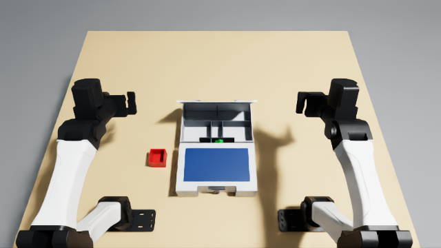
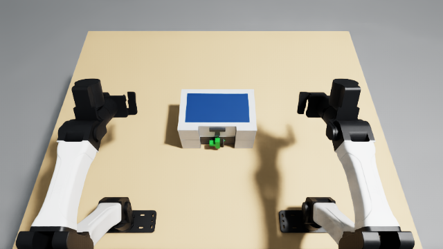

# Stow a parts box in a lower Systainer, slide the upper Systainer into its rear cleats, and turn T-Loc to connect

Instruction: `Place the red parts box flat inside the open lower Systainer, close its lid flush, slide the upper Systainer rearward under the lower lid's rear cleats until it seats flush, and turn the lower green T-Loc latch to its connect position so both cases lock together, then let go and move both hands clear.`

Files: `task.json`; `task.py` (rules, `score()`); `scene.py` (bodies, joints); `parts.py` (figures, sources); `checks.py`, `trials.py`, `demo.py`; `test_systainer_tloc.py`; kit (`mechkit.py`, `demo_kit.py`); `start_top.png`, `start_top_policy.png` (320 x 176), `start_left_wrist.png`, `start_right_wrist.png`; `end_top.png`, `end_top_policy.png`.



## What the task tests

- **Flat insert stowage.** The red `54 x 54 x 45 mm` Allit box must sit flat on the `7.0 mm` floor of the open lower `SYS3 S 76` (`44 mm` ribs, `67 mm` interior) before the `57.3 deg` lid closes (`<= 2.5 deg`). Cocked on a rib, it props the lid `> 6 deg` (`0.0`).
- **Two-case rear-cleat slide before rotary lock.** Stacking the smooth-walled `0.48 kg` upper `SYS3 S 76` requires landing ahead of the rear cleats (`dx ~ -16 mm`) and sliding rearward (`+12 mm`) so both `3.5 mm` rear hooks tuck `>= 5.0 mm` under the `6.5 mm`-throat lid cleats before the `5.0 mm` front feet drop onto the `71.0 mm` deck (`0.5`). Dropping straight down perches `10.75 mm` proud (`0.25`); leaving it `12 mm` forward kicks it `8.61 mm` proud on T-Loc turn (`0.25`).
- **Braced 3-position T-Loc coupling.** Left braces the `0.94 kg` stack while Right turns the green `T-Loc` on `case_low`'s front wall from `OPEN` (`-55 deg`) through `CLOSE` (`0 deg`, holding `lid_low`) to `CONNECT` (`+90 deg`, holding `lid_low` via Lobe 2 while Lobe 3 hooks `case_top`'s keeper bar so lifting `case_top` lifts both).

## Scene and grasps

- **Lower Systainer** `(34.5, 0.0) cm` (start pencil ticks, not drawn): **Festool Systainer3 `SYS3 S 76`, item `577808`** (`265 x 171 x 76 mm` w/ `5 mm` feet, `71 mm` body, `258 x 164 x 67 mm` interior, `0.40 kg` = `0.30+0.08+0.02 kg`; grey ABS), `265 mm` along `y`, `92 x 106 mm` cell, `lid_hinge` `57.3 deg` (`62 deg` built), front `tloc` `-55.0 deg` (`z = 45.0 mm`).
- **Upper Systainer** `(16.5, 0.0) cm`: closed **Festool `SYS3 S 76`, item `577808`** (`0.48 kg` w/ partitions, smooth walls, no side handles, blue band, closed T-Loc).
- **Parts box** `(21.5, +21.5) cm`: red PS **Allit `EuroPlus Insert 45/1`, item `456300`** (`EAN 4005187563009`, `54 x 54 x 45 mm` outer, `48 x 48 x 42 mm` inner, `14 g` est. / `60 g` sim; US: **Schaller `2x2x1-3/4 in` red box**).
- **Grasps (`<= 94 mm` jaw, `<= 158 mm` z, `>= 205 mm` TCP sep, `<= 28.1 N/pad`, `33 %` effort):** (1) Left pinch on `54 mm` box (`z = 50..128 mm`, `~27.5 N/pad`). (2) Left closed sweep closing `lid_low` (`z = 75..138 mm`, `-4 N`). (3) Two-arm `76 mm`-open 4-point squeeze (`83.7 mm` span, `2` pads/arm) on `case_top`'s `y = +/-132.5 mm` walls (`z = 46..148 mm`, `18 N` push; `24.9 N/pad` = `49.8 N` 2-pad preload peak, `~12.3 N/pad` carry) + `+x` slide (`4.5 N/arm`). (4) Left brace at `(39.2, +10.0, 14.8) cm` (`-8.5 N` z, `+2.0 N` x) while Right pinches `16 mm` T-Loc wings (`38 mm` open, `28.1 N/pad` peak, `z = 45..64 mm`) across `-55 -> 0 -> +90 deg`.

## Rules, score, and shortcuts

- **0 for good:** `case_low`, `case_top`, or `parts_box` falls off bench (`> 30 mm` below top; video, end photo).
- **0.25:** `parts_box` flat in `case_low` (`<= 5 mm` floor, `<= 10 deg` tilt) and `lid_low <= 2.5 deg`.
- **0.5:** `0.25` + rear hooks `>= 5.0 mm` under cleats and flush (`seam <= 2.5 mm` all corners, `|dx| <= 4.0 mm`, `|dy| <= 6.0 mm`, `|yaw| <= 6.0 deg`, `tilt <= 3.0 deg`).
- **1.0:** `0.5` + `tloc_low` in `+80..+95 deg` (lifting `case_top` by its sides after hold lifts `case_low`), hands `>= 30 mm` clear, both cases within `2.0 mm` and `T-Loc` within `2.0 deg` for `1.0 s` (`20 steps`). Limit: `1,600 steps` (`80 s`).
- **Shortcuts (`trials.py`):** empty close (`0.0`); cocked box props lid `> 6 deg` (`0.0`); unslid drop `10.75 mm` proud (`0.25`); `12 mm` forward kicks `case_top` `8.61 mm` proud on T-Loc turn (`0.25`); `0 deg` `CLOSE` scores `0.5` and peels `> 12 mm` under `15 N`.

## Stand-ins and states set directly

- **Stand-ins:** (1) Rigid colliders at maker sizes (ABS flex and clips omitted; cleat slide and 3-lobe cam locks are rigid). (2) `parts_box` `60 g` in PhysX (`14 g` est., `12 mm` CoM) for jitter-free `27 N` pinch.
- **States set directly:** `0` calls to `write_pose` or `set_joint` in `task.py`, `scene.py`, or `demo.py`. `lid_low` and `tloc_low` are built open; `@on_reset` / `@on_step` only step `<= 40 deg` spring targets via `set_spring`. `demo.py`: arm actions only.

## Key figures and sources

| Figure | Value | Source |
|---|---|---|
| `SYS3 S 76` outer (`577808`) | `265 x 171 x 71 / 76 mm` | maker: `"265 x 171 x 71 mm"`, `"265 x 171 x 76 mm"` w/ feet [s76] |
| `SYS3 S 76` inner & mass | `258 x 164 x 67 mm`, `0.40 kg` | maker: `"258 x 164 x 67 mm"`, `"0.40 kg"` (`0.48 kg` upper w/ dividers) [s76] |
| T-Loc 3-state function | `OPEN / CLOSE / CONNECT` | maker: `"can be closed, opened and connected with a single turn"` [s147] |
| T-Loc knob & detents | `56x38x17 mm`; `-55,0,+90 deg`; `0.18 N m` | estimate: scaled from `265x71 mm` front [s76]; `~6.4 N` at `28 mm` wing |
| Cleat throat & slide | `6.5 mm` throat, `12.0 mm` slide | estimate: `5 mm` foot (`76-71 mm`) + `3 mm` clearance over `3.5 mm` hook |
| Lid stay & rib height | `62 deg` (`57.3 deg` settled), `44 mm` | estimate: clears `92x106 mm` cell while cocked `45 mm` box props lid |
| Allit `456300` box | `54 x 54 x 45 mm`; `14 g` (`60 g` sim) | estimate: [conrad] listing title (not opened: 403); a PS shell with `~1.1 mm` walls |
| Bench / case friction | `1.10` feet, `0.18` ABS deck | estimate: elastomer feet on bench vs smooth ABS cleat slide |

`parts.FIGURES` (`29` figures): `8` maker, `21` estimate.

## First minutes of a real trial

Bought `2x Festool 577808` + `Allit 456300` (`~5 min`): weigh cases and box (`1 min`); caliper `T-Loc` wings, cleat throat, and slide stroke (`2 min`); protractor on `-55 / 0 / +90 deg` detents (`1 min`); spring scale at `28 mm` wing (`~0.18 N m`) and upward lift check (`1 min`) — a different reading replaces the estimate.

## Forces, visibility, and checks

| Force / hold | Primitive | On | Against | Verified in sim |
|---|---|---|---|---|
| Lid stay (`0.26 N m/rad`) | `hinge("lid_hinge")` | `lid_low` | `case_low` | `57.3 deg` -> `-0.04 deg` (`11.05 s`) |
| Rear cleat lock | Rigid hook-under-cleat | `case_top` | `lid_low -> case_low` | `dx -16.1->+0.8 mm`, `cleat 11.1 mm`, `seam 0.14 mm` (`21.55 s`) |
| T-Loc detent (`0.18 N m`) | `hinge("tloc")` (`<=40 deg`) | `tloc_low` | `case_low` | `-54.4->-1.1 deg` (`0.119 N m`), `-1.8->+90.6->+89.7 deg` (`0.180 N m`) |
| Coupled lift lock | Rigid Lobes 1-3 | `lid_low`, `case_top` | `tloc_low -> case_low` | `15 N` pull lifts `0.94 kg` stack `400 mm` (`seam 3.1` vs `423 mm`) |

- **Visibility (`start_top_policy.png`, `end_top_policy.png` at `320 x 176`):** Start shows red `54 mm` box, open `case_low` cell, green `-55 deg` `T-Loc`, and blue-banded `case_top`. End (`end_top_policy.png`, `end_top.png`) shows box stowed, `0.09 mm` seam, and vertical green `+89.7 deg` `T-Loc`.
- **Checks:** `9` unit tests; `34` poses (`<= 0.08 mm`, margin `>= 11.9 deg`, `z <= 158 mm`, `20` pairs `>= 205.2 mm` TCP / `>= 127.4 mm` hull); `7` PhysX trials; `demo.py` `1.0` at `38.70 s` (`41.15 s`, `823/1,600` steps, `dx 0.2 mm`, `dy -0.1 mm`, `cleat 11.4 mm`, `seam 0.09 mm`, `tloc +89.70 deg`, `clear 155.2 mm`).



## How it differs

Single-case toolbox tasks clear an item from one lid and thread a padlock or pull draw latches; twist-lock carrier tasks turn one round lid; box-lid tasks press one lid down; `BEHAVIOR-1K` (*Outfit A Basic Toolbox*) and `RoboDojo` (*Store Tools In Toolbox*) place tools in a tray (`0` case-coupling tasks in `BEHAVIOR-1K`, `RoboCasa`, `LIBERO`). None slide a smooth-walled case under rear lid cleats and turn a 3-position cam locking lower lid and upper case together.

## Assets and sources

Kit primitives only (no external meshes, textures, or sounds). Opened `2026-11-21/22`:
- `[s76]` https://www.festool.com/products/systainer-and-transport-systems/systainer/577808---sys3-s-76 ; `[s147]` https://www.festool.com/products/systainer-and-transport-systems/systainer/577818---sys3-s-147
- `[jobs]` https://www.onetonline.org/link/summary/47-2061.00 (`1,489,300`, `'Load, unload, or identify building materials, machinery, or tools ...'`) ; https://www.onetonline.org/link/summary/47-2031.00 (`889,700`) ; https://www.onetonline.org/link/summary/47-2111.00 (`821,000`) ; https://www.onetonline.org/link/summary/49-9071.00 (`1,621,800`).
- `[conrad]` https://www.conrad.com/en/p/allit-456300-insert-box-l-x-w-x-h-54-x-54-x-45-mm-number-of-compartments-1-polystyrene-ps-red-1-pc-s-1520907.html (listing, not opened: 403).

## How to run

`scripts/rta check systainer_tloc`; `scripts/rta simpy <id> <dir>/checks.py --frame0 <out>`; `scripts/rta simpy <id> <dir>/trials.py <out>`; `scripts/rta demo <id> <dir>` (`--check`, `--dry`). Limit `80 s` (`1,600 steps`, `~2.8 min` wall; demo `41.15 s`). `--seed 0` gives trial seed `1415158438` (fixed start, `object_jitter=0`).

```bash
inspect-robots run --embodiment yam_arena --policy dream \
  -E task=mech/tasks/systainer_tloc/task.py -E object_jitter=0 -E control_hz=20 -E cam_width=320 -E cam_height=176 \
  --instruction "$(jq -r .instruction mech/tasks/systainer_tloc/task.json)" \
  --scorer task_score --max-steps 1600 --seed 0 --no-prompt --store-frames --log-dir <log dir>
```
