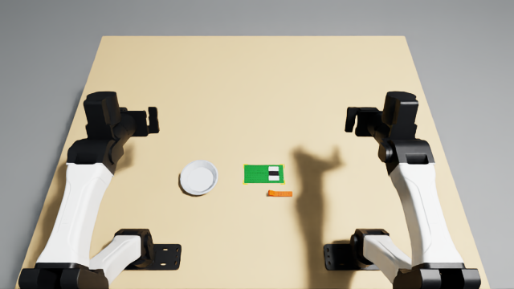
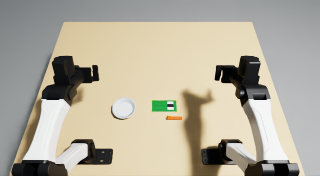

# Take a flush LEGO 2x4 plate off its base with the brick separator, then pull the plate out of the tool into the dish

Instruction: `Use the orange brick separator to take the black 2x4 plate off the green plate without moving the two white plates beside it, then put the black plate in the dish and the separator on the bench.`

 

## Task

Taking a LEGO build apart to sort it back into its box ends at plates pressed flat onto others. Here the black plate
has no edge to grip: 3.2 mm thick, white plates cover its long sides, its ends stand 1.5 mm above the green plate's
studs. The separator's front must sit squarely over the plate's two end studs and be pressed on; only then does
lowering its back rock the tool over its lower edge and lift the plate, which is then pulled out along its studs.

## Setup

Centimetres from the midpoint between the arm bases (x away from the arms, y left). Both arms start at the ready pose,
grippers open. A fixed layout (`object_jitter = 0`; `--seed 0` gives the trial seed 1415158438, the same layout for
every seed). The green plate starts within 2 mm of the tape marks at its corners, the separator within 5 mm and the
dish within 10 mm of their places, checked against the start photo. LEGO parts and element numbers: Brickset's
inventory of Classic 10696.

| Object | Product | Size, mass | Start |
|---|---|---|---|
| green plate | LEGO Plate 8 x 16, element 4610353 (design 92438), Bright Green | 63.8 x 127.8 x 3.2 mm, 17.0 g | flat at (26.0, -3.6), along y |
| black plate | LEGO Plate 2 x 4, element 302026 (design 3020), black | 31.8 x 15.8 x 3.2 mm, 1.2 g | centred across the green plate's width, two studs in from its right end |
| two white plates | Plate 2 x 4, element 302001, white | as the black plate | flush on its long sides, ends level |
| separator | LEGO Brick and Axle Separator, element 6240515 (design 31510 / 96874), orange | 76.0 x 16.0 x 19.2 mm, 3.93 g | on its handle before the green plate, lower edge (19.0, -6.5), handle to the right arm |
| dish | a white porcelain soup plate | 120 mm across, 25 mm deep, 150 g | (24.0, 17.0) |

## Scoring

Zero at every step, judged from the trial video: a corner of the green plate lifts more than 3 mm or slides more than
15 mm from its mark, or the dish is pushed more than 20 mm. Otherwise at the end: 0.0 while the black plate is on the
green plate (idle run: 0.0); 0.25 once the separator was seated on its near row (at the bench: its front stays pressed
on the plate's two end studs by itself, seen on the trial video); 0.5 when the plate came off while the separator was
seated on it (peeled off without it, it counts as still on); 1.0 when in addition the plate is out of the separator,
resting in the dish (centre inside the rim, below its top), the separator lies on the bench outside the dish, both
white plates within 2 mm of their places, both grasp points 30 mm or more from the plate, the separator and the dish,
and every body below 10 mm/s and 0.1 rad/s for 1 s (20 steps).

Shortcuts: pinching the plate's ends and lifting it (zero: a base corner lifted 6.2 mm) or rolling it (zero: the base
slid 16.5 mm), or rolling it with the base held (0.0: the plate stays on); peeling with the green plate not held down
(zero, only just: a base corner lifted 3.5 mm against the 3 mm limit). The white plates are welded, so their rule
cannot fail in the simulator; dropping the separator, plate still in it, into the dish scores 0.5 at most.

## How the stud clutch is simulated

Three joints stand for the clutch, each a force between the two named bodies.

| Stated force or hold | Code | Acts on / reaction on | Ends when |
|---|---|---|---|
| press to seat, `PRESS_N` 6 N | separator-plate contact, read on the `peel` hinge's sprung stop (`press_force_n`) | black plate down / separator up, through the green plate to the bench | `w_seat` made: socket within 0.8 mm and 4 deg of the near row, on the plate, pressed 6 N or more for 3 steps |
| plate held on the green plate, `PEEL_HOLD_NM` 0.07 N m (2.5 N at the near row) | `hinge("peel")` about the plate's far edge, capped spring, rest following the joint (`_peel_rule`) | black plate / green plate | turned to `PEEL_RELEASE_DEG` 12 deg: weld `w_target` cut |
| separator holds the plate, `SEP_HOLD_N` 4 N | `slide("pull")` along the studs, capped spring, rest following (`_pull_rule`) | black plate / separator, through the socket's chain and `w_seat` | pulled 1.7 mm along the studs (read each 50 ms step: 2.08 mm at the cut in the run): `w_seat` cut |
| hand on the handle; brace on the green plate | gripper contacts | separator; green plate | the plate comes free |
| white plates | welds | white plates / green plate | never |

The press reading is the moment on the peel's sprung lower stop minus its rest reading after the reset (0.0171 N m),
over the 27.9 mm lever; it counts every load on the near row, the separator's own weight (0.29 N at 30 g). Force
against travel (run l10t25): peel, the 0.07 N m cap (2.51 N at the row) reached within 0.16 deg and held to the release
at 12.12 deg; pull, 1.5 -> 4.0 N over 0.37 mm, then held at 4.0 N to the cut.

Stand-ins (`parts.py`, beside each true figure): the separator at 30 g, not 3.93 g (lighter, it turned out of the 29 N
pinch at its first touch of the plate; the extra 0.26 N is under 5 % of the press it adds to); the black plate at 10
g, not 1.2 g (lighter, its weld to the hinge link opened 0.9 mm under the press; +0.086 N, 3 % of the peel hold);
hidden links of 1 g, the hinge link's 10 g taken out of the green plate's 17 g on the hinge axis (harder to hold
down); the socket's collider 14 mm wide, not the drawn 16 mm (at 16 mm a 0.6 mm offset pressed a white plate's edge);
the studs drawn, not collided, their play in the socket a 60 deg hinge and an 8 mm slide on light springs (at most
0.005 N m and 0.12 N, under 8 % of the peel hold); gram-scale inertias enlarged (solver). Plastic flex is not
modelled. No code pushes or pulls a body outside the contacts and these joints.

## Key figures (`parts.py`) and sources

| Figure | Constants | Now | Source |
|---|---|---|---|
| stud pitch, stud diameter, plate thickness; stud height | `PITCH`, `STUD_D`, `PLATE_T`; `STUD_H` | 8.0, 4.8, 3.2; 1.7 mm | LDraw spec (20, 12, 8 LDU of 0.4 mm), Bartneck's 3020 drawing; stud height: estimate between their 1.6 and 1.8 mm |
| 2x4 plate size and mass | `PLATE_W`, `PLATE_L`, `PLATE_MASS` | 15.8 x 31.8 mm, 1.2 g | Bartneck's drawing; Dashbrick listing |
| separator size and mass | `SEP_L`, `SEP_W`, `SEP_H`, `SEP_MASS` | 76.0 x 16.0 x 19.2 mm, 3.93 g | listing (mamevsechno.cz) |
| separator side profile | `SOCKET_DEPTH`, `EDGE_X`, `EDGE_DZ`, `HANDLE_DEG` | 3.3, 17.0, 0.5 mm, 35 deg | estimate: a seller's side photo against the listed 76.0 mm |
| green plate size and mass | `BASE_L`, `BASE_W`, `BASE_MASS` | 127.8 x 63.8 mm, 17.0 g | 16 x 8 pitches less 0.2 mm, as the drawing's 2x4; iloveblokjes listing |
| press to seat | `PRESS_N` | 6 N | estimate: twice the socket's hold, a fingertip's light press |
| peel hold, release angle | `PEEL_HOLD_NM`, `PEEL_RELEASE_DEG` | 0.07 N m, 12 deg | estimate: a thumb's lift at the plate's end; the far row lets go at 5.8 mm |
| separator's hold on the plate | `SEP_HOLD_N` | 4 N | estimate: 2 N a stud for the socket's two anti-studs |
| seating tolerance | `SOCKET_TOL_MM`, `SOCKET_TOL_DEG` | 0.8 mm, 4 deg | estimate: the rim sits 0.9 mm inside the plate's sides; 4 deg lifts its corner 0.55 mm |
| dish size and mass | `DISH_D`, `DISH_H`, `DISH_MASS` | 120, 25 mm, 150 g | estimate: a porcelain soup plate |

LEGO publishes no clutch force, so press, peel and pull are our estimates. Sources: brickset.com/inventories/10696-1
(parts, element numbers); ldraw.org/article/218.html ("1 stud diameter = 12 LDU", "1 LDU = 0.4 mm");
bartneck.de/2019/04/21/lego-brick-dimensions-and-measurements (Bartneck's 3020 drawing, 2019);
iloveblokjes.nl/products/groen-plaat-8-x-16 (green 8 x 16, "17.0 gram");
dashbrick.com.au/products/lego-plate-2-x-4-dark-orange-3020-6097511 ("Weight 1.2g");
mamevsechno.cz/96874-Orange-Brick-and-Axle-Separator-d4117.htm ("3,93 g").

## First minutes of a real trial (about 11 minutes)

1. **Sizes and masses, 3 min:** caliper and scale on the parts and the dish; the separator's socket depth and a side
   photo.
2. **Press to seat, 2 min:** green plate on a kitchen scale, tare; press the separator onto the end row with one
   finger until it holds; peak grams x 0.0098 = N, 3 times; once 1 mm off centre: does it hold?
3. **Lever, 3 min:** seated, push the handle's end down with a pencil until the plate comes off; peak, side video;
   once with the green plate not held: does it lift?
4. **Pulls, 2 min:** the seated separator straight up with a luggage scale (which lets go first, socket or far row?);
   the plate out of the tool along its studs, on a binder clip.
5. **By hand, 1 min:** green plate held down, pinch the black plate's ends and roll: does it come off?

## How it differs

Other prying tasks slide a blade under a free edge: a tin's lid, a nailed board. This plate has none: the tool must be
seated over two studs and pressed on, holding only when square; only then does lowering its back lift the plate, pulled
out along its studs. Nearby LEGO tasks join bricks or sort loose ones; none takes a build apart.

## Run

- Tests: `scripts/rta check lego_separator` (23).
- Trials: `scripts/rta simpy <id> mech/tasks/lego_separator/trials.py /workspace/robocurve/outputs/<id>`.
- Reference run: `scripts/rta demo <id> mech/tasks/lego_separator --check`.
- Policy (2400 steps, 120 s at 20 Hz): `inspect-robots run --embodiment yam_arena --policy <policy> -E task=mech/tasks/lego_separator/task.py -E object_jitter=0 -E control_hz=20 -E cam_width=320 -E cam_height=176 --instruction "<the instruction above>" --scorer task_score --max-steps 2400 --seed 0`.
