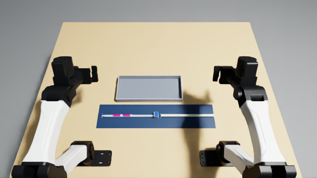

# Thread a 273 mm CryoSleeve onto a vial-loaded aluminum CryoCane up to its top tab before transfer-racking

Instruction given to the policy: `Slide the ivory cryo-sleeve from the prep mat onto the aluminum cryo-cane up to its bent top tab without spilling either vial, lay the sleeved cane flat inside the stainless transfer tray, then let go and move both hands clear.`

Files: `task.json`; `task.py` (rules, score); `scene.py` (bodies); `parts.py` (figures, sources); `checks.py`, `trials.py`, `demo.py`; `test_cryocane_sleeve.py`; kit (`mechkit.py`, `demo_kit.py`, `kit_extra.py`); `start_top.png`, `start_top_policy.png`, `start_left_wrist.png`, `start_right_wrist.png`; `end_top.png`, `end_top_policy.png`.



## What the task tests

- **Level 180-degree yaw with loose tubes.** Two loose 1.8 mL Nunc CryoTubes (`377267`) lie in open bays of a 290 mm aluminum Nalgene CryoCane (`5015-0001`) whose 26 mm tab starts facing the sleeve; yawed 180 degrees level they stay, rolled past ~57 degrees or tipped steeply they spill (0).
- **A snug sleeve kept straight for 265 mm.** The 273 mm Nalgene CryoSleeve (`5016-0001`, 14.5 mm outside per Heathrow's equivalent HS23210, 13.5 mm bore) passes the 13.2 mm cane-and-tube stack with 0.15 mm a side. No joint guides it: a free PVC tube in true contact with cane and tubes, kept on the cane's axis by one hand while the other holds the cane. Straight its only drag is weight x 0.38; cocked, its rim wedges and it stops.
- **One way on.** The 26 mm tab stops a wrong-end sleeve at 0 mm; the sleeve goes on only from the foot, after the yaw.
- **Shortcuts scored 0.** An unsleeved or half-sleeved cane in the tray latches 0.
- **Grasps and visibility.** Left hand pinches the 26 mm tab (37.6 N a finger), right hand the 14.5 mm sleeve near its tail (33.0 N); blue tab, magenta vials, ivory sleeve, blue mat and steel tray stand out at 320 x 176.

## Scene

- **Prep mat:** 130 x 600 x 2.0 mm blue silicone strip [hs-mat], taped at (210, 0) mm with white ticks.
- **CryoCane (`cane`):** Thermo Scientific Nalgene stepped aluminum CryoCane (`5015-0001`, 290 mm) [cane], trough-up along x = 210 mm from y = +278 mm (foot) to -12 mm (blue-labelled tab). Its trough (2.3 mm strip, 0.5 mm clip arms to a 2.8 mm lip, 4 mm steps, a 2 mm lead-in at the foot) lies inside the sleeve's 13.5 mm bore.
- **Cryovials (`vial_a`, `vial_b`):** Thermo Scientific Nunc 1.8 mL round-bottom PP CryoTubes (`377267`) [vial], white caps toward -y, sealed with 1.5 mL magenta water, loose in bays 3 and 2.
- **CryoSleeve (`sleeve`):** Thermo Scientific Nalgene PVC CryoSleeve (`5016-0001`, 273 mm) [sleeve], which Thermo says fits this cane [brochure]; along x = 210 mm from y = -298 to -25 mm (mouth 13 mm from the tab).
- **Transfer tray (`tray`):** our fixture, open 18/10 stainless tray 350 x 150 x 35 mm (any open tray >= 320 x 140 mm; cf. [bochem]), 420 g, at (365, +35) mm.

## Rules and score

- **0 for good** (from the video on a bench, end photo confirming) if either vial leaves its bay (centre > 14 mm off the cane's axis or > 15 mm off its bay centre, or touching mat, tray or bench), the cane or a vial enters inside the tray (below its 35 mm rim) before the sleeve is seated to the tab, or any object drops off the bench.
- **On the cane:** the sleeve's axis within 2 mm and 2 degrees of the middle line of the cane-and-vial stack, the sleeve reaching from behind the foot onto it.
- **0.25:** on the cane with its leading mouth >= 120 mm from the foot, vials retained.
- **0.5:** mouth <= 10 mm from the tab's shoulder (>= 258 mm on) and the foot wholly inside the sleeve, vials retained.
- **1.0:** 0.5 met, the sleeved cane flat in the tray (inside its 344 x 144 mm walls below the 35 mm rim, tilt <= 8 degrees), both hands >= 30 mm clear, held so 1.0 s (20 steps) with cane and sleeve moving 3 mm at most. Limit 1,800 steps (90 s).

## Key figures and their sources

| Figure | Value | Source |
|---|---|---|
| CryoCane (`5015-0001`) | 290 mm, aluminum, stepped | maker: '5015-0001 \| stepped \| 290 / 11.3125' [brochure]; 5-place: listing [cp] |
| Cryovial (`377267`) | 1.8 mL, 12.5 x 49 mm | maker: 'Diameter (Metric) 12.5 mm', 'Length (Metric) 49 mm' [vial] |
| CryoSleeve (`5016-0001`) | 273 mm PVC, fits the cane | maker: 'Nalgene CryoSleeve, 273 mm, PVC' [sleeve]; '5016-0001 will fit over the above 3 canes' [brochure] |
| Sleeve outside | 14.5 mm | maker: 'Dimensions: 14.5 mm diameter x 275 mm length' [hs-slv] (inner or outer not stated: taken as outside, the tighter fit) |
| Sleeve wall; bore | 0.5 mm; 13.5 mm | estimate: under the 0.65 mm that lets a 14.5 mm tube pass the 13.2 mm stack, over a film that would not stay round |
| Stack | 0.7 + 12.5 = 13.2 mm | estimate: 0.7 mm aluminum strip under the maker's 12.5 mm tube |
| Strip, clip arms, lip, step | 2.3, 0.5, 2.8, 2.2 mm | estimate: the widest strip and thickest arms that stay inside the 13.5 mm bore; spill at ~57 / 50 deg |
| Friction, PVC on aluminum | 0.53 static, 0.38 sliding | listing: 'Steel \| PVC \| 0.53 \| 0.38' [mg] (aluminum taken alike) |
| Friction, PP vials | 0.30, 0.25 | estimate: PP slides more easily than PVC on metal |
| Pitch, tab stop, tab | 51.3, 268, 26 mm | estimate: scaled from the `5015-0001` photo against 290 mm |
| Silicone mat | 350 x 600 x 2.0 mm | maker: '14 x 23.5 x 0.1 in (35 x 60 x 0.2 cm)' [hs-mat] |
| Transfer tray | 350 x 150 x 35 mm, 420 g | our fixture (cf. [bochem]); mass estimate (0.6 mm steel) |

`parts.FIGURES`: 8 maker, 2 listing, 9 our fixture, 15 estimate.

## First minutes of a real trial

On the bought `5015-0001`, `5016-0001`, `377267`, mat and tray (~6 min): caliper the sleeve's outside and wall (its bore), the cane's strip, arms, lip, tab and bay pitch, and the strip-plus-tube stack (2 min); weigh the parts (1 min); roll and tilt the loaded cane against a phone inclinometer for the spill angles (1 min); holding the cane by its tab, pull the sleeve along it with a luggage scale, straight and then cocked 10 degrees (2 min). A different reading replaces the estimate.

## Forces

| Force or stop | How made (`scene.py`) | Acts on | Reaction on | Ends / triggers |
|---|---|---|---|---|
| C-trough seating | gravity, 2.8 mm lip, 2.2 mm steps | `vial_a`, `vial_b` | `cane` | spills past ~57 deg roll or steep pitch |
| Top-tab stop | rigid 26 mm tab against the 14.5 mm sleeve | `sleeve` mouth | `cane` tab | wrong-end entry stops at 0 mm |
| Sleeve on the cane | true contact of 16 PVC staves (13.5 mm bore) with strip, arms, steps and tubes; friction 0.53 / 0.38 on aluminum, 0.30 / 0.25 on PP: straight, weight x 0.38 (~0.1 N solver, ~0.03 N real); cocked, the rim wedges | `sleeve` | `cane`, vials | slides pushed straight; a cocked push stops |

## Checks run so far

- Tests: 9 pass (the cane fits inside the 13.5 mm bore, no joint, the on-cane and wall readings, zero rules, levels; no `write_pose`, `set_joint` or `mk.push` in `task.py`, `scene.py`, `demo.py`).
- Reach (`checks.py`, gcrA): 15 poses (IK <= 0.073 mm, joints >= 9.7 deg inside limits, <= 13.3 cm up, hulls >= 33 mm apart); 2 s idle 0.
- Trials (gcr9): the two-hand push held straight slides to 266.5 mm (0.5; peak contact 1.2 N, normal force while steering the rim); with the sleeve 12 or 3 degrees off the cane it stops at 2.7 / 3.3 mm (0); wrong end stops at the tab (0); 75-degree roll spills (0); unsleeved in tray (0); threaded 150 mm (0.25); seated on its side (0.5). No cane point went over 0.16 mm into the sleeve wall; with thin plates alone (gcr7) a cocked sleeve went through them at ~40 N, hence 2.5 mm solver cores behind strip and arms.
- Demo (gcrB = recording gcrR): 1.0 at 41.95 s, done at 45.4 s (908 steps; 0.25 at 26.6 s, 0.5 at 31.85 s); seated 3.3 mm from the tab; peak sleeve contact 0.97 N; cane roll / pitch <= 2.1 / 1.9 deg.


## How it differs

Other tasks hang a canister hook in a Dewar neck or drop a ring in a bench block. Here nothing is fixed: the robot turns a loaded open cane 180 degrees level in mid-air and keeps a snug 273 mm sleeve straight on it for a 265 mm two-hand pass.

## Assets and sources

No third-party meshes, scans, textures or sounds; only `mechkit.py` primitives.
- [cane] https://www.thermofisher.com/order/catalog/product/5015-0001 ; [sleeve] https://www.thermofisher.com/order/catalog/product/5016-0001 ; [vial] https://www.thermofisher.com/order/catalog/product/377267
- [brochure] https://assets.thermofisher.com/TFS-Assets/LED/brochures/Cryopreservation-Brochure-EN.pdf (p. 11, p. 16)
- [hs-slv] https://www.heathrowscientific.com/pvc-cryogenic-cane-sleeves/ ; [hs-mat] https://www.heathrowscientific.com/silicone-lab-mats/
- [cp] https://www.cplabsafety.com/nalgene-5015-0001-cryocane-stepped-aluminum-5-place-case-48/ng-5015-0001 ; [mg] https://mechguru.com/machine-design/typical-coefficient-of-friction-values-for-common-materials/
- [bochem] https://bochem.de/produkt/instrumentenablage-18-10-stahl/

## How to run

Tests: `scripts/rta check cryocane_sleeve`. Reach/start: `scripts/rta simpy <id> mech/tasks/cryocane_sleeve/checks.py --frame0 /workspace/robocurve/outputs/<id>`. Trials: `scripts/rta simpy <id> mech/tasks/cryocane_sleeve/trials.py /workspace/robocurve/outputs/<id>`. Demo: `scripts/rta demo <id> mech/tasks/cryocane_sleeve`.

A trial lasts at most 90 s (1,800 steps at 20 Hz). Fixed layout, nothing drawn from the seed.

```bash
inspect-robots run --embodiment yam_arena --policy dream \
  -E task=mech/tasks/cryocane_sleeve/task.py -E object_jitter=0 -E control_hz=20 -E cam_width=320 -E cam_height=176 \
  --instruction "Slide the ivory cryo-sleeve from the prep mat onto the aluminum cryo-cane up to its bent top tab without spilling either vial, lay the sleeved cane flat inside the stainless transfer tray, then let go and move both hands clear." \
  --scorer task_score --max-steps 1800 --seed 0 --no-prompt --store-frames --log-dir <log dir>
```
